# _unmapped ドメイン ER 図

> このファイルは自動生成されます。手で編集しないでください。再生成: `cd backend && ./gradlew generateErDiagrams`

- テーブル数: 10
- ビュー数: 5

## ER 図

実線 = 外部キー、点線 = ID参照(FKなし)。図中の `FK` は実外部キーの列だけ（ID参照列は `FK` を付けず "ID参照" と注記）。図にはキー列（PK / FK / 参照推定列 / 単一列 UNIQUE）のみを描く。全列は下の「テーブル定義」を参照。

```mermaid
erDiagram
    billing_customer_migrations {
        binary id PK
        binary operation_id FK, UK
        binary contract_id FK, UK
        binary billing_customer_id FK
        bigint organization_id "ID参照"
        varchar stripe_setup_intent_ref UK
        varchar stripe_schedule_ref UK
        bigint created_by "ID参照"
    }
    billing_membership_price_adjustments {
        binary id PK
        binary operation_id FK, UK
        binary contract_id FK
        bigint organization_id "ID参照"
        binary from_price_band_version_id FK
        binary to_price_band_version_id FK
        varchar stripe_schedule_ref UK
    }
    chat_messages_archive {
        bigint id PK
        bigint parent_id "ID参照"
    }
    content_reports_archive {
        bigint id PK
        bigint reported_by "ID参照"
        bigint target_user_id "ID参照"
        bigint reviewed_by "ID参照"
    }
    direct_mail_logs_archive {
        bigint id PK
    }
    direct_mail_recipients_archive {
        bigint id PK
        bigint user_id "ID参照"
    }
    event_publication {
        binary id PK
    }
    notifications_archive {
        bigint id PK
        bigint user_id "ID参照"
        bigint organization_id "ID参照"
    }
    report_actions_archive {
        bigint id PK
        bigint action_by "ID参照"
    }
    shedlock {
        varchar name PK
    }
    billing_contract_operations
    billing_contracts
    billing_customers
    billing_price_band_versions
    organizations
    users
    billing_contract_operations ||--o| billing_customer_migrations : "operation_id"
    billing_contracts ||--o| billing_customer_migrations : "contract_id"
    billing_customers ||--o{ billing_customer_migrations : "billing_customer_id"
    organizations |o..o{ billing_customer_migrations : "ID参照(FKなし) organization_id"
    users ||..o{ billing_customer_migrations : "ID参照(FKなし) created_by"
    billing_contract_operations ||--o| billing_membership_price_adjustments : "operation_id"
    billing_contracts ||--o{ billing_membership_price_adjustments : "contract_id"
    billing_price_band_versions ||--o{ billing_membership_price_adjustments : "from_price_band_version_id"
    billing_price_band_versions ||--o{ billing_membership_price_adjustments : "to_price_band_version_id"
    organizations |o..o{ billing_membership_price_adjustments : "ID参照(FKなし) organization_id"
    chat_messages_archive |o..o{ chat_messages_archive : "ID参照(FKなし) parent_id"
    users ||..o{ content_reports_archive : "ID参照(FKなし) reported_by"
    users |o..o{ content_reports_archive : "ID参照(FKなし) reviewed_by"
    users |o..o{ content_reports_archive : "ID参照(FKなし) target_user_id"
    users ||..o{ direct_mail_recipients_archive : "ID参照(FKなし) user_id"
    organizations |o..o{ notifications_archive : "ID参照(FKなし) organization_id"
    users ||..o{ notifications_archive : "ID参照(FKなし) user_id"
    users ||..o{ report_actions_archive : "ID参照(FKなし) action_by"
```

## 被参照（他ドメインから）

このドメインのテーブルを参照している他ドメインの側（実 FK と ID参照のみ。多態参照と推定不能参照は含まない。同一ドメイン内の参照は上の図を参照）。

なし

## 自己参照

mermaid は同一テーブルの自己参照を複数描けず 1 本に畳むため、図に線が欠けることがある。自己参照はこの表を正とする。

| テーブル | 列 | 種別 |
| --- | --- | --- |
| `chat_messages_archive` | `parent_id` | ID参照 |

## 多態参照（線を引かない）

| テーブル | 種別列 | ID列 |
| --- | --- | --- |
| `content_reports_archive` | `scope_type` | `scope_id` |
| `content_reports_archive` | `target_type` | `target_id` |
| `direct_mail_logs_archive` | `scope_type` | `scope_id` |
| `notifications_archive` | `scope_type` | `scope_id` |
| `notifications_archive` | `source_type` | `source_id` |

## 推定不能参照

| テーブル | 列 | 理由 |
| --- | --- | --- |
| `chat_messages_archive` | `channel_id` | 参照先テーブルを特定できない |
| `chat_messages_archive` | `forwarded_from_id` | 参照先テーブルを特定できない |
| `chat_messages_archive` | `sender_id` | 参照先テーブルを特定できない |
| `direct_mail_logs_archive` | `sender_id` | 参照先テーブルを特定できない |
| `direct_mail_recipients_archive` | `mail_log_id` | 参照先テーブルを特定できない |
| `direct_mail_recipients_archive` | `ses_message_id` | 参照先テーブルを特定できない |
| `event_publication` | `listener_id` | 参照先テーブルを特定できない |
| `notifications_archive` | `actor_id` | 参照先テーブルを特定できない |
| `report_actions_archive` | `report_id` | 参照先テーブルを特定できない |

## テーブル定義

### `billing_customer_migrations`

| 列名 | 型 | NULL | 既定値 | コメント |
| --- | --- | --- | --- | --- |
| `id` | `binary(16)` | NO | （なし） | UUIDv7 |
| `operation_id` | `binary(16)` | NO | （なし） |  |
| `contract_id` | `binary(16)` | NO | （なし） |  |
| `billing_customer_id` | `binary(16)` | NO | （なし） |  |
| `organization_id` | `bigint unsigned` | YES | NULL |  |
| `legacy_psp_customer_ref` | `varchar(255)` | NO | （なし） |  |
| `legacy_psp_subscription_ref` | `varchar(255)` | NO | （なし） |  |
| `stripe_setup_intent_ref` | `varchar(255)` | YES | NULL |  |
| `setup_intent_expires_at` | `datetime(6)` | YES | NULL |  |
| `default_payment_method_ref` | `varchar(255)` | YES | NULL |  |
| `stripe_schedule_ref` | `varchar(255)` | YES | NULL |  |
| `schedule_metadata_hash` | `char(64)` | YES | NULL |  |
| `effective_at` | `datetime(6)` | NO | （なし） |  |
| `status` | `varchar(32)` | NO | （なし） |  |
| `compensation_reason` | `varchar(500)` | YES | NULL |  |
| `idempotency_key` | `char(36)` | NO | （なし） |  |
| `version` | `bigint` | NO | `0` |  |
| `created_by` | `bigint unsigned` | NO | （なし） |  |
| `created_at` | `datetime(6)` | NO | `CURRENT_TIMESTAMP(6)` （式） |  |
| `updated_at` | `datetime(6)` | NO | `CURRENT_TIMESTAMP(6)` （式） |  |
| `deleted_at` | `datetime(6)` | YES | NULL |  |

### `billing_membership_price_adjustments`

| 列名 | 型 | NULL | 既定値 | コメント |
| --- | --- | --- | --- | --- |
| `id` | `binary(16)` | NO | （なし） | UUIDv7 |
| `operation_id` | `binary(16)` | NO | （なし） |  |
| `contract_id` | `binary(16)` | NO | （なし） |  |
| `organization_id` | `bigint unsigned` | YES | NULL |  |
| `period_start` | `datetime(6)` | NO | （なし） |  |
| `member_count_snapshot` | `int unsigned` | NO | （なし） |  |
| `from_price_band_version_id` | `binary(16)` | NO | （なし） |  |
| `to_price_band_version_id` | `binary(16)` | NO | （なし） |  |
| `stripe_schedule_ref` | `varchar(255)` | YES | NULL |  |
| `status` | `varchar(24)` | NO | （なし） |  |
| `idempotency_key` | `char(36)` | NO | （なし） |  |
| `version` | `bigint` | NO | `0` |  |
| `created_at` | `datetime(6)` | NO | `CURRENT_TIMESTAMP(6)` （式） |  |
| `updated_at` | `datetime(6)` | NO | `CURRENT_TIMESTAMP(6)` （式） |  |
| `deleted_at` | `datetime(6)` | YES | NULL |  |

### `chat_messages_archive`

| 列名 | 型 | NULL | 既定値 | コメント |
| --- | --- | --- | --- | --- |
| `id` | `bigint unsigned` | NO | （なし） |  |
| `channel_id` | `bigint unsigned` | NO | （なし） |  |
| `sender_id` | `bigint unsigned` | YES | NULL |  |
| `parent_id` | `bigint unsigned` | YES | NULL |  |
| `body` | `text` | NO | （なし） |  |
| `forwarded_from_id` | `bigint unsigned` | YES | NULL |  |
| `is_edited` | `tinyint(1)` | NO | `0` |  |
| `is_system` | `tinyint(1)` | NO | `0` |  |
| `scheduled_at` | `datetime` | YES | NULL |  |
| `reply_count` | `int` | NO | `0` |  |
| `reaction_count` | `int` | NO | `0` |  |
| `is_pinned` | `tinyint(1)` | NO | `0` |  |
| `created_at` | `datetime` | NO | （なし） |  |
| `updated_at` | `datetime` | NO | （なし） |  |
| `deleted_at` | `datetime` | YES | NULL |  |
| `archived_at` | `datetime` | NO | `CURRENT_TIMESTAMP` （式） | 移送日時 |

### `content_reports_archive`

| 列名 | 型 | NULL | 既定値 | コメント |
| --- | --- | --- | --- | --- |
| `id` | `bigint unsigned` | NO | （なし） |  |
| `target_type` | `varchar(30)` | NO | （なし） |  |
| `target_id` | `bigint unsigned` | NO | （なし） |  |
| `reported_by` | `bigint unsigned` | NO | （なし） |  |
| `scope_type` | `varchar(20)` | NO | `TEAM` |  |
| `scope_id` | `bigint unsigned` | NO | `0` |  |
| `target_user_id` | `bigint unsigned` | YES | NULL |  |
| `reason` | `varchar(20)` | NO | （なし） |  |
| `description` | `varchar(1000)` | YES | NULL |  |
| `content_snapshot` | `json` | YES | NULL |  |
| `status` | `varchar(20)` | NO | `PENDING` |  |
| `reviewed_by` | `bigint unsigned` | YES | NULL |  |
| `reviewed_at` | `datetime` | YES | NULL |  |
| `content_hidden` | `tinyint(1)` | NO | `0` | 通報対象コンテンツを非表示にしたか（モデレーション操作の結果、本体V220と対） |
| `created_at` | `datetime` | NO | （なし） |  |
| `updated_at` | `datetime` | NO | （なし） |  |
| `archived_at` | `datetime` | NO | （なし） |  |

### `direct_mail_logs_archive`

| 列名 | 型 | NULL | 既定値 | コメント |
| --- | --- | --- | --- | --- |
| `id` | `bigint unsigned` | NO | （なし） auto_increment |  |
| `scope_type` | `varchar(20)` | NO | （なし） |  |
| `scope_id` | `bigint unsigned` | NO | （なし） |  |
| `sender_id` | `bigint unsigned` | NO | （なし） |  |
| `subject` | `varchar(200)` | NO | （なし） |  |
| `body_markdown` | `text` | NO | （なし） |  |
| `body_html` | `text` | NO | （なし） |  |
| `recipient_type` | `varchar(20)` | NO | （なし） |  |
| `recipient_filter` | `json` | YES | NULL |  |
| `estimated_recipients` | `int` | YES | NULL |  |
| `total_recipients` | `int` | NO | `0` |  |
| `sent_count` | `int` | NO | `0` |  |
| `opened_count` | `int` | NO | `0` |  |
| `bounced_count` | `int` | NO | `0` |  |
| `status` | `varchar(20)` | NO | `DRAFT` |  |
| `scheduled_at` | `datetime` | YES | NULL |  |
| `error_message` | `text` | YES | NULL |  |
| `sent_at` | `datetime` | YES | NULL |  |
| `created_at` | `datetime` | NO | `CURRENT_TIMESTAMP` （式） |  |
| `updated_at` | `datetime` | NO | `CURRENT_TIMESTAMP` （式） |  |
| `archived_at` | `datetime` | NO | （なし） |  |

### `direct_mail_recipients_archive`

| 列名 | 型 | NULL | 既定値 | コメント |
| --- | --- | --- | --- | --- |
| `id` | `bigint unsigned` | NO | （なし） auto_increment |  |
| `mail_log_id` | `bigint unsigned` | NO | （なし） |  |
| `user_id` | `bigint unsigned` | NO | （なし） |  |
| `email` | `varchar(255)` | NO | （なし） |  |
| `status` | `varchar(20)` | NO | `PENDING` |  |
| `ses_message_id` | `varchar(100)` | YES | NULL |  |
| `opened_at` | `datetime` | YES | NULL |  |
| `bounced_at` | `datetime` | YES | NULL |  |
| `bounce_type` | `varchar(20)` | YES | NULL |  |
| `created_at` | `datetime` | NO | `CURRENT_TIMESTAMP` （式） |  |
| `archived_at` | `datetime` | NO | （なし） |  |

### `event_publication`

| 列名 | 型 | NULL | 既定値 | コメント |
| --- | --- | --- | --- | --- |
| `completion_date` | `datetime(6)` | YES | NULL |  |
| `publication_date` | `datetime(6)` | NO | （なし） |  |
| `id` | `binary(16)` | NO | （なし） |  |
| `event_type` | `varchar(255)` | NO | （なし） |  |
| `listener_id` | `varchar(255)` | NO | （なし） |  |
| `serialized_event` | `varchar(255)` | NO | （なし） |  |

### `notifications_archive`

| 列名 | 型 | NULL | 既定値 | コメント |
| --- | --- | --- | --- | --- |
| `id` | `bigint` | NO | （なし） | notifications.id をそのまま引き継ぐ（採番しない） |
| `user_id` | `bigint unsigned` | NO | （なし） |  |
| `organization_id` | `bigint unsigned` | YES | NULL | テナント（論理参照・FK なし） |
| `notification_type` | `varchar(50)` | NO | （なし） |  |
| `priority` | `varchar(10)` | NO | `NORMAL` |  |
| `title` | `varchar(200)` | NO | （なし） |  |
| `body` | `varchar(1000)` | YES | NULL |  |
| `source_type` | `varchar(50)` | YES | NULL | notifications.source_type と一致（nullable）。moverが null 行を弾かないよう NOT NULL にしない（m-1 是正） |
| `source_id` | `bigint unsigned` | YES | NULL |  |
| `scope_type` | `varchar(20)` | NO | （なし） |  |
| `scope_id` | `bigint unsigned` | YES | NULL |  |
| `action_url` | `varchar(500)` | YES | NULL |  |
| `actor_id` | `bigint unsigned` | YES | NULL |  |
| `is_read` | `tinyint(1)` | NO | `0` |  |
| `read_at` | `datetime` | YES | NULL |  |
| `channels_sent` | `json` | YES | NULL |  |
| `snoozed_until` | `datetime` | YES | NULL |  |
| `created_at` | `datetime` | NO | （なし） |  |
| `archived_at` | `datetime(3)` | NO | `CURRENT_TIMESTAMP(3)` （式） | 移送日時 |

### `report_actions_archive`

| 列名 | 型 | NULL | 既定値 | コメント |
| --- | --- | --- | --- | --- |
| `id` | `bigint unsigned` | NO | （なし） |  |
| `report_id` | `bigint unsigned` | NO | （なし） |  |
| `action_type` | `varchar(20)` | NO | （なし） |  |
| `action_by` | `bigint unsigned` | NO | （なし） |  |
| `note` | `text` | YES | NULL |  |
| `freeze_until` | `datetime` | YES | NULL |  |
| `guideline_section` | `varchar(100)` | YES | NULL |  |
| `created_at` | `datetime` | NO | （なし） |  |
| `archived_at` | `datetime` | NO | （なし） |  |

### `shedlock`

| 列名 | 型 | NULL | 既定値 | コメント |
| --- | --- | --- | --- | --- |
| `name` | `varchar(64)` | NO | （なし） |  |
| `lock_until` | `timestamp(3)` | NO | （なし） |  |
| `locked_at` | `timestamp(3)` | NO | `CURRENT_TIMESTAMP(3)` （式） |  |
| `locked_by` | `varchar(255)` | NO | （なし） |  |

## ビュー

- `v_announcement_reads_by_person` （列: id, announcement_feed_id, user_id, read_at）
- `v_repair_fund_balance` （列: scope_type, scope_id, balance, as_of_date）
- `v_repair_fund_yearly_summary` （列: scope_type, scope_id, fiscal_year_id, fiscal_year_name, total_income, total_expense）
- `v_repair_plan_summary` （列: scope_type, scope_id, planned_year, category, planned_count, total_estimated）
- `v_survey_responses_by_person` （列: id, survey_id, question_id, user_id, option_id, text_response, created_at, updated_at, is_proxy_input, proxy_input_record_id）
