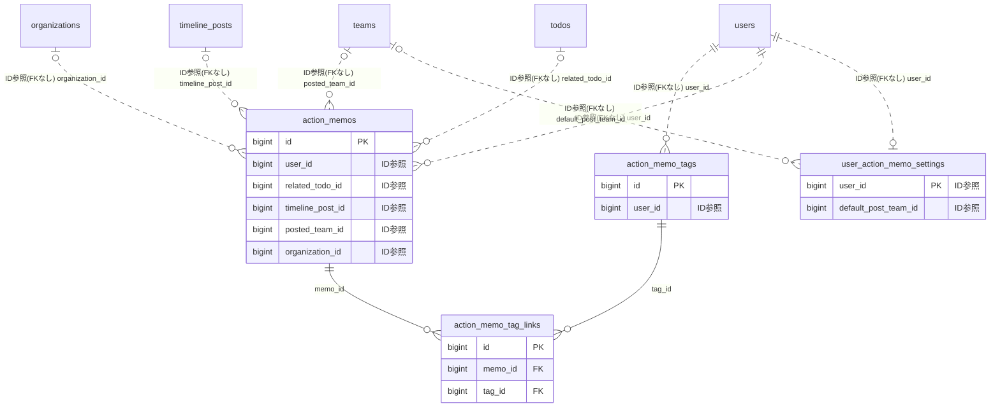

# actionmemo ドメイン ER 図

> このファイルは自動生成されます。手で編集しないでください。再生成: `cd backend && ./gradlew generateErDiagrams`

- テーブル数: 4
- ビュー数: 0

## ER 図

実線 = 外部キー、点線 = ID参照(FKなし)。図中の `FK` は実外部キーの列だけ（ID参照列は `FK` を付けず "ID参照" と注記）。図にはキー列（PK / FK / 参照推定列 / 単一列 UNIQUE）のみを描く。全列は下の「テーブル定義」を参照。

## 被参照（他ドメインから）

このドメインのテーブルを参照している他ドメインの側（実 FK と ID参照のみ。多態参照と推定不能参照は含まない。同一ドメイン内の参照は上の図を参照）。

なし

## テーブル定義

### `action_memo_tag_links`

| 列名 | 型 | NULL | 既定値 | コメント |
| --- | --- | --- | --- | --- |
| `id` | `bigint unsigned` | NO | （なし） auto_increment |  |
| `memo_id` | `bigint unsigned` | NO | （なし） | FK → action_memos |
| `tag_id` | `bigint unsigned` | NO | （なし） | FK → action_memo_tags |
| `created_at` | `datetime` | NO | `CURRENT_TIMESTAMP` （式） |  |

### `action_memo_tags`

| 列名 | 型 | NULL | 既定値 | コメント |
| --- | --- | --- | --- | --- |
| `id` | `bigint unsigned` | NO | （なし） auto_increment |  |
| `user_id` | `bigint unsigned` | NO | （なし） | 所有ユーザー |
| `name` | `varchar(50)` | NO | （なし） | タグ名 |
| `color` | `varchar(7)` | YES | NULL | 表示色（HEX）。NULL = デフォルト色 |
| `sort_order` | `smallint unsigned` | NO | `0` | 並び順 |
| `created_at` | `datetime` | NO | `CURRENT_TIMESTAMP` （式） |  |
| `updated_at` | `datetime` | NO | `CURRENT_TIMESTAMP` （式） |  |
| `deleted_at` | `datetime` | YES | NULL | 論理削除日時 |

### `action_memos`

| 列名 | 型 | NULL | 既定値 | コメント |
| --- | --- | --- | --- | --- |
| `id` | `bigint unsigned` | NO | （なし） auto_increment |  |
| `user_id` | `bigint unsigned` | NO | （なし） | 所有ユーザー |
| `memo_date` | `date` | NO | （なし） | このメモが属する日付（JST 基準） |
| `content` | `text` | NO | （なし） | メモ本文（最大5,000文字。アプリ層で検証） |
| `category` | `varchar(16)` | NO | `PRIVATE` | メモのカテゴリ。WORK = 仕事 / PRIVATE = 私事 / OTHER = その他 |
| `duration_minutes` | `int unsigned` | YES | NULL | 実績時間（分）。NULL = 未入力 |
| `progress_rate` | `decimal(5,2)` | YES | NULL | 記録時点の進捗率（0.00〜100.00）。NULL = 未入力 |
| `mood` | `varchar(20)` | YES | NULL | GREAT / GOOD / OK / TIRED / BAD。設定 OFF のユーザーは常に NULL |
| `related_todo_id` | `bigint unsigned` | YES | NULL | FK → todos。PERSONAL スコープのみ許可（アプリ層で検証） |
| `completes_todo` | `tinyint(1)` | NO | `0` | related_todo_id の TODO を完了扱いにするフラグ |
| `timeline_post_id` | `bigint unsigned` | YES | NULL | FK → timeline_posts。publish-daily 成功時のみ埋まる |
| `posted_team_id` | `bigint unsigned` | YES | NULL | チームタイムラインに投稿済みの場合のチームID |
| `created_at` | `datetime` | NO | `CURRENT_TIMESTAMP` （式） |  |
| `updated_at` | `datetime` | NO | `CURRENT_TIMESTAMP` （式） |  |
| `deleted_at` | `datetime` | YES | NULL | 論理削除日時 |
| `organization_id` | `bigint unsigned` | YES | NULL | 組織スコープ投稿先組織 ID |
| `org_visibility` | `varchar(20)` | YES | NULL | 組織公開範囲（TEAM_ONLY/ORG_WIDE） |

### `user_action_memo_settings`

| 列名 | 型 | NULL | 既定値 | コメント |
| --- | --- | --- | --- | --- |
| `user_id` | `bigint unsigned` | NO | （なし） | PK 兼 FK → users |
| `mood_enabled` | `tinyint(1)` | NO | `0` | 気分（mood）入力 UI を表示するか。デフォルト OFF（ドライモード） |
| `default_post_team_id` | `bigint unsigned` | YES | NULL | 行動メモのデフォルト投稿先チーム |
| `default_category` | `varchar(16)` | NO | `PRIVATE` | メモ作成時のデフォルトカテゴリ |
| `reminder_enabled` | `tinyint(1)` | NO | `0` |  |
| `reminder_time` | `time` | YES | NULL |  |
| `created_at` | `datetime` | NO | `CURRENT_TIMESTAMP` （式） |  |
| `updated_at` | `datetime` | NO | `CURRENT_TIMESTAMP` （式） |  |
