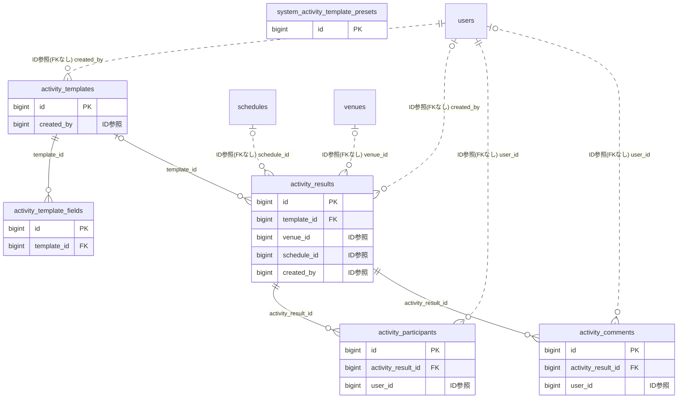

# activity ドメイン ER 図

> このファイルは自動生成されます。手で編集しないでください。再生成: `cd backend && ./gradlew generateErDiagrams`

- テーブル数: 6
- ビュー数: 0

## ER 図

実線 = 外部キー、点線 = ID参照(FKなし)。図中の `FK` は実外部キーの列だけ（ID参照列は `FK` を付けず "ID参照" と注記）。図にはキー列（PK / FK / 参照推定列 / 単一列 UNIQUE）のみを描く。全列は下の「テーブル定義」を参照。

## 被参照（他ドメインから）

このドメインのテーブルを参照している他ドメインの側（実 FK と ID参照のみ。多態参照と推定不能参照は含まない。同一ドメイン内の参照は上の図を参照）。

| 参照元ドメイン | 参照元テーブル | 列 | 種別 | 参照先テーブル |
| --- | --- | --- | --- | --- |
| [performance](performance.md) | `performance_records` | `activity_result_id` | ID参照 | `activity_results` |

## 多態参照（線を引かない）

| テーブル | 種別列 | ID列 |
| --- | --- | --- |
| `activity_results` | `scope_type` | `scope_id` |
| `activity_results` | `source_type` | `source_id` |
| `activity_templates` | `scope_type` | `scope_id` |

## テーブル定義

### `activity_comments`

| 列名 | 型 | NULL | 既定値 | コメント |
| --- | --- | --- | --- | --- |
| `id` | `bigint unsigned` | NO | （なし） auto_increment |  |
| `activity_result_id` | `bigint unsigned` | NO | （なし） |  |
| `user_id` | `bigint unsigned` | YES | NULL |  |
| `body` | `text` | NO | （なし） |  |
| `created_at` | `datetime` | NO | `CURRENT_TIMESTAMP` （式） |  |
| `updated_at` | `datetime` | NO | `CURRENT_TIMESTAMP` （式） |  |
| `deleted_at` | `datetime` | YES | NULL |  |

### `activity_participants`

| 列名 | 型 | NULL | 既定値 | コメント |
| --- | --- | --- | --- | --- |
| `id` | `bigint unsigned` | NO | （なし） auto_increment |  |
| `activity_result_id` | `bigint unsigned` | NO | （なし） |  |
| `user_id` | `bigint unsigned` | NO | （なし） |  |
| `role_label` | `varchar(50)` | YES | NULL |  |
| `created_at` | `datetime` | NO | `CURRENT_TIMESTAMP` （式） |  |

### `activity_results`

| 列名 | 型 | NULL | 既定値 | コメント |
| --- | --- | --- | --- | --- |
| `id` | `bigint unsigned` | NO | （なし） auto_increment |  |
| `scope_type` | `varchar(20)` | NO | （なし） | スコープ種別: TEAM / ORGANIZATION / COMMITTEE |
| `scope_id` | `bigint unsigned` | NO | （なし） |  |
| `template_id` | `bigint unsigned` | YES | NULL |  |
| `title` | `varchar(200)` | NO | （なし） |  |
| `activity_date` | `date` | NO | （なし） |  |
| `activity_time_start` | `time` | YES | NULL |  |
| `activity_time_end` | `time` | YES | NULL |  |
| `location` | `varchar(300)` | YES | NULL | 活動場所（自由入力） |
| `venue_id` | `bigint unsigned` | YES | NULL | 施設マスタID |
| `description` | `text` | YES | NULL |  |
| `field_values` | `json` | NO | `_utf8mb4\'{}\'` （式） |  |
| `attachments` | `json` | YES | NULL |  |
| `visibility` | `varchar(20)` | NO | `MEMBERS_ONLY` |  |
| `status` | `varchar(20)` | NO | `PUBLISHED` | ライフサイクル状態（DRAFT / PUBLISHED） |
| `schedule_id` | `bigint unsigned` | YES | NULL |  |
| `created_by` | `bigint unsigned` | YES | NULL |  |
| `created_at` | `datetime` | NO | `CURRENT_TIMESTAMP` （式） |  |
| `updated_at` | `datetime` | NO | `CURRENT_TIMESTAMP` （式） |  |
| `deleted_at` | `datetime` | YES | NULL |  |
| `source_type` | `varchar(30)` | YES | NULL | ソース種別（TOURNAMENT_MATCH等） |
| `source_id` | `bigint unsigned` | YES | NULL | ソースID |
| `activity_end_date` | `date` | YES | NULL |  |
| `schedule_sync_state` | `json` | YES | NULL |  |
| `version` | `bigint` | NO | `0` |  |
| `is_auto_generated_from_schedule` | `tinyint(1)` | NO | `0` |  |
| `is_planned` | `tinyint(1)` | NO | `0` |  |

### `activity_template_fields`

| 列名 | 型 | NULL | 既定値 | コメント |
| --- | --- | --- | --- | --- |
| `id` | `bigint unsigned` | NO | （なし） auto_increment |  |
| `template_id` | `bigint unsigned` | NO | （なし） |  |
| `field_key` | `varchar(50)` | NO | （なし） |  |
| `field_label` | `varchar(100)` | NO | （なし） |  |
| `field_type` | `varchar(20)` | NO | （なし） |  |
| `is_required` | `tinyint(1)` | NO | `0` |  |
| `options_json` | `json` | YES | NULL |  |
| `placeholder` | `varchar(200)` | YES | NULL |  |
| `unit` | `varchar(20)` | YES | NULL |  |
| `is_aggregatable` | `tinyint(1)` | NO | `0` |  |
| `sort_order` | `int` | NO | `0` |  |

### `activity_templates`

| 列名 | 型 | NULL | 既定値 | コメント |
| --- | --- | --- | --- | --- |
| `id` | `bigint unsigned` | NO | （なし） auto_increment |  |
| `scope_type` | `varchar(20)` | NO | （なし） |  |
| `scope_id` | `bigint unsigned` | NO | （なし） |  |
| `name` | `varchar(100)` | NO | （なし） |  |
| `description` | `varchar(500)` | YES | NULL |  |
| `icon` | `varchar(30)` | YES | NULL |  |
| `color` | `varchar(7)` | YES | NULL |  |
| `is_participant_required` | `tinyint(1)` | NO | `1` |  |
| `default_visibility` | `varchar(20)` | NO | `MEMBERS_ONLY` |  |
| `sort_order` | `int` | NO | `0` |  |
| `created_by` | `bigint unsigned` | NO | （なし） |  |
| `created_at` | `datetime` | NO | `CURRENT_TIMESTAMP` （式） |  |
| `updated_at` | `datetime` | NO | `CURRENT_TIMESTAMP` （式） |  |
| `deleted_at` | `datetime` | YES | NULL |  |

### `system_activity_template_presets`

| 列名 | 型 | NULL | 既定値 | コメント |
| --- | --- | --- | --- | --- |
| `id` | `bigint unsigned` | NO | （なし） auto_increment |  |
| `category` | `varchar(30)` | NO | （なし） |  |
| `name` | `varchar(100)` | NO | （なし） |  |
| `description` | `varchar(500)` | YES | NULL |  |
| `icon` | `varchar(30)` | YES | NULL |  |
| `color` | `varchar(7)` | YES | NULL |  |
| `is_participant_required` | `tinyint(1)` | NO | `1` |  |
| `default_visibility` | `varchar(20)` | NO | `MEMBERS_ONLY` |  |
| `fields_json` | `json` | NO | （なし） |  |
| `is_active` | `tinyint(1)` | NO | `1` |  |
| `created_at` | `datetime` | NO | `CURRENT_TIMESTAMP` （式） |  |
| `updated_at` | `datetime` | NO | `CURRENT_TIMESTAMP` （式） |  |
| `deleted_at` | `datetime` | YES | NULL |  |
