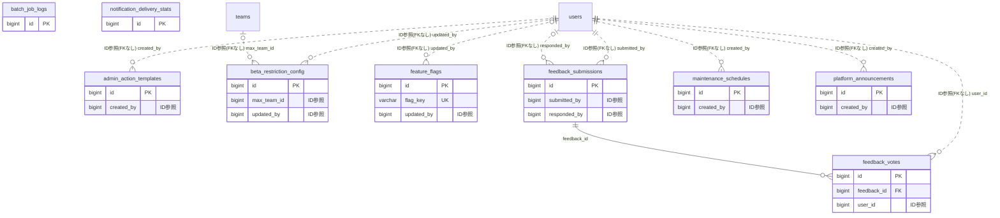

# admin ドメイン ER 図

> このファイルは自動生成されます。手で編集しないでください。再生成: `cd backend && ./gradlew generateErDiagrams`

- テーブル数: 9
- ビュー数: 0

## ER 図

実線 = 外部キー、点線 = ID参照(FKなし)。図中の `FK` は実外部キーの列だけ（ID参照列は `FK` を付けず "ID参照" と注記）。図にはキー列（PK / FK / 参照推定列 / 単一列 UNIQUE）のみを描く。全列は下の「テーブル定義」を参照。

## 被参照（他ドメインから）

このドメインのテーブルを参照している他ドメインの側（実 FK と ID参照のみ。多態参照と推定不能参照は含まない。同一ドメイン内の参照は上の図を参照）。

なし

## 多態参照（線を引かない）

| テーブル | 種別列 | ID列 |
| --- | --- | --- |
| `feedback_submissions` | `scope_type` | `scope_id` |

## 推定不能参照

| テーブル | 列 | 理由 |
| --- | --- | --- |
| `beta_restriction_config` | `max_org_id` | 参照先テーブルを特定できない |

## テーブル定義

### `admin_action_templates`

| 列名 | 型 | NULL | 既定値 | コメント |
| --- | --- | --- | --- | --- |
| `id` | `bigint unsigned` | NO | （なし） auto_increment |  |
| `name` | `varchar(100)` | NO | （なし） |  |
| `action_type` | `varchar(20)` | NO | （なし） |  |
| `reason` | `varchar(30)` | YES | NULL |  |
| `template_text` | `text` | NO | （なし） |  |
| `is_default` | `tinyint(1)` | NO | `0` |  |
| `created_by` | `bigint unsigned` | NO | （なし） |  |
| `created_at` | `datetime` | NO | `CURRENT_TIMESTAMP` （式） |  |
| `updated_at` | `datetime` | NO | `CURRENT_TIMESTAMP` （式） |  |
| `deleted_at` | `datetime` | YES | NULL |  |

### `batch_job_logs`

| 列名 | 型 | NULL | 既定値 | コメント |
| --- | --- | --- | --- | --- |
| `id` | `bigint unsigned` | NO | （なし） auto_increment |  |
| `job_name` | `varchar(100)` | NO | （なし） |  |
| `status` | `varchar(20)` | NO | （なし） |  |
| `started_at` | `datetime` | NO | （なし） |  |
| `finished_at` | `datetime` | YES | NULL |  |
| `processed_count` | `int` | NO | `0` |  |
| `error_message` | `text` | YES | NULL |  |
| `created_at` | `datetime` | NO | `CURRENT_TIMESTAMP` （式） |  |

### `beta_restriction_config`

| 列名 | 型 | NULL | 既定値 | コメント |
| --- | --- | --- | --- | --- |
| `id` | `bigint` | NO | （なし） auto_increment |  |
| `is_enabled` | `tinyint(1)` | NO | `0` |  |
| `max_team_id` | `bigint unsigned` | YES | NULL | このID以下のチームが招待可能（NULL=制限なし） |
| `max_org_id` | `bigint unsigned` | YES | NULL | このID以下の組織が招待可能（NULL=制限なし） |
| `updated_by` | `bigint` | YES | NULL |  |
| `updated_at` | `datetime(6)` | NO | `CURRENT_TIMESTAMP(6)` （式） |  |

### `feature_flags`

| 列名 | 型 | NULL | 既定値 | コメント |
| --- | --- | --- | --- | --- |
| `id` | `bigint unsigned` | NO | （なし） auto_increment |  |
| `flag_key` | `varchar(100)` | NO | （なし） |  |
| `is_enabled` | `tinyint(1)` | NO | `0` |  |
| `description` | `varchar(500)` | YES | NULL |  |
| `updated_by` | `bigint unsigned` | YES | NULL |  |
| `created_at` | `datetime` | NO | `CURRENT_TIMESTAMP` （式） |  |
| `updated_at` | `datetime` | NO | `CURRENT_TIMESTAMP` （式） |  |

### `feedback_submissions`

| 列名 | 型 | NULL | 既定値 | コメント |
| --- | --- | --- | --- | --- |
| `id` | `bigint unsigned` | NO | （なし） auto_increment |  |
| `scope_type` | `varchar(20)` | NO | （なし） |  |
| `scope_id` | `bigint unsigned` | YES | NULL |  |
| `category` | `varchar(20)` | NO | （なし） |  |
| `title` | `varchar(200)` | NO | （なし） |  |
| `body` | `text` | NO | （なし） |  |
| `is_anonymous` | `tinyint(1)` | NO | `0` |  |
| `submitted_by` | `bigint unsigned` | NO | （なし） |  |
| `status` | `varchar(20)` | NO | `OPEN` |  |
| `admin_response` | `text` | YES | NULL |  |
| `responded_by` | `bigint unsigned` | YES | NULL |  |
| `responded_at` | `datetime` | YES | NULL |  |
| `is_public_response` | `tinyint(1)` | NO | `0` |  |
| `created_at` | `datetime` | NO | `CURRENT_TIMESTAMP` （式） |  |
| `updated_at` | `datetime` | NO | `CURRENT_TIMESTAMP` （式） |  |

### `feedback_votes`

| 列名 | 型 | NULL | 既定値 | コメント |
| --- | --- | --- | --- | --- |
| `id` | `bigint unsigned` | NO | （なし） auto_increment |  |
| `feedback_id` | `bigint unsigned` | NO | （なし） |  |
| `user_id` | `bigint unsigned` | NO | （なし） |  |
| `created_at` | `datetime` | NO | `CURRENT_TIMESTAMP` （式） |  |

### `maintenance_schedules`

| 列名 | 型 | NULL | 既定値 | コメント |
| --- | --- | --- | --- | --- |
| `id` | `bigint unsigned` | NO | （なし） auto_increment |  |
| `title` | `varchar(200)` | NO | （なし） |  |
| `message` | `text` | YES | NULL |  |
| `mode` | `varchar(20)` | NO | `MAINTENANCE` |  |
| `starts_at` | `datetime` | NO | （なし） |  |
| `ends_at` | `datetime` | NO | （なし） |  |
| `status` | `varchar(20)` | NO | `SCHEDULED` |  |
| `created_by` | `bigint unsigned` | NO | （なし） |  |
| `created_at` | `datetime` | NO | `CURRENT_TIMESTAMP` （式） |  |
| `updated_at` | `datetime` | NO | `CURRENT_TIMESTAMP` （式） |  |

### `notification_delivery_stats`

| 列名 | 型 | NULL | 既定値 | コメント |
| --- | --- | --- | --- | --- |
| `id` | `bigint unsigned` | NO | （なし） auto_increment |  |
| `date` | `date` | NO | （なし） |  |
| `channel` | `varchar(20)` | NO | （なし） |  |
| `sent_count` | `int unsigned` | NO | `0` |  |
| `delivered_count` | `int unsigned` | NO | `0` |  |
| `failed_count` | `int unsigned` | NO | `0` |  |
| `bounce_count` | `int unsigned` | NO | `0` |  |
| `created_at` | `datetime` | NO | `CURRENT_TIMESTAMP` （式） |  |

### `platform_announcements`

| 列名 | 型 | NULL | 既定値 | コメント |
| --- | --- | --- | --- | --- |
| `id` | `bigint unsigned` | NO | （なし） auto_increment |  |
| `title` | `varchar(200)` | NO | （なし） |  |
| `body` | `text` | NO | （なし） |  |
| `priority` | `varchar(10)` | NO | `NORMAL` |  |
| `target_scope` | `varchar(20)` | NO | `ALL` |  |
| `is_pinned` | `tinyint(1)` | NO | `0` |  |
| `published_at` | `datetime` | YES | NULL |  |
| `expires_at` | `datetime` | YES | NULL |  |
| `created_by` | `bigint unsigned` | NO | （なし） |  |
| `created_at` | `datetime` | NO | `CURRENT_TIMESTAMP` （式） |  |
| `updated_at` | `datetime` | NO | `CURRENT_TIMESTAMP` （式） |  |
| `deleted_at` | `datetime` | YES | NULL |  |
