# advertising ドメイン ER 図

> このファイルは自動生成されます。手で編集しないでください。再生成: `cd backend && ./gradlew generateErDiagrams`

- テーブル数: 29
- ビュー数: 0

## ER 図

実線 = 外部キー、点線 = ID参照(FKなし)。図中の `FK` は実外部キーの列だけ（ID参照列は `FK` を付けず "ID参照" と注記）。図にはキー列（PK / FK / 参照推定列 / 単一列 UNIQUE）のみを描く。全列は下の「テーブル定義」を参照。

```mermaid
erDiagram
    ad_announcement_deliveries {
        binary id PK
        binary campaign_id FK
        bigint user_id "ID参照"
        bigint announcement_feed_id "ID参照"
    }
    ad_audience_segments {
        binary id PK
        binary campaign_id FK
    }
    ad_banner_deliveries {
        binary id PK
        binary campaign_id FK
        bigint user_id "ID参照"
        bigint ad_impression_id "ID参照"
    }
    ad_campaign_delivery_claims {
        binary id PK
        binary campaign_id FK
        bigint user_id "ID参照"
    }
    ad_campaign_moderation_logs {
        binary id PK
        binary campaign_id FK
        bigint moderator_user_id "ID参照"
    }
    ad_campaigns {
        bigint id PK
        bigint advertiser_account_id FK
        bigint rate_card_id FK
    }
    ad_clicks {
        bigint id PK
        bigint ad_id FK
        bigint campaign_id FK
        bigint user_id "ID参照"
    }
    ad_conversions {
        bigint id PK
        bigint click_id FK
        bigint campaign_id FK
        bigint ad_id FK
        bigint converted_user_id "ID参照"
    }
    ad_credit_limit_requests {
        bigint id PK
        bigint advertiser_account_id FK
        bigint reviewed_by "ID参照"
    }
    ad_daily_stats {
        bigint id PK
        bigint campaign_id FK
        bigint ad_id FK
    }
    ad_email_deliveries {
        binary id PK
        binary campaign_id FK
        bigint user_id "ID参照"
        bigint direct_mail_recipient_id "ID参照"
    }
    ad_impressions {
        bigint id PK
        bigint ad_id FK
        bigint campaign_id FK
        bigint user_id "ID参照"
    }
    ad_invoice_items {
        bigint id PK
        bigint invoice_id FK
    }
    ad_invoices {
        bigint id PK
        bigint advertiser_account_id FK
        varchar invoice_number UK
    }
    ad_messaging_campaign_channels {
        binary id PK
        binary campaign_id FK
    }
    ad_messaging_campaigns {
        binary id PK
        bigint advertiser_account_id "ID参照"
        bigint created_by_user_id "ID参照"
    }
    ad_ng_words {
        binary id PK
        varchar word UK
        bigint created_by_user_id "ID参照"
    }
    ad_push_deliveries {
        binary id PK
        binary campaign_id FK
        bigint user_id "ID参照"
        bigint notification_id "ID参照"
    }
    ad_rate_cards {
        bigint id PK
        bigint created_by "ID参照"
    }
    ad_report_schedules {
        bigint id PK
        bigint advertiser_account_id FK
        bigint created_by "ID参照"
    }
    ad_targeting_rules {
        bigint id PK
        bigint campaign_id FK
    }
    ad_user_reports {
        binary id PK
        binary campaign_id FK
        bigint reporter_user_id "ID参照"
    }
    ads {
        bigint id PK
        bigint campaign_id FK
    }
    advertiser_accounts {
        bigint id PK
        bigint approved_by "ID参照"
    }
    affiliate_configs {
        bigint id PK
    }
    equipment_ranking_exclusions {
        bigint id PK
        bigint team_id "ID参照"
        bigint excluded_by_user_id "ID参照"
    }
    equipment_rankings {
        bigint id PK
    }
    user_ad_delivery_counters {
        binary id PK
        bigint user_id "ID参照"
    }
    user_ad_preferences {
        binary id PK
        bigint user_id UK "ID参照"
    }
    announcement_feeds
    direct_mail_recipients
    notifications
    teams
    users
    ad_messaging_campaigns ||--o{ ad_announcement_deliveries : "campaign_id"
    announcement_feeds ||..o{ ad_announcement_deliveries : "ID参照(FKなし) announcement_feed_id"
    users |o..o{ ad_announcement_deliveries : "ID参照(FKなし) user_id"
    ad_messaging_campaigns ||--o{ ad_audience_segments : "campaign_id"
    ad_impressions |o..o{ ad_banner_deliveries : "ID参照(FKなし) ad_impression_id"
    ad_messaging_campaigns ||--o{ ad_banner_deliveries : "campaign_id"
    users |o..o{ ad_banner_deliveries : "ID参照(FKなし) user_id"
    ad_messaging_campaigns ||--o{ ad_campaign_delivery_claims : "campaign_id"
    users ||..o{ ad_campaign_delivery_claims : "ID参照(FKなし) user_id"
    ad_messaging_campaigns ||--o{ ad_campaign_moderation_logs : "campaign_id"
    users |o..o{ ad_campaign_moderation_logs : "ID参照(FKなし) moderator_user_id"
    ad_rate_cards |o--o{ ad_campaigns : "rate_card_id"
    advertiser_accounts ||--o{ ad_campaigns : "advertiser_account_id"
    ad_campaigns |o--o{ ad_clicks : "campaign_id"
    ads ||--o{ ad_clicks : "ad_id"
    users |o..o{ ad_clicks : "ID参照(FKなし) user_id"
    ad_campaigns ||--o{ ad_conversions : "campaign_id"
    ad_clicks ||--o{ ad_conversions : "click_id"
    ads ||--o{ ad_conversions : "ad_id"
    users ||..o{ ad_conversions : "ID参照(FKなし) converted_user_id"
    advertiser_accounts ||--o{ ad_credit_limit_requests : "advertiser_account_id"
    users |o..o{ ad_credit_limit_requests : "ID参照(FKなし) reviewed_by"
    ad_campaigns ||--o{ ad_daily_stats : "campaign_id"
    ads ||--o{ ad_daily_stats : "ad_id"
    ad_messaging_campaigns ||--o{ ad_email_deliveries : "campaign_id"
    direct_mail_recipients ||..o{ ad_email_deliveries : "ID参照(FKなし) direct_mail_recipient_id"
    users |o..o{ ad_email_deliveries : "ID参照(FKなし) user_id"
    ad_campaigns |o--o{ ad_impressions : "campaign_id"
    ads ||--o{ ad_impressions : "ad_id"
    users |o..o{ ad_impressions : "ID参照(FKなし) user_id"
    ad_invoices ||--o{ ad_invoice_items : "invoice_id"
    advertiser_accounts ||--o{ ad_invoices : "advertiser_account_id"
    ad_messaging_campaigns ||--o{ ad_messaging_campaign_channels : "campaign_id"
    advertiser_accounts ||..o{ ad_messaging_campaigns : "ID参照(FKなし) advertiser_account_id"
    users ||..o{ ad_messaging_campaigns : "ID参照(FKなし) created_by_user_id"
    users |o..o{ ad_ng_words : "ID参照(FKなし) created_by_user_id"
    ad_messaging_campaigns ||--o{ ad_push_deliveries : "campaign_id"
    notifications ||..o{ ad_push_deliveries : "ID参照(FKなし) notification_id"
    users |o..o{ ad_push_deliveries : "ID参照(FKなし) user_id"
    users ||..o{ ad_rate_cards : "ID参照(FKなし) created_by"
    advertiser_accounts ||--o{ ad_report_schedules : "advertiser_account_id"
    users ||..o{ ad_report_schedules : "ID参照(FKなし) created_by"
    ad_campaigns ||--o{ ad_targeting_rules : "campaign_id"
    ad_messaging_campaigns |o--o{ ad_user_reports : "campaign_id"
    users |o..o{ ad_user_reports : "ID参照(FKなし) reporter_user_id"
    ad_campaigns ||--o{ ads : "campaign_id"
    users |o..o{ advertiser_accounts : "ID参照(FKなし) approved_by"
    teams |o..o{ equipment_ranking_exclusions : "ID参照(FKなし) team_id"
    users |o..o{ equipment_ranking_exclusions : "ID参照(FKなし) excluded_by_user_id"
    users ||..o{ user_ad_delivery_counters : "ID参照(FKなし) user_id"
    users ||..o| user_ad_preferences : "ID参照(FKなし) user_id"
```

## 被参照（他ドメインから）

このドメインのテーブルを参照している他ドメインの側（実 FK と ID参照のみ。多態参照と推定不能参照は含まない。同一ドメイン内の参照は上の図を参照）。

なし

## 多態参照（線を引かない）

| テーブル | 種別列 | ID列 |
| --- | --- | --- |
| `ad_messaging_campaigns` | `scope_type` | `scope_id` |
| `advertiser_accounts` | `scope_type` | `scope_id` |

## 推定不能参照

| テーブル | 列 | 理由 |
| --- | --- | --- |
| `ad_clicks` | `impression_id` | 参照先テーブルを特定できない |
| `ad_clicks` | `messaging_campaign_id` | 参照先テーブルを特定できない |
| `ad_email_deliveries` | `email_outbox_id` | 参照先テーブルを特定できない |
| `ad_impressions` | `messaging_campaign_id` | 参照先テーブルを特定できない |
| `ad_invoice_items` | `campaign_id` | 参照先テーブルを特定できない |
| `ad_invoice_items` | `messaging_campaign_id` | 参照先テーブルを特定できない |
| `ad_invoices` | `stripe_invoice_id` | 参照先テーブルを特定できない |
| `ad_messaging_campaign_channels` | `banner_creative_id` | 参照先テーブルを特定できない |
| `ad_user_reports` | `operational_campaign_id` | 参照先テーブルを特定できない |
| `advertiser_accounts` | `stripe_customer_id` | 型が参照先 stripe_customers.id と不一致（varchar ≠ bigint） |
| `affiliate_configs` | `tag_id` | 型が参照先 tags.id と不一致（varchar ≠ bigint） |

## テーブル定義

### `ad_announcement_deliveries`

| 列名 | 型 | NULL | 既定値 | コメント |
| --- | --- | --- | --- | --- |
| `id` | `binary(16)` | NO | （なし） |  |
| `campaign_id` | `binary(16)` | NO | （なし） | ad_messaging_campaigns.id (FK CASCADE) |
| `user_id` | `bigint unsigned` | YES | NULL | 受信者 (退会時 NULL 化・FKなし) |
| `announcement_feed_id` | `bigint unsigned` | NO | （なし） | F02.6 announcement_feeds.id (FKなし) |
| `delivered_at` | `datetime` | NO | （なし） | 配信時刻 |
| `read_at` | `datetime` | YES | NULL | 既読時刻 |
| `month_key` | `char(7)` | NO | （なし） | YYYY-MM 形式 (パーティショニング用) |
| `created_at` | `datetime` | NO | `CURRENT_TIMESTAMP` （式） |  |

### `ad_audience_segments`

| 列名 | 型 | NULL | 既定値 | コメント |
| --- | --- | --- | --- | --- |
| `id` | `binary(16)` | NO | （なし） |  |
| `campaign_id` | `binary(16)` | NO | （なし） | ad_messaging_campaigns.id (FK CASCADE) |
| `segment_type` | `enum('AGE_RANGE','GENDER','REGION_PREFECTURE','REGION_CITY','INTEREST_TAG','ORG_TYPE','LOCALE','DEVICE')` | NO | （なし） | セグメント種別 |
| `segment_value` | `json` | NO | （なし） | 条件値 (F09.2 SegmentEvaluator スキーマ準拠) |
| `inclusion_mode` | `enum('INCLUDE','EXCLUDE')` | NO | `INCLUDE` | 包含/除外 |
| `created_at` | `datetime` | NO | `CURRENT_TIMESTAMP` （式） |  |

### `ad_banner_deliveries`

| 列名 | 型 | NULL | 既定値 | コメント |
| --- | --- | --- | --- | --- |
| `id` | `binary(16)` | NO | （なし） |  |
| `campaign_id` | `binary(16)` | NO | （なし） | ad_messaging_campaigns.id (FK CASCADE) |
| `user_id` | `bigint unsigned` | YES | NULL | 受信者 (退会時 NULL 化・FKなし) |
| `ad_impression_id` | `bigint unsigned` | YES | NULL | F09.7 ad_impressions.id (FKなし)。実表示（serve）時に設定。予約時 NULL |
| `served_at` | `datetime` | YES | NULL | バナー実表示時刻。予約時 NULL（NULL = 未表示予約） |
| `clicked_at` | `datetime` | YES | NULL | クリック時刻 |
| `month_key` | `char(7)` | NO | （なし） | YYYY-MM 形式 (パーティショニング用) |
| `created_at` | `datetime` | NO | `CURRENT_TIMESTAMP` （式） |  |

### `ad_campaign_delivery_claims`

| 列名 | 型 | NULL | 既定値 | コメント |
| --- | --- | --- | --- | --- |
| `id` | `binary(16)` | NO | （なし） |  |
| `campaign_id` | `binary(16)` | NO | （なし） | ad_messaging_campaigns.id (FK CASCADE) |
| `user_id` | `bigint unsigned` | NO | （なし） | 配信先ユーザー (FKなし・クロスドメイン参照) |
| `week_start` | `date` | NO | （なし） | 消費週の月曜 (ユーザーTZ、AdFrequencyCapServiceと同一定義) |
| `created_at` | `datetime` | NO | `CURRENT_TIMESTAMP` （式） |  |

### `ad_campaign_moderation_logs`

| 列名 | 型 | NULL | 既定値 | コメント |
| --- | --- | --- | --- | --- |
| `id` | `binary(16)` | NO | （なし） |  |
| `campaign_id` | `binary(16)` | NO | （なし） | ad_messaging_campaigns.id (FK CASCADE) |
| `moderator_user_id` | `bigint unsigned` | YES | NULL | レビュアー user_id (自動検知は NULL・FKなし) |
| `action` | `enum('APPROVED','BLOCKED','UNBLOCKED','AUTO_FLAGGED','AUTO_PASSED')` | NO | （なし） | 操作種別 |
| `reason` | `text` | YES | NULL | 理由 |
| `ng_words_detected` | `json` | YES | NULL | 検知された NG ワード配列 |
| `created_at` | `datetime` | NO | `CURRENT_TIMESTAMP` （式） |  |

### `ad_campaigns`

| 列名 | 型 | NULL | 既定値 | コメント |
| --- | --- | --- | --- | --- |
| `id` | `bigint unsigned` | NO | （なし） auto_increment |  |
| `advertiser_account_id` | `bigint unsigned` | NO | （なし） | advertiser_accounts.id（同一 advertising ドメインのため FK 可） |
| `name` | `varchar(200)` | NO | （なし） |  |
| `status` | `enum('DRAFT','PENDING_REVIEW','ACTIVE','PAUSED','ENDED')` | NO | `DRAFT` |  |
| `pricing_model` | `enum('CPM','CPC')` | NO | （なし） |  |
| `daily_budget` | `decimal(10,2)` | YES | NULL |  |
| `daily_impression_limit` | `int unsigned` | YES | NULL |  |
| `rate_card_id` | `bigint unsigned` | YES | NULL | ad_rate_cards.id（同一 advertising ドメインのため FK 可） |
| `unit_price_snapshot` | `decimal(10,4)` | YES | NULL | 申込時単価スナップショット（円）。NULL 時は集計日に有効な全国・全テンプレートカードで代替 |
| `reject_reason` | `varchar(500)` | YES | NULL | 直近の審査差戻し理由。reject 時 SET・submit 時 NULL クリア |
| `report_suspended_at` | `datetime` | YES | NULL | 通報 3 件による自動停止時刻（書き込みは F09.19.9 実装後。それまで常に NULL） |
| `report_auto_paused` | `tinyint(1)` | YES | `0` | 通報自動停止が ACTIVE→PAUSED 遷移を行った場合 TRUE。unsuspend の ACTIVE 復帰判定用（F09.19.9） |
| `start_date` | `date` | YES | NULL |  |
| `end_date` | `date` | YES | NULL |  |
| `created_at` | `datetime` | NO | `CURRENT_TIMESTAMP` （式） |  |
| `updated_at` | `datetime` | NO | `CURRENT_TIMESTAMP` （式） |  |

### `ad_clicks`

| 列名 | 型 | NULL | 既定値 | コメント |
| --- | --- | --- | --- | --- |
| `id` | `bigint unsigned` | NO | （なし） auto_increment |  |
| `ad_id` | `bigint unsigned` | NO | （なし） |  |
| `campaign_id` | `bigint unsigned` | YES | NULL |  |
| `messaging_campaign_id` | `binary(16)` | YES | NULL |  |
| `impression_id` | `bigint unsigned` | YES | NULL |  |
| `user_id` | `bigint unsigned` | YES | NULL |  |
| `occurred_at` | `datetime` | NO | `CURRENT_TIMESTAMP` （式） |  |

### `ad_conversions`

| 列名 | 型 | NULL | 既定値 | コメント |
| --- | --- | --- | --- | --- |
| `id` | `bigint unsigned` | NO | （なし） auto_increment |  |
| `click_id` | `bigint unsigned` | NO | （なし） |  |
| `campaign_id` | `bigint unsigned` | NO | （なし） |  |
| `ad_id` | `bigint unsigned` | NO | （なし） |  |
| `conversion_type` | `enum('TEAM_JOIN','ORG_JOIN','MODULE_ACTIVATE','EVENT_REGISTER')` | NO | （なし） |  |
| `converted_user_id` | `bigint unsigned` | NO | （なし） |  |
| `converted_at` | `datetime` | NO | （なし） |  |
| `attribution_window_days` | `tinyint unsigned` | NO | `7` |  |
| `created_at` | `datetime` | NO | `CURRENT_TIMESTAMP` （式） |  |
| `updated_at` | `datetime` | NO | `CURRENT_TIMESTAMP` （式） |  |

### `ad_credit_limit_requests`

| 列名 | 型 | NULL | 既定値 | コメント |
| --- | --- | --- | --- | --- |
| `id` | `bigint unsigned` | NO | （なし） auto_increment |  |
| `advertiser_account_id` | `bigint unsigned` | NO | （なし） |  |
| `current_limit` | `decimal(12,2)` | NO | （なし） |  |
| `requested_limit` | `decimal(12,2)` | NO | （なし） |  |
| `reason` | `varchar(500)` | NO | （なし） |  |
| `status` | `enum('PENDING','APPROVED','REJECTED')` | NO | `PENDING` |  |
| `reviewed_by` | `bigint unsigned` | YES | NULL |  |
| `reviewed_at` | `datetime` | YES | NULL |  |
| `review_note` | `varchar(500)` | YES | NULL |  |
| `created_at` | `datetime` | NO | `CURRENT_TIMESTAMP` （式） |  |
| `updated_at` | `datetime` | NO | `CURRENT_TIMESTAMP` （式） |  |

### `ad_daily_stats`

| 列名 | 型 | NULL | 既定値 | コメント |
| --- | --- | --- | --- | --- |
| `id` | `bigint unsigned` | NO | （なし） auto_increment |  |
| `campaign_id` | `bigint unsigned` | NO | （なし） |  |
| `ad_id` | `bigint unsigned` | NO | （なし） |  |
| `date` | `date` | NO | （なし） |  |
| `impressions` | `bigint unsigned` | NO | `0` |  |
| `clicks` | `bigint unsigned` | NO | `0` |  |
| `cost` | `decimal(12,2)` | NO | `0.00` |  |
| `created_at` | `datetime` | NO | `CURRENT_TIMESTAMP` （式） |  |
| `updated_at` | `datetime` | NO | `CURRENT_TIMESTAMP` （式） |  |

### `ad_email_deliveries`

| 列名 | 型 | NULL | 既定値 | コメント |
| --- | --- | --- | --- | --- |
| `id` | `binary(16)` | NO | （なし） |  |
| `campaign_id` | `binary(16)` | NO | （なし） | ad_messaging_campaigns.id (FK CASCADE) |
| `user_id` | `bigint unsigned` | YES | NULL | 受信者 (退会時 NULL 化・FKなし) |
| `direct_mail_recipient_id` | `bigint unsigned` | NO | （なし） | F09.6 direct_mail_recipients.id (FKなし) |
| `email_outbox_id` | `binary(16)` | YES | NULL | F09.18 email_outbox.id — 双方向トレース用 (FK なし、クロスドメイン原則1準拠) |
| `sent_at` | `datetime` | NO | （なし） | SES 送信完了時刻 |
| `opened_at` | `datetime` | YES | NULL | 開封ピクセル発火時刻 |
| `bounced_at` | `datetime` | YES | NULL | バウンス検知時刻 |
| `bounce_type` | `enum('HARD','SOFT','COMPLAINT')` | YES | NULL | バウンス種別 |
| `month_key` | `char(7)` | NO | （なし） | YYYY-MM 形式 (パーティショニング用) |
| `created_at` | `datetime` | NO | `CURRENT_TIMESTAMP` （式） |  |

### `ad_impressions`

| 列名 | 型 | NULL | 既定値 | コメント |
| --- | --- | --- | --- | --- |
| `id` | `bigint unsigned` | NO | （なし） auto_increment |  |
| `ad_id` | `bigint unsigned` | NO | （なし） |  |
| `campaign_id` | `bigint unsigned` | YES | NULL |  |
| `messaging_campaign_id` | `binary(16)` | YES | NULL |  |
| `user_id` | `bigint unsigned` | YES | NULL |  |
| `occurred_at` | `datetime` | NO | `CURRENT_TIMESTAMP` （式） |  |

### `ad_invoice_items`

| 列名 | 型 | NULL | 既定値 | コメント |
| --- | --- | --- | --- | --- |
| `id` | `bigint unsigned` | NO | （なし） auto_increment |  |
| `invoice_id` | `bigint unsigned` | NO | （なし） |  |
| `campaign_id` | `bigint unsigned` | YES | NULL | F09.7 ad_campaigns.id (NULL=F09.17 messaging_campaign_id 経由) |
| `campaign_name` | `varchar(200)` | NO | （なし） |  |
| `pricing_model` | `enum('CPM','CPC')` | NO | （なし） |  |
| `impressions` | `bigint unsigned` | NO | `0` |  |
| `clicks` | `bigint unsigned` | NO | `0` |  |
| `unit_price` | `decimal(10,4)` | NO | （なし） |  |
| `subtotal` | `decimal(12,2)` | NO | `0.00` |  |
| `created_at` | `datetime` | NO | `CURRENT_TIMESTAMP` （式） |  |
| `updated_at` | `datetime` | NO | `CURRENT_TIMESTAMP` （式） |  |
| `messaging_campaign_id` | `binary(16)` | YES | NULL | F09.17 ad_messaging_campaigns.id (NULL=F09.7 BIGINT campaign_id 経由の従来課金) |
| `channel_type` | `varchar(20)` | YES | NULL | F09.17 由来行のチャネル種別: ANNOUNCEMENT / EMAIL / PUSH / BANNER |
| `month_key` | `varchar(7)` | YES | NULL | F09.17 由来行の集計対象月 (YYYY-MM) |

### `ad_invoices`

| 列名 | 型 | NULL | 既定値 | コメント |
| --- | --- | --- | --- | --- |
| `id` | `bigint unsigned` | NO | （なし） auto_increment |  |
| `advertiser_account_id` | `bigint unsigned` | NO | （なし） |  |
| `invoice_number` | `varchar(20)` | NO | （なし） |  |
| `invoice_month` | `date` | NO | （なし） |  |
| `total_amount` | `decimal(12,2)` | NO | `0.00` |  |
| `tax_rate` | `decimal(5,2)` | NO | `10.00` |  |
| `tax_amount` | `decimal(12,2)` | NO | `0.00` |  |
| `total_with_tax` | `decimal(12,2)` | NO | `0.00` |  |
| `status` | `enum('DRAFT','ISSUED','PAID','OVERDUE')` | NO | `DRAFT` |  |
| `stripe_invoice_id` | `varchar(50)` | YES | NULL |  |
| `issued_at` | `datetime` | YES | NULL |  |
| `paid_at` | `datetime` | YES | NULL |  |
| `due_date` | `date` | YES | NULL |  |
| `note` | `varchar(500)` | YES | NULL |  |
| `created_at` | `datetime` | NO | `CURRENT_TIMESTAMP` （式） |  |
| `updated_at` | `datetime` | NO | `CURRENT_TIMESTAMP` （式） |  |

### `ad_messaging_campaign_channels`

| 列名 | 型 | NULL | 既定値 | コメント |
| --- | --- | --- | --- | --- |
| `id` | `binary(16)` | NO | （なし） |  |
| `campaign_id` | `binary(16)` | NO | （なし） | ad_messaging_campaigns.id (同一ドメイン FK CASCADE) |
| `channel_type` | `enum('ANNOUNCEMENT','EMAIL','PUSH','BANNER')` | NO | （なし） | 配信チャネル |
| `locale` | `varchar(10)` | NO | `ja` | 言語コード (ja/en/zh/ko/de/es) |
| `subject` | `varchar(200)` | YES | NULL | EMAIL/PUSH 件名 ([PR] / 【広告】は配信時自動付与) |
| `body_markdown` | `mediumtext` | NO | （なし） | 本文 Markdown (F02.6 サニタイザ通過) |
| `image_url` | `varchar(500)` | YES | NULL | バナー画像 URL (許可ホストのみ) |
| `cta_label` | `varchar(50)` | YES | NULL | CTA ボタンラベル |
| `cta_url` | `varchar(500)` | YES | NULL | CTA リンク (https のみ) |
| `banner_creative_id` | `bigint unsigned` | YES | NULL | F09.7 ads.id (BANNER 時のみ・FKなし) |
| `placement` | `varchar(30)` | YES | NULL | AdPlacement。channel_type=BANNER 時のみ必須 |
| `created_at` | `datetime` | NO | `CURRENT_TIMESTAMP` （式） |  |
| `updated_at` | `datetime` | NO | `CURRENT_TIMESTAMP` （式） |  |

### `ad_messaging_campaigns`

| 列名 | 型 | NULL | 既定値 | コメント |
| --- | --- | --- | --- | --- |
| `id` | `binary(16)` | NO | （なし） |  |
| `advertiser_account_id` | `bigint unsigned` | NO | （なし） | F09.11 advertiser_accounts.id (FKなし) |
| `name` | `varchar(120)` | NO | （なし） | キャンペーン名 (広告主表示用) |
| `status` | `enum('DRAFT','REVIEW','APPROVED','SCHEDULED','DELIVERING','PAUSED','COMPLETED','BLOCKED','CANCELLED')` | NO | `DRAFT` | キャンペーン状態 |
| `total_budget_yen` | `bigint unsigned` | NO | `0` | 総予算 (円) |
| `consumed_budget_yen` | `bigint unsigned` | NO | `0` | 消費済予算 (円・月次バッチで更新) |
| `frequency_cap_override` | `tinyint unsigned` | YES | NULL | キャンペーン個別キャップ (NULL=デフォルト週3件) |
| `starts_at` | `datetime` | NO | （なし） | 配信開始時刻 |
| `ends_at` | `datetime` | NO | （なし） | 配信終了時刻 |
| `scheduled_timezone` | `varchar(50)` | NO | `Asia/Tokyo` | 配信スケジュール基準 TZ |
| `moderation_status` | `enum('PENDING','AUTO_PASSED','AUTO_FLAGGED','APPROVED','BLOCKED')` | NO | `PENDING` | 審査状態 |
| `blocked_reason` | `text` | YES | NULL | BLOCKED 時の理由 |
| `created_by_user_id` | `bigint unsigned` | NO | （なし） | 作成者 user_id (FKなし) |
| `created_at` | `datetime` | NO | `CURRENT_TIMESTAMP` （式） |  |
| `updated_at` | `datetime` | NO | `CURRENT_TIMESTAMP` （式） |  |
| `deleted_at` | `datetime` | YES | NULL | 論理削除 (DRAFT のみ許可) |
| `scope_type` | `varchar(20)` | NO | （なし） |  |
| `scope_id` | `bigint unsigned` | NO | （なし） |  |

### `ad_ng_words`

| 列名 | 型 | NULL | 既定値 | コメント |
| --- | --- | --- | --- | --- |
| `id` | `binary(16)` | NO | （なし） |  |
| `word` | `varchar(100)` | NO | （なし） | 照合対象ワード (大文字小文字無視) |
| `category` | `varchar(50)` | NO | （なし） | PHARMA / SUPERLATIVE / FINANCIAL_RISK / DISCRIMINATION / OTHER |
| `severity` | `enum('WARN','BLOCK')` | NO | `WARN` | WARN=AUTO_FLAGGED, BLOCK=自動 BLOCKED |
| `note` | `varchar(500)` | YES | NULL | 辞書登録理由 (運用メモ) |
| `is_active` | `tinyint(1)` | NO | `1` | 有効/無効フラグ (論理削除代替) |
| `created_by_user_id` | `bigint unsigned` | YES | NULL | SYSTEM_ADMIN user_id (FKなし) |
| `created_at` | `datetime` | NO | `CURRENT_TIMESTAMP` （式） |  |
| `updated_at` | `datetime` | NO | `CURRENT_TIMESTAMP` （式） |  |

### `ad_push_deliveries`

| 列名 | 型 | NULL | 既定値 | コメント |
| --- | --- | --- | --- | --- |
| `id` | `binary(16)` | NO | （なし） |  |
| `campaign_id` | `binary(16)` | NO | （なし） | ad_messaging_campaigns.id (FK CASCADE) |
| `user_id` | `bigint unsigned` | YES | NULL | 受信者 (退会時 NULL 化・FKなし) |
| `notification_id` | `bigint unsigned` | NO | （なし） | F04.3 notifications.id (FKなし) |
| `delivered_at` | `datetime` | NO | （なし） | FCM/APNs 配信成功時刻 |
| `tapped_at` | `datetime` | YES | NULL | タップ時刻 |
| `failed_reason` | `varchar(100)` | YES | NULL | 失敗理由 (unregistered 等) |
| `month_key` | `char(7)` | NO | （なし） | YYYY-MM 形式 (パーティショニング用) |
| `created_at` | `datetime` | NO | `CURRENT_TIMESTAMP` （式） |  |

### `ad_rate_cards`

| 列名 | 型 | NULL | 既定値 | コメント |
| --- | --- | --- | --- | --- |
| `id` | `bigint unsigned` | NO | （なし） auto_increment |  |
| `target_prefecture` | `varchar(20)` | YES | NULL |  |
| `target_template` | `varchar(30)` | YES | NULL |  |
| `pricing_model` | `enum('CPM','CPC')` | NO | （なし） |  |
| `unit_price` | `decimal(10,4)` | NO | （なし） |  |
| `min_daily_budget` | `decimal(10,2)` | NO | `500.00` |  |
| `effective_from` | `date` | NO | （なし） |  |
| `effective_until` | `date` | YES | NULL |  |
| `created_by` | `bigint unsigned` | NO | （なし） |  |
| `created_at` | `datetime` | NO | `CURRENT_TIMESTAMP` （式） |  |
| `updated_at` | `datetime` | NO | `CURRENT_TIMESTAMP` （式） |  |

### `ad_report_schedules`

| 列名 | 型 | NULL | 既定値 | コメント |
| --- | --- | --- | --- | --- |
| `id` | `bigint unsigned` | NO | （なし） auto_increment |  |
| `advertiser_account_id` | `bigint unsigned` | NO | （なし） |  |
| `frequency` | `enum('WEEKLY','MONTHLY')` | NO | （なし） |  |
| `recipients` | `json` | NO | （なし） |  |
| `include_campaigns` | `json` | YES | NULL |  |
| `enabled` | `tinyint(1)` | NO | `1` |  |
| `last_sent_at` | `datetime` | YES | NULL |  |
| `created_by` | `bigint unsigned` | NO | （なし） |  |
| `created_at` | `datetime` | NO | `CURRENT_TIMESTAMP` （式） |  |
| `updated_at` | `datetime` | NO | `CURRENT_TIMESTAMP` （式） |  |
| `deleted_at` | `datetime` | YES | NULL |  |

### `ad_targeting_rules`

| 列名 | 型 | NULL | 既定値 | コメント |
| --- | --- | --- | --- | --- |
| `id` | `bigint unsigned` | NO | （なし） auto_increment |  |
| `campaign_id` | `bigint unsigned` | NO | （なし） |  |
| `target_prefecture` | `varchar(20)` | YES | NULL |  |
| `target_template` | `varchar(30)` | YES | NULL |  |
| `created_at` | `datetime` | NO | `CURRENT_TIMESTAMP` （式） |  |
| `updated_at` | `datetime` | NO | `CURRENT_TIMESTAMP` （式） |  |

### `ad_user_reports`

| 列名 | 型 | NULL | 既定値 | コメント |
| --- | --- | --- | --- | --- |
| `id` | `binary(16)` | NO | （なし） |  |
| `campaign_id` | `binary(16)` | YES | NULL | ad_messaging_campaigns.id (FK CASCADE)。運用型通報時 NULL |
| `operational_campaign_id` | `bigint unsigned` | YES | NULL | F09.7 ad_campaigns.id（同一 advertising ドメインだが将来分離に備え FK なし・INDEX のみ） |
| `reporter_user_id` | `bigint unsigned` | YES | NULL | 通報者 (退会時 NULL 化・FKなし) |
| `channel_type` | `enum('ANNOUNCEMENT','EMAIL','PUSH','BANNER')` | NO | （なし） | 通報元チャネル |
| `reason_code` | `enum('OFFENSIVE','MISLEADING','SPAM','IRRELEVANT','OTHER')` | NO | （なし） | 通報理由 |
| `comment` | `varchar(500)` | YES | NULL | 自由記述 |
| `status` | `enum('NEW','REVIEWING','RESOLVED','DISMISSED')` | NO | `NEW` | 対応状態 |
| `created_at` | `datetime` | NO | `CURRENT_TIMESTAMP` （式） |  |
| `updated_at` | `datetime` | NO | `CURRENT_TIMESTAMP` （式） |  |

### `ads`

| 列名 | 型 | NULL | 既定値 | コメント |
| --- | --- | --- | --- | --- |
| `id` | `bigint unsigned` | NO | （なし） auto_increment |  |
| `campaign_id` | `bigint unsigned` | NO | （なし） |  |
| `title` | `varchar(200)` | NO | （なし） |  |
| `image_url` | `varchar(500)` | YES | NULL |  |
| `destination_url` | `varchar(500)` | NO | （なし） |  |
| `placement` | `varchar(30)` | NO | `DASHBOARD_TILE` | AdPlacement。クリエイティブはサイズが placement 依存のため ads 単位 |
| `width` | `smallint unsigned` | YES | NULL | バナー幅 px（NULL: FE の placement 既定サイズ） |
| `height` | `smallint unsigned` | YES | NULL | バナー高さ px |
| `alt_text` | `varchar(200)` | YES | NULL | 代替テキスト（NULL: title を代用） |
| `status` | `enum('DRAFT','ACTIVE','PAUSED','ENDED')` | NO | `DRAFT` |  |
| `created_at` | `datetime` | NO | `CURRENT_TIMESTAMP` （式） |  |
| `updated_at` | `datetime` | NO | `CURRENT_TIMESTAMP` （式） |  |

### `advertiser_accounts`

| 列名 | 型 | NULL | 既定値 | コメント |
| --- | --- | --- | --- | --- |
| `id` | `bigint unsigned` | NO | （なし） auto_increment |  |
| `status` | `enum('PENDING','ACTIVE','SUSPENDED')` | NO | `PENDING` |  |
| `company_name` | `varchar(200)` | NO | （なし） |  |
| `contact_email` | `varchar(254)` | NO | （なし） |  |
| `billing_method` | `enum('STRIPE','INVOICE')` | NO | `STRIPE` |  |
| `stripe_customer_id` | `varchar(50)` | YES | NULL |  |
| `credit_limit` | `decimal(12,2)` | NO | `100000.00` |  |
| `approved_by` | `bigint unsigned` | YES | NULL |  |
| `approved_at` | `datetime` | YES | NULL |  |
| `created_at` | `datetime` | NO | `CURRENT_TIMESTAMP` （式） |  |
| `updated_at` | `datetime` | NO | `CURRENT_TIMESTAMP` （式） |  |
| `deleted_at` | `datetime` | YES | NULL |  |
| `scope_type` | `varchar(20)` | NO | （なし） |  |
| `scope_id` | `bigint unsigned` | NO | （なし） |  |

### `affiliate_configs`

| 列名 | 型 | NULL | 既定値 | コメント |
| --- | --- | --- | --- | --- |
| `id` | `bigint unsigned` | NO | （なし） auto_increment |  |
| `provider` | `varchar(20)` | NO | （なし） | AMAZON / RAKUTEN / GOOGLE_ADSENSE / GOOGLE_ADMOB / DIRECT |
| `tag_id` | `varchar(100)` | NO | （なし） | アフィリエイトタグID |
| `placement` | `varchar(30)` | NO | （なし） | SIDEBAR_RIGHT / BANNER_FOOTER / BANNER_HEADER / IN_FEED |
| `description` | `varchar(200)` | YES | NULL | 管理者メモ |
| `banner_image_url` | `varchar(500)` | YES | NULL | バナー画像URL |
| `banner_width` | `smallint unsigned` | YES | NULL | バナー幅px |
| `banner_height` | `smallint unsigned` | YES | NULL | バナー高さpx |
| `alt_text` | `varchar(200)` | YES | NULL | 代替テキスト |
| `is_active` | `tinyint(1)` | NO | `1` | 有効/無効 |
| `active_from` | `datetime` | YES | NULL | 有効開始日時 |
| `active_until` | `datetime` | YES | NULL | 有効終了日時 |
| `display_priority` | `smallint unsigned` | NO | `0` | 表示優先度（昇順） |
| `target_template` | `varchar(30)` | YES | NULL | ターゲット組織テンプレート（NULLは全テンプレート対象） |
| `target_prefecture` | `varchar(20)` | YES | NULL | ターゲット都道府県（NULLは全地域対象） |
| `target_locale` | `varchar(10)` | YES | NULL | ターゲットロケール（NULLは全言語対象） |
| `created_at` | `datetime` | NO | `CURRENT_TIMESTAMP` （式） |  |
| `updated_at` | `datetime` | NO | `CURRENT_TIMESTAMP` （式） |  |
| `deleted_at` | `datetime` | YES | NULL | 論理削除 |

### `equipment_ranking_exclusions`

| 列名 | 型 | NULL | 既定値 | コメント |
| --- | --- | --- | --- | --- |
| `id` | `bigint unsigned` | NO | （なし） auto_increment |  |
| `exclusion_type` | `enum('TEAM_OPT_OUT','ITEM_EXCLUSION')` | NO | （なし） |  |
| `team_id` | `bigint unsigned` | YES | NULL |  |
| `normalized_name` | `varchar(200)` | YES | NULL |  |
| `reason` | `varchar(300)` | YES | NULL |  |
| `excluded_by_user_id` | `bigint unsigned` | YES | NULL |  |
| `created_at` | `datetime` | NO | `CURRENT_TIMESTAMP` （式） |  |

### `equipment_rankings`

| 列名 | 型 | NULL | 既定値 | コメント |
| --- | --- | --- | --- | --- |
| `id` | `bigint unsigned` | NO | （なし） auto_increment |  |
| `team_template` | `varchar(50)` | NO | （なし） |  |
| `category` | `varchar(100)` | NO | `__ALL__` |  |
| `rank` | `smallint unsigned` | NO | （なし） |  |
| `item_name` | `varchar(200)` | NO | （なし） |  |
| `normalized_name` | `varchar(200)` | NO | （なし） |  |
| `amazon_asin` | `varchar(10)` | YES | NULL |  |
| `asin_confidence` | `tinyint unsigned` | YES | NULL |  |
| `team_count` | `int unsigned` | NO | （なし） |  |
| `total_quantity` | `int unsigned` | NO | （なし） |  |
| `consume_event_count` | `int unsigned` | NO | `0` |  |
| `score` | `decimal(10,2)` | NO | （なし） |  |
| `calculated_at` | `datetime` | NO | （なし） |  |

### `user_ad_delivery_counters`

| 列名 | 型 | NULL | 既定値 | コメント |
| --- | --- | --- | --- | --- |
| `id` | `binary(16)` | NO | （なし） |  |
| `user_id` | `bigint unsigned` | NO | （なし） | users.id (FKなし) |
| `week_start_date` | `date` | NO | （なし） | 週開始日 (ユーザー TZ の月曜 00:00) |
| `delivery_count` | `int unsigned` | NO | `0` | 配信件数 (キャップ判定用) |
| `created_at` | `datetime` | NO | `CURRENT_TIMESTAMP` （式） |  |
| `updated_at` | `datetime` | NO | `CURRENT_TIMESTAMP` （式） |  |

### `user_ad_preferences`

| 列名 | 型 | NULL | 既定値 | コメント |
| --- | --- | --- | --- | --- |
| `id` | `binary(16)` | NO | （なし） |  |
| `user_id` | `bigint unsigned` | NO | （なし） | users.id (FKなし・UNIQUE) |
| `accept_announcement_ads` | `tinyint(1)` | NO | `1` | お知らせ広告 ON/OFF |
| `accept_email_ads` | `tinyint(1)` | NO | `1` | メール広告 ON/OFF |
| `accept_push_ads` | `tinyint(1)` | NO | `1` | プッシュ広告 ON/OFF |
| `accept_banner_ads` | `tinyint(1)` | NO | `1` | バナー広告 ON/OFF |
| `blocked_advertiser_account_ids` | `json` | NO | （なし） | ブロック広告主 ID 配列 (上限 100 件・Service 層で検証) |
| `unsubscribe_token_version` | `int unsigned` | NO | `1` | unsubscribe JWT バージョン (インクリメントで一括失効) |
| `consented_at` | `datetime` | YES | NULL | 初回広告受信時の明示同意取得時刻 |
| `created_at` | `datetime` | NO | `CURRENT_TIMESTAMP` （式） |  |
| `updated_at` | `datetime` | NO | `CURRENT_TIMESTAMP` （式） |  |
