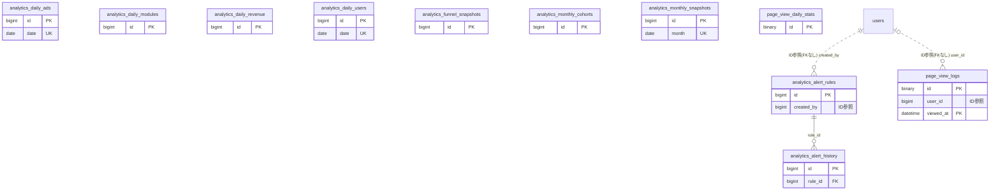

# analytics ドメイン ER 図

> このファイルは自動生成されます。手で編集しないでください。再生成: `cd backend && ./gradlew generateErDiagrams`

- テーブル数: 11
- ビュー数: 0

## ER 図

実線 = 外部キー、点線 = ID参照(FKなし)。図中の `FK` は実外部キーの列だけ（ID参照列は `FK` を付けず "ID参照" と注記）。図にはキー列（PK / FK / 参照推定列 / 単一列 UNIQUE）のみを描く。全列は下の「テーブル定義」を参照。

## 被参照（他ドメインから）

このドメインのテーブルを参照している他ドメインの側（実 FK と ID参照のみ。多態参照と推定不能参照は含まない。同一ドメイン内の参照は上の図を参照）。

なし

## 多態参照（線を引かない）

| テーブル | 種別列 | ID列 |
| --- | --- | --- |
| `page_view_daily_stats` | `scope_type` | `scope_id` |
| `page_view_logs` | `content_type` | `content_id` |
| `page_view_logs` | `scope_type` | `scope_id` |

## 推定不能参照

| テーブル | 列 | 理由 |
| --- | --- | --- |
| `analytics_daily_modules` | `module_id` | 参照先テーブルを特定できない |
| `page_view_logs` | `visitor_id` | 参照先テーブルを特定できない |

## テーブル定義

### `analytics_alert_history`

| 列名 | 型 | NULL | 既定値 | コメント |
| --- | --- | --- | --- | --- |
| `id` | `bigint unsigned` | NO | （なし） auto_increment |  |
| `rule_id` | `bigint unsigned` | NO | （なし） |  |
| `triggered_at` | `datetime` | NO | （なし） |  |
| `metric_value` | `decimal(12,4)` | NO | （なし） |  |
| `threshold_value` | `decimal(12,4)` | NO | （なし） |  |
| `comparison_value` | `decimal(12,4)` | YES | NULL |  |
| `change_pct` | `decimal(8,4)` | YES | NULL |  |
| `notified` | `tinyint(1)` | NO | `0` |  |
| `created_at` | `datetime` | NO | `CURRENT_TIMESTAMP` （式） |  |
| `updated_at` | `datetime` | NO | `CURRENT_TIMESTAMP` （式） |  |

### `analytics_alert_rules`

| 列名 | 型 | NULL | 既定値 | コメント |
| --- | --- | --- | --- | --- |
| `id` | `bigint unsigned` | NO | （なし） auto_increment |  |
| `name` | `varchar(100)` | NO | （なし） |  |
| `metric` | `enum('MRR','CHURN_RATE','NEW_USERS','ACTIVE_USERS','ARPU','NRR','QUICK_RATIO','AD_REVENUE')` | NO | （なし） |  |
| `condition` | `enum('ABOVE','BELOW','CHANGE_ABOVE','CHANGE_BELOW')` | NO | （なし） |  |
| `threshold` | `decimal(12,4)` | NO | （なし） |  |
| `comparison_period` | `enum('PREV_DAY','PREV_WEEK','PREV_MONTH','AVG_30D')` | NO | `PREV_MONTH` |  |
| `enabled` | `tinyint(1)` | NO | `1` |  |
| `notify_channels` | `json` | NO | `_utf8mb4\'["PUSH"]\'` （式） |  |
| `consecutive_triggers` | `tinyint unsigned` | NO | `1` |  |
| `cooldown_hours` | `smallint unsigned` | NO | `24` |  |
| `created_by` | `bigint unsigned` | NO | （なし） |  |
| `created_at` | `datetime` | NO | `CURRENT_TIMESTAMP` （式） |  |
| `updated_at` | `datetime` | NO | `CURRENT_TIMESTAMP` （式） |  |
| `deleted_at` | `datetime` | YES | NULL |  |

### `analytics_daily_ads`

| 列名 | 型 | NULL | 既定値 | コメント |
| --- | --- | --- | --- | --- |
| `id` | `bigint unsigned` | NO | （なし） auto_increment |  |
| `date` | `date` | NO | （なし） |  |
| `impressions` | `int unsigned` | NO | `0` |  |
| `clicks` | `int unsigned` | NO | `0` |  |
| `ctr` | `decimal(5,4)` | NO | `0.0000` |  |
| `ad_revenue` | `decimal(12,2)` | NO | `0.00` |  |
| `ecpm` | `decimal(8,2)` | NO | `0.00` |  |
| `created_at` | `datetime` | NO | `CURRENT_TIMESTAMP` （式） |  |
| `updated_at` | `datetime` | NO | `CURRENT_TIMESTAMP` （式） |  |

### `analytics_daily_modules`

| 列名 | 型 | NULL | 既定値 | コメント |
| --- | --- | --- | --- | --- |
| `id` | `bigint unsigned` | NO | （なし） auto_increment |  |
| `date` | `date` | NO | （なし） |  |
| `module_id` | `bigint unsigned` | NO | （なし） |  |
| `active_teams` | `int unsigned` | NO | `0` |  |
| `new_activations` | `int unsigned` | NO | `0` |  |
| `deactivations` | `int unsigned` | NO | `0` |  |
| `revenue` | `decimal(12,2)` | NO | `0.00` |  |
| `created_at` | `datetime` | NO | `CURRENT_TIMESTAMP` （式） |  |
| `updated_at` | `datetime` | NO | `CURRENT_TIMESTAMP` （式） |  |

### `analytics_daily_revenue`

| 列名 | 型 | NULL | 既定値 | コメント |
| --- | --- | --- | --- | --- |
| `id` | `bigint unsigned` | NO | （なし） auto_increment |  |
| `date` | `date` | NO | （なし） |  |
| `revenue_source` | `enum('MODULE_SUBSCRIPTION','ONE_TIME_PAYMENT','STORAGE_ADDON','ORG_COUNT_BILLING','ADVERTISING','AFFILIATE')` | NO | （なし） |  |
| `gross_revenue` | `decimal(12,2)` | NO | `0.00` |  |
| `refund_amount` | `decimal(12,2)` | NO | `0.00` |  |
| `net_revenue` | `decimal(12,2)` | NO | `0.00` |  |
| `transaction_count` | `int unsigned` | NO | `0` |  |
| `created_at` | `datetime` | NO | `CURRENT_TIMESTAMP` （式） |  |
| `updated_at` | `datetime` | NO | `CURRENT_TIMESTAMP` （式） |  |

### `analytics_daily_users`

| 列名 | 型 | NULL | 既定値 | コメント |
| --- | --- | --- | --- | --- |
| `id` | `bigint unsigned` | NO | （なし） auto_increment |  |
| `date` | `date` | NO | （なし） |  |
| `new_users` | `int unsigned` | NO | `0` |  |
| `active_users` | `int unsigned` | NO | `0` |  |
| `paying_users` | `int unsigned` | NO | `0` |  |
| `churned_users` | `int unsigned` | NO | `0` |  |
| `reactivated_users` | `int unsigned` | NO | `0` |  |
| `total_users` | `int unsigned` | NO | `0` |  |
| `created_at` | `datetime` | NO | `CURRENT_TIMESTAMP` （式） |  |
| `updated_at` | `datetime` | NO | `CURRENT_TIMESTAMP` （式） |  |

### `analytics_funnel_snapshots`

| 列名 | 型 | NULL | 既定値 | コメント |
| --- | --- | --- | --- | --- |
| `id` | `bigint unsigned` | NO | （なし） auto_increment |  |
| `date` | `date` | NO | （なし） |  |
| `stage` | `enum('REGISTERED','TEAM_JOINED','MODULE_ACTIVATED','FIRST_PAYMENT','SUBSCRIBED','RETAINED_3M','RETAINED_6M','RETAINED_12M')` | NO | （なし） |  |
| `user_count` | `int unsigned` | NO | `0` |  |
| `created_at` | `datetime` | NO | `CURRENT_TIMESTAMP` （式） |  |
| `updated_at` | `datetime` | NO | `CURRENT_TIMESTAMP` （式） |  |

### `analytics_monthly_cohorts`

| 列名 | 型 | NULL | 既定値 | コメント |
| --- | --- | --- | --- | --- |
| `id` | `bigint unsigned` | NO | （なし） auto_increment |  |
| `cohort_month` | `date` | NO | （なし） |  |
| `months_elapsed` | `tinyint unsigned` | NO | （なし） |  |
| `cohort_size` | `int unsigned` | NO | `0` |  |
| `retained_users` | `int unsigned` | NO | `0` |  |
| `retained_paying` | `int unsigned` | NO | `0` |  |
| `revenue` | `decimal(12,2)` | NO | `0.00` |  |
| `created_at` | `datetime` | NO | `CURRENT_TIMESTAMP` （式） |  |
| `updated_at` | `datetime` | NO | `CURRENT_TIMESTAMP` （式） |  |

### `analytics_monthly_snapshots`

| 列名 | 型 | NULL | 既定値 | コメント |
| --- | --- | --- | --- | --- |
| `id` | `bigint unsigned` | NO | （なし） auto_increment |  |
| `month` | `date` | NO | （なし） |  |
| `mrr` | `decimal(12,2)` | NO | `0.00` |  |
| `arr` | `decimal(14,2)` | NO | `0.00` |  |
| `arpu` | `decimal(10,2)` | YES | NULL |  |
| `ltv` | `decimal(12,2)` | YES | NULL |  |
| `nrr` | `decimal(8,4)` | YES | NULL |  |
| `quick_ratio` | `decimal(8,4)` | YES | NULL |  |
| `payback_months` | `decimal(6,2)` | YES | NULL |  |
| `total_users` | `int unsigned` | NO | `0` |  |
| `active_users` | `int unsigned` | NO | `0` |  |
| `paying_users` | `int unsigned` | NO | `0` |  |
| `new_users` | `int unsigned` | NO | `0` |  |
| `churned_users` | `int unsigned` | NO | `0` |  |
| `user_churn_rate` | `decimal(5,2)` | NO | `0.00` |  |
| `revenue_churn_rate` | `decimal(5,2)` | NO | `0.00` |  |
| `net_revenue` | `decimal(12,2)` | NO | `0.00` |  |
| `ad_revenue` | `decimal(12,2)` | NO | `0.00` |  |
| `report_sent` | `tinyint(1)` | NO | `0` |  |
| `report_sent_at` | `datetime` | YES | NULL |  |
| `created_at` | `datetime` | NO | `CURRENT_TIMESTAMP` （式） |  |
| `updated_at` | `datetime` | NO | `CURRENT_TIMESTAMP` （式） |  |

### `page_view_daily_stats`

| 列名 | 型 | NULL | 既定値 | コメント |
| --- | --- | --- | --- | --- |
| `id` | `binary(16)` | NO | （なし） |  |
| `scope_type` | `varchar(20)` | NO | （なし） |  |
| `scope_id` | `bigint unsigned` | NO | （なし） |  |
| `date` | `date` | NO | （なし） |  |
| `total_views` | `int unsigned` | NO | `0` |  |
| `unique_visitors` | `int unsigned` | NO | `0` |  |
| `member_views` | `int unsigned` | NO | `0` |  |
| `guest_views` | `int unsigned` | NO | `0` |  |
| `created_at` | `datetime` | NO | `CURRENT_TIMESTAMP` （式） |  |
| `updated_at` | `datetime` | NO | `CURRENT_TIMESTAMP` （式） |  |

### `page_view_logs`

| 列名 | 型 | NULL | 既定値 | コメント |
| --- | --- | --- | --- | --- |
| `id` | `binary(16)` | NO | （なし） |  |
| `scope_type` | `varchar(20)` | NO | （なし） |  |
| `scope_id` | `bigint unsigned` | NO | （なし） |  |
| `content_type` | `varchar(20)` | NO | （なし） |  |
| `content_id` | `bigint unsigned` | NO | `0` |  |
| `url` | `varchar(512)` | NO | （なし） |  |
| `title` | `varchar(255)` | NO | （なし） |  |
| `user_id` | `bigint unsigned` | YES | NULL |  |
| `visitor_id` | `char(36)` | NO | （なし） |  |
| `viewed_at` | `datetime` | NO | `CURRENT_TIMESTAMP` （式） |  |
| `created_at` | `datetime` | NO | `CURRENT_TIMESTAMP` （式） |  |
