# auth ドメイン ER 図

> このファイルは自動生成されます。手で編集しないでください。再生成: `cd backend && ./gradlew generateErDiagrams`

- テーブル数: 17
- ビュー数: 0

## ER 図

実線 = 外部キー、点線 = ID参照(FKなし)。図中の `FK` は実外部キーの列だけ（ID参照列は `FK` を付けず "ID参照" と注記）。図にはキー列（PK / FK / 参照推定列 / 単一列 UNIQUE）のみを描く。全列は下の「テーブル定義」を参照。

```mermaid
erDiagram
    age_group_settings {
        varchar age_group PK
        bigint updated_by "ID参照"
    }
    audit_logs {
        bigint id PK
        bigint user_id "ID参照"
        bigint target_user_id "ID参照"
        bigint team_id "ID参照"
        bigint organization_id "ID参照"
        datetime created_at PK
    }
    birth_profile_commands {
        binary id PK
        bigint user_id "ID参照"
    }
    birth_profile_confirmations {
        binary id PK
        bigint user_id "ID参照"
    }
    email_change_tokens {
        bigint id PK
        bigint user_id FK
        varchar token_hash UK
    }
    email_verification_tokens {
        bigint id PK
        bigint user_id FK
        varchar token_hash UK
    }
    guardianship_transition_notifications {
        binary id PK
        bigint recipient_user_id "ID参照"
        bigint child_user_id "ID参照"
    }
    mfa_recovery_tokens {
        bigint id PK
        bigint user_id FK
        varchar token_hash UK
    }
    oauth_accounts {
        bigint id PK
        bigint user_id FK
    }
    oauth_link_tokens {
        bigint id PK
        bigint user_id FK
        varchar token_hash UK
    }
    parental_consent_links {
        binary id PK
        bigint child_user_id "ID参照"
        bigint parent_user_id "ID参照"
        varchar token_hash UK
        bigint revoked_by "ID参照"
    }
    password_reset_tokens {
        bigint id PK
        bigint user_id FK
        varchar token_hash UK
    }
    refresh_tokens {
        bigint id PK
        bigint user_id FK
        varchar token_hash UK
    }
    two_factor_auth {
        bigint id PK
        bigint user_id FK, UK
    }
    user_interest_tags {
        binary id PK
        bigint user_id "ID参照"
    }
    users {
        bigint id PK
        varchar email UK
        varchar contact_handle UK
        bigint account_created_by_watcher_user_id "ID参照"
    }
    webauthn_credentials {
        bigint id PK
        bigint user_id "ID参照"
        varchar credential_id UK
    }
    organizations
    teams
    users |o..o{ age_group_settings : "ID参照(FKなし) updated_by"
    organizations |o..o{ audit_logs : "ID参照(FKなし) organization_id"
    teams |o..o{ audit_logs : "ID参照(FKなし) team_id"
    users |o..o{ audit_logs : "ID参照(FKなし) target_user_id"
    users |o..o{ audit_logs : "ID参照(FKなし) user_id"
    users ||..o{ birth_profile_commands : "ID参照(FKなし) user_id"
    users ||..o{ birth_profile_confirmations : "ID参照(FKなし) user_id"
    users ||--o{ email_change_tokens : "user_id"
    users ||--o{ email_verification_tokens : "user_id"
    users ||..o{ guardianship_transition_notifications : "ID参照(FKなし) child_user_id"
    users ||..o{ guardianship_transition_notifications : "ID参照(FKなし) recipient_user_id"
    users ||--o{ mfa_recovery_tokens : "user_id"
    users ||--o{ oauth_accounts : "user_id"
    users ||--o{ oauth_link_tokens : "user_id"
    users ||..o{ parental_consent_links : "ID参照(FKなし) child_user_id"
    users |o..o{ parental_consent_links : "ID参照(FKなし) parent_user_id"
    users |o..o{ parental_consent_links : "ID参照(FKなし) revoked_by"
    users ||--o{ password_reset_tokens : "user_id"
    users ||--o{ refresh_tokens : "user_id"
    users ||--o| two_factor_auth : "user_id"
    users ||..o{ user_interest_tags : "ID参照(FKなし) user_id"
    users |o..o{ users : "ID参照(FKなし) account_created_by_watcher_user_id"
    users ||..o{ webauthn_credentials : "ID参照(FKなし) user_id"
```

## 被参照（他ドメインから）

このドメインのテーブルを参照している他ドメインの側（実 FK と ID参照のみ。多態参照と推定不能参照は含まない。同一ドメイン内の参照は上の図を参照）。

| 参照元ドメイン | 参照元テーブル | 列 | 種別 | 参照先テーブル |
| --- | --- | --- | --- | --- |
| [_unmapped](_unmapped.md) | `billing_customer_migrations` | `created_by` | ID参照 | `users` |
| [_unmapped](_unmapped.md) | `content_reports_archive` | `reported_by` | ID参照 | `users` |
| [_unmapped](_unmapped.md) | `content_reports_archive` | `reviewed_by` | ID参照 | `users` |
| [_unmapped](_unmapped.md) | `content_reports_archive` | `target_user_id` | ID参照 | `users` |
| [_unmapped](_unmapped.md) | `direct_mail_recipients_archive` | `user_id` | ID参照 | `users` |
| [_unmapped](_unmapped.md) | `notifications_archive` | `user_id` | ID参照 | `users` |
| [_unmapped](_unmapped.md) | `report_actions_archive` | `action_by` | ID参照 | `users` |
| [actionmemo](actionmemo.md) | `action_memo_tags` | `user_id` | ID参照 | `users` |
| [actionmemo](actionmemo.md) | `action_memos` | `user_id` | ID参照 | `users` |
| [actionmemo](actionmemo.md) | `user_action_memo_settings` | `user_id` | ID参照 | `users` |
| [activity](activity.md) | `activity_comments` | `user_id` | ID参照 | `users` |
| [activity](activity.md) | `activity_participants` | `user_id` | ID参照 | `users` |
| [activity](activity.md) | `activity_results` | `created_by` | ID参照 | `users` |
| [activity](activity.md) | `activity_templates` | `created_by` | ID参照 | `users` |
| [admin](admin.md) | `admin_action_templates` | `created_by` | ID参照 | `users` |
| [admin](admin.md) | `beta_restriction_config` | `updated_by` | ID参照 | `users` |
| [admin](admin.md) | `feature_flags` | `updated_by` | ID参照 | `users` |
| [admin](admin.md) | `feedback_submissions` | `responded_by` | ID参照 | `users` |
| [admin](admin.md) | `feedback_submissions` | `submitted_by` | ID参照 | `users` |
| [admin](admin.md) | `feedback_votes` | `user_id` | ID参照 | `users` |
| [admin](admin.md) | `maintenance_schedules` | `created_by` | ID参照 | `users` |
| [admin](admin.md) | `platform_announcements` | `created_by` | ID参照 | `users` |
| [advertising](advertising.md) | `ad_announcement_deliveries` | `user_id` | ID参照 | `users` |
| [advertising](advertising.md) | `ad_banner_deliveries` | `user_id` | ID参照 | `users` |
| [advertising](advertising.md) | `ad_campaign_delivery_claims` | `user_id` | ID参照 | `users` |
| [advertising](advertising.md) | `ad_campaign_moderation_logs` | `moderator_user_id` | ID参照 | `users` |
| [advertising](advertising.md) | `ad_clicks` | `user_id` | ID参照 | `users` |
| [advertising](advertising.md) | `ad_conversions` | `converted_user_id` | ID参照 | `users` |
| [advertising](advertising.md) | `ad_credit_limit_requests` | `reviewed_by` | ID参照 | `users` |
| [advertising](advertising.md) | `ad_email_deliveries` | `user_id` | ID参照 | `users` |
| [advertising](advertising.md) | `ad_impressions` | `user_id` | ID参照 | `users` |
| [advertising](advertising.md) | `ad_messaging_campaigns` | `created_by_user_id` | ID参照 | `users` |
| [advertising](advertising.md) | `ad_ng_words` | `created_by_user_id` | ID参照 | `users` |
| [advertising](advertising.md) | `ad_push_deliveries` | `user_id` | ID参照 | `users` |
| [advertising](advertising.md) | `ad_rate_cards` | `created_by` | ID参照 | `users` |
| [advertising](advertising.md) | `ad_report_schedules` | `created_by` | ID参照 | `users` |
| [advertising](advertising.md) | `ad_user_reports` | `reporter_user_id` | ID参照 | `users` |
| [advertising](advertising.md) | `advertiser_accounts` | `approved_by` | ID参照 | `users` |
| [advertising](advertising.md) | `equipment_ranking_exclusions` | `excluded_by_user_id` | ID参照 | `users` |
| [advertising](advertising.md) | `user_ad_delivery_counters` | `user_id` | ID参照 | `users` |
| [advertising](advertising.md) | `user_ad_preferences` | `user_id` | ID参照 | `users` |
| [analytics](analytics.md) | `analytics_alert_rules` | `created_by` | ID参照 | `users` |
| [analytics](analytics.md) | `page_view_logs` | `user_id` | ID参照 | `users` |
| [appearance](appearance.md) | `appearance_settings` | `user_id` | ID参照 | `users` |
| [billing](billing.md) | `beta_grants` | `granted_by` | ID参照 | `users` |
| [billing](billing.md) | `beta_grants` | `review_resolved_by` | ID参照 | `users` |
| [billing](billing.md) | `beta_grants` | `revoked_by` | ID参照 | `users` |
| [billing](billing.md) | `billing_contract_changes` | `created_by` | ID参照 | `users` |
| [billing](billing.md) | `billing_contract_operations` | `created_by` | ID参照 | `users` |
| [billing](billing.md) | `billing_contracts` | `created_by` | ID参照 | `users` |
| [billing](billing.md) | `billing_contracts` | `payer_user_id` | ID参照 | `users` |
| [billing](billing.md) | `billing_payer_handover_requests` | `new_payer_user_id` | ID参照 | `users` |
| [billing](billing.md) | `billing_payer_handover_requests` | `old_payer_user_id` | ID参照 | `users` |
| [billing](billing.md) | `billing_price_band_versions` | `created_by` | ID参照 | `users` |
| [billing](billing.md) | `billing_price_versions` | `created_by` | ID参照 | `users` |
| [billing](billing.md) | `entitlements` | `revoked_by` | ID参照 | `users` |
| [budget](budget.md) | `budget_fiscal_years` | `created_by` | ID参照 | `users` |
| [budget](budget.md) | `budget_reports` | `generated_by` | ID参照 | `users` |
| [budget](budget.md) | `budget_transactions` | `recorded_by` | ID参照 | `users` |
| [bulletin](bulletin.md) | `bulletin_archive_folders` | `created_by` | ID参照 | `users` |
| [bulletin](bulletin.md) | `bulletin_attachments` | `created_by` | ID参照 | `users` |
| [bulletin](bulletin.md) | `bulletin_categories` | `created_by` | ID参照 | `users` |
| [bulletin](bulletin.md) | `bulletin_reactions` | `user_id` | ID参照 | `users` |
| [bulletin](bulletin.md) | `bulletin_read_status` | `user_id` | ID参照 | `users` |
| [chart](chart.md) | `chart_records` | `customer_user_id` | ID参照 | `users` |
| [chart](chart.md) | `chart_records` | `staff_user_id` | ID参照 | `users` |
| [chat](chat.md) | `chat_channel_members` | `user_id` | ID参照 | `users` |
| [chat](chat.md) | `chat_channels` | `created_by` | ID参照 | `users` |
| [chat](chat.md) | `chat_message_bookmarks` | `user_id` | ID参照 | `users` |
| [chat](chat.md) | `chat_message_reactions` | `user_id` | ID参照 | `users` |
| [circulation](circulation.md) | `circulation_comments` | `user_id` | ID参照 | `users` |
| [circulation](circulation.md) | `circulation_documents` | `created_by` | ID参照 | `users` |
| [circulation](circulation.md) | `circulation_recipients` | `skipped_by` | ID参照 | `users` |
| [circulation](circulation.md) | `circulation_recipients` | `user_id` | ID参照 | `users` |
| [circulation](circulation.md) | `circulation_stamp_correction_logs` | `corrected_by` | ID参照 | `users` |
| [circulation](circulation.md) | `circulation_stamp_delegations` | `delegatee_user_id` | ID参照 | `users` |
| [circulation](circulation.md) | `circulation_stamp_delegations` | `delegator_user_id` | ID参照 | `users` |
| [cms](cms.md) | `blog_post_reactions` | `user_id` | ID参照 | `users` |
| [cms](cms.md) | `blog_post_series` | `created_by` | ID参照 | `users` |
| [cms](cms.md) | `blog_post_shares` | `shared_by` | ID参照 | `users` |
| [cms](cms.md) | `blog_posts` | `first_published_author_user_id` | ID参照 | `users` |
| [cms](cms.md) | `blog_posts` | `user_id` | ID参照 | `users` |
| [cms](cms.md) | `blog_ranch_admin_commands` | `actor_user_id` | ID参照 | `users` |
| [cms](cms.md) | `blog_ranch_outboxes` | `recipient_user_id` | ID参照 | `users` |
| [cms](cms.md) | `blog_ranch_witnesses` | `recipient_user_id` | ID参照 | `users` |
| [cms](cms.md) | `user_blog_settings` | `user_id` | ID参照 | `users` |
| [committee](committee.md) | `committee_distribution_logs` | `created_by` | ID参照 | `users` |
| [committee](committee.md) | `committee_invitations` | `invited_by` | ID参照 | `users` |
| [committee](committee.md) | `committee_invitations` | `invitee_user_id` | ID参照 | `users` |
| [committee](committee.md) | `committee_members` | `invited_by` | ID参照 | `users` |
| [committee](committee.md) | `committee_members` | `user_id` | ID参照 | `users` |
| [committee](committee.md) | `committees` | `created_by` | ID参照 | `users` |
| [contact](contact.md) | `contact_invite_tokens` | `user_id` | ID参照 | `users` |
| [contact](contact.md) | `contact_request_blocks` | `user_id` | ID参照 | `users` |
| [corkboard](corkboard.md) | `corkboard_cards` | `created_by` | ID参照 | `users` |
| [dashboard](dashboard.md) | `chat_contact_folders` | `user_id` | ID参照 | `users` |
| [dashboard](dashboard.md) | `dashboard_scope_tab_order` | `user_id` | ID参照 | `users` |
| [dashboard](dashboard.md) | `dashboard_widget_role_visibility` | `updated_by` | ID参照 | `users` |
| [dashboard](dashboard.md) | `dashboard_widget_settings` | `user_id` | ID参照 | `users` |
| [diagnosis](diagnosis.md) | `diagnosis_commands` | `user_id` | ID参照 | `users` |
| [diagnosis](diagnosis.md) | `diagnosis_results` | `user_id` | ID参照 | `users` |
| [diagnosis](diagnosis.md) | `diagnosis_sessions` | `user_id` | ID参照 | `users` |
| [digest](digest.md) | `timeline_digest_configs` | `created_by` | ID参照 | `users` |
| [digest](digest.md) | `timeline_digests` | `triggered_by` | ID参照 | `users` |
| [directmail](directmail.md) | `direct_mail_image_uploads` | `uploaded_by` | ID参照 | `users` |
| [directmail](directmail.md) | `direct_mail_recipients` | `user_id` | ID参照 | `users` |
| [directmail](directmail.md) | `direct_mail_templates` | `created_by` | ID参照 | `users` |
| [disclosure](disclosure.md) | `disclosure_exports` | `requester_user_id` | ID参照 | `users` |
| [disclosure](disclosure.md) | `disclosure_form_drafts` | `created_by` | ID参照 | `users` |
| [disclosure](disclosure.md) | `disclosure_form_drafts` | `updated_by` | ID参照 | `users` |
| [disclosure](disclosure.md) | `disclosure_form_templates` | `created_by` | ID参照 | `users` |
| [equipment](equipment.md) | `equipment_assignments` | `assigned_by_user_id` | ID参照 | `users` |
| [equipment](equipment.md) | `equipment_assignments` | `assigned_to_user_id` | ID参照 | `users` |
| [equipment](equipment.md) | `equipment_assignments` | `returned_by_user_id` | ID参照 | `users` |
| [errorreport](errorreport.md) | `error_report_ai_analyses` | `created_by` | ID参照 | `users` |
| [errorreport](errorreport.md) | `error_report_occurrences` | `user_id` | ID参照 | `users` |
| [errorreport](errorreport.md) | `error_reports` | `resolved_by` | ID参照 | `users` |
| [errorreport](errorreport.md) | `error_reports` | `user_id` | ID参照 | `users` |
| [event](event.md) | `event_care_notification_logs` | `care_recipient_user_id` | ID参照 | `users` |
| [event](event.md) | `event_care_notification_logs` | `watcher_user_id` | ID参照 | `users` |
| [event](event.md) | `event_checkins` | `checked_in_by` | ID参照 | `users` |
| [event](event.md) | `event_checkins` | `roll_call_user_id` | ID参照 | `users` |
| [event](event.md) | `event_guest_invite_tokens` | `created_by` | ID参照 | `users` |
| [event](event.md) | `event_registrations` | `approved_by` | ID参照 | `users` |
| [event](event.md) | `event_registrations` | `user_id` | ID参照 | `users` |
| [event](event.md) | `event_rsvp_responses` | `user_id` | ID参照 | `users` |
| [event](event.md) | `events` | `created_by` | ID参照 | `users` |
| [event](event.md) | `events` | `dismissal_notified_by` | ID参照 | `users` |
| [facility](facility.md) | `facility_booking_payments` | `payer_user_id` | ID参照 | `users` |
| [facility](facility.md) | `facility_bookings` | `approved_by` | ID参照 | `users` |
| [facility](facility.md) | `facility_bookings` | `booked_by` | ID参照 | `users` |
| [facility](facility.md) | `facility_bookings` | `cancelled_by` | ID参照 | `users` |
| [facility](facility.md) | `shared_facilities` | `created_by` | ID参照 | `users` |
| [family](family.md) | `coin_toss_results` | `user_id` | ID参照 | `users` |
| [family](family.md) | `duty_rotations` | `created_by` | ID参照 | `users` |
| [family](family.md) | `presence_events` | `user_id` | ID参照 | `users` |
| [family](family.md) | `shopping_list_items` | `checked_by` | ID参照 | `users` |
| [family](family.md) | `shopping_list_items` | `created_by` | ID参照 | `users` |
| [family](family.md) | `shopping_lists` | `created_by` | ID参照 | `users` |
| [family](family.md) | `team_anniversaries` | `created_by` | ID参照 | `users` |
| [family](family.md) | `team_care_notification_overrides` | `created_by` | ID参照 | `users` |
| [family](family.md) | `team_presence_icons` | `updated_by` | ID参照 | `users` |
| [family](family.md) | `team_role_aliases` | `updated_by` | ID参照 | `users` |
| [family](family.md) | `user_care_links` | `care_recipient_user_id` | ID参照 | `users` |
| [family](family.md) | `user_care_links` | `created_by` | ID参照 | `users` |
| [family](family.md) | `user_care_links` | `revoked_by` | ID参照 | `users` |
| [family](family.md) | `user_care_links` | `watcher_user_id` | ID参照 | `users` |
| [faq](faq.md) | `public_faqs` | `created_by` | ID参照 | `users` |
| [favorite](favorite.md) | `user_favorites` | `user_id` | ID参照 | `users` |
| [filesharing](filesharing.md) | `shared_file_comments` | `user_id` | ID参照 | `users` |
| [filesharing](filesharing.md) | `shared_file_links` | `created_by` | ID参照 | `users` |
| [filesharing](filesharing.md) | `shared_file_stars` | `user_id` | ID参照 | `users` |
| [filesharing](filesharing.md) | `shared_file_tags` | `user_id` | ID参照 | `users` |
| [filesharing](filesharing.md) | `shared_file_versions` | `uploaded_by` | ID参照 | `users` |
| [filesharing](filesharing.md) | `shared_files` | `created_by` | ID参照 | `users` |
| [filesharing](filesharing.md) | `shared_folders` | `created_by` | ID参照 | `users` |
| [filesharing](filesharing.md) | `shared_folders` | `user_id` | ID参照 | `users` |
| [forms](forms.md) | `form_submissions` | `submitted_by` | ID参照 | `users` |
| [forms](forms.md) | `form_templates` | `created_by` | ID参照 | `users` |
| [forms](forms.md) | `system_form_presets` | `created_by` | ID参照 | `users` |
| [gallery](gallery.md) | `photo_albums` | `created_by` | ID参照 | `users` |
| [gallery](gallery.md) | `photos` | `uploaded_by` | ID参照 | `users` |
| [gamification](gamification.md) | `gamification_user_settings` | `user_id` | ID参照 | `users` |
| [gamification](gamification.md) | `point_transactions` | `user_id` | ID参照 | `users` |
| [gamification](gamification.md) | `ranking_snapshots` | `user_id` | ID参照 | `users` |
| [gamification](gamification.md) | `user_badges` | `user_id` | ID参照 | `users` |
| [gdpr](gdpr.md) | `account_purge_completion_status` | `user_id` | ID参照 | `users` |
| [gdpr](gdpr.md) | `data_exports` | `user_id` | ID参照 | `users` |
| [gdpr](gdpr.md) | `gdpr_s3_purge_failures` | `user_id` | ID参照 | `users` |
| [gdpr](gdpr.md) | `otp_challenges` | `user_id` | ID参照 | `users` |
| [inbox](inbox.md) | `inbox_item_states` | `user_id` | ID参照 | `users` |
| [inbox](inbox.md) | `inbox_label_links` | `user_id` | ID参照 | `users` |
| [inbox](inbox.md) | `notification_labels` | `user_id` | ID参照 | `users` |
| [incident](incident.md) | `incident_assignments` | `user_id` | ID参照 | `users` |
| [incident](incident.md) | `incident_attachments` | `created_by` | ID参照 | `users` |
| [incident](incident.md) | `incident_categories` | `created_by` | ID参照 | `users` |
| [incident](incident.md) | `incident_comment_attachments` | `created_by` | ID参照 | `users` |
| [incident](incident.md) | `incident_comments` | `user_id` | ID参照 | `users` |
| [incident](incident.md) | `incident_maintenance_schedules` | `created_by` | ID参照 | `users` |
| [incident](incident.md) | `incident_maintenance_schedules` | `default_assignee_user_id` | ID参照 | `users` |
| [incident](incident.md) | `incident_status_histories` | `changed_by` | ID参照 | `users` |
| [incident](incident.md) | `incidents` | `reported_by` | ID参照 | `users` |
| [incidentbanner](incidentbanner.md) | `incident_banners` | `created_by` | ID参照 | `users` |
| [jobmatching](jobmatching.md) | `job_applications` | `applicant_user_id` | ID参照 | `users` |
| [jobmatching](jobmatching.md) | `job_applications` | `decided_by_user_id` | ID参照 | `users` |
| [jobmatching](jobmatching.md) | `job_check_ins` | `worker_user_id` | ID参照 | `users` |
| [jobmatching](jobmatching.md) | `job_contracts` | `requester_user_id` | ID参照 | `users` |
| [jobmatching](jobmatching.md) | `job_contracts` | `worker_user_id` | ID参照 | `users` |
| [jobmatching](jobmatching.md) | `job_postings` | `created_by_user_id` | ID参照 | `users` |
| [jobmatching](jobmatching.md) | `job_qr_tokens` | `issued_by_user_id` | ID参照 | `users` |
| [joinrequest](joinrequest.md) | `join_requests` | `requester_user_id` | ID参照 | `users` |
| [joinrequest](joinrequest.md) | `join_requests` | `reviewer_user_id` | ID参照 | `users` |
| [knowledgebase](knowledgebase.md) | `kb_page_favorites` | `user_id` | ID参照 | `users` |
| [knowledgebase](knowledgebase.md) | `kb_page_pins` | `pinned_by` | ID参照 | `users` |
| [knowledgebase](knowledgebase.md) | `kb_pages` | `created_by` | ID参照 | `users` |
| [knowledgebase](knowledgebase.md) | `kb_pages` | `last_edited_by` | ID参照 | `users` |
| [knowledgebase](knowledgebase.md) | `kb_templates` | `created_by` | ID参照 | `users` |
| [line](line.md) | `line_bot_configs` | `configured_by` | ID参照 | `users` |
| [line](line.md) | `sns_feed_configs` | `configured_by` | ID参照 | `users` |
| [line](line.md) | `user_line_connections` | `user_id` | ID参照 | `users` |
| [loyalty](loyalty.md) | `team_loyalty_accounts` | `user_id` | ID参照 | `users` |
| [loyalty](loyalty.md) | `team_loyalty_award_requests` | `terminal_actor_user_id` | ID参照 | `users` |
| [loyalty](loyalty.md) | `team_loyalty_award_requests` | `user_id` | ID参照 | `users` |
| [loyalty](loyalty.md) | `team_loyalty_transactions` | `actor_user_id` | ID参照 | `users` |
| [loyalty](loyalty.md) | `team_loyalty_transactions` | `user_id` | ID参照 | `users` |
| [mail](mail.md) | `email_outbox` | `user_id` | ID参照 | `users` |
| [match](match.md) | `match_attachments` | `created_by` | ID参照 | `users` |
| [match](match.md) | `match_events` | `player_user_id` | ID参照 | `users` |
| [match](match.md) | `match_events` | `related_player_user_id` | ID参照 | `users` |
| [match](match.md) | `match_score_entries` | `competitor_user_id` | ID参照 | `users` |
| [match](match.md) | `matches` | `created_by` | ID参照 | `users` |
| [match](match.md) | `matches` | `scorekeeper_user_id` | ID参照 | `users` |
| [match](match.md) | `player_appearances` | `player_user_id` | ID参照 | `users` |
| [member](member.md) | `member_profiles` | `user_id` | ID参照 | `users` |
| [member](member.md) | `member_subtab_role_visibility` | `updated_by` | ID参照 | `users` |
| [member](member.md) | `team_pages` | `created_by` | ID参照 | `users` |
| [memberinfo](memberinfo.md) | `team_member_info_responses` | `user_id` | ID参照 | `users` |
| [membership](membership.md) | `checkin_locations` | `created_by` | ID参照 | `users` |
| [membership](membership.md) | `member_card_checkins` | `checked_in_by` | ID参照 | `users` |
| [membership](membership.md) | `member_cards` | `active_platform_user_id` | ID参照 | `users` |
| [membership](membership.md) | `member_cards` | `user_id` | ID参照 | `users` |
| [membership](membership.md) | `member_positions` | `assigned_by` | ID参照 | `users` |
| [membership](membership.md) | `memberships` | `archived_by` | ID参照 | `users` |
| [membership](membership.md) | `memberships` | `invited_by` | ID参照 | `users` |
| [membership](membership.md) | `memberships` | `left_by` | ID参照 | `users` |
| [membership](membership.md) | `memberships` | `user_id` | ID参照 | `users` |
| [membership](membership.md) | `scope_member_calendar_settings` | `user_id` | ID参照 | `users` |
| [mention](mention.md) | `mentions` | `mentioned_user_id` | ID参照 | `users` |
| [moderation](moderation.md) | `content_reports` | `reported_by` | ID参照 | `users` |
| [moderation](moderation.md) | `content_reports` | `reviewed_by` | ID参照 | `users` |
| [moderation](moderation.md) | `content_reports` | `target_user_id` | ID参照 | `users` |
| [moderation](moderation.md) | `moderation_action_templates` | `created_by` | ID参照 | `users` |
| [moderation](moderation.md) | `moderation_appeals` | `reviewed_by` | ID参照 | `users` |
| [moderation](moderation.md) | `moderation_appeals` | `user_id` | ID参照 | `users` |
| [moderation](moderation.md) | `moderation_settings` | `updated_by` | ID参照 | `users` |
| [moderation](moderation.md) | `moderation_settings_history` | `changed_by` | ID参照 | `users` |
| [moderation](moderation.md) | `report_actions` | `action_by` | ID参照 | `users` |
| [moderation](moderation.md) | `user_violations` | `user_id` | ID参照 | `users` |
| [moderation](moderation.md) | `warning_re_reviews` | `admin_reviewed_by` | ID参照 | `users` |
| [moderation](moderation.md) | `warning_re_reviews` | `system_admin_reviewed_by` | ID参照 | `users` |
| [moderation](moderation.md) | `warning_re_reviews` | `user_id` | ID参照 | `users` |
| [moderation](moderation.md) | `yabai_unflag_requests` | `reviewed_by` | ID参照 | `users` |
| [moderation](moderation.md) | `yabai_unflag_requests` | `user_id` | ID参照 | `users` |
| [moduleevent](moduleevent.md) | `module_event_resume_actor_states` | `actor_user_id` | ID参照 | `users` |
| [moduleevent](moduleevent.md) | `module_event_resume_audits` | `actor_user_id` | ID参照 | `users` |
| [navsettings](navsettings.md) | `user_nav_settings` | `user_id` | ID参照 | `users` |
| [notification](notification.md) | `confirmable_notification_recipients` | `excluded_by` | ID参照 | `users` |
| [notification](notification.md) | `confirmable_notification_recipients` | `user_id` | ID参照 | `users` |
| [notification](notification.md) | `confirmable_notification_templates` | `created_by` | ID参照 | `users` |
| [notification](notification.md) | `confirmable_notifications` | `cancelled_by` | ID参照 | `users` |
| [notification](notification.md) | `confirmable_notifications` | `created_by` | ID参照 | `users` |
| [notification](notification.md) | `confirmable_recipient_groups` | `created_by` | ID参照 | `users` |
| [notification](notification.md) | `notification_credit_purchases` | `purchased_by_user_id` | ID参照 | `users` |
| [notification](notification.md) | `notification_preferences` | `user_id` | ID参照 | `users` |
| [notification](notification.md) | `notification_settings` | `user_id` | ID参照 | `users` |
| [notification](notification.md) | `notification_type_preferences` | `user_id` | ID参照 | `users` |
| [notification](notification.md) | `notifications` | `user_id` | ID参照 | `users` |
| [notification](notification.md) | `push_subscriptions` | `user_id` | ID参照 | `users` |
| [onboarding](onboarding.md) | `onboarding_progresses` | `user_id` | ID参照 | `users` |
| [onboarding](onboarding.md) | `onboarding_templates` | `created_by` | ID参照 | `users` |
| [onboarding](onboarding.md) | `system_onboarding_presets` | `created_by` | ID参照 | `users` |
| [organization](organization.md) | `org_team_groups` | `created_by` | ID参照 | `users` |
| [organization](organization.md) | `org_team_groups` | `updated_by` | ID参照 | `users` |
| [organization](organization.md) | `organization_blocks` | `blocked_by` | ID参照 | `users` |
| [organization](organization.md) | `organization_blocks` | `user_id` | ID参照 | `users` |
| [parking](parking.md) | `parking_applications` | `user_id` | ID参照 | `users` |
| [parking](parking.md) | `parking_assignments` | `assigned_by` | ID参照 | `users` |
| [parking](parking.md) | `parking_assignments` | `released_by` | ID参照 | `users` |
| [parking](parking.md) | `parking_assignments` | `user_id` | ID参照 | `users` |
| [parking](parking.md) | `parking_listings` | `listed_by` | ID参照 | `users` |
| [parking](parking.md) | `parking_listings` | `transferee_user_id` | ID参照 | `users` |
| [parking](parking.md) | `parking_space_price_history` | `changed_by` | ID参照 | `users` |
| [parking](parking.md) | `parking_spaces` | `created_by` | ID参照 | `users` |
| [parking](parking.md) | `parking_sublease_applications` | `user_id` | ID参照 | `users` |
| [parking](parking.md) | `parking_sublease_payments` | `payee_user_id` | ID参照 | `users` |
| [parking](parking.md) | `parking_sublease_payments` | `payer_user_id` | ID参照 | `users` |
| [parking](parking.md) | `parking_subleases` | `offered_by` | ID参照 | `users` |
| [parking](parking.md) | `parking_visitor_recurring` | `user_id` | ID参照 | `users` |
| [parking](parking.md) | `parking_visitor_reservations` | `approved_by` | ID参照 | `users` |
| [parking](parking.md) | `parking_visitor_reservations` | `reserved_by` | ID参照 | `users` |
| [parking](parking.md) | `parking_watchlist` | `user_id` | ID参照 | `users` |
| [parking](parking.md) | `registered_vehicles` | `user_id` | ID参照 | `users` |
| [parking](parking.md) | `stripe_connect_accounts` | `user_id` | ID参照 | `users` |
| [payment](payment.md) | `content_payment_gates` | `created_by` | ID参照 | `users` |
| [payment](payment.md) | `member_payments` | `payer_user_id` | ID参照 | `users` |
| [payment](payment.md) | `member_payments` | `recorded_by` | ID参照 | `users` |
| [payment](payment.md) | `member_payments` | `user_id` | ID参照 | `users` |
| [payment](payment.md) | `membership_beneficiary_withdrawal_cancellations` | `beneficiary_user_id` | ID参照 | `users` |
| [payment](payment.md) | `membership_payer_withdrawal_cancellations` | `payer_user_id` | ID参照 | `users` |
| [payment](payment.md) | `membership_subscriptions` | `beneficiary_user_id` | ID参照 | `users` |
| [payment](payment.md) | `membership_subscriptions` | `payer_user_id` | ID参照 | `users` |
| [payment](payment.md) | `payment_items` | `created_by` | ID参照 | `users` |
| [payment](payment.md) | `payment_request_payment_attempts` | `payer_user_id` | ID参照 | `users` |
| [payment](payment.md) | `payment_requests` | `created_by` | ID参照 | `users` |
| [payment](payment.md) | `refunds` | `refunded_by_user_id` | ID参照 | `users` |
| [payment](payment.md) | `stripe_customers` | `user_id` | ID参照 | `users` |
| [payment](payment.md) | `team_payment_advances` | `payer_user_id` | ID参照 | `users` |
| [payment](payment.md) | `team_payment_advances` | `settled_confirmed_by` | ID参照 | `users` |
| [performance](performance.md) | `performance_monthly_summaries` | `user_id` | ID参照 | `users` |
| [performance](performance.md) | `performance_records` | `recorded_by` | ID参照 | `users` |
| [performance](performance.md) | `performance_records` | `user_id` | ID参照 | `users` |
| [pointcard](pointcard.md) | `point_card_balance_events` | `operated_by_user_id` | ID参照 | `users` |
| [pointcard](pointcard.md) | `point_card_groups` | `user_id` | ID参照 | `users` |
| [pointcard](pointcard.md) | `point_card_stamp_events` | `pressed_by_user_id` | ID参照 | `users` |
| [pointcard](pointcard.md) | `point_card_user_settings` | `user_id` | ID参照 | `users` |
| [pointcard](pointcard.md) | `user_point_cards` | `user_id` | ID参照 | `users` |
| [promotion](promotion.md) | `coupon_distributions` | `user_id` | ID参照 | `users` |
| [promotion](promotion.md) | `coupon_redemptions` | `redeemed_by` | ID参照 | `users` |
| [promotion](promotion.md) | `coupons` | `created_by` | ID参照 | `users` |
| [promotion](promotion.md) | `promotion_deliveries` | `user_id` | ID参照 | `users` |
| [promotion](promotion.md) | `promotions` | `approved_by` | ID参照 | `users` |
| [promotion](promotion.md) | `promotions` | `created_by` | ID参照 | `users` |
| [promotion](promotion.md) | `saved_segment_presets` | `created_by` | ID参照 | `users` |
| [property](property.md) | `property_work_documents` | `created_by` | ID参照 | `users` |
| [property](property.md) | `property_work_history_views` | `user_id` | ID参照 | `users` |
| [property](property.md) | `property_work_packages` | `created_by` | ID参照 | `users` |
| [property](property.md) | `property_work_packages` | `updated_by` | ID参照 | `users` |
| [property](property.md) | `vendors` | `created_by` | ID参照 | `users` |
| [provisioning](provisioning.md) | `provisioning_invitations` | `accepted_by` | ID参照 | `users` |
| [provisioning](provisioning.md) | `provisioning_invitations` | `issued_by` | ID参照 | `users` |
| [proxy](proxy.md) | `proxy_input_consents` | `approved_by_user_id` | ID参照 | `users` |
| [proxy](proxy.md) | `proxy_input_consents` | `proxy_user_id` | ID参照 | `users` |
| [proxy](proxy.md) | `proxy_input_consents` | `revoke_witnessed_by_user_id` | ID参照 | `users` |
| [proxy](proxy.md) | `proxy_input_consents` | `subject_user_id` | ID参照 | `users` |
| [proxy](proxy.md) | `proxy_input_consents` | `witness_user_id` | ID参照 | `users` |
| [proxy](proxy.md) | `proxy_input_records` | `proxy_user_id` | ID参照 | `users` |
| [proxy](proxy.md) | `proxy_input_records` | `subject_user_id` | ID参照 | `users` |
| [proxyvote](proxyvote.md) | `proxy_delegations` | `reviewed_by` | ID参照 | `users` |
| [proxyvote](proxyvote.md) | `proxy_vote_attachments` | `uploaded_by` | ID参照 | `users` |
| [proxyvote](proxyvote.md) | `proxy_vote_motion_comments` | `user_id` | ID参照 | `users` |
| [proxyvote](proxyvote.md) | `proxy_vote_sessions` | `created_by` | ID参照 | `users` |
| [proxyvote](proxyvote.md) | `proxy_votes` | `user_id` | ID参照 | `users` |
| [publicview](publicview.md) | `organization_name_disclosure_change_logs` | `changed_by` | ID参照 | `users` |
| [publicview](publicview.md) | `team_name_disclosure_change_logs` | `changed_by` | ID参照 | `users` |
| [queue](queue.md) | `queue_counters` | `created_by` | ID参照 | `users` |
| [queue](queue.md) | `queue_tickets` | `cancelled_by` | ID参照 | `users` |
| [queue](queue.md) | `queue_tickets` | `user_id` | ID参照 | `users` |
| [quickmemo](quickmemo.md) | `pending_uploads` | `user_id` | ID参照 | `users` |
| [quickmemo](quickmemo.md) | `quick_memos` | `user_id` | ID参照 | `users` |
| [quickmemo](quickmemo.md) | `tags` | `created_by` | ID参照 | `users` |
| [quickmemo](quickmemo.md) | `user_quick_memo_settings` | `user_id` | ID参照 | `users` |
| [quickmemo](quickmemo.md) | `user_voice_input_consents` | `user_id` | ID参照 | `users` |
| [quickmemo](quickmemo.md) | `withdraw_jobs` | `user_id` | ID参照 | `users` |
| [ranch](ranch.md) | `ranch_admin_commands` | `actor_user_id` | ID参照 | `users` |
| [ranch](ranch.md) | `ranch_affinity_units` | `user_id` | ID参照 | `users` |
| [ranch](ranch.md) | `ranch_care_rules` | `published_by` | ID参照 | `users` |
| [ranch](ranch.md) | `ranch_care_week_budgets` | `user_id` | ID参照 | `users` |
| [ranch](ranch.md) | `ranch_collectible_inventory` | `user_id` | ID参照 | `users` |
| [ranch](ranch.md) | `ranch_commands` | `user_id` | ID参照 | `users` |
| [ranch](ranch.md) | `ranch_dinosaurs` | `user_id` | ID参照 | `users` |
| [ranch](ranch.md) | `ranch_operational_controls` | `updated_by` | ID参照 | `users` |
| [ranch](ranch.md) | `ranch_owners` | `user_id` | ID参照 | `users` |
| [ranch](ranch.md) | `ranch_participation_periods` | `user_id` | ID参照 | `users` |
| [ranch](ranch.md) | `ranch_point_ledger` | `user_id` | ID参照 | `users` |
| [ranch](ranch.md) | `ranch_reward_decisions` | `user_id` | ID参照 | `users` |
| [ranch](ranch.md) | `ranch_reward_pause_periods` | `changed_by` | ID参照 | `users` |
| [ranch](ranch.md) | `ranch_reward_policies` | `published_by` | ID参照 | `users` |
| [ranch](ranch.md) | `ranch_room_placements` | `user_id` | ID参照 | `users` |
| [ranch](ranch.md) | `ranch_week_budgets` | `user_id` | ID参照 | `users` |
| [receipt](receipt.md) | `receipt_issuer_settings` | `default_seal_user_id` | ID参照 | `users` |
| [receipt](receipt.md) | `receipt_presets` | `created_by` | ID参照 | `users` |
| [receipt](receipt.md) | `receipt_queue` | `recipient_user_id` | ID参照 | `users` |
| [receipt](receipt.md) | `receipts` | `issued_by` | ID参照 | `users` |
| [receipt](receipt.md) | `receipts` | `recipient_user_id` | ID参照 | `users` |
| [receipt](receipt.md) | `receipts` | `voided_by` | ID参照 | `users` |
| [recruitment](recruitment.md) | `recruitment_cancellation_policies` | `created_by` | ID参照 | `users` |
| [recruitment](recruitment.md) | `recruitment_cancellation_records` | `cancelled_by` | ID参照 | `users` |
| [recruitment](recruitment.md) | `recruitment_cancellation_records` | `user_id` | ID参照 | `users` |
| [recruitment](recruitment.md) | `recruitment_listings` | `cancelled_by` | ID参照 | `users` |
| [recruitment](recruitment.md) | `recruitment_listings` | `created_by` | ID参照 | `users` |
| [recruitment](recruitment.md) | `recruitment_listings` | `payee_user_id` | ID参照 | `users` |
| [recruitment](recruitment.md) | `recruitment_no_show_records` | `recorded_by` | ID参照 | `users` |
| [recruitment](recruitment.md) | `recruitment_no_show_records` | `user_id` | ID参照 | `users` |
| [recruitment](recruitment.md) | `recruitment_participant_history` | `changed_by` | ID参照 | `users` |
| [recruitment](recruitment.md) | `recruitment_participants` | `applied_by` | ID参照 | `users` |
| [recruitment](recruitment.md) | `recruitment_participants` | `cancelled_by` | ID参照 | `users` |
| [recruitment](recruitment.md) | `recruitment_participants` | `user_id` | ID参照 | `users` |
| [recruitment](recruitment.md) | `recruitment_subcategories` | `created_by` | ID参照 | `users` |
| [recruitment](recruitment.md) | `recruitment_templates` | `created_by` | ID参照 | `users` |
| [recruitment](recruitment.md) | `recruitment_user_penalties` | `lifted_by` | ID参照 | `users` |
| [recruitment](recruitment.md) | `recruitment_user_penalties` | `user_id` | ID参照 | `users` |
| [reflection](reflection.md) | `recall_attempts` | `user_id` | ID参照 | `users` |
| [reflection](reflection.md) | `reflection_entries` | `user_id` | ID参照 | `users` |
| [reflection](reflection.md) | `reflection_ranch_admin_commands` | `actor_user_id` | ID参照 | `users` |
| [reflection](reflection.md) | `reflection_ranch_outboxes` | `recipient_user_id` | ID参照 | `users` |
| [reflection](reflection.md) | `reflection_ranch_witnesses` | `recipient_user_id` | ID参照 | `users` |
| [reflection](reflection.md) | `reflection_recall_commands` | `user_id` | ID参照 | `users` |
| [reflection](reflection.md) | `reflection_recall_sessions` | `user_id` | ID参照 | `users` |
| [reflection](reflection.md) | `reflection_spaced_reminders` | `user_id` | ID参照 | `users` |
| [reflection](reflection.md) | `reflection_themes` | `user_id` | ID参照 | `users` |
| [reflection](reflection.md) | `user_reflection_settings` | `user_id` | ID参照 | `users` |
| [repairplan](repairplan.md) | `board_handover_packs` | `generated_by` | ID参照 | `users` |
| [repairplan](repairplan.md) | `external_agent_delegations` | `agent_user_id` | ID参照 | `users` |
| [repairplan](repairplan.md) | `external_agent_delegations` | `granted_by` | ID参照 | `users` |
| [repairplan](repairplan.md) | `external_agent_delegations` | `revoked_by` | ID参照 | `users` |
| [repairplan](repairplan.md) | `repair_plan_items` | `created_by` | ID参照 | `users` |
| [repairplan](repairplan.md) | `repair_plan_items` | `updated_by` | ID参照 | `users` |
| [repairplan](repairplan.md) | `repair_quote_cards` | `created_by` | ID参照 | `users` |
| [repairplan](repairplan.md) | `repair_quote_kanbans` | `created_by` | ID参照 | `users` |
| [repairplan](repairplan.md) | `repair_simulation_scenario_versions` | `locked_by` | ID参照 | `users` |
| [repairplan](repairplan.md) | `repair_simulation_scenarios` | `created_by` | ID参照 | `users` |
| [repairplan](repairplan.md) | `team_member_terms` | `user_id` | ID参照 | `users` |
| [reservation](reservation.md) | `emergency_closure_confirmations` | `user_id` | ID参照 | `users` |
| [reservation](reservation.md) | `emergency_closures` | `created_by` | ID参照 | `users` |
| [reservation](reservation.md) | `reservation_blocked_times` | `created_by` | ID参照 | `users` |
| [reservation](reservation.md) | `reservation_lines` | `default_staff_user_id` | ID参照 | `users` |
| [reservation](reservation.md) | `reservation_menus` | `created_by` | ID参照 | `users` |
| [reservation](reservation.md) | `reservation_notification_recipients` | `created_by` | ID参照 | `users` |
| [reservation](reservation.md) | `reservation_recurring_blocked_times` | `created_by` | ID参照 | `users` |
| [reservation](reservation.md) | `reservation_slot_templates` | `created_by` | ID参照 | `users` |
| [reservation](reservation.md) | `reservation_slot_templates` | `staff_user_id` | ID参照 | `users` |
| [reservation](reservation.md) | `reservation_slots` | `created_by` | ID参照 | `users` |
| [reservation](reservation.md) | `reservation_slots` | `staff_user_id` | ID参照 | `users` |
| [reservation](reservation.md) | `reservation_waitlist_entries` | `user_id` | ID参照 | `users` |
| [reservation](reservation.md) | `reservations` | `user_id` | ID参照 | `users` |
| [residencestatus](residencestatus.md) | `annual_review_responses` | `respondent_user_id` | ID参照 | `users` |
| [residencestatus](residencestatus.md) | `annual_reviews` | `created_by` | ID参照 | `users` |
| [residencestatus](residencestatus.md) | `monitoring_committee_visits` | `subject_user_id` | ID参照 | `users` |
| [residencestatus](residencestatus.md) | `monitoring_committee_visits` | `visitor_user_id` | ID参照 | `users` |
| [residencestatus](residencestatus.md) | `org_wide_safety_checks` | `triggered_by` | ID参照 | `users` |
| [residencestatus](residencestatus.md) | `resident_activity_snapshots` | `subject_user_id` | ID参照 | `users` |
| [resident](resident.md) | `property_listing_inquiries` | `user_id` | ID参照 | `users` |
| [resident](resident.md) | `property_listings` | `listed_by` | ID参照 | `users` |
| [resident](resident.md) | `resident_documents` | `uploaded_by` | ID参照 | `users` |
| [resident](resident.md) | `resident_registry` | `death_status_changed_by` | ID参照 | `users` |
| [resident](resident.md) | `resident_registry` | `move_out_changed_by` | ID参照 | `users` |
| [resident](resident.md) | `resident_registry` | `user_id` | ID参照 | `users` |
| [resident](resident.md) | `resident_registry` | `verified_by` | ID参照 | `users` |
| [resume](resume.md) | `resumes` | `user_id` | ID参照 | `users` |
| [returnstayplan](returnstayplan.md) | `return_stay_plan_owner_locks` | `owner_user_id` | ID参照 | `users` |
| [returnstayplan](returnstayplan.md) | `return_stay_plans` | `owner_user_id` | ID参照 | `users` |
| [role](role.md) | `archived_membership_grants` | `granted_by` | ID参照 | `users` |
| [role](role.md) | `invite_token_claims` | `user_id` | ID参照 | `users` |
| [role](role.md) | `invite_tokens` | `created_by` | ID参照 | `users` |
| [role](role.md) | `invite_tokens` | `target_user_id` | ID参照 | `users` |
| [role](role.md) | `ownership_transfer_offers` | `issued_by` | ID参照 | `users` |
| [role](role.md) | `ownership_transfer_offers` | `target_user_id` | ID参照 | `users` |
| [role](role.md) | `permission_groups` | `created_by` | ID参照 | `users` |
| [role](role.md) | `user_permission_groups` | `assigned_by` | ID参照 | `users` |
| [role](role.md) | `user_permission_groups` | `user_id` | ID参照 | `users` |
| [role](role.md) | `user_roles` | `granted_by` | ID参照 | `users` |
| [role](role.md) | `user_roles` | `user_id` | ID参照 | `users` |
| [safetycheck](safetycheck.md) | `safety_check_templates` | `created_by` | ID参照 | `users` |
| [safetycheck](safetycheck.md) | `safety_checks` | `closed_by` | ID参照 | `users` |
| [safetycheck](safetycheck.md) | `safety_checks` | `created_by` | ID参照 | `users` |
| [safetycheck](safetycheck.md) | `safety_responses` | `user_id` | ID参照 | `users` |
| [schedule](schedule.md) | `event_survey_responses` | `user_id` | ID参照 | `users` |
| [schedule](schedule.md) | `google_calendar_webhook_channels` | `user_id` | ID参照 | `users` |
| [schedule](schedule.md) | `schedule_annual_copy_logs` | `executed_by` | ID参照 | `users` |
| [schedule](schedule.md) | `schedule_attendances` | `ranch_first_self_user_id` | ID参照 | `users` |
| [schedule](schedule.md) | `schedule_attendances` | `user_id` | ID参照 | `users` |
| [schedule](schedule.md) | `schedule_comments` | `user_id` | ID参照 | `users` |
| [schedule](schedule.md) | `schedule_cross_refs` | `invited_by` | ID参照 | `users` |
| [schedule](schedule.md) | `schedule_keeps` | `created_by` | ID参照 | `users` |
| [schedule](schedule.md) | `schedule_keeps` | `user_id` | ID参照 | `users` |
| [schedule](schedule.md) | `schedule_ranch_admin_commands` | `actor_user_id` | ID参照 | `users` |
| [schedule](schedule.md) | `schedule_ranch_outboxes` | `recipient_user_id` | ID参照 | `users` |
| [schedule](schedule.md) | `schedule_ranch_witnesses` | `recipient_user_id` | ID参照 | `users` |
| [schedule](schedule.md) | `schedule_scheduled_tasks` | `created_by` | ID参照 | `users` |
| [schedule](schedule.md) | `schedule_targets` | `user_id` | ID参照 | `users` |
| [schedule](schedule.md) | `schedules` | `created_by` | ID参照 | `users` |
| [schedule](schedule.md) | `schedules` | `user_id` | ID参照 | `users` |
| [schedule](schedule.md) | `user_calendar_layer_settings` | `user_id` | ID参照 | `users` |
| [schedule](schedule.md) | `user_calendar_sync_settings` | `user_id` | ID参照 | `users` |
| [schedule](schedule.md) | `user_google_calendar_connections` | `user_id` | ID参照 | `users` |
| [schedule](schedule.md) | `user_ical_tokens` | `user_id` | ID参照 | `users` |
| [schedule](schedule.md) | `user_schedule_google_events` | `user_id` | ID参照 | `users` |
| [school](school.md) | `attendance_disclosure_records` | `decided_by` | ID参照 | `users` |
| [school](school.md) | `attendance_disclosure_records` | `student_user_id` | ID参照 | `users` |
| [school](school.md) | `attendance_location_changes` | `recorded_by` | ID参照 | `users` |
| [school](school.md) | `attendance_location_changes` | `student_user_id` | ID参照 | `users` |
| [school](school.md) | `attendance_requirement_evaluations` | `resolver_user_id` | ID参照 | `users` |
| [school](school.md) | `attendance_requirement_evaluations` | `student_user_id` | ID参照 | `users` |
| [school](school.md) | `attendance_transition_alerts` | `resolved_by` | ID参照 | `users` |
| [school](school.md) | `attendance_transition_alerts` | `student_user_id` | ID参照 | `users` |
| [school](school.md) | `class_homerooms` | `created_by` | ID参照 | `users` |
| [school](school.md) | `class_homerooms` | `homeroom_teacher_user_id` | ID参照 | `users` |
| [school](school.md) | `daily_attendance_records` | `recorded_by` | ID参照 | `users` |
| [school](school.md) | `daily_attendance_records` | `student_user_id` | ID参照 | `users` |
| [school](school.md) | `family_attendance_notices` | `acknowledged_by` | ID参照 | `users` |
| [school](school.md) | `family_attendance_notices` | `student_user_id` | ID参照 | `users` |
| [school](school.md) | `family_attendance_notices` | `submitter_user_id` | ID参照 | `users` |
| [school](school.md) | `period_attendance_records` | `recorded_by` | ID参照 | `users` |
| [school](school.md) | `period_attendance_records` | `student_user_id` | ID参照 | `users` |
| [school](school.md) | `period_attendance_records` | `teacher_user_id` | ID参照 | `users` |
| [school](school.md) | `student_attendance_summaries` | `student_user_id` | ID参照 | `users` |
| [scopefolder](scopefolder.md) | `my_scope_folders` | `user_id` | ID参照 | `users` |
| [seal](seal.md) | `electronic_seals` | `user_id` | ID参照 | `users` |
| [seal](seal.md) | `seal_scope_defaults` | `user_id` | ID参照 | `users` |
| [seal](seal.md) | `seal_stamp_logs` | `user_id` | ID参照 | `users` |
| [search](search.md) | `search_histories` | `user_id` | ID参照 | `users` |
| [search](search.md) | `search_saved_queries` | `user_id` | ID参照 | `users` |
| [service](service.md) | `service_record_reactions` | `user_id` | ID参照 | `users` |
| [service](service.md) | `service_record_templates` | `created_by` | ID参照 | `users` |
| [service](service.md) | `service_records` | `member_user_id` | ID参照 | `users` |
| [service](service.md) | `service_records` | `staff_user_id` | ID参照 | `users` |
| [shift](shift.md) | `member_availability_defaults` | `user_id` | ID参照 | `users` |
| [shift](shift.md) | `member_work_constraints` | `user_id` | ID参照 | `users` |
| [shift](shift.md) | `shift_assignment_runs` | `triggered_by` | ID参照 | `users` |
| [shift](shift.md) | `shift_assignment_runs` | `visual_review_confirmed_by` | ID参照 | `users` |
| [shift](shift.md) | `shift_assignments` | `assigned_by` | ID参照 | `users` |
| [shift](shift.md) | `shift_assignments` | `user_id` | ID参照 | `users` |
| [shift](shift.md) | `shift_change_requests` | `requested_by` | ID参照 | `users` |
| [shift](shift.md) | `shift_hourly_rates` | `user_id` | ID参照 | `users` |
| [shift](shift.md) | `shift_requests` | `user_id` | ID参照 | `users` |
| [shift](shift.md) | `shift_schedules` | `created_by` | ID参照 | `users` |
| [shift](shift.md) | `shift_schedules` | `published_by` | ID参照 | `users` |
| [shift](shift.md) | `shift_swap_requests` | `claimed_by` | ID参照 | `users` |
| [shift](shift.md) | `shift_swap_requests` | `resolved_by` | ID参照 | `users` |
| [shift](shift.md) | `shift_swap_requests` | `target_user_id` | ID参照 | `users` |
| [shiftbudget](shiftbudget.md) | `budget_threshold_alerts` | `acknowledged_by` | ID参照 | `users` |
| [shiftbudget](shiftbudget.md) | `shift_budget_allocations` | `created_by` | ID参照 | `users` |
| [shiftbudget](shiftbudget.md) | `shift_budget_consumptions` | `user_id` | ID参照 | `users` |
| [shiftbudget](shiftbudget.md) | `todo_budget_links` | `created_by` | ID参照 | `users` |
| [signage](signage.md) | `signage_access_tokens` | `created_by` | ID参照 | `users` |
| [signage](signage.md) | `signage_emergency_messages` | `dismissed_by` | ID参照 | `users` |
| [signage](signage.md) | `signage_emergency_messages` | `sent_by` | ID参照 | `users` |
| [signage](signage.md) | `signage_screens` | `created_by` | ID参照 | `users` |
| [skill](skill.md) | `member_skills` | `user_id` | ID参照 | `users` |
| [skill](skill.md) | `member_skills` | `verified_by` | ID参照 | `users` |
| [skill](skill.md) | `skill_categories` | `created_by` | ID参照 | `users` |
| [social](social.md) | `announcement_feeds` | `pinned_by` | ID参照 | `users` |
| [social](social.md) | `announcement_range_templates` | `created_by` | ID参照 | `users` |
| [social](social.md) | `announcement_read_status` | `user_id` | ID参照 | `users` |
| [social](social.md) | `friend_content_forwards` | `forwarded_by` | ID参照 | `users` |
| [social](social.md) | `friend_content_forwards` | `revoked_by` | ID参照 | `users` |
| [social](social.md) | `team_friend_folder_members` | `added_by` | ID参照 | `users` |
| [social](social.md) | `user_social_profiles` | `user_id` | ID参照 | `users` |
| [succession](succession.md) | `succession_covenants` | `signer_user_id` | ID参照 | `users` |
| [succession](succession.md) | `succession_pre_registrations` | `owner_user_id` | ID参照 | `users` |
| [succession](succession.md) | `unseal_audit_views` | `viewer_user_id` | ID参照 | `users` |
| [succession](succession.md) | `unseal_requests` | `first_approver_user_id` | ID参照 | `users` |
| [succession](succession.md) | `unseal_requests` | `rejected_by` | ID参照 | `users` |
| [succession](succession.md) | `unseal_requests` | `requested_by` | ID参照 | `users` |
| [succession](succession.md) | `unseal_requests` | `second_approver_user_id` | ID参照 | `users` |
| [supporter](supporter.md) | `supporter_applications` | `user_id` | ID参照 | `users` |
| [survey](survey.md) | `survey_responses` | `user_id` | ID参照 | `users` |
| [survey](survey.md) | `survey_result_viewers` | `user_id` | ID参照 | `users` |
| [survey](survey.md) | `survey_targets` | `user_id` | ID参照 | `users` |
| [survey](survey.md) | `surveys` | `created_by` | ID参照 | `users` |
| [sync](sync.md) | `offline_sync_conflicts` | `user_id` | ID参照 | `users` |
| [team](team.md) | `team_blocks` | `blocked_by` | ID参照 | `users` |
| [team](team.md) | `team_blocks` | `user_id` | ID参照 | `users` |
| [team](team.md) | `team_org_affiliation_restrictions` | `created_by` | ID参照 | `users` |
| [team](team.md) | `team_org_memberships` | `invited_by` | ID参照 | `users` |
| [team](team.md) | `team_org_memberships` | `responded_by` | ID参照 | `users` |
| [template](template.md) | `organization_enabled_modules` | `enabled_by` | ID参照 | `users` |
| [template](template.md) | `scope_feature_display_policies` | `updated_by` | ID参照 | `users` |
| [template](template.md) | `team_enabled_modules` | `enabled_by` | ID参照 | `users` |
| [template](template.md) | `team_templates` | `created_by` | ID参照 | `users` |
| [ticket](ticket.md) | `ticket_books` | `issued_by` | ID参照 | `users` |
| [ticket](ticket.md) | `ticket_books` | `user_id` | ID参照 | `users` |
| [ticket](ticket.md) | `ticket_consumptions` | `consumed_by` | ID参照 | `users` |
| [ticket](ticket.md) | `ticket_consumptions` | `voided_by` | ID参照 | `users` |
| [ticket](ticket.md) | `ticket_payments` | `recorded_by` | ID参照 | `users` |
| [ticket](ticket.md) | `ticket_payments` | `user_id` | ID参照 | `users` |
| [ticket](ticket.md) | `ticket_products` | `created_by` | ID参照 | `users` |
| [timeline](timeline.md) | `timeline_bookmarks` | `user_id` | ID参照 | `users` |
| [timeline](timeline.md) | `timeline_poll_votes` | `user_id` | ID参照 | `users` |
| [timeline](timeline.md) | `timeline_post_reactions` | `user_id` | ID参照 | `users` |
| [timeline](timeline.md) | `timeline_posts` | `ranch_qualified_user_id` | ID参照 | `users` |
| [timeline](timeline.md) | `timeline_posts` | `user_id` | ID参照 | `users` |
| [timeline](timeline.md) | `timeline_ranch_admin_commands` | `actor_user_id` | ID参照 | `users` |
| [timeline](timeline.md) | `timeline_ranch_outboxes` | `recipient_user_id` | ID参照 | `users` |
| [timeline](timeline.md) | `timeline_ranch_witnesses` | `recipient_user_id` | ID参照 | `users` |
| [timeline](timeline.md) | `user_mutes` | `user_id` | ID参照 | `users` |
| [timetable](timetable.md) | `personal_timetable_settings` | `user_id` | ID参照 | `users` |
| [timetable](timetable.md) | `personal_timetables` | `user_id` | ID参照 | `users` |
| [timetable](timetable.md) | `timetable_changes` | `created_by` | ID参照 | `users` |
| [timetable](timetable.md) | `timetable_slot_user_note_attachments` | `user_id` | ID参照 | `users` |
| [timetable](timetable.md) | `timetable_slot_user_note_fields` | `user_id` | ID参照 | `users` |
| [timetable](timetable.md) | `timetable_slot_user_notes` | `user_id` | ID参照 | `users` |
| [timetable](timetable.md) | `timetables` | `created_by` | ID参照 | `users` |
| [todo](todo.md) | `projects` | `created_by` | ID参照 | `users` |
| [todo](todo.md) | `todo_assignees` | `assigned_by` | ID参照 | `users` |
| [todo](todo.md) | `todo_assignees` | `user_id` | ID参照 | `users` |
| [todo](todo.md) | `todo_comments` | `user_id` | ID参照 | `users` |
| [todo](todo.md) | `todo_handoffs` | `from_user_id` | ID参照 | `users` |
| [todo](todo.md) | `todo_personal_memos` | `user_id` | ID参照 | `users` |
| [todo](todo.md) | `todo_shared_memo_entries` | `user_id` | ID参照 | `users` |
| [todo](todo.md) | `todo_status_labels` | `created_by` | ID参照 | `users` |
| [todo](todo.md) | `todos` | `completed_by` | ID参照 | `users` |
| [todo](todo.md) | `todos` | `created_by` | ID参照 | `users` |
| [tournament](tournament.md) | `league_transfer` | `initiated_by` | ID参照 | `users` |
| [tournament](tournament.md) | `league_transfer` | `responded_by` | ID参照 | `users` |
| [tournament](tournament.md) | `match_roster_staff` | `user_id` | ID参照 | `users` |
| [tournament](tournament.md) | `tournament_entry_members` | `user_id` | ID参照 | `users` |
| [tournament](tournament.md) | `tournament_entry_template_members` | `user_id` | ID参照 | `users` |
| [tournament](tournament.md) | `tournament_entry_template_staff` | `user_id` | ID参照 | `users` |
| [tournament](tournament.md) | `tournament_entry_templates` | `created_by` | ID参照 | `users` |
| [tournament](tournament.md) | `tournament_fee` | `created_by` | ID参照 | `users` |
| [tournament](tournament.md) | `tournament_individual_rankings` | `user_id` | ID参照 | `users` |
| [tournament](tournament.md) | `tournament_match_player_stats` | `user_id` | ID参照 | `users` |
| [tournament](tournament.md) | `tournament_match_rosters` | `user_id` | ID参照 | `users` |
| [tournament](tournament.md) | `tournament_promotion_records` | `executed_by` | ID参照 | `users` |
| [tournament](tournament.md) | `tournament_scorekeepers` | `created_by` | ID参照 | `users` |
| [tournament](tournament.md) | `tournament_scorekeepers` | `user_id` | ID参照 | `users` |
| [tournament](tournament.md) | `tournament_submission_requirement` | `created_by` | ID参照 | `users` |
| [tournament](tournament.md) | `tournament_templates` | `created_by` | ID参照 | `users` |
| [tournament](tournament.md) | `tournaments` | `created_by` | ID参照 | `users` |
| [translation](translation.md) | `translation_assignments` | `user_id` | ID参照 | `users` |
| [village](village.md) | `user_village_nicknames` | `user_id` | ID参照 | `users` |
| [village](village.md) | `user_village_pins` | `user_id` | ID参照 | `users` |
| [village](village.md) | `village_calendar_event_logs` | `created_by_user_id` | ID参照 | `users` |
| [village](village.md) | `village_calendar_events` | `created_by_user_id` | ID参照 | `users` |
| [village](village.md) | `village_charter_drafters` | `user_id` | ID参照 | `users` |
| [village](village.md) | `village_creation_requests` | `requester_user_id` | ID参照 | `users` |
| [village](village.md) | `village_creation_requests` | `reviewer_user_id` | ID参照 | `users` |
| [village](village.md) | `village_festival_rsvps` | `user_id` | ID参照 | `users` |
| [village](village.md) | `village_festivals` | `created_by_user_id` | ID参照 | `users` |
| [village](village.md) | `village_invitations` | `target_user_id` | ID参照 | `users` |
| [village](village.md) | `village_join_requests` | `requester_user_id` | ID参照 | `users` |
| [village](village.md) | `village_match_recruit_applications` | `applicant_user_id` | ID参照 | `users` |
| [village](village.md) | `village_match_recruit_applications` | `reviewed_by_user_id` | ID参照 | `users` |
| [village](village.md) | `village_match_recruits` | `posted_by_user_id` | ID参照 | `users` |
| [village](village.md) | `village_meetup_attendances` | `user_id` | ID参照 | `users` |
| [village](village.md) | `village_meetup_comments` | `author_user_id` | ID参照 | `users` |
| [village](village.md) | `village_meetup_todos` | `assignee_user_id` | ID参照 | `users` |
| [village](village.md) | `village_meetup_todos` | `created_by` | ID参照 | `users` |
| [village](village.md) | `village_meetup_votes` | `voter_user_id` | ID参照 | `users` |
| [village](village.md) | `village_meetups` | `organizer_user_id` | ID参照 | `users` |
| [village](village.md) | `village_newsletter_issues` | `comment_updated_by` | ID参照 | `users` |
| [village](village.md) | `village_newsletter_opt_outs` | `user_id` | ID参照 | `users` |
| [village](village.md) | `village_pilgrimage_recommendations` | `user_id` | ID参照 | `users` |
| [village](village.md) | `village_recruit_categories` | `created_by` | ID参照 | `users` |
| [village](village.md) | `village_reports` | `reporter_user_id` | ID参照 | `users` |
| [village](village.md) | `village_representatives` | `granted_by_user_id` | ID参照 | `users` |
| [village](village.md) | `village_representatives` | `representative_user_id` | ID参照 | `users` |
| [village](village.md) | `village_representatives` | `revoked_by_user_id` | ID参照 | `users` |
| [village](village.md) | `village_serendipity_scores` | `user_id` | ID参照 | `users` |
| [village](village.md) | `village_user_admission_locks` | `user_id` | ID参照 | `users` |
| [village](village.md) | `villages` | `created_by_user_id` | ID参照 | `users` |
| [visibility](visibility.md) | `visibility_templates` | `owner_user_id` | ID参照 | `users` |
| [weather](weather.md) | `geonames_metadata` | `imported_by_user_id` | ID参照 | `users` |
| [weather](weather.md) | `user_weather_locations` | `user_id` | ID参照 | `users` |
| [webhook](webhook.md) | `api_keys` | `created_by` | ID参照 | `users` |
| [webhook](webhook.md) | `incoming_webhook_tokens` | `created_by` | ID参照 | `users` |
| [webhook](webhook.md) | `webhook_endpoints` | `created_by` | ID参照 | `users` |
| [workflow](workflow.md) | `workflow_request_approvers` | `approver_user_id` | ID参照 | `users` |
| [workflow](workflow.md) | `workflow_request_attachments` | `uploaded_by` | ID参照 | `users` |
| [workflow](workflow.md) | `workflow_request_comments` | `user_id` | ID参照 | `users` |
| [workflow](workflow.md) | `workflow_requests` | `requested_by` | ID参照 | `users` |
| [workflow](workflow.md) | `workflow_templates` | `created_by` | ID参照 | `users` |

## 自己参照

mermaid は同一テーブルの自己参照を複数描けず 1 本に畳むため、図に線が欠けることがある。自己参照はこの表を正とする。

| テーブル | 列 | 種別 |
| --- | --- | --- |
| `users` | `account_created_by_watcher_user_id` | ID参照 |

## 多態参照（線を引かない）

| テーブル | 種別列 | ID列 |
| --- | --- | --- |
| `audit_logs` | `target_type` | `target_id` |
| `birth_profile_commands` | `command_type` | `command_id` |

## 推定不能参照

| テーブル | 列 | 理由 |
| --- | --- | --- |
| `birth_profile_commands` | `request_key_id` | 参照先テーブルを特定できない |
| `birth_profile_confirmations` | `key_id` | 参照先テーブルを特定できない |
| `birth_profile_confirmations` | `withdrawal_attempt_id` | 参照先テーブルを特定できない |
| `oauth_accounts` | `provider_user_id` | 型が参照先 users.id と不一致（varchar ≠ bigint） |
| `oauth_link_tokens` | `provider_user_id` | 型が参照先 users.id と不一致（varchar ≠ bigint） |
| `users` | `withdrawal_attempt_id` | 参照先テーブルを特定できない |
| `webauthn_credentials` | `credential_id` | 参照先テーブルを特定できない |

## テーブル定義

### `age_group_settings`

| 列名 | 型 | NULL | 既定値 | コメント |
| --- | --- | --- | --- | --- |
| `age_group` | `varchar(30)` | NO | （なし） |  |
| `display_name` | `varchar(50)` | NO | （なし） |  |
| `min_age` | `tinyint` | NO | （なし） |  |
| `max_age` | `tinyint` | YES | NULL |  |
| `features_enabled` | `json` | NO | `_utf8mb4\'{}\'` （式） |  |
| `theme_config` | `json` | NO | `_utf8mb4\'{}\'` （式） |  |
| `updated_by` | `bigint unsigned` | YES | NULL |  |
| `updated_at` | `datetime` | NO | `CURRENT_TIMESTAMP` （式） |  |

### `audit_logs`

| 列名 | 型 | NULL | 既定値 | コメント |
| --- | --- | --- | --- | --- |
| `id` | `bigint unsigned` | NO | （なし） auto_increment |  |
| `user_id` | `bigint unsigned` | YES | NULL |  |
| `target_user_id` | `bigint unsigned` | YES | NULL |  |
| `team_id` | `bigint unsigned` | YES | NULL |  |
| `organization_id` | `bigint unsigned` | YES | NULL |  |
| `event_type` | `varchar(100)` | NO | （なし） |  |
| `target_type` | `varchar(50)` | YES | NULL |  |
| `target_id` | `bigint unsigned` | YES | NULL |  |
| `ip_address` | `varchar(45)` | YES | NULL |  |
| `user_agent` | `varchar(500)` | YES | NULL |  |
| `session_hash` | `varchar(64)` | YES | NULL |  |
| `metadata` | `json` | YES | NULL |  |
| `created_at` | `datetime` | NO | （なし） |  |

### `birth_profile_commands`

| 列名 | 型 | NULL | 既定値 | コメント |
| --- | --- | --- | --- | --- |
| `id` | `binary(16)` | NO | （なし） |  |
| `user_id` | `bigint unsigned` | NO | （なし） |  |
| `command_id` | `binary(16)` | NO | （なし） |  |
| `request_hash` | `varchar(64)` | NO | （なし） |  |
| `response_snapshot` | `longtext` | NO | （なし） |  |
| `created_at` | `datetime(6)` | NO | （なし） |  |
| `updated_at` | `datetime(6)` | NO | （なし） |  |
| `command_type` | `varchar(30)` | YES | NULL |  |
| `request_key_id` | `varchar(64)` | YES | NULL |  |

### `birth_profile_confirmations`

| 列名 | 型 | NULL | 既定値 | コメント |
| --- | --- | --- | --- | --- |
| `id` | `binary(16)` | NO | （なし） |  |
| `user_id` | `bigint unsigned` | NO | （なし） |  |
| `profile_revision` | `bigint` | NO | （なし） |  |
| `withdrawal_attempt_id` | `binary(16)` | YES | NULL |  |
| `fingerprint` | `varchar(64)` | NO | （なし） |  |
| `signature` | `varchar(64)` | NO | （なし） |  |
| `key_id` | `varchar(64)` | NO | （なし） |  |
| `purpose` | `varchar(80)` | NO | （なし） |  |
| `expires_at` | `datetime(6)` | NO | （なし） |  |
| `created_at` | `datetime(6)` | NO | （なし） |  |
| `updated_at` | `datetime(6)` | NO | （なし） |  |

### `email_change_tokens`

| 列名 | 型 | NULL | 既定値 | コメント |
| --- | --- | --- | --- | --- |
| `id` | `bigint unsigned` | NO | （なし） auto_increment |  |
| `user_id` | `bigint unsigned` | NO | （なし） |  |
| `new_email` | `varchar(255)` | NO | （なし） |  |
| `token_hash` | `varchar(64)` | NO | （なし） |  |
| `expires_at` | `datetime` | NO | （なし） |  |
| `used_at` | `datetime` | YES | NULL |  |
| `created_at` | `datetime` | NO | （なし） |  |

### `email_verification_tokens`

| 列名 | 型 | NULL | 既定値 | コメント |
| --- | --- | --- | --- | --- |
| `id` | `bigint unsigned` | NO | （なし） auto_increment |  |
| `user_id` | `bigint unsigned` | NO | （なし） |  |
| `token_hash` | `varchar(64)` | NO | （なし） |  |
| `expires_at` | `datetime` | NO | （なし） |  |
| `used_at` | `datetime` | YES | NULL |  |
| `created_at` | `datetime` | NO | （なし） |  |

### `guardianship_transition_notifications`

| 列名 | 型 | NULL | 既定値 | コメント |
| --- | --- | --- | --- | --- |
| `id` | `binary(16)` | NO | （なし） | PK (UUIDv7) |
| `notification_kind` | `varchar(32)` | NO | （なし） | 種別: PROGRESSION_NOTICE（進学予告・保護者宛）/ SEAL_UNSET_PASSWORD（封印時未設定メール・子宛） |
| `recipient_user_id` | `bigint unsigned` | NO | （なし） | 通知の宛先ユーザーID（進学予告=保護者／封印時メール=子本人）。論理参照・FKなし |
| `child_user_id` | `bigint unsigned` | NO | （なし） | 対象の子ユーザーID。論理参照・FKなし |
| `seal_date` | `date` | NO | （なし） | 封印境界日（GuardianshipAgePolicy.sealDate）。冪等キーの一部 |
| `created_at` | `datetime` | NO | `CURRENT_TIMESTAMP` （式） | 送信記録作成日時（UTC） |

### `mfa_recovery_tokens`

| 列名 | 型 | NULL | 既定値 | コメント |
| --- | --- | --- | --- | --- |
| `id` | `bigint unsigned` | NO | （なし） auto_increment |  |
| `user_id` | `bigint unsigned` | NO | （なし） |  |
| `token_hash` | `varchar(64)` | NO | （なし） |  |
| `expires_at` | `datetime` | NO | （なし） |  |
| `used_at` | `datetime` | YES | NULL |  |
| `created_at` | `datetime` | NO | （なし） |  |

### `oauth_accounts`

| 列名 | 型 | NULL | 既定値 | コメント |
| --- | --- | --- | --- | --- |
| `id` | `bigint unsigned` | NO | （なし） auto_increment |  |
| `user_id` | `bigint unsigned` | NO | （なし） |  |
| `provider` | `varchar(20)` | NO | （なし） |  |
| `provider_user_id` | `varchar(255)` | NO | （なし） |  |
| `provider_email` | `varchar(255)` | YES | NULL |  |
| `created_at` | `datetime` | NO | （なし） |  |
| `updated_at` | `datetime` | NO | （なし） |  |

### `oauth_link_tokens`

| 列名 | 型 | NULL | 既定値 | コメント |
| --- | --- | --- | --- | --- |
| `id` | `bigint unsigned` | NO | （なし） auto_increment |  |
| `user_id` | `bigint unsigned` | NO | （なし） |  |
| `provider` | `varchar(20)` | NO | （なし） |  |
| `provider_user_id` | `varchar(255)` | NO | （なし） |  |
| `provider_email` | `varchar(255)` | YES | NULL |  |
| `token_hash` | `varchar(64)` | NO | （なし） |  |
| `expires_at` | `datetime` | NO | （なし） |  |
| `used_at` | `datetime` | YES | NULL |  |
| `created_at` | `datetime` | NO | （なし） |  |

### `parental_consent_links`

| 列名 | 型 | NULL | 既定値 | コメント |
| --- | --- | --- | --- | --- |
| `id` | `binary(16)` | NO | （なし） |  |
| `child_user_id` | `bigint unsigned` | NO | （なし） |  |
| `parent_user_id` | `bigint unsigned` | YES | NULL |  |
| `parent_email` | `varchar(255)` | NO | （なし） |  |
| `token_hash` | `varchar(64)` | NO | （なし） |  |
| `status` | `enum('PENDING','APPROVED','REJECTED','REVOKED')` | NO | `PENDING` |  |
| `expires_at` | `datetime` | NO | （なし） |  |
| `approved_at` | `datetime` | YES | NULL |  |
| `rejected_at` | `datetime` | YES | NULL |  |
| `revoked_at` | `datetime` | YES | NULL |  |
| `revoked_by` | `bigint unsigned` | YES | NULL |  |
| `created_at` | `datetime` | NO | `CURRENT_TIMESTAMP` （式） |  |
| `updated_at` | `datetime` | NO | `CURRENT_TIMESTAMP` （式） |  |

### `password_reset_tokens`

| 列名 | 型 | NULL | 既定値 | コメント |
| --- | --- | --- | --- | --- |
| `id` | `bigint unsigned` | NO | （なし） auto_increment |  |
| `user_id` | `bigint unsigned` | NO | （なし） |  |
| `token_hash` | `varchar(64)` | NO | （なし） |  |
| `expires_at` | `datetime` | NO | （なし） |  |
| `used_at` | `datetime` | YES | NULL |  |
| `created_at` | `datetime` | NO | （なし） |  |

### `refresh_tokens`

| 列名 | 型 | NULL | 既定値 | コメント |
| --- | --- | --- | --- | --- |
| `id` | `bigint unsigned` | NO | （なし） auto_increment |  |
| `user_id` | `bigint unsigned` | NO | （なし） |  |
| `token_hash` | `varchar(64)` | NO | （なし） |  |
| `replaced_by_token_hash` | `varchar(64)` | YES | NULL |  |
| `remember_me` | `tinyint(1)` | NO | `0` |  |
| `device_fingerprint` | `varchar(64)` | YES | NULL |  |
| `ip_address` | `varchar(45)` | YES | NULL |  |
| `user_agent` | `varchar(500)` | YES | NULL |  |
| `device_name` | `varchar(100)` | YES | NULL |  |
| `expires_at` | `datetime` | NO | （なし） |  |
| `last_used_at` | `datetime` | YES | NULL |  |
| `revoked_at` | `datetime` | YES | NULL |  |
| `created_at` | `datetime` | NO | （なし） |  |
| `jti` | `varchar(36)` | NO | （空文字） |  |

### `two_factor_auth`

| 列名 | 型 | NULL | 既定値 | コメント |
| --- | --- | --- | --- | --- |
| `id` | `bigint unsigned` | NO | （なし） auto_increment |  |
| `user_id` | `bigint unsigned` | NO | （なし） |  |
| `method` | `varchar(16)` | NO | `TOTP` | 2FA方式（TOTP / EMAIL） |
| `totp_secret` | `varchar(500)` | YES | NULL | AES-256-GCM暗号化済みTOTP秘密鍵（EMAIL方式はNULL） |
| `backup_codes` | `json` | NO | （なし） |  |
| `is_enabled` | `tinyint(1)` | NO | `0` |  |
| `verified_at` | `datetime` | YES | NULL |  |
| `created_at` | `datetime` | NO | （なし） |  |
| `updated_at` | `datetime` | NO | （なし） |  |

### `user_interest_tags`

| 列名 | 型 | NULL | 既定値 | コメント |
| --- | --- | --- | --- | --- |
| `id` | `binary(16)` | NO | （なし） |  |
| `user_id` | `bigint unsigned` | NO | （なし） |  |
| `tag` | `varchar(50)` | NO | （なし） | タグ文字列（小文字英数字・アンダースコア） |
| `tag_hash` | `varchar(64)` | NO | （なし） | tag の HMAC-SHA256（広告ターゲティング検索用） |
| `created_at` | `datetime` | NO | `CURRENT_TIMESTAMP` （式） |  |

### `users`

| 列名 | 型 | NULL | 既定値 | コメント |
| --- | --- | --- | --- | --- |
| `id` | `bigint unsigned` | NO | （なし） auto_increment |  |
| `email` | `varchar(255)` | NO | （なし） |  |
| `password_hash` | `varchar(255)` | YES | NULL |  |
| `last_name` | `text` | NO | （なし） | 姓（AES-256-GCM暗号化） |
| `first_name` | `text` | NO | （なし） | 名（AES-256-GCM暗号化） |
| `last_name_kana` | `text` | YES | NULL | 姓カナ（AES-256-GCM暗号化） |
| `first_name_kana` | `text` | YES | NULL | 名カナ（AES-256-GCM暗号化） |
| `display_name` | `varchar(50)` | NO | （なし） |  |
| `contact_handle` | `varchar(30)` | YES | NULL | アプリ内@ハンドル。英数字・アンダースコア・ハイフン。user_social_profiles.handleとは別物 |
| `handle_searchable` | `tinyint(1)` | NO | `1` | 1=@ハンドルで検索可能, 0=検索不可 |
| `contact_approval_required` | `tinyint(1)` | NO | `1` | 1=追加申請に承認が必要(デフォルト), 0=自動承認 |
| `online_visibility` | `varchar(20)` | NO | `NOBODY` | オンライン状態の公開範囲: NOBODY / CONTACTS_ONLY / EVERYONE |
| `nickname2` | `varchar(50)` | YES | NULL |  |
| `is_searchable` | `tinyint(1)` | NO | `1` |  |
| `dm_receive_from` | `enum('ANYONE','TEAM_MEMBERS_ONLY','CONTACTS_ONLY')` | NO | `ANYONE` |  |
| `avatar_url` | `varchar(500)` | YES | NULL |  |
| `banner_url` | `varchar(500)` | YES | NULL | バナー画像R2キー |
| `phone_number` | `text` | YES | NULL | 電話番号（AES-256-GCM暗号化） |
| `postal_code` | `text` | YES | NULL | 郵便番号（AES-256-GCM暗号化） |
| `last_name_hash` | `char(64)` | YES | NULL | 姓のHMACハッシュ（検索用） |
| `first_name_hash` | `char(64)` | YES | NULL | 名のHMACハッシュ（検索用） |
| `phone_number_hash` | `char(64)` | YES | NULL | 電話番号のHMACハッシュ（検索用） |
| `encryption_key_version` | `int unsigned` | NO | `1` | 暗号化キーバージョン |
| `locale` | `varchar(10)` | NO | `ja` |  |
| `country_code` | `char(2)` | YES | NULL | ISO 3166-1 alpha-2 国コード（例: JP・US・DE）。カレンダー祝日表示用。NULL時はlocaleから推定 |
| `timezone` | `varchar(50)` | NO | `Asia/Tokyo` |  |
| `status` | `varchar(30)` | NO | `PENDING_VERIFICATION` |  |
| `last_login_at` | `datetime` | YES | NULL |  |
| `reminder_sent_at` | `datetime` | YES | NULL |  |
| `reporting_restricted` | `tinyint(1)` | NO | `0` |  |
| `archived_at` | `datetime` | YES | NULL |  |
| `deleted_at` | `datetime` | YES | NULL |  |
| `privacy_policy_accepted_at` | `datetime` | YES | NULL | 同意日時（NULL=未同意または旧登録） |
| `privacy_policy_version` | `varchar(20)` | YES | NULL | 同意時のポリシーバージョン |
| `created_at` | `datetime` | NO | （なし） |  |
| `updated_at` | `datetime` | NO | （なし） |  |
| `follow_list_visibility` | `varchar(16)` | NO | `PUBLIC` |  |
| `purged_at` | `datetime` | YES | NULL |  |
| `purge_started_at` | `timestamp` | YES | NULL | 柱①ADMINゼロ根治: purge開始マーク（§12.5） |
| `withdrawal_attempt_id` | `binary(16)` | YES | NULL | 退会申請ごとに一意な識別子（UUID）。退会試行の世代の正本。requestWithdrawal で毎回新規採番する |
| `birth_date` | `varbinary(255)` | YES | NULL | 生年月日（AES-256-GCM 暗号化、任意） |
| `care_category` | `enum('MINOR','ELDERLY','DISABILITY_SUPPORT','GENERAL_FAMILY')` | YES | NULL | ケア区分（NULL=ケア対象外、設定時はbirth_dateより優先） |
| `care_notification_enabled` | `tinyint(1)` | NO | `1` | 見守り通知有効フラグ（本人または見守り者が無効化可能） |
| `offline_only` | `tinyint(1)` | NO | `0` | スマホ・PCを持たない住民フラグ（1=非デジタル住民） |
| `account_created_by_watcher_user_id` | `bigint unsigned` | YES | NULL | 見守り者代理作成の場合の見守り者users.id（自動リンク作成のため） |
| `gender` | `text` | YES | NULL | 性別（AES-256-GCM 暗号化、任意） |
| `gender_hash` | `varchar(64)` | YES | NULL | gender の HMAC-SHA256（広告ターゲティング検索用） |
| `prefecture_code` | `text` | YES | NULL | 都道府県コード（AES-256-GCM 暗号化、JIS X 0401 01〜47、任意） |
| `prefecture_code_hash` | `varchar(64)` | YES | NULL | prefecture_code の HMAC-SHA256（広告ターゲティング検索用） |
| `city_code` | `text` | YES | NULL | 市区町村コード（AES-256-GCM 暗号化、JIS X 0402、任意） |
| `city_code_hash` | `varchar(64)` | YES | NULL | city_code の HMAC-SHA256（広告ターゲティング検索用） |
| `birth_date_hash` | `varchar(64)` | YES | NULL | birth_date の HMAC-SHA256（AGE_RANGE ターゲティング検索用） |
| `birth_year` | `smallint unsigned` | YES | NULL | F09.17 Phase B: AGE_RANGE セグメント用。birth_date の年のみ平文保存 |
| `public_profile_enabled` | `tinyint(1)` | NO | `0` |  |
| `birth_profile_version` | `bigint` | NO | `0` |  |

### `webauthn_credentials`

| 列名 | 型 | NULL | 既定値 | コメント |
| --- | --- | --- | --- | --- |
| `id` | `bigint unsigned` | NO | （なし） auto_increment |  |
| `user_id` | `bigint unsigned` | NO | （なし） |  |
| `credential_id` | `varchar(500)` | NO | （なし） |  |
| `public_key` | `text` | NO | （なし） |  |
| `sign_count` | `bigint` | NO | `0` |  |
| `device_name` | `varchar(100)` | YES | NULL |  |
| `aaguid` | `varchar(36)` | YES | NULL |  |
| `last_used_at` | `datetime` | YES | NULL |  |
| `created_at` | `datetime` | NO | （なし） |  |
| `updated_at` | `datetime` | NO | （なし） |  |
