# auth ドメイン ER 図

> このファイルは自動生成されます。手で編集しないでください。再生成: `cd backend && ./gradlew generateErDiagrams`

- テーブル数: 17
- ビュー数: 0

## ER 図

実線 = 外部キー、点線 = ID参照(FKなし)。図にはキー列（PK / FK / 参照推定列 / 単一列 UNIQUE）のみを描く。全列は下の「テーブル定義」を参照。

```mermaid
erDiagram
    age_group_settings {
        varchar age_group PK
        bigint updated_by FK "ID参照"
    }
    audit_logs {
        bigint id PK
        bigint user_id FK "ID参照"
        bigint target_user_id FK "ID参照"
        bigint team_id FK "ID参照"
        bigint organization_id FK "ID参照"
        datetime created_at PK
    }
    birth_profile_commands {
        binary id PK
        bigint user_id FK "ID参照"
    }
    birth_profile_confirmations {
        binary id PK
        bigint user_id FK "ID参照"
    }
    email_change_tokens {
        bigint id PK
        bigint user_id FK
        varchar token_hash UK
    }
    email_verification_tokens {
        bigint id PK
        bigint user_id FK
        varchar token_hash UK
    }
    guardianship_transition_notifications {
        binary id PK
        bigint recipient_user_id FK "ID参照"
        bigint child_user_id FK "ID参照"
    }
    mfa_recovery_tokens {
        bigint id PK
        bigint user_id FK
        varchar token_hash UK
    }
    oauth_accounts {
        bigint id PK
        bigint user_id FK
    }
    oauth_link_tokens {
        bigint id PK
        bigint user_id FK
        varchar token_hash UK
    }
    parental_consent_links {
        binary id PK
        bigint child_user_id FK "ID参照"
        bigint parent_user_id FK "ID参照"
        varchar token_hash UK
        bigint revoked_by FK "ID参照"
    }
    password_reset_tokens {
        bigint id PK
        bigint user_id FK
        varchar token_hash UK
    }
    refresh_tokens {
        bigint id PK
        bigint user_id FK
        varchar token_hash UK
    }
    two_factor_auth {
        bigint id PK
        bigint user_id FK, UK
    }
    user_interest_tags {
        binary id PK
        bigint user_id FK "ID参照"
    }
    users {
        bigint id PK
        varchar email UK
        varchar contact_handle UK
        bigint account_created_by_watcher_user_id FK "ID参照"
    }
    webauthn_credentials {
        bigint id PK
        bigint user_id FK "ID参照"
        varchar credential_id UK
    }
    organizations
    teams
    users |o..o{ age_group_settings : "ID参照(FKなし) updated_by"
    organizations |o..o{ audit_logs : "ID参照(FKなし) organization_id"
    teams |o..o{ audit_logs : "ID参照(FKなし) team_id"
    users |o..o{ audit_logs : "ID参照(FKなし) target_user_id"
    users |o..o{ audit_logs : "ID参照(FKなし) user_id"
    users ||..o{ birth_profile_commands : "ID参照(FKなし) user_id"
    users ||..o{ birth_profile_confirmations : "ID参照(FKなし) user_id"
    users ||--o{ email_change_tokens : "user_id"
    users ||--o{ email_verification_tokens : "user_id"
    users ||..o{ guardianship_transition_notifications : "ID参照(FKなし) child_user_id"
    users ||..o{ guardianship_transition_notifications : "ID参照(FKなし) recipient_user_id"
    users ||--o{ mfa_recovery_tokens : "user_id"
    users ||--o{ oauth_accounts : "user_id"
    users ||--o{ oauth_link_tokens : "user_id"
    users ||..o{ parental_consent_links : "ID参照(FKなし) child_user_id"
    users |o..o{ parental_consent_links : "ID参照(FKなし) parent_user_id"
    users |o..o{ parental_consent_links : "ID参照(FKなし) revoked_by"
    users ||--o{ password_reset_tokens : "user_id"
    users ||--o{ refresh_tokens : "user_id"
    users ||--o| two_factor_auth : "user_id"
    users ||..o{ user_interest_tags : "ID参照(FKなし) user_id"
    users |o..o{ users : "ID参照(FKなし) account_created_by_watcher_user_id"
    users ||..o{ webauthn_credentials : "ID参照(FKなし) user_id"
```

## 多態参照（線を引かない）

| テーブル | 種別列 | ID列 |
| --- | --- | --- |
| `audit_logs` | `target_type` | `target_id` |
| `birth_profile_commands` | `command_type` | `command_id` |

## 推定不能参照

| テーブル | 列 | 理由 |
| --- | --- | --- |
| `birth_profile_commands` | `request_key_id` | 参照先テーブルを特定できない |
| `birth_profile_confirmations` | `key_id` | 参照先テーブルを特定できない |
| `birth_profile_confirmations` | `withdrawal_attempt_id` | 参照先テーブルを特定できない |
| `oauth_accounts` | `provider_user_id` | 型が参照先 users.id と不一致（varchar ≠ bigint） |
| `oauth_link_tokens` | `provider_user_id` | 型が参照先 users.id と不一致（varchar ≠ bigint） |
| `users` | `withdrawal_attempt_id` | 参照先テーブルを特定できない |
| `webauthn_credentials` | `credential_id` | 参照先テーブルを特定できない |

## テーブル定義

### `age_group_settings`

| 列名 | 型 | NULL | 既定値 | コメント |
| --- | --- | --- | --- | --- |
| `age_group` | `varchar(30)` | NO | （なし） |  |
| `display_name` | `varchar(50)` | NO | （なし） |  |
| `min_age` | `tinyint` | NO | （なし） |  |
| `max_age` | `tinyint` | YES | NULL |  |
| `features_enabled` | `json` | NO | `_utf8mb4\'{}\'` （式） |  |
| `theme_config` | `json` | NO | `_utf8mb4\'{}\'` （式） |  |
| `updated_by` | `bigint unsigned` | YES | NULL |  |
| `updated_at` | `datetime` | NO | `CURRENT_TIMESTAMP` （式） |  |

### `audit_logs`

| 列名 | 型 | NULL | 既定値 | コメント |
| --- | --- | --- | --- | --- |
| `id` | `bigint unsigned` | NO | （なし） auto_increment |  |
| `user_id` | `bigint unsigned` | YES | NULL |  |
| `target_user_id` | `bigint unsigned` | YES | NULL |  |
| `team_id` | `bigint unsigned` | YES | NULL |  |
| `organization_id` | `bigint unsigned` | YES | NULL |  |
| `event_type` | `varchar(100)` | NO | （なし） |  |
| `target_type` | `varchar(50)` | YES | NULL |  |
| `target_id` | `bigint unsigned` | YES | NULL |  |
| `ip_address` | `varchar(45)` | YES | NULL |  |
| `user_agent` | `varchar(500)` | YES | NULL |  |
| `session_hash` | `varchar(64)` | YES | NULL |  |
| `metadata` | `json` | YES | NULL |  |
| `created_at` | `datetime` | NO | （なし） |  |

### `birth_profile_commands`

| 列名 | 型 | NULL | 既定値 | コメント |
| --- | --- | --- | --- | --- |
| `id` | `binary(16)` | NO | （なし） |  |
| `user_id` | `bigint unsigned` | NO | （なし） |  |
| `command_id` | `binary(16)` | NO | （なし） |  |
| `request_hash` | `varchar(64)` | NO | （なし） |  |
| `response_snapshot` | `longtext` | NO | （なし） |  |
| `created_at` | `datetime(6)` | NO | （なし） |  |
| `updated_at` | `datetime(6)` | NO | （なし） |  |
| `command_type` | `varchar(30)` | YES | NULL |  |
| `request_key_id` | `varchar(64)` | YES | NULL |  |

### `birth_profile_confirmations`

| 列名 | 型 | NULL | 既定値 | コメント |
| --- | --- | --- | --- | --- |
| `id` | `binary(16)` | NO | （なし） |  |
| `user_id` | `bigint unsigned` | NO | （なし） |  |
| `profile_revision` | `bigint` | NO | （なし） |  |
| `withdrawal_attempt_id` | `binary(16)` | YES | NULL |  |
| `fingerprint` | `varchar(64)` | NO | （なし） |  |
| `signature` | `varchar(64)` | NO | （なし） |  |
| `key_id` | `varchar(64)` | NO | （なし） |  |
| `purpose` | `varchar(80)` | NO | （なし） |  |
| `expires_at` | `datetime(6)` | NO | （なし） |  |
| `created_at` | `datetime(6)` | NO | （なし） |  |
| `updated_at` | `datetime(6)` | NO | （なし） |  |

### `email_change_tokens`

| 列名 | 型 | NULL | 既定値 | コメント |
| --- | --- | --- | --- | --- |
| `id` | `bigint unsigned` | NO | （なし） auto_increment |  |
| `user_id` | `bigint unsigned` | NO | （なし） |  |
| `new_email` | `varchar(255)` | NO | （なし） |  |
| `token_hash` | `varchar(64)` | NO | （なし） |  |
| `expires_at` | `datetime` | NO | （なし） |  |
| `used_at` | `datetime` | YES | NULL |  |
| `created_at` | `datetime` | NO | （なし） |  |

### `email_verification_tokens`

| 列名 | 型 | NULL | 既定値 | コメント |
| --- | --- | --- | --- | --- |
| `id` | `bigint unsigned` | NO | （なし） auto_increment |  |
| `user_id` | `bigint unsigned` | NO | （なし） |  |
| `token_hash` | `varchar(64)` | NO | （なし） |  |
| `expires_at` | `datetime` | NO | （なし） |  |
| `used_at` | `datetime` | YES | NULL |  |
| `created_at` | `datetime` | NO | （なし） |  |

### `guardianship_transition_notifications`

| 列名 | 型 | NULL | 既定値 | コメント |
| --- | --- | --- | --- | --- |
| `id` | `binary(16)` | NO | （なし） | PK (UUIDv7) |
| `notification_kind` | `varchar(32)` | NO | （なし） | 種別: PROGRESSION_NOTICE（進学予告・保護者宛）/ SEAL_UNSET_PASSWORD（封印時未設定メール・子宛） |
| `recipient_user_id` | `bigint unsigned` | NO | （なし） | 通知の宛先ユーザーID（進学予告=保護者／封印時メール=子本人）。論理参照・FKなし |
| `child_user_id` | `bigint unsigned` | NO | （なし） | 対象の子ユーザーID。論理参照・FKなし |
| `seal_date` | `date` | NO | （なし） | 封印境界日（GuardianshipAgePolicy.sealDate）。冪等キーの一部 |
| `created_at` | `datetime` | NO | `CURRENT_TIMESTAMP` （式） | 送信記録作成日時（UTC） |

### `mfa_recovery_tokens`

| 列名 | 型 | NULL | 既定値 | コメント |
| --- | --- | --- | --- | --- |
| `id` | `bigint unsigned` | NO | （なし） auto_increment |  |
| `user_id` | `bigint unsigned` | NO | （なし） |  |
| `token_hash` | `varchar(64)` | NO | （なし） |  |
| `expires_at` | `datetime` | NO | （なし） |  |
| `used_at` | `datetime` | YES | NULL |  |
| `created_at` | `datetime` | NO | （なし） |  |

### `oauth_accounts`

| 列名 | 型 | NULL | 既定値 | コメント |
| --- | --- | --- | --- | --- |
| `id` | `bigint unsigned` | NO | （なし） auto_increment |  |
| `user_id` | `bigint unsigned` | NO | （なし） |  |
| `provider` | `varchar(20)` | NO | （なし） |  |
| `provider_user_id` | `varchar(255)` | NO | （なし） |  |
| `provider_email` | `varchar(255)` | YES | NULL |  |
| `created_at` | `datetime` | NO | （なし） |  |
| `updated_at` | `datetime` | NO | （なし） |  |

### `oauth_link_tokens`

| 列名 | 型 | NULL | 既定値 | コメント |
| --- | --- | --- | --- | --- |
| `id` | `bigint unsigned` | NO | （なし） auto_increment |  |
| `user_id` | `bigint unsigned` | NO | （なし） |  |
| `provider` | `varchar(20)` | NO | （なし） |  |
| `provider_user_id` | `varchar(255)` | NO | （なし） |  |
| `provider_email` | `varchar(255)` | YES | NULL |  |
| `token_hash` | `varchar(64)` | NO | （なし） |  |
| `expires_at` | `datetime` | NO | （なし） |  |
| `used_at` | `datetime` | YES | NULL |  |
| `created_at` | `datetime` | NO | （なし） |  |

### `parental_consent_links`

| 列名 | 型 | NULL | 既定値 | コメント |
| --- | --- | --- | --- | --- |
| `id` | `binary(16)` | NO | （なし） |  |
| `child_user_id` | `bigint unsigned` | NO | （なし） |  |
| `parent_user_id` | `bigint unsigned` | YES | NULL |  |
| `parent_email` | `varchar(255)` | NO | （なし） |  |
| `token_hash` | `varchar(64)` | NO | （なし） |  |
| `status` | `enum('PENDING','APPROVED','REJECTED','REVOKED')` | NO | `PENDING` |  |
| `expires_at` | `datetime` | NO | （なし） |  |
| `approved_at` | `datetime` | YES | NULL |  |
| `rejected_at` | `datetime` | YES | NULL |  |
| `revoked_at` | `datetime` | YES | NULL |  |
| `revoked_by` | `bigint unsigned` | YES | NULL |  |
| `created_at` | `datetime` | NO | `CURRENT_TIMESTAMP` （式） |  |
| `updated_at` | `datetime` | NO | `CURRENT_TIMESTAMP` （式） |  |

### `password_reset_tokens`

| 列名 | 型 | NULL | 既定値 | コメント |
| --- | --- | --- | --- | --- |
| `id` | `bigint unsigned` | NO | （なし） auto_increment |  |
| `user_id` | `bigint unsigned` | NO | （なし） |  |
| `token_hash` | `varchar(64)` | NO | （なし） |  |
| `expires_at` | `datetime` | NO | （なし） |  |
| `used_at` | `datetime` | YES | NULL |  |
| `created_at` | `datetime` | NO | （なし） |  |

### `refresh_tokens`

| 列名 | 型 | NULL | 既定値 | コメント |
| --- | --- | --- | --- | --- |
| `id` | `bigint unsigned` | NO | （なし） auto_increment |  |
| `user_id` | `bigint unsigned` | NO | （なし） |  |
| `token_hash` | `varchar(64)` | NO | （なし） |  |
| `replaced_by_token_hash` | `varchar(64)` | YES | NULL |  |
| `remember_me` | `tinyint(1)` | NO | `0` |  |
| `device_fingerprint` | `varchar(64)` | YES | NULL |  |
| `ip_address` | `varchar(45)` | YES | NULL |  |
| `user_agent` | `varchar(500)` | YES | NULL |  |
| `device_name` | `varchar(100)` | YES | NULL |  |
| `expires_at` | `datetime` | NO | （なし） |  |
| `last_used_at` | `datetime` | YES | NULL |  |
| `revoked_at` | `datetime` | YES | NULL |  |
| `created_at` | `datetime` | NO | （なし） |  |
| `jti` | `varchar(36)` | NO | （空文字） |  |

### `two_factor_auth`

| 列名 | 型 | NULL | 既定値 | コメント |
| --- | --- | --- | --- | --- |
| `id` | `bigint unsigned` | NO | （なし） auto_increment |  |
| `user_id` | `bigint unsigned` | NO | （なし） |  |
| `method` | `varchar(16)` | NO | `TOTP` | 2FA方式（TOTP / EMAIL） |
| `totp_secret` | `varchar(500)` | YES | NULL | AES-256-GCM暗号化済みTOTP秘密鍵（EMAIL方式はNULL） |
| `backup_codes` | `json` | NO | （なし） |  |
| `is_enabled` | `tinyint(1)` | NO | `0` |  |
| `verified_at` | `datetime` | YES | NULL |  |
| `created_at` | `datetime` | NO | （なし） |  |
| `updated_at` | `datetime` | NO | （なし） |  |

### `user_interest_tags`

| 列名 | 型 | NULL | 既定値 | コメント |
| --- | --- | --- | --- | --- |
| `id` | `binary(16)` | NO | （なし） |  |
| `user_id` | `bigint unsigned` | NO | （なし） |  |
| `tag` | `varchar(50)` | NO | （なし） | タグ文字列（小文字英数字・アンダースコア） |
| `tag_hash` | `varchar(64)` | NO | （なし） | tag の HMAC-SHA256（広告ターゲティング検索用） |
| `created_at` | `datetime` | NO | `CURRENT_TIMESTAMP` （式） |  |

### `users`

| 列名 | 型 | NULL | 既定値 | コメント |
| --- | --- | --- | --- | --- |
| `id` | `bigint unsigned` | NO | （なし） auto_increment |  |
| `email` | `varchar(255)` | NO | （なし） |  |
| `password_hash` | `varchar(255)` | YES | NULL |  |
| `last_name` | `text` | NO | （なし） | 姓（AES-256-GCM暗号化） |
| `first_name` | `text` | NO | （なし） | 名（AES-256-GCM暗号化） |
| `last_name_kana` | `text` | YES | NULL | 姓カナ（AES-256-GCM暗号化） |
| `first_name_kana` | `text` | YES | NULL | 名カナ（AES-256-GCM暗号化） |
| `display_name` | `varchar(50)` | NO | （なし） |  |
| `contact_handle` | `varchar(30)` | YES | NULL | アプリ内@ハンドル。英数字・アンダースコア・ハイフン。user_social_profiles.handleとは別物 |
| `handle_searchable` | `tinyint(1)` | NO | `1` | 1=@ハンドルで検索可能, 0=検索不可 |
| `contact_approval_required` | `tinyint(1)` | NO | `1` | 1=追加申請に承認が必要(デフォルト), 0=自動承認 |
| `online_visibility` | `varchar(20)` | NO | `NOBODY` | オンライン状態の公開範囲: NOBODY / CONTACTS_ONLY / EVERYONE |
| `nickname2` | `varchar(50)` | YES | NULL |  |
| `is_searchable` | `tinyint(1)` | NO | `1` |  |
| `dm_receive_from` | `enum('ANYONE','TEAM_MEMBERS_ONLY','CONTACTS_ONLY')` | NO | `ANYONE` |  |
| `avatar_url` | `varchar(500)` | YES | NULL |  |
| `banner_url` | `varchar(500)` | YES | NULL | バナー画像R2キー |
| `phone_number` | `text` | YES | NULL | 電話番号（AES-256-GCM暗号化） |
| `postal_code` | `text` | YES | NULL | 郵便番号（AES-256-GCM暗号化） |
| `last_name_hash` | `char(64)` | YES | NULL | 姓のHMACハッシュ（検索用） |
| `first_name_hash` | `char(64)` | YES | NULL | 名のHMACハッシュ（検索用） |
| `phone_number_hash` | `char(64)` | YES | NULL | 電話番号のHMACハッシュ（検索用） |
| `encryption_key_version` | `int unsigned` | NO | `1` | 暗号化キーバージョン |
| `locale` | `varchar(10)` | NO | `ja` |  |
| `country_code` | `char(2)` | YES | NULL | ISO 3166-1 alpha-2 国コード（例: JP・US・DE）。カレンダー祝日表示用。NULL時はlocaleから推定 |
| `timezone` | `varchar(50)` | NO | `Asia/Tokyo` |  |
| `status` | `varchar(30)` | NO | `PENDING_VERIFICATION` |  |
| `last_login_at` | `datetime` | YES | NULL |  |
| `reminder_sent_at` | `datetime` | YES | NULL |  |
| `reporting_restricted` | `tinyint(1)` | NO | `0` |  |
| `archived_at` | `datetime` | YES | NULL |  |
| `deleted_at` | `datetime` | YES | NULL |  |
| `privacy_policy_accepted_at` | `datetime` | YES | NULL | 同意日時（NULL=未同意または旧登録） |
| `privacy_policy_version` | `varchar(20)` | YES | NULL | 同意時のポリシーバージョン |
| `created_at` | `datetime` | NO | （なし） |  |
| `updated_at` | `datetime` | NO | （なし） |  |
| `follow_list_visibility` | `varchar(16)` | NO | `PUBLIC` |  |
| `purged_at` | `datetime` | YES | NULL |  |
| `purge_started_at` | `timestamp` | YES | NULL | 柱①ADMINゼロ根治: purge開始マーク（§12.5） |
| `withdrawal_attempt_id` | `binary(16)` | YES | NULL | 退会申請ごとに一意な識別子（UUID）。退会試行の世代の正本。requestWithdrawal で毎回新規採番する |
| `birth_date` | `varbinary(255)` | YES | NULL | 生年月日（AES-256-GCM 暗号化、任意） |
| `care_category` | `enum('MINOR','ELDERLY','DISABILITY_SUPPORT','GENERAL_FAMILY')` | YES | NULL | ケア区分（NULL=ケア対象外、設定時はbirth_dateより優先） |
| `care_notification_enabled` | `tinyint(1)` | NO | `1` | 見守り通知有効フラグ（本人または見守り者が無効化可能） |
| `offline_only` | `tinyint(1)` | NO | `0` | スマホ・PCを持たない住民フラグ（1=非デジタル住民） |
| `account_created_by_watcher_user_id` | `bigint unsigned` | YES | NULL | 見守り者代理作成の場合の見守り者users.id（自動リンク作成のため） |
| `gender` | `text` | YES | NULL | 性別（AES-256-GCM 暗号化、任意） |
| `gender_hash` | `varchar(64)` | YES | NULL | gender の HMAC-SHA256（広告ターゲティング検索用） |
| `prefecture_code` | `text` | YES | NULL | 都道府県コード（AES-256-GCM 暗号化、JIS X 0401 01〜47、任意） |
| `prefecture_code_hash` | `varchar(64)` | YES | NULL | prefecture_code の HMAC-SHA256（広告ターゲティング検索用） |
| `city_code` | `text` | YES | NULL | 市区町村コード（AES-256-GCM 暗号化、JIS X 0402、任意） |
| `city_code_hash` | `varchar(64)` | YES | NULL | city_code の HMAC-SHA256（広告ターゲティング検索用） |
| `birth_date_hash` | `varchar(64)` | YES | NULL | birth_date の HMAC-SHA256（AGE_RANGE ターゲティング検索用） |
| `birth_year` | `smallint unsigned` | YES | NULL | F09.17 Phase B: AGE_RANGE セグメント用。birth_date の年のみ平文保存 |
| `public_profile_enabled` | `tinyint(1)` | NO | `0` |  |
| `birth_profile_version` | `bigint` | NO | `0` |  |

### `webauthn_credentials`

| 列名 | 型 | NULL | 既定値 | コメント |
| --- | --- | --- | --- | --- |
| `id` | `bigint unsigned` | NO | （なし） auto_increment |  |
| `user_id` | `bigint unsigned` | NO | （なし） |  |
| `credential_id` | `varchar(500)` | NO | （なし） |  |
| `public_key` | `text` | NO | （なし） |  |
| `sign_count` | `bigint` | NO | `0` |  |
| `device_name` | `varchar(100)` | YES | NULL |  |
| `aaguid` | `varchar(36)` | YES | NULL |  |
| `last_used_at` | `datetime` | YES | NULL |  |
| `created_at` | `datetime` | NO | （なし） |  |
| `updated_at` | `datetime` | NO | （なし） |  |
