# billing ドメイン ER 図

> このファイルは自動生成されます。手で編集しないでください。再生成: `cd backend && ./gradlew generateErDiagrams`

- テーブル数: 26
- ビュー数: 0

## ER 図

実線 = 外部キー、点線 = ID参照(FKなし)。図中の `FK` は実外部キーの列だけ（ID参照列は `FK` を付けず "ID参照" と注記）。図にはキー列（PK / FK / 参照推定列 / 単一列 UNIQUE）のみを描く。全列は下の「テーブル定義」を参照。

```mermaid
erDiagram
    active_billing_contract_operation_pointers {
        binary contract_id PK, FK
        binary operation_id FK, UK
    }
    active_contract_pointers {
        binary id PK
        binary contract_id FK
        bigint organization_id "ID参照"
    }
    beta_grants {
        binary id PK
        bigint organization_id "ID参照"
        bigint review_resolved_by "ID参照"
        bigint revoked_by "ID参照"
        bigint granted_by "ID参照"
    }
    beta_perk_criteria {
        tinyint beta_phase PK
        varchar grant_kind PK
    }
    billing_api_idempotencies {
        binary id PK
    }
    billing_change_previews {
        binary id PK
        binary contract_id FK
        binary billing_customer_id FK
        bigint organization_id "ID参照"
        binary from_price_band_version_id FK
        binary to_price_band_version_id FK
    }
    billing_checkout_reconciliations {
        binary id PK
        varchar stripe_session_ref UK
    }
    billing_contract_changes {
        binary id PK
        binary operation_id FK, UK
        binary contract_id FK
        binary billing_customer_id FK
        bigint organization_id "ID参照"
        binary from_price_band_version_id FK
        binary to_price_band_version_id FK
        varchar stripe_invoice_ref UK
        varchar stripe_schedule_ref UK
        bigint created_by "ID参照"
    }
    billing_contract_operations {
        binary id PK
        binary contract_id FK
        binary billing_customer_id FK
        bigint organization_id "ID参照"
        bigint created_by "ID参照"
    }
    billing_contracts {
        binary id PK
        bigint organization_id "ID参照"
        binary price_band_version_id FK
        bigint created_by "ID参照"
        bigint payer_user_id "ID参照"
        binary billing_customer_id FK
        varchar psp_subscription_ref UK
        varchar stripe_checkout_session_ref UK
    }
    billing_customers {
        binary id PK
        bigint organization_id "ID参照"
        varchar psp_customer_ref UK
    }
    billing_invoice_adjustments {
        binary id PK
        binary invoice_id FK
        binary operation_id FK
        bigint organization_id "ID参照"
        varchar psp_object_ref UK
    }
    billing_invoice_lines {
        binary id PK
        binary invoice_id FK
        bigint organization_id "ID参照"
        binary price_band_version_id FK
    }
    billing_invoices {
        binary id PK
        binary billing_customer_id FK
        binary contract_id FK
        bigint organization_id "ID参照"
        varchar psp_invoice_ref UK
    }
    billing_payer_handover_requests {
        binary id PK
        bigint old_payer_user_id "ID参照"
        bigint new_payer_user_id "ID参照"
        binary open_old_contract_id UK
    }
    billing_price_band_versions {
        binary id PK
        varchar product_kind FK
        varchar product_key FK
        varchar scope_kind FK
        binary price_version_id FK
        varchar stripe_price_ref UK
        bigint created_by "ID参照"
    }
    billing_price_versions {
        binary id PK
        bigint organization_id "ID参照"
        bigint created_by "ID参照"
        varchar future_reservation_key UK
    }
    billing_quotes {
        binary id PK
        binary billing_customer_id FK
        bigint organization_id "ID参照"
        binary price_band_version_id FK
    }
    billing_return_state_nonces {
        binary id PK
        char nonce_hash UK
        bigint organization_id "ID参照"
        binary billing_customer_id FK
    }
    billing_stripe_products {
        binary id PK
    }
    billing_tax_codes {
        binary id PK
    }
    entitlements {
        binary id PK
        bigint revoked_by "ID参照"
        bigint organization_id "ID参照"
    }
    feature_catalog {
        varchar feature_key PK
    }
    plan_features {
        varchar plan_key PK, FK
        varchar feature_key PK
    }
    plan_price_bands {
        varchar plan_key PK, FK
        varchar scope_kind PK
        tinyint band_no PK
    }
    plans {
        varchar plan_key PK
    }
    organizations
    users
    billing_contract_operations ||--o| active_billing_contract_operation_pointers : "operation_id"
    billing_contracts ||--o| active_billing_contract_operation_pointers : "contract_id"
    billing_contracts ||--o{ active_contract_pointers : "contract_id"
    organizations |o..o{ active_contract_pointers : "ID参照(FKなし) organization_id"
    organizations |o..o{ beta_grants : "ID参照(FKなし) organization_id"
    users |o..o{ beta_grants : "ID参照(FKなし) granted_by"
    users |o..o{ beta_grants : "ID参照(FKなし) review_resolved_by"
    users |o..o{ beta_grants : "ID参照(FKなし) revoked_by"
    billing_contracts ||--o{ billing_change_previews : "contract_id"
    billing_customers ||--o{ billing_change_previews : "billing_customer_id"
    billing_price_band_versions ||--o{ billing_change_previews : "from_price_band_version_id"
    billing_price_band_versions ||--o{ billing_change_previews : "to_price_band_version_id"
    organizations |o..o{ billing_change_previews : "ID参照(FKなし) organization_id"
    billing_contract_operations ||--o| billing_contract_changes : "operation_id"
    billing_contracts ||--o{ billing_contract_changes : "contract_id"
    billing_customers ||--o{ billing_contract_changes : "billing_customer_id"
    billing_price_band_versions ||--o{ billing_contract_changes : "from_price_band_version_id"
    billing_price_band_versions ||--o{ billing_contract_changes : "to_price_band_version_id"
    organizations |o..o{ billing_contract_changes : "ID参照(FKなし) organization_id"
    users ||..o{ billing_contract_changes : "ID参照(FKなし) created_by"
    billing_contracts ||--o{ billing_contract_operations : "contract_id"
    billing_customers ||--o{ billing_contract_operations : "billing_customer_id"
    organizations |o..o{ billing_contract_operations : "ID参照(FKなし) organization_id"
    users |o..o{ billing_contract_operations : "ID参照(FKなし) created_by"
    billing_customers |o--o{ billing_contracts : "billing_customer_id"
    billing_price_band_versions |o--o{ billing_contracts : "price_band_version_id"
    organizations |o..o{ billing_contracts : "ID参照(FKなし) organization_id"
    users |o..o{ billing_contracts : "ID参照(FKなし) created_by"
    users |o..o{ billing_contracts : "ID参照(FKなし) payer_user_id"
    organizations |o..o{ billing_customers : "ID参照(FKなし) organization_id"
    billing_contract_operations |o--o{ billing_invoice_adjustments : "operation_id"
    billing_invoices ||--o{ billing_invoice_adjustments : "invoice_id"
    organizations |o..o{ billing_invoice_adjustments : "ID参照(FKなし) organization_id"
    billing_invoices ||--o{ billing_invoice_lines : "invoice_id"
    billing_price_band_versions |o--o{ billing_invoice_lines : "price_band_version_id"
    organizations |o..o{ billing_invoice_lines : "ID参照(FKなし) organization_id"
    billing_contracts |o--o{ billing_invoices : "contract_id"
    billing_customers ||--o{ billing_invoices : "billing_customer_id"
    organizations |o..o{ billing_invoices : "ID参照(FKなし) organization_id"
    users |o..o{ billing_payer_handover_requests : "ID参照(FKなし) new_payer_user_id"
    users ||..o{ billing_payer_handover_requests : "ID参照(FKなし) old_payer_user_id"
    billing_price_versions ||--o{ billing_price_band_versions : "price_version_id, product_kind, product_key, scope_kind"
    users |o..o{ billing_price_band_versions : "ID参照(FKなし) created_by"
    organizations |o..o{ billing_price_versions : "ID参照(FKなし) organization_id"
    users |o..o{ billing_price_versions : "ID参照(FKなし) created_by"
    billing_customers ||--o{ billing_quotes : "billing_customer_id"
    billing_price_band_versions ||--o{ billing_quotes : "price_band_version_id"
    organizations |o..o{ billing_quotes : "ID参照(FKなし) organization_id"
    billing_customers |o--o{ billing_return_state_nonces : "billing_customer_id"
    organizations |o..o{ billing_return_state_nonces : "ID参照(FKなし) organization_id"
    organizations |o..o{ entitlements : "ID参照(FKなし) organization_id"
    users |o..o{ entitlements : "ID参照(FKなし) revoked_by"
    plans ||--o{ plan_features : "plan_key"
    plans ||--o{ plan_price_bands : "plan_key"
```

## 被参照（他ドメインから）

このドメインのテーブルを参照している他ドメインの側（実 FK と ID参照のみ。多態参照と推定不能参照は含まない。同一ドメイン内の参照は上の図を参照）。

| 参照元ドメイン | 参照元テーブル | 列 | 種別 | 参照先テーブル |
| --- | --- | --- | --- | --- |
| [_unmapped](_unmapped.md) | `billing_customer_migrations` | `billing_customer_id` | FK | `billing_customers` |
| [_unmapped](_unmapped.md) | `billing_customer_migrations` | `contract_id` | FK | `billing_contracts` |
| [_unmapped](_unmapped.md) | `billing_customer_migrations` | `operation_id` | FK | `billing_contract_operations` |
| [_unmapped](_unmapped.md) | `billing_membership_price_adjustments` | `contract_id` | FK | `billing_contracts` |
| [_unmapped](_unmapped.md) | `billing_membership_price_adjustments` | `from_price_band_version_id` | FK | `billing_price_band_versions` |
| [_unmapped](_unmapped.md) | `billing_membership_price_adjustments` | `operation_id` | FK | `billing_contract_operations` |
| [_unmapped](_unmapped.md) | `billing_membership_price_adjustments` | `to_price_band_version_id` | FK | `billing_price_band_versions` |
| [payment](payment.md) | `stripe_webhook_events` | `billing_contract_id` | ID参照 | `billing_contracts` |
| [payment](payment.md) | `stripe_webhook_events` | `billing_customer_id` | ID参照 | `billing_customers` |

## 推定不能参照

| テーブル | 列 | 理由 |
| --- | --- | --- |
| `active_contract_pointers` | `scope_id` | 参照先テーブルを特定できない |
| `beta_grants` | `scope_id` | 参照先テーブルを特定できない |
| `billing_api_idempotencies` | `actor_id` | 参照先テーブルを特定できない |
| `billing_change_previews` | `actor_id` | 参照先テーブルを特定できない |
| `billing_change_previews` | `scope_id` | 参照先テーブルを特定できない |
| `billing_checkout_reconciliations` | `idempotency_id` | 参照先テーブルを特定できない |
| `billing_contracts` | `handover_request_id` | 参照先テーブルを特定できない |
| `billing_contracts` | `scope_id` | 参照先テーブルを特定できない |
| `billing_customers` | `scope_id` | 参照先テーブルを特定できない |
| `billing_invoices` | `scope_id` | 参照先テーブルを特定できない |
| `billing_payer_handover_requests` | `new_contract_id` | 参照先テーブルを特定できない |
| `billing_payer_handover_requests` | `old_contract_id` | 参照先テーブルを特定できない |
| `billing_payer_handover_requests` | `open_old_contract_id` | 参照先テーブルを特定できない |
| `billing_payer_handover_requests` | `scope_id` | 参照先テーブルを特定できない |
| `billing_quotes` | `actor_id` | 参照先テーブルを特定できない |
| `billing_quotes` | `scope_id` | 参照先テーブルを特定できない |
| `billing_return_state_nonces` | `actor_id` | 参照先テーブルを特定できない |
| `billing_return_state_nonces` | `scope_id` | 参照先テーブルを特定できない |
| `billing_stripe_products` | `stripe_product_id` | 参照先テーブルを特定できない |
| `entitlements` | `scope_id` | 参照先テーブルを特定できない |
| `entitlements` | `source_ref_id` | 参照先テーブルを特定できない |

## テーブル定義

### `active_billing_contract_operation_pointers`

| 列名 | 型 | NULL | 既定値 | コメント |
| --- | --- | --- | --- | --- |
| `contract_id` | `binary(16)` | NO | （なし） |  |
| `operation_id` | `binary(16)` | NO | （なし） |  |
| `created_at` | `datetime(6)` | NO | `CURRENT_TIMESTAMP(6)` （式） |  |
| `updated_at` | `datetime(6)` | NO | `CURRENT_TIMESTAMP(6)` （式） |  |

### `active_contract_pointers`

| 列名 | 型 | NULL | 既定値 | コメント |
| --- | --- | --- | --- | --- |
| `id` | `binary(16)` | NO | （なし） | UUIDv7 |
| `scope_kind` | `varchar(8)` | NO | （なし） | USER / TEAM / ORG |
| `scope_id` | `bigint unsigned` | NO | （なし） | 論理参照 |
| `contract_kind` | `varchar(8)` | NO | （なし） | PLAN / ADDON |
| `addon_feature_key` | `varchar(64)` | NO | （空文字） | ADDON のとき対象 feature_key。PLAN のとき空文字（UNIQUE を1本化するため NULL でなく '' 固定） |
| `contract_id` | `binary(16)` | NO | （なし） | 現在アクティブな billing_contracts.id（論理参照・切替時に UPDATE） |
| `organization_id` | `bigint unsigned` | YES | NULL | テナント（billing_contracts と同値・参考列。検索はスロットキーで行う） |
| `created_at` | `datetime(6)` | NO | `CURRENT_TIMESTAMP(6)` （式） |  |
| `updated_at` | `datetime(6)` | NO | `CURRENT_TIMESTAMP(6)` （式） |  |

### `beta_grants`

| 列名 | 型 | NULL | 既定値 | コメント |
| --- | --- | --- | --- | --- |
| `id` | `binary(16)` | NO | （なし） | UUIDv7 |
| `grant_kind` | `varchar(12)` | NO | （なし） | INDIVIDUAL（個人特典）/ TEAM_ORG（チーム・組織特典） |
| `beta_phase` | `tinyint unsigned` | NO | （なし） | ベータ段階（1〜4。4=1万人規模） |
| `scope_kind` | `varchar(8)` | NO | （なし） | USER / TEAM / ORG。INDIVIDUAL は USER 固定・TEAM_ORG は TEAM/ORG（CHECK） |
| `scope_id` | `bigint unsigned` | NO | （なし） | users.id / teams.id / organizations.id（論理参照・FKなし） |
| `organization_id` | `bigint unsigned` | YES | NULL | テナント。ORG=scope_id / TEAM=主所属組織（無所属 NULL）/ USER=NULL |
| `criteria_snapshot` | `json` | NO | （なし） | 付与時の実測値と閾値の焼き付け（例: {"activeDays":21,"requiredActiveDays":14,"membershipTenureDays":45,"requiredTenureDays":30,"evaluationWindowDays":60,"criteriaVersion":"2026-07-08T00:00:00"}） |
| `active_member_count_snapshot` | `int unsigned` | YES | NULL | 付与時アクティブ人数（TEAM_ORG のみ・memberships left_at IS NULL 数。INDIVIDUAL は NULL） |
| `granted_feature_keys` | `json` | NO | （なし） | 付与時に展開した feature_key 配列（plan_features(FULL) のスナップショット・例: ["ads.hide","template.premium_modules"]） |
| `transferable` | `tinyint(1)` | NO | `0` | 譲渡可否。常に FALSE（CHECK で物理固定） |
| `review_flag` | `tinyint(1)` | NO | `0` | 所有者変更等の兆候による審査待ちフラグ（true でも権利は有効のまま） |
| `review_reason` | `varchar(32)` | YES | NULL | OWNER_CHANGED / SUSPECTED_TRANSFER / MANUAL（review_flag=true のとき必須・アプリ層保証） |
| `review_flagged_at` | `datetime(6)` | YES | NULL | フラグ設定日時 |
| `review_resolved_at` | `datetime(6)` | YES | NULL | 審査解決日時（問題なし） |
| `review_resolved_by` | `bigint unsigned` | YES | NULL | 審査解決者（シスアド userId・論理参照） |
| `revoked_at` | `datetime(6)` | YES | NULL | 取消日時（終端・復活しない） |
| `revoked_by` | `bigint unsigned` | YES | NULL | 取消操作者（シスアド userId。退会等システム取消は NULL） |
| `revoke_reason` | `varchar(64)` | YES | NULL | 取消事由（TERMS_VIOLATION / ACCOUNT_TRANSFER / WITHDRAWAL / OTHER。revoked_at とセットで必須・アプリ層保証） |
| `granted_at` | `datetime(6)` | NO | （なし） | 付与日時（チーム/組織特典の valid_until 起点） |
| `granted_by` | `bigint unsigned` | YES | NULL | 付与操作者（シスアド userId。自動付与バッチは NULL=SYSTEM） |
| `created_at` | `datetime(6)` | NO | `CURRENT_TIMESTAMP(6)` （式） |  |
| `updated_at` | `datetime(6)` | NO | `CURRENT_TIMESTAMP(6)` （式） |  |
| `deleted_at` | `datetime(6)` | YES | NULL | 論理削除（通常は使わない。業務上の無効化は revoked_at。基底要求の保持列） |

### `beta_perk_criteria`

| 列名 | 型 | NULL | 既定値 | コメント |
| --- | --- | --- | --- | --- |
| `beta_phase` | `tinyint unsigned` | NO | （なし） | ベータ段階（1〜4） |
| `grant_kind` | `varchar(12)` | NO | （なし） | INDIVIDUAL / TEAM_ORG |
| `evaluation_window_days` | `int unsigned` | NO | `60` | activeDays の評価ウィンドウ（日） |
| `min_active_days` | `int unsigned` | YES | NULL | アクティブ日数の下限。NULL=この指標を評価しない（F10.8 実装前は NULL 運用） |
| `min_membership_tenure_days` | `int unsigned` | YES | NULL | 所属経過日数の下限。NULL=評価しない |
| `min_active_members` | `int unsigned` | YES | NULL | アクティブ人数の下限（TEAM_ORG のみ意味を持つ）。NULL=評価しない |
| `enabled` | `tinyint(1)` | NO | `1` | false=このフェーズ×種別の付与を停止（自動バッチ・手動とも） |
| `created_at` | `datetime(6)` | NO | `CURRENT_TIMESTAMP(6)` （式） |  |
| `updated_at` | `datetime(6)` | NO | `CURRENT_TIMESTAMP(6)` （式） |  |

### `billing_api_idempotencies`

| 列名 | 型 | NULL | 既定値 | コメント |
| --- | --- | --- | --- | --- |
| `id` | `binary(16)` | NO | （なし） | UUIDv7 |
| `actor_id` | `bigint unsigned` | NO | （なし） |  |
| `http_method` | `varchar(8)` | NO | （なし） |  |
| `request_path` | `varchar(255)` | NO | （なし） |  |
| `idempotency_key` | `char(36)` | NO | （なし） |  |
| `request_hash` | `char(64)` | NO | （なし） |  |
| `status` | `varchar(16)` | NO | （なし） |  |
| `response_status` | `smallint` | YES | NULL |  |
| `response_json` | `json` | YES | NULL |  |
| `lease_owner` | `varchar(64)` | YES | NULL |  |
| `lease_expires_at` | `datetime(6)` | YES | NULL |  |
| `started_at` | `datetime(6)` | NO | （なし） |  |
| `completed_at` | `datetime(6)` | YES | NULL |  |
| `expires_at` | `datetime(6)` | NO | （なし） |  |
| `created_at` | `datetime(6)` | NO | `CURRENT_TIMESTAMP(6)` （式） |  |

### `billing_change_previews`

| 列名 | 型 | NULL | 既定値 | コメント |
| --- | --- | --- | --- | --- |
| `id` | `binary(16)` | NO | （なし） | UUIDv7 |
| `actor_id` | `bigint unsigned` | NO | （なし） |  |
| `contract_id` | `binary(16)` | NO | （なし） |  |
| `billing_customer_id` | `binary(16)` | NO | （なし） |  |
| `organization_id` | `bigint unsigned` | YES | NULL |  |
| `scope_kind` | `varchar(8)` | NO | （なし） |  |
| `scope_id` | `bigint unsigned` | NO | （なし） |  |
| `product_kind` | `varchar(8)` | NO | `PLAN` |  |
| `product_key` | `varchar(64)` | NO | （なし） |  |
| `from_price_band_version_id` | `binary(16)` | NO | （なし） |  |
| `to_price_band_version_id` | `binary(16)` | NO | （なし） |  |
| `member_count` | `int unsigned` | YES | NULL |  |
| `tax_snapshot` | `json` | NO | （なし） |  |
| `amount_snapshot` | `json` | NO | （なし） |  |
| `period_start` | `datetime(6)` | NO | （なし） |  |
| `period_end` | `datetime(6)` | NO | （なし） |  |
| `proration_at` | `datetime(6)` | NO | （なし） |  |
| `contract_version` | `bigint` | NO | （なし） |  |
| `request_hash` | `char(64)` | NO | （なし） |  |
| `expires_at` | `datetime(6)` | NO | （なし） |  |
| `consumed_at` | `datetime(6)` | YES | NULL |  |
| `version` | `bigint` | NO | `0` |  |
| `created_at` | `datetime(6)` | NO | `CURRENT_TIMESTAMP(6)` （式） |  |
| `deleted_at` | `datetime(6)` | YES | NULL |  |

### `billing_checkout_reconciliations`

| 列名 | 型 | NULL | 既定値 | コメント |
| --- | --- | --- | --- | --- |
| `id` | `binary(16)` | NO | （なし） | UUIDv7 |
| `stripe_session_ref` | `varchar(255)` | NO | （なし） | Stripe Checkout Session ID（cs_xxx） |
| `stripe_customer_ref` | `varchar(255)` | NO | （なし） | Stripe Customer ID（cus_xxx） |
| `idempotency_id` | `binary(16)` | NO | （なし） | 退避の識別子（呼び出し元が採番） |
| `status` | `varchar(32)` | NO | `PENDING` |  |
| `attempt_count` | `int` | NO | `0` |  |
| `last_error_at` | `datetime(6)` | YES | NULL |  |
| `created_at` | `datetime(6)` | NO | `CURRENT_TIMESTAMP(6)` （式） |  |
| `updated_at` | `datetime(6)` | NO | `CURRENT_TIMESTAMP(6)` （式） |  |

### `billing_contract_changes`

| 列名 | 型 | NULL | 既定値 | コメント |
| --- | --- | --- | --- | --- |
| `id` | `binary(16)` | NO | （なし） | UUIDv7 |
| `operation_id` | `binary(16)` | NO | （なし） |  |
| `contract_id` | `binary(16)` | NO | （なし） |  |
| `billing_customer_id` | `binary(16)` | NO | （なし） |  |
| `organization_id` | `bigint unsigned` | YES | NULL |  |
| `kind` | `varchar(16)` | NO | （なし） |  |
| `status` | `varchar(24)` | NO | （なし） |  |
| `from_plan_key` | `varchar(64)` | NO | （なし） |  |
| `to_plan_key` | `varchar(64)` | NO | （なし） |  |
| `from_price_band_version_id` | `binary(16)` | NO | （なし） |  |
| `to_price_band_version_id` | `binary(16)` | NO | （なし） |  |
| `from_amount_including_tax` | `bigint` | NO | （なし） |  |
| `to_amount_including_tax` | `bigint` | NO | （なし） |  |
| `stripe_invoice_ref` | `varchar(255)` | YES | NULL |  |
| `stripe_subscription_ref` | `varchar(255)` | YES | NULL |  |
| `pending_update_expires_at` | `datetime(6)` | YES | NULL |  |
| `pending_update_target_snapshot` | `json` | YES | NULL |  |
| `stripe_schedule_ref` | `varchar(255)` | YES | NULL |  |
| `effective_at` | `datetime(6)` | NO | （なし） |  |
| `expires_at` | `datetime(6)` | YES | NULL |  |
| `idempotency_key` | `char(36)` | NO | （なし） |  |
| `request_hash` | `char(64)` | NO | （なし） |  |
| `version` | `bigint` | NO | `0` |  |
| `created_by` | `bigint unsigned` | NO | （なし） |  |
| `created_at` | `datetime(6)` | NO | `CURRENT_TIMESTAMP(6)` （式） |  |
| `updated_at` | `datetime(6)` | NO | `CURRENT_TIMESTAMP(6)` （式） |  |
| `deleted_at` | `datetime(6)` | YES | NULL |  |

### `billing_contract_operations`

| 列名 | 型 | NULL | 既定値 | コメント |
| --- | --- | --- | --- | --- |
| `id` | `binary(16)` | NO | （なし） | UUIDv7 |
| `contract_id` | `binary(16)` | NO | （なし） |  |
| `billing_customer_id` | `binary(16)` | NO | （なし） |  |
| `organization_id` | `bigint unsigned` | YES | NULL |  |
| `kind` | `varchar(24)` | NO | （なし） |  |
| `status` | `varchar(24)` | NO | （なし） |  |
| `step` | `varchar(32)` | NO | （なし） |  |
| `idempotency_key` | `char(36)` | NO | （なし） |  |
| `request_hash` | `char(64)` | NO | （なし） |  |
| `stripe_subscription_ref` | `varchar(255)` | YES | NULL |  |
| `stripe_schedule_ref` | `varchar(255)` | YES | NULL |  |
| `effective_at` | `datetime(6)` | YES | NULL |  |
| `error_code` | `varchar(64)` | YES | NULL |  |
| `version` | `bigint` | NO | `0` |  |
| `actor_kind` | `varchar(8)` | NO | （なし） |  |
| `created_by` | `bigint unsigned` | YES | NULL |  |
| `created_at` | `datetime(6)` | NO | `CURRENT_TIMESTAMP(6)` （式） |  |
| `updated_at` | `datetime(6)` | NO | `CURRENT_TIMESTAMP(6)` （式） |  |
| `deleted_at` | `datetime(6)` | YES | NULL |  |

### `billing_contracts`

| 列名 | 型 | NULL | 既定値 | コメント |
| --- | --- | --- | --- | --- |
| `id` | `binary(16)` | NO | （なし） | UUIDv7 |
| `scope_kind` | `varchar(8)` | NO | （なし） | USER / TEAM / ORG |
| `scope_id` | `bigint unsigned` | NO | （なし） | users.id / teams.id / organizations.id（論理参照・FKなし） |
| `organization_id` | `bigint unsigned` | YES | NULL | テナント。ORG=scope_id 自身 / TEAM=主所属組織（無所属は NULL）/ USER=NULL |
| `contract_kind` | `varchar(8)` | NO | （なし） | PLAN / ADDON |
| `plan_key` | `varchar(32)` | YES | NULL | contract_kind=PLAN のとき必須（論理参照・plans） |
| `feature_key` | `varchar(64)` | YES | NULL | contract_kind=ADDON のとき必須（論理参照・feature_catalog） |
| `status` | `varchar(20)` | NO | `ACTIVE` | ACTIVE / CANCELLED / EXPIRED / PENDING / PAST_DUE / PENDING_HANDOVER |
| `member_count_snapshot` | `int unsigned` | YES | NULL | 契約時アクティブ人数スナップショット（TEAM/ORG のみ・memberships left_at IS NULL 数） |
| `band_no_snapshot` | `tinyint unsigned` | YES | NULL | 契約時に解決した plan_price_bands.band_no（TEAM/ORG の PLAN のみ） |
| `price_jpy_snapshot` | `int unsigned` | YES | NULL | 契約時単価スナップショット（円）。ベータ中=NULL（無償）。遡及防止の焼き付け（F22.1 fee_policy_key と同型） |
| `price_band_version_id` | `binary(16)` | YES | NULL |  |
| `contracted_at` | `datetime(6)` | NO | （なし） | 契約開始日時 |
| `cancelled_at` | `datetime(6)` | YES | NULL | 解約日時（status=CANCELLED と同時にセット） |
| `created_by` | `bigint unsigned` | YES | NULL | 契約操作者（論理参照。シスアド手動付与時はシスアドの userId） |
| `payer_user_id` | `bigint unsigned` | YES | NULL | 現在この契約の実質決済者（Stripe Customer 紐付け先）。作成時は created_by と同値で初期化し、引継後に更新される |
| `handover_request_id` | `binary(16)` | YES | NULL | PENDING_HANDOVER 中に自分を作った billing_payer_handover_requests.id（新契約行のみ非NULL） |
| `created_at` | `datetime(6)` | NO | `CURRENT_TIMESTAMP(6)` （式） |  |
| `updated_at` | `datetime(6)` | NO | `CURRENT_TIMESTAMP(6)` （式） |  |
| `deleted_at` | `datetime(6)` | YES | NULL | 論理削除（契約記録は原則物理削除しない） |
| `psp_customer_ref` | `varchar(255)` | YES | NULL | Stripe Customer ID（履歴参照） |
| `billing_customer_id` | `binary(16)` | YES | NULL |  |
| `psp_subscription_ref` | `varchar(255)` | YES | NULL | Stripe Subscription ID（webhook逆引き） |
| `stripe_checkout_session_ref` | `varchar(255)` | YES | NULL | Stripe Checkout Session ID（cs_xxx・二重Session防止の正本） |
| `current_period_end` | `datetime(6)` | YES | NULL | 現サイクル終了（valid_until 上限／期末解約の失効時刻） |
| `billing_cycle_anchor_at` | `datetime(6)` | YES | NULL |  |
| `cancel_scheduled_at` | `datetime(6)` | YES | NULL |  |
| `version` | `bigint` | NO | `0` |  |

### `billing_customers`

| 列名 | 型 | NULL | 既定値 | コメント |
| --- | --- | --- | --- | --- |
| `id` | `binary(16)` | NO | （なし） | UUIDv7 |
| `scope_kind` | `varchar(8)` | NO | （なし） |  |
| `scope_id` | `bigint unsigned` | NO | （なし） |  |
| `organization_id` | `bigint unsigned` | YES | NULL |  |
| `psp_customer_ref` | `varchar(255)` | YES | NULL |  |
| `billing_email` | `varchar(254)` | YES | NULL |  |
| `billing_name` | `varchar(255)` | YES | NULL |  |
| `status` | `varchar(32)` | NO | `PROVISIONING` |  |
| `provision_attempts` | `int` | NO | `0` |  |
| `last_provision_error_code` | `varchar(64)` | YES | NULL |  |
| `version` | `bigint` | NO | `0` |  |
| `created_at` | `datetime(6)` | NO | `CURRENT_TIMESTAMP(6)` （式） |  |
| `updated_at` | `datetime(6)` | NO | `CURRENT_TIMESTAMP(6)` （式） |  |
| `deleted_at` | `datetime(6)` | YES | NULL |  |

### `billing_invoice_adjustments`

| 列名 | 型 | NULL | 既定値 | コメント |
| --- | --- | --- | --- | --- |
| `id` | `binary(16)` | NO | （なし） | UUIDv7 |
| `invoice_id` | `binary(16)` | NO | （なし） |  |
| `operation_id` | `binary(16)` | YES | NULL |  |
| `organization_id` | `bigint unsigned` | YES | NULL |  |
| `kind` | `varchar(16)` | NO | （なし） |  |
| `psp_object_ref` | `varchar(255)` | NO | （なし） |  |
| `amount` | `bigint` | NO | （なし） |  |
| `currency` | `char(3)` | NO | `JPY` |  |
| `status` | `varchar(24)` | NO | （なし） |  |
| `reason` | `varchar(128)` | YES | NULL |  |
| `effective_at` | `datetime(6)` | NO | （なし） |  |
| `version` | `bigint` | NO | `0` |  |
| `created_at` | `datetime(6)` | NO | `CURRENT_TIMESTAMP(6)` （式） |  |
| `updated_at` | `datetime(6)` | NO | `CURRENT_TIMESTAMP(6)` （式） |  |
| `deleted_at` | `datetime(6)` | YES | NULL |  |

### `billing_invoice_lines`

| 列名 | 型 | NULL | 既定値 | コメント |
| --- | --- | --- | --- | --- |
| `id` | `binary(16)` | NO | （なし） | UUIDv7 |
| `invoice_id` | `binary(16)` | NO | （なし） |  |
| `organization_id` | `bigint unsigned` | YES | NULL |  |
| `price_band_version_id` | `binary(16)` | YES | NULL |  |
| `stripe_price_ref` | `varchar(255)` | YES | NULL |  |
| `psp_line_ref` | `varchar(255)` | NO | （なし） |  |
| `description_snapshot` | `varchar(500)` | NO | （なし） |  |
| `quantity` | `decimal(12,3)` | NO | `1.000` |  |
| `amount_excluding_tax` | `bigint` | NO | （なし） |  |
| `discount_amount` | `bigint` | NO | `0` |  |
| `tax_name_snapshot` | `varchar(64)` | YES | NULL |  |
| `tax_rate_basis_points` | `int` | YES | NULL |  |
| `tax_amount` | `bigint` | NO | `0` |  |
| `is_included_in_price` | `tinyint(1)` | NO | （なし） |  |
| `amount_including_tax` | `bigint` | NO | （なし） |  |
| `period_start` | `datetime(6)` | YES | NULL |  |
| `period_end` | `datetime(6)` | YES | NULL |  |
| `created_at` | `datetime(6)` | NO | `CURRENT_TIMESTAMP(6)` （式） |  |

### `billing_invoices`

| 列名 | 型 | NULL | 既定値 | コメント |
| --- | --- | --- | --- | --- |
| `id` | `binary(16)` | NO | （なし） | UUIDv7 |
| `billing_customer_id` | `binary(16)` | NO | （なし） |  |
| `contract_id` | `binary(16)` | YES | NULL |  |
| `organization_id` | `bigint unsigned` | YES | NULL |  |
| `scope_kind` | `varchar(8)` | NO | （なし） |  |
| `scope_id` | `bigint unsigned` | NO | （なし） |  |
| `psp_invoice_ref` | `varchar(255)` | NO | （なし） |  |
| `psp_subscription_ref` | `varchar(255)` | YES | NULL |  |
| `billing_reason` | `varchar(32)` | NO | （なし） |  |
| `status` | `varchar(16)` | NO | （なし） |  |
| `period_start` | `datetime(6)` | YES | NULL |  |
| `period_end` | `datetime(6)` | YES | NULL |  |
| `currency` | `char(3)` | NO | `JPY` |  |
| `subtotal_amount` | `bigint` | NO | （なし） |  |
| `discount_amount` | `bigint` | NO | `0` |  |
| `tax_amount` | `bigint` | NO | `0` |  |
| `total_amount` | `bigint` | NO | （なし） |  |
| `issuer_name_snapshot` | `varchar(255)` | NO | （なし） |  |
| `billing_name_snapshot` | `varchar(255)` | YES | NULL |  |
| `billing_email_snapshot` | `varchar(254)` | YES | NULL |  |
| `billing_address_snapshot` | `json` | YES | NULL |  |
| `finalized_at` | `datetime(6)` | YES | NULL |  |
| `paid_at` | `datetime(6)` | YES | NULL |  |
| `voided_at` | `datetime(6)` | YES | NULL |  |
| `version` | `bigint` | NO | `0` |  |
| `created_at` | `datetime(6)` | NO | `CURRENT_TIMESTAMP(6)` （式） |  |
| `updated_at` | `datetime(6)` | NO | `CURRENT_TIMESTAMP(6)` （式） |  |
| `deleted_at` | `datetime(6)` | YES | NULL |  |

### `billing_payer_handover_requests`

| 列名 | 型 | NULL | 既定値 | コメント |
| --- | --- | --- | --- | --- |
| `id` | `binary(16)` | NO | （なし） | UUIDv7 |
| `old_contract_id` | `binary(16)` | NO | （なし） | 引継元 billing_contracts.id |
| `new_contract_id` | `binary(16)` | YES | NULL | 引継先 billing_contracts.id（ACCEPTED 以降で確定・PENDING_HANDOVER 状態で作成） |
| `scope_kind` | `varchar(8)` | NO | （なし） | TEAM または ORG のみ許容（USER は引継対象外・アプリ層で拒否） |
| `scope_id` | `bigint unsigned` | NO | （なし） |  |
| `old_payer_user_id` | `bigint unsigned` | NO | （なし） | 退会予定・引継元の payer |
| `new_payer_user_id` | `bigint unsigned` | YES | NULL | 承諾した引継先 ADMIN（ACCEPTED 以降で確定） |
| `status` | `varchar(24)` | NO | （なし） | REQUESTED/ACCEPTED/REQUIRES_PAYMENT_METHOD/SWITCHING/PARTIALLY_COMPLETED/MANUAL_INTERVENTION/COMPLETED/FAILED/EXPIRED（9値） |
| `open_old_contract_id` | `binary(16)` | YES | NULL | 村の現役所属重複防止と同型: 進行中(非終端)の要求のみ値を持つ生成列 |
| `requested_at` | `datetime(6)` | NO | （なし） |  |
| `expires_at` | `datetime(6)` | NO | （なし） | 既定 requested_at + 14日。期限内未引継は期末解約へフォールバック（設計書§5.4） |
| `accepted_at` | `datetime(6)` | YES | NULL |  |
| `completed_at` | `datetime(6)` | YES | NULL |  |
| `psp_new_subscription_ref` | `varchar(64)` | YES | NULL | P0-2: 新サブスク作成成功時点で永続化する一次防衛の要 |
| `old_cancel_scheduled_at` | `datetime(6)` | YES | NULL | R4-P1-2: 旧サブスクへの cancel_at_period_end=true 設定 API が成功した時点で永続化。NULLのままACCEPTED以降に残る行は設定が未完了/未確認であることを示し、夜次照合バッチの検出対象になる |
| `setup_intent_verified_at` | `datetime` | YES | NULL | PR-4: 新サブスクの pending_setup_intent が解決済みであることを確認した時刻。SWITCHING 滞留の夜次照合はこの列が NULL の行だけを対象にする（正常待機行が上限を埋めて認証未解決行を飢餓させるのを防ぐ） |
| `cleanup_revert_old_cancel` | `tinyint(1)` | YES | NULL | PR-4: 失敗確定の後始末で旧サブスクの cancel_at_period_end を差し戻すか。RESUME→FAILED では運用者が明示的に選ぶ。NULL は既定（差し戻す） |
| `cleanup_renotify` | `tinyint(1)` | YES | NULL | PR-4: 失敗確定後に AC-20 の再要求・再通知を行うか。RESUME→FAILED（引継自体を諦める判断）では false。NULL は既定（再通知する） |
| `created_at` | `datetime(6)` | NO | `CURRENT_TIMESTAMP(6)` （式） |  |
| `updated_at` | `datetime(6)` | NO | `CURRENT_TIMESTAMP(6)` （式） |  |

### `billing_price_band_versions`

| 列名 | 型 | NULL | 既定値 | コメント |
| --- | --- | --- | --- | --- |
| `id` | `binary(16)` | NO | （なし） | UUIDv7 |
| `product_kind` | `varchar(8)` | NO | （なし） |  |
| `product_key` | `varchar(64)` | NO | （なし） |  |
| `scope_kind` | `varchar(8)` | NO | （なし） |  |
| `band_no` | `int unsigned` | NO | （なし） |  |
| `min_members` | `int unsigned` | NO | （なし） |  |
| `max_members` | `int unsigned` | YES | NULL |  |
| `price_version_id` | `binary(16)` | NO | （なし） |  |
| `stripe_price_ref` | `varchar(255)` | YES | NULL |  |
| `currency` | `char(3)` | NO | `JPY` |  |
| `input_amount` | `bigint` | NO | （なし） |  |
| `tax_behavior` | `varchar(16)` | NO | （なし） |  |
| `tax_code_snapshot` | `varchar(64)` | NO | （なし） |  |
| `tax_master_snapshot` | `json` | NO | （なし） |  |
| `amount_excluding_tax` | `bigint` | NO | （なし） |  |
| `tax_amount` | `bigint` | NO | （なし） |  |
| `tax_rate_basis_points` | `int` | NO | （なし） |  |
| `tax_name_snapshot` | `varchar(64)` | NO | （なし） |  |
| `is_included_in_price` | `tinyint(1)` | NO | （なし） |  |
| `amount_including_tax` | `bigint` | NO | （なし） |  |
| `effective_from` | `datetime(6)` | NO | （なし） |  |
| `effective_until` | `datetime(6)` | YES | NULL |  |
| `status` | `varchar(24)` | NO | `DRAFT` |  |
| `provision_error_code` | `varchar(64)` | YES | NULL |  |
| `provision_attempts` | `int` | NO | `0` |  |
| `lock_version` | `bigint` | NO | `0` |  |
| `created_by` | `bigint unsigned` | YES | NULL |  |
| `creation_source` | `varchar(24)` | NO | （なし） |  |
| `created_at` | `datetime(6)` | NO | `CURRENT_TIMESTAMP(6)` （式） |  |
| `updated_at` | `datetime(6)` | NO | `CURRENT_TIMESTAMP(6)` （式） |  |
| `deleted_at` | `datetime(6)` | YES | NULL |  |

### `billing_price_versions`

| 列名 | 型 | NULL | 既定値 | コメント |
| --- | --- | --- | --- | --- |
| `id` | `binary(16)` | NO | （なし） | UUIDv7 |
| `product_kind` | `varchar(8)` | NO | （なし） |  |
| `product_key` | `varchar(64)` | NO | （なし） |  |
| `scope_kind` | `varchar(8)` | NO | （なし） |  |
| `organization_id` | `bigint unsigned` | YES | NULL |  |
| `catalog_revision` | `varchar(64)` | NO | （なし） | 不変の運用識別子 |
| `revision_no` | `bigint unsigned` | NO | （なし） | product/scopeごとの不変連番 |
| `status` | `varchar(24)` | NO | `DRAFT` |  |
| `provision_attempts` | `int unsigned` | NO | `0` |  |
| `last_provision_error_code` | `varchar(64)` | YES | NULL |  |
| `effective_from` | `datetime(6)` | NO | （なし） |  |
| `effective_until` | `datetime(6)` | YES | NULL |  |
| `lock_version` | `bigint` | NO | `0` | 可変操作CAS専用 |
| `created_by` | `bigint unsigned` | YES | NULL |  |
| `creation_source` | `varchar(24)` | NO | （なし） |  |
| `created_at` | `datetime(6)` | NO | `CURRENT_TIMESTAMP(6)` （式） |  |
| `updated_at` | `datetime(6)` | NO | `CURRENT_TIMESTAMP(6)` （式） |  |
| `deleted_at` | `datetime(6)` | YES | NULL |  |
| `future_reservation_key` | `varchar(200)` | YES | NULL |  |

### `billing_quotes`

| 列名 | 型 | NULL | 既定値 | コメント |
| --- | --- | --- | --- | --- |
| `id` | `binary(16)` | NO | （なし） | UUIDv7 |
| `actor_id` | `bigint unsigned` | NO | （なし） |  |
| `billing_customer_id` | `binary(16)` | NO | （なし） |  |
| `organization_id` | `bigint unsigned` | YES | NULL |  |
| `scope_kind` | `varchar(8)` | NO | （なし） |  |
| `scope_id` | `bigint unsigned` | NO | （なし） |  |
| `product_kind` | `varchar(8)` | NO | （なし） |  |
| `product_key` | `varchar(64)` | NO | （なし） |  |
| `price_band_version_id` | `binary(16)` | NO | （なし） |  |
| `member_count` | `int unsigned` | YES | NULL |  |
| `tax_snapshot` | `json` | NO | （なし） |  |
| `amount_snapshot` | `json` | NO | （なし） |  |
| `period_start` | `datetime(6)` | NO | （なし） |  |
| `period_end` | `datetime(6)` | NO | （なし） |  |
| `proration_at` | `datetime(6)` | NO | （なし） |  |
| `contract_version` | `bigint` | YES | NULL |  |
| `request_hash` | `char(64)` | NO | （なし） |  |
| `expires_at` | `datetime(6)` | NO | （なし） |  |
| `consumed_at` | `datetime(6)` | YES | NULL |  |
| `version` | `bigint` | NO | `0` |  |
| `created_at` | `datetime(6)` | NO | `CURRENT_TIMESTAMP(6)` （式） |  |
| `deleted_at` | `datetime(6)` | YES | NULL |  |

### `billing_return_state_nonces`

| 列名 | 型 | NULL | 既定値 | コメント |
| --- | --- | --- | --- | --- |
| `id` | `binary(16)` | NO | （なし） | UUIDv7 |
| `nonce_hash` | `char(64)` | NO | （なし） |  |
| `purpose` | `varchar(24)` | NO | （なし） |  |
| `actor_id` | `bigint unsigned` | NO | （なし） |  |
| `scope_kind` | `varchar(8)` | NO | （なし） |  |
| `scope_id` | `bigint unsigned` | NO | （なし） |  |
| `organization_id` | `bigint unsigned` | YES | NULL |  |
| `stripe_session_ref` | `varchar(255)` | YES | NULL |  |
| `billing_customer_id` | `binary(16)` | YES | NULL |  |
| `expires_at` | `datetime(6)` | NO | （なし） |  |
| `consumed_at` | `datetime(6)` | YES | NULL |  |
| `created_at` | `datetime(6)` | NO | `CURRENT_TIMESTAMP(6)` （式） |  |

### `billing_stripe_products`

| 列名 | 型 | NULL | 既定値 | コメント |
| --- | --- | --- | --- | --- |
| `id` | `binary(16)` | NO | （なし） |  |
| `product_kind` | `varchar(16)` | NO | （なし） |  |
| `product_key` | `varchar(64)` | NO | （なし） |  |
| `stripe_tax_code` | `varchar(64)` | YES | NULL |  |
| `stripe_tax_code_norm` | `varchar(64)` | YES | NULL |  |
| `stripe_product_id` | `varchar(255)` | NO | （なし） |  |
| `created_at` | `datetime(6)` | NO | `CURRENT_TIMESTAMP(6)` （式） |  |
| `updated_at` | `datetime(6)` | NO | `CURRENT_TIMESTAMP(6)` （式） |  |

### `billing_tax_codes`

| 列名 | 型 | NULL | 既定値 | コメント |
| --- | --- | --- | --- | --- |
| `id` | `binary(16)` | NO | （なし） |  |
| `code` | `varchar(64)` | NO | （なし） |  |
| `display_name` | `varchar(64)` | NO | （なし） |  |
| `rate_basis_points` | `int` | NO | （なし） |  |
| `stripe_tax_code` | `varchar(64)` | YES | NULL |  |
| `valid_from` | `datetime(6)` | NO | （なし） |  |
| `valid_until` | `datetime(6)` | YES | NULL |  |
| `enabled` | `tinyint(1)` | NO | `1` |  |
| `created_at` | `datetime(6)` | NO | `CURRENT_TIMESTAMP(6)` （式） |  |
| `updated_at` | `datetime(6)` | NO | `CURRENT_TIMESTAMP(6)` （式） |  |
| `deleted_at` | `datetime(6)` | YES | NULL |  |

### `entitlements`

| 列名 | 型 | NULL | 既定値 | コメント |
| --- | --- | --- | --- | --- |
| `id` | `binary(16)` | NO | （なし） | UUIDv7 |
| `scope_kind` | `varchar(8)` | NO | （なし） | USER / TEAM / ORG（payment.connect.ScopeKind と同値） |
| `scope_id` | `bigint unsigned` | NO | （なし） | users.id / teams.id / organizations.id（論理参照・FKなし・INDEX） |
| `feature_key` | `varchar(64)` | NO | （なし） | feature_catalog.feature_key（論理参照） |
| `source_kind` | `varchar(12)` | NO | （なし） | PLAN / ADDON / BETA_GRANT |
| `source_ref_id` | `binary(16)` | NO | （なし） | 発行元行: PLAN/ADDON=billing_contracts.id / BETA_GRANT=beta_grants.id（論理参照） |
| `valid_from` | `datetime(6)` | NO | （なし） | 有効開始（含む） |
| `valid_until` | `datetime(6)` | YES | NULL | 有効終了（含まない・半開区間）。NULL=無期限 |
| `revoked_at` | `datetime(6)` | YES | NULL | 取消日時。NOT NULL なら期間内でも無効 |
| `revoked_by` | `bigint unsigned` | YES | NULL | 取消操作者（論理参照。システム自動取消は NULL） |
| `organization_id` | `bigint unsigned` | YES | NULL | テナント。ORG=scope_id / TEAM=主所属組織（無所属 NULL）/ USER=NULL |
| `created_at` | `datetime(6)` | NO | `CURRENT_TIMESTAMP(6)` （式） |  |
| `updated_at` | `datetime(6)` | NO | `CURRENT_TIMESTAMP(6)` （式） |  |
| `deleted_at` | `datetime(6)` | YES | NULL | 論理削除（通常運用では使わない。業務上の無効化は revoked_at。AbstractTenantAwareRepository 基底要求の保持列） |

### `feature_catalog`

| 列名 | 型 | NULL | 既定値 | コメント |
| --- | --- | --- | --- | --- |
| `feature_key` | `varchar(64)` | NO | （なし） | 機能キー（英小文字ドット区切り。例: reservation.notification_recipients_extended） |
| `category` | `varchar(8)` | NO | （なし） | INTERNAL=内向き機能（無料枠広い方針）/ REVENUE=収益機能（区分問わず有料） |
| `addon_available` | `tinyint(1)` | NO | `0` | 単品アドオン契約可か |
| `addon_price_jpy` | `int unsigned` | YES | NULL | アドオン月額（円）。NULL=未定（実額はベータ終了時決定・機構のみ） |
| `free_for_nonprofit` | `tinyint(1)` | NO | `0` | 非営利スコープに無料開放するか（INTERNAL の無料枠の機構・値は運用設定） |
| `display_name_key` | `varchar(128)` | NO | （なし） | i18n 表示名キー（例: billing.features.reservation_notification_recipients_extended.name） |
| `description_key` | `varchar(128)` | NO | （なし） | i18n 説明キー（同 .description） |
| `sort_order` | `int` | NO | `0` | 表示順 |
| `enabled` | `tinyint(1)` | NO | `1` | false=カタログ非表示＋isEntitled は常に false（fail-safe） |
| `created_at` | `datetime(6)` | NO | `CURRENT_TIMESTAMP(6)` （式） |  |
| `updated_at` | `datetime(6)` | NO | `CURRENT_TIMESTAMP(6)` （式） |  |

### `plan_features`

| 列名 | 型 | NULL | 既定値 | コメント |
| --- | --- | --- | --- | --- |
| `plan_key` | `varchar(32)` | NO | （なし） |  |
| `feature_key` | `varchar(64)` | NO | （なし） |  |
| `created_at` | `datetime(6)` | NO | `CURRENT_TIMESTAMP(6)` （式） |  |

### `plan_price_bands`

| 列名 | 型 | NULL | 既定値 | コメント |
| --- | --- | --- | --- | --- |
| `plan_key` | `varchar(32)` | NO | （なし） |  |
| `scope_kind` | `varchar(8)` | NO | （なし） | TEAM / ORG（USER は base_monthly_price_jpy を使用しバンド無し） |
| `band_no` | `tinyint unsigned` | NO | （なし） | バンド番号（1〜・昇順） |
| `min_members` | `int unsigned` | NO | （なし） | アクティブ人数下限（この値以上） |
| `max_members` | `int unsigned` | YES | NULL | アクティブ人数上限（この値以下）。NULL=無制限（最終バンド） |
| `monthly_price_jpy` | `int unsigned` | YES | NULL | 月額（円）。NULL=未定（実額はベータ終了時に実データで決定） |
| `created_at` | `datetime(6)` | NO | `CURRENT_TIMESTAMP(6)` （式） |  |
| `updated_at` | `datetime(6)` | NO | `CURRENT_TIMESTAMP(6)` （式） |  |

### `plans`

| 列名 | 型 | NULL | 既定値 | コメント |
| --- | --- | --- | --- | --- |
| `plan_key` | `varchar(32)` | NO | （なし） | FREE / BASIC / FULL |
| `display_name_key` | `varchar(128)` | NO | （なし） | i18n キー（例: billing.plans.full.name） |
| `description_key` | `varchar(128)` | NO | （なし） | i18n キー（同 .description） |
| `base_monthly_price_jpy` | `int unsigned` | YES | NULL | 基準月額（円・USER スコープ/バンド未定義時）。NULL=未定。FULL=2000 想定（実額はベータ終了時決定） |
| `sort_order` | `int` | NO | `0` |  |
| `enabled` | `tinyint(1)` | NO | `1` | false=新規契約不可（既存契約は維持） |
| `created_at` | `datetime(6)` | NO | `CURRENT_TIMESTAMP(6)` （式） |  |
| `updated_at` | `datetime(6)` | NO | `CURRENT_TIMESTAMP(6)` （式） |  |
