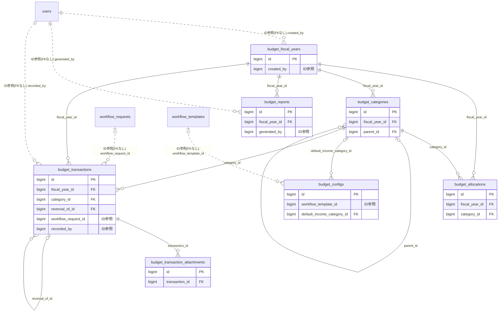

# budget ドメイン ER 図

> このファイルは自動生成されます。手で編集しないでください。再生成: `cd backend && ./gradlew generateErDiagrams`

- テーブル数: 7
- ビュー数: 0

## ER 図

実線 = 外部キー、点線 = ID参照(FKなし)。図中の `FK` は実外部キーの列だけ（ID参照列は `FK` を付けず "ID参照" と注記）。図にはキー列（PK / FK / 参照推定列 / 単一列 UNIQUE）のみを描く。全列は下の「テーブル定義」を参照。

## 被参照（他ドメインから）

このドメインのテーブルを参照している他ドメインの側（実 FK と ID参照のみ。多態参照と推定不能参照は含まない。同一ドメイン内の参照は上の図を参照）。

| 参照元ドメイン | 参照元テーブル | 列 | 種別 | 参照先テーブル |
| --- | --- | --- | --- | --- |
| [property](property.md) | `property_work_packages` | `budget_transaction_id` | ID参照 | `budget_transactions` |
| [shiftbudget](shiftbudget.md) | `shift_budget_allocations` | `budget_category_id` | ID参照 | `budget_categories` |

## 自己参照

mermaid は同一テーブルの自己参照を複数描けず 1 本に畳むため、図に線が欠けることがある。自己参照はこの表を正とする。

| テーブル | 列 | 種別 |
| --- | --- | --- |
| `budget_categories` | `parent_id` | 外部キー |
| `budget_transactions` | `reversal_of_id` | 外部キー |

## 多態参照（線を引かない）

| テーブル | 種別列 | ID列 |
| --- | --- | --- |
| `budget_configs` | `scope_type` | `scope_id` |
| `budget_fiscal_years` | `scope_type` | `scope_id` |
| `budget_reports` | `scope_type` | `scope_id` |
| `budget_transactions` | `scope_type` | `scope_id` |
| `budget_transactions` | `source_type` | `source_id` |

## 推定不能参照

| テーブル | 列 | 理由 |
| --- | --- | --- |
| `budget_configs` | `over_limit_workflow_id` | 参照先テーブルを特定できない |

## テーブル定義

### `budget_allocations`

| 列名 | 型 | NULL | 既定値 | コメント |
| --- | --- | --- | --- | --- |
| `id` | `bigint unsigned` | NO | （なし） auto_increment |  |
| `fiscal_year_id` | `bigint unsigned` | NO | （なし） |  |
| `category_id` | `bigint unsigned` | NO | （なし） |  |
| `amount` | `decimal(12,0)` | NO | （なし） |  |
| `note` | `varchar(500)` | YES | NULL |  |
| `version` | `bigint` | NO | `0` |  |
| `created_at` | `datetime` | NO | `CURRENT_TIMESTAMP` （式） |  |
| `updated_at` | `datetime` | NO | `CURRENT_TIMESTAMP` （式） |  |

### `budget_categories`

| 列名 | 型 | NULL | 既定値 | コメント |
| --- | --- | --- | --- | --- |
| `id` | `bigint unsigned` | NO | （なし） auto_increment |  |
| `fiscal_year_id` | `bigint unsigned` | NO | （なし） |  |
| `parent_id` | `bigint unsigned` | YES | NULL |  |
| `name` | `varchar(100)` | NO | （なし） |  |
| `category_type` | `varchar(20)` | NO | （なし） |  |
| `description` | `varchar(500)` | YES | NULL |  |
| `sort_order` | `int` | NO | `0` |  |
| `version` | `bigint` | NO | `0` |  |
| `created_at` | `datetime` | NO | `CURRENT_TIMESTAMP` （式） |  |
| `updated_at` | `datetime` | NO | `CURRENT_TIMESTAMP` （式） |  |
| `deleted_at` | `datetime` | YES | NULL |  |
| `active_unique_key` | `tinyint` | YES | NULL |  |

### `budget_configs`

| 列名 | 型 | NULL | 既定値 | コメント |
| --- | --- | --- | --- | --- |
| `id` | `bigint unsigned` | NO | （なし） auto_increment |  |
| `scope_type` | `varchar(20)` | NO | （なし） |  |
| `scope_id` | `bigint unsigned` | NO | （なし） |  |
| `approval_threshold` | `decimal(12,0)` | YES | NULL |  |
| `workflow_template_id` | `bigint unsigned` | YES | NULL |  |
| `auto_record_payments` | `tinyint(1)` | NO | `1` |  |
| `default_income_category_id` | `bigint unsigned` | YES | NULL |  |
| `budget_warning_threshold` | `smallint` | NO | `80` |  |
| `budget_critical_threshold` | `smallint` | NO | `95` |  |
| `version` | `bigint` | NO | `0` |  |
| `created_at` | `datetime` | NO | `CURRENT_TIMESTAMP` （式） |  |
| `updated_at` | `datetime` | NO | `CURRENT_TIMESTAMP` （式） |  |
| `over_limit_workflow_id` | `bigint unsigned` | YES | NULL |  |
| `shift_budget_enabled` | `tinyint(1)` | YES | NULL |  |

### `budget_fiscal_years`

| 列名 | 型 | NULL | 既定値 | コメント |
| --- | --- | --- | --- | --- |
| `id` | `bigint unsigned` | NO | （なし） auto_increment |  |
| `scope_type` | `varchar(20)` | NO | （なし） |  |
| `scope_id` | `bigint unsigned` | NO | （なし） |  |
| `name` | `varchar(100)` | NO | （なし） |  |
| `start_date` | `date` | NO | （なし） |  |
| `end_date` | `date` | NO | （なし） |  |
| `status` | `varchar(20)` | NO | `OPEN` |  |
| `created_by` | `bigint unsigned` | NO | （なし） |  |
| `version` | `bigint` | NO | `0` |  |
| `created_at` | `datetime` | NO | `CURRENT_TIMESTAMP` （式） |  |
| `updated_at` | `datetime` | NO | `CURRENT_TIMESTAMP` （式） |  |
| `deleted_at` | `datetime` | YES | NULL |  |
| `active_unique_key` | `tinyint` | YES | NULL |  |

### `budget_reports`

| 列名 | 型 | NULL | 既定値 | コメント |
| --- | --- | --- | --- | --- |
| `id` | `bigint unsigned` | NO | （なし） auto_increment |  |
| `fiscal_year_id` | `bigint unsigned` | NO | （なし） |  |
| `scope_type` | `varchar(20)` | NO | （なし） |  |
| `scope_id` | `bigint unsigned` | NO | （なし） |  |
| `report_type` | `varchar(20)` | NO | （なし） |  |
| `period_start` | `date` | NO | （なし） |  |
| `period_end` | `date` | NO | （なし） |  |
| `file_key` | `varchar(500)` | YES | NULL |  |
| `file_size` | `int unsigned` | YES | NULL |  |
| `status` | `varchar(20)` | NO | `GENERATING` |  |
| `generated_by` | `bigint unsigned` | NO | （なし） |  |
| `generated_at` | `datetime` | YES | NULL |  |
| `created_at` | `datetime` | NO | `CURRENT_TIMESTAMP` （式） |  |
| `updated_at` | `datetime` | NO | `CURRENT_TIMESTAMP` （式） |  |

### `budget_transaction_attachments`

| 列名 | 型 | NULL | 既定値 | コメント |
| --- | --- | --- | --- | --- |
| `id` | `bigint unsigned` | NO | （なし） auto_increment |  |
| `transaction_id` | `bigint unsigned` | NO | （なし） |  |
| `file_key` | `varchar(500)` | NO | （なし） |  |
| `original_filename` | `varchar(255)` | NO | （なし） |  |
| `file_size` | `int unsigned` | NO | （なし） |  |
| `mime_type` | `varchar(100)` | NO | （なし） |  |
| `sort_order` | `smallint` | NO | `0` |  |
| `created_at` | `datetime` | NO | `CURRENT_TIMESTAMP` （式） |  |
| `updated_at` | `datetime` | NO | `CURRENT_TIMESTAMP` （式） |  |

### `budget_transactions`

| 列名 | 型 | NULL | 既定値 | コメント |
| --- | --- | --- | --- | --- |
| `id` | `bigint unsigned` | NO | （なし） auto_increment |  |
| `fiscal_year_id` | `bigint unsigned` | NO | （なし） |  |
| `category_id` | `bigint unsigned` | NO | （なし） |  |
| `scope_type` | `varchar(20)` | NO | （なし） |  |
| `scope_id` | `bigint unsigned` | NO | （なし） |  |
| `transaction_type` | `varchar(20)` | NO | （なし） |  |
| `amount` | `decimal(12,0)` | NO | （なし） |  |
| `transaction_date` | `date` | NO | （なし） |  |
| `title` | `varchar(200)` | NO | （なし） |  |
| `description` | `text` | YES | NULL |  |
| `payment_method` | `varchar(30)` | YES | NULL |  |
| `reference_number` | `varchar(100)` | YES | NULL |  |
| `counterparty` | `varchar(200)` | YES | NULL |  |
| `is_auto_recorded` | `tinyint(1)` | NO | `0` |  |
| `source_type` | `varchar(50)` | YES | NULL |  |
| `source_id` | `bigint unsigned` | YES | NULL |  |
| `reversal_of_id` | `bigint unsigned` | YES | NULL |  |
| `workflow_request_id` | `bigint unsigned` | YES | NULL |  |
| `approval_status` | `varchar(20)` | NO | `APPROVED` |  |
| `recorded_by` | `bigint unsigned` | NO | （なし） |  |
| `version` | `bigint` | NO | `0` |  |
| `created_at` | `datetime` | NO | `CURRENT_TIMESTAMP` （式） |  |
| `updated_at` | `datetime` | NO | `CURRENT_TIMESTAMP` （式） |  |
| `deleted_at` | `datetime` | YES | NULL |  |
