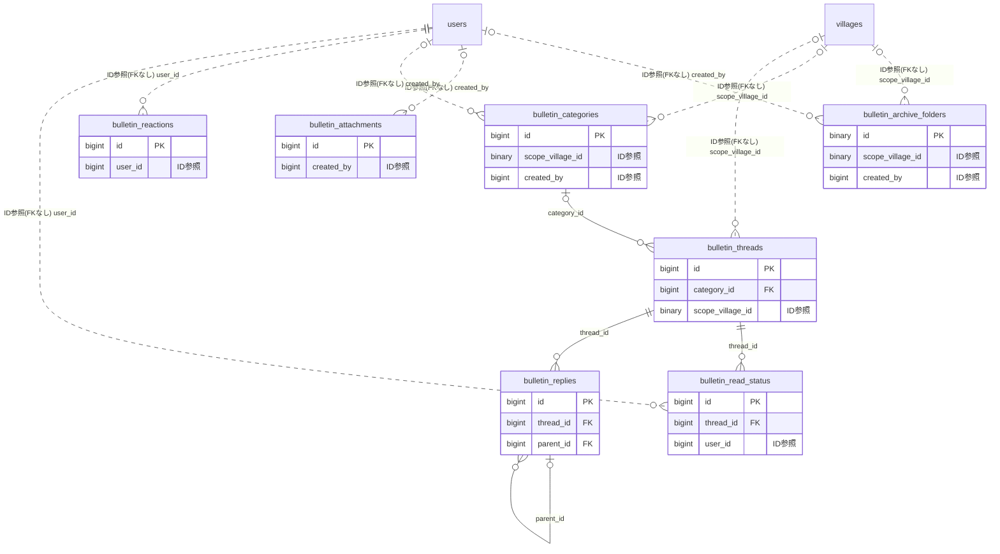

# bulletin ドメイン ER 図

> このファイルは自動生成されます。手で編集しないでください。再生成: `cd backend && ./gradlew generateErDiagrams`

- テーブル数: 7
- ビュー数: 0

## ER 図

実線 = 外部キー、点線 = ID参照(FKなし)。図中の `FK` は実外部キーの列だけ（ID参照列は `FK` を付けず "ID参照" と注記）。図にはキー列（PK / FK / 参照推定列 / 単一列 UNIQUE）のみを描く。全列は下の「テーブル定義」を参照。

## 被参照（他ドメインから）

このドメインのテーブルを参照している他ドメインの側（実 FK と ID参照のみ。多態参照と推定不能参照は含まない。同一ドメイン内の参照は上の図を参照）。

| 参照元ドメイン | 参照元テーブル | 列 | 種別 | 参照先テーブル |
| --- | --- | --- | --- | --- |
| [safetycheck](safetycheck.md) | `safety_checks` | `bulletin_thread_id` | ID参照 | `bulletin_threads` |

## 自己参照

mermaid は同一テーブルの自己参照を複数描けず 1 本に畳むため、図に線が欠けることがある。自己参照はこの表を正とする。

| テーブル | 列 | 種別 |
| --- | --- | --- |
| `bulletin_replies` | `parent_id` | 外部キー |

## 多態参照（線を引かない）

| テーブル | 種別列 | ID列 |
| --- | --- | --- |
| `bulletin_archive_folders` | `scope_type` | `scope_id` |
| `bulletin_attachments` | `target_type` | `target_id` |
| `bulletin_categories` | `scope_type` | `scope_id` |
| `bulletin_reactions` | `target_type` | `target_id` |
| `bulletin_replies` | `posted_as_subject_type` | `posted_as_subject_id` |
| `bulletin_threads` | `posted_as_subject_type` | `posted_as_subject_id` |
| `bulletin_threads` | `scope_type` | `scope_id` |
| `bulletin_threads` | `source_type` | `source_id` |

## 推定不能参照

| テーブル | 列 | 理由 |
| --- | --- | --- |
| `bulletin_archive_folders` | `parent_folder_id` | 参照先テーブルを特定できない |
| `bulletin_replies` | `author_id` | 参照先テーブルを特定できない |
| `bulletin_threads` | `archive_folder_id` | 参照先テーブルを特定できない |
| `bulletin_threads` | `author_id` | 参照先テーブルを特定できない |

## テーブル定義

### `bulletin_archive_folders`

| 列名 | 型 | NULL | 既定値 | コメント |
| --- | --- | --- | --- | --- |
| `id` | `binary(16)` | NO | （なし） | UUIDv7 主キー |
| `scope_type` | `varchar(20)` | NO | （なし） | スコープ種別 TEAM / ORGANIZATION（既存 bulletin 慣習で VARCHAR） |
| `scope_id` | `bigint unsigned` | NO | （なし） | チーム/組織の ID（FK なし・アプリ層整合） |
| `scope_village_id` | `binary(16)` | YES | NULL | 村スコープ時の村 ID（将来対応用。当面 UI は team/org のみ） |
| `parent_folder_id` | `binary(16)` | YES | NULL | 親フォルダ（自己参照ネスト）。NULL = 保管庫直下のルートフォルダ。FK なし |
| `name` | `varchar(100)` | NO | （なし） | フォルダ名 |
| `color` | `varchar(7)` | YES | NULL | フォルダカラー（HEX 形式 #FF5733） |
| `icon` | `varchar(40)` | YES | NULL | アイコン（PrimeIcons 名 例 pi-folder） |
| `depth` | `tinyint unsigned` | NO | `0` | 階層の深さ。ルート = 0、最大4（= 5 階層） |
| `display_order` | `int unsigned` | NO | `0` | 同一親の中での表示順 |
| `created_by` | `bigint unsigned` | YES | NULL | FK → users（作成者）。ON DELETE SET NULL（退会時にフォルダは残す） |
| `created_at` | `datetime` | NO | `CURRENT_TIMESTAMP` （式） |  |
| `updated_at` | `datetime` | NO | `CURRENT_TIMESTAMP` （式） |  |
| `deleted_at` | `datetime` | YES | NULL | 論理削除日時 |

### `bulletin_attachments`

| 列名 | 型 | NULL | 既定値 | コメント |
| --- | --- | --- | --- | --- |
| `id` | `bigint unsigned` | NO | （なし） auto_increment |  |
| `target_type` | `varchar(10)` | NO | （なし） |  |
| `target_id` | `bigint unsigned` | NO | （なし） |  |
| `file_key` | `varchar(500)` | NO | （なし） |  |
| `original_filename` | `varchar(255)` | NO | （なし） |  |
| `file_size` | `bigint unsigned` | NO | （なし） |  |
| `content_type` | `varchar(100)` | NO | （なし） |  |
| `created_by` | `bigint unsigned` | YES | NULL |  |
| `created_at` | `datetime(6)` | NO | （なし） |  |

### `bulletin_categories`

| 列名 | 型 | NULL | 既定値 | コメント |
| --- | --- | --- | --- | --- |
| `id` | `bigint unsigned` | NO | （なし） auto_increment |  |
| `scope_type` | `varchar(20)` | NO | （なし） |  |
| `scope_id` | `bigint unsigned` | NO | （なし） |  |
| `scope_village_id` | `binary(16)` | YES | NULL | scope_type=VILLAGE のとき村ID（FK 張らない / 原則1） |
| `name` | `varchar(50)` | NO | （なし） |  |
| `description` | `varchar(200)` | YES | NULL |  |
| `display_order` | `int` | NO | `0` |  |
| `color` | `varchar(7)` | YES | NULL |  |
| `post_min_role` | `varchar(20)` | NO | `MEMBER` |  |
| `created_by` | `bigint unsigned` | YES | NULL |  |
| `created_at` | `datetime(6)` | NO | （なし） |  |
| `updated_at` | `datetime(6)` | NO | （なし） |  |
| `deleted_at` | `datetime(6)` | YES | NULL |  |

### `bulletin_reactions`

| 列名 | 型 | NULL | 既定値 | コメント |
| --- | --- | --- | --- | --- |
| `id` | `bigint unsigned` | NO | （なし） auto_increment |  |
| `target_type` | `varchar(10)` | NO | （なし） |  |
| `target_id` | `bigint unsigned` | NO | （なし） |  |
| `user_id` | `bigint unsigned` | NO | （なし） |  |
| `emoji` | `varchar(10)` | NO | （なし） |  |
| `created_at` | `datetime(6)` | NO | （なし） |  |

### `bulletin_read_status`

| 列名 | 型 | NULL | 既定値 | コメント |
| --- | --- | --- | --- | --- |
| `id` | `bigint unsigned` | NO | （なし） auto_increment |  |
| `thread_id` | `bigint unsigned` | NO | （なし） |  |
| `user_id` | `bigint unsigned` | NO | （なし） |  |
| `read_at` | `datetime(6)` | NO | `CURRENT_TIMESTAMP(6)` （式） |  |

### `bulletin_replies`

| 列名 | 型 | NULL | 既定値 | コメント |
| --- | --- | --- | --- | --- |
| `id` | `bigint unsigned` | NO | （なし） auto_increment |  |
| `thread_id` | `bigint unsigned` | NO | （なし） |  |
| `parent_id` | `bigint unsigned` | YES | NULL |  |
| `depth` | `tinyint unsigned` | NO | `0` |  |
| `author_id` | `bigint unsigned` | YES | NULL |  |
| `body` | `text` | NO | （なし） |  |
| `is_edited` | `tinyint(1)` | NO | `0` |  |
| `reply_count` | `int` | NO | `0` |  |
| `created_at` | `datetime(6)` | NO | （なし） |  |
| `updated_at` | `datetime(6)` | NO | （なし） |  |
| `deleted_at` | `datetime(6)` | YES | NULL |  |
| `posted_as_subject_type` | `varchar(20)` | NO | `USER` | 投稿主体種別 USER/TEAM/ORGANIZATION |
| `posted_as_subject_id` | `bigint unsigned` | YES | NULL | USER 以外の場合の主体ID |

### `bulletin_threads`

| 列名 | 型 | NULL | 既定値 | コメント |
| --- | --- | --- | --- | --- |
| `id` | `bigint unsigned` | NO | （なし） auto_increment |  |
| `category_id` | `bigint unsigned` | YES | NULL |  |
| `scope_type` | `varchar(20)` | NO | （なし） |  |
| `scope_id` | `bigint unsigned` | NO | （なし） |  |
| `scope_village_id` | `binary(16)` | YES | NULL | scope_type=VILLAGE のとき村ID（FK 張らない / 原則1） |
| `author_id` | `bigint unsigned` | YES | NULL |  |
| `posted_as_subject_type` | `varchar(20)` | NO | `USER` | 投稿主体種別 USER/TEAM/ORGANIZATION |
| `posted_as_subject_id` | `bigint unsigned` | YES | NULL | USER 以外の場合の主体ID |
| `title` | `varchar(200)` | NO | （なし） |  |
| `body` | `text` | NO | （なし） |  |
| `priority` | `varchar(20)` | NO | `INFO` |  |
| `read_tracking_mode` | `varchar(20)` | NO | `COUNT_ONLY` |  |
| `is_pinned` | `tinyint(1)` | NO | `0` |  |
| `is_locked` | `tinyint(1)` | NO | `0` |  |
| `is_archived` | `tinyint(1)` | NO | `0` |  |
| `archive_folder_id` | `binary(16)` | YES | NULL | 保管庫フォルダ（bulletin_archive_folders.id）。NULL かつ is_archived=TRUE = 保管庫直下（未分類）。FK なし |
| `reply_count` | `int` | NO | `0` |  |
| `read_count` | `int` | NO | `0` |  |
| `last_replied_at` | `datetime(6)` | YES | NULL |  |
| `source_type` | `varchar(30)` | YES | NULL |  |
| `source_id` | `bigint unsigned` | YES | NULL |  |
| `created_at` | `datetime(6)` | NO | （なし） |  |
| `updated_at` | `datetime(6)` | NO | （なし） |  |
| `deleted_at` | `datetime(6)` | YES | NULL |  |
