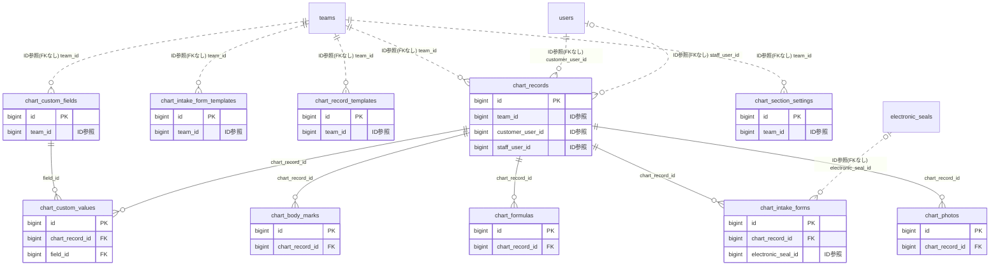

# chart ドメイン ER 図

> このファイルは自動生成されます。手で編集しないでください。再生成: `cd backend && ./gradlew generateErDiagrams`

- テーブル数: 10
- ビュー数: 0

## ER 図

実線 = 外部キー、点線 = ID参照(FKなし)。図中の `FK` は実外部キーの列だけ（ID参照列は `FK` を付けず "ID参照" と注記）。図にはキー列（PK / FK / 参照推定列 / 単一列 UNIQUE）のみを描く。全列は下の「テーブル定義」を参照。

## 被参照（他ドメインから）

このドメインのテーブルを参照している他ドメインの側（実 FK と ID参照のみ。多態参照と推定不能参照は含まない。同一ドメイン内の参照は上の図を参照）。

なし

## テーブル定義

### `chart_body_marks`

| 列名 | 型 | NULL | 既定値 | コメント |
| --- | --- | --- | --- | --- |
| `id` | `bigint unsigned` | NO | （なし） auto_increment |  |
| `chart_record_id` | `bigint unsigned` | NO | （なし） |  |
| `body_part` | `varchar(20)` | NO | （なし） |  |
| `x_position` | `decimal(5,2)` | NO | （なし） |  |
| `y_position` | `decimal(5,2)` | NO | （なし） |  |
| `mark_type` | `varchar(20)` | NO | （なし） |  |
| `severity` | `tinyint unsigned` | NO | （なし） |  |
| `note` | `varchar(300)` | YES | NULL |  |
| `created_at` | `datetime` | NO | `CURRENT_TIMESTAMP` （式） |  |
| `updated_at` | `datetime` | NO | `CURRENT_TIMESTAMP` （式） |  |

### `chart_custom_fields`

| 列名 | 型 | NULL | 既定値 | コメント |
| --- | --- | --- | --- | --- |
| `id` | `bigint unsigned` | NO | （なし） auto_increment |  |
| `team_id` | `bigint unsigned` | NO | （なし） |  |
| `field_name` | `varchar(100)` | NO | （なし） |  |
| `field_type` | `varchar(20)` | NO | （なし） |  |
| `options` | `json` | YES | NULL |  |
| `sort_order` | `int` | NO | `0` |  |
| `is_active` | `tinyint(1)` | NO | `1` |  |
| `created_at` | `datetime` | NO | `CURRENT_TIMESTAMP` （式） |  |
| `updated_at` | `datetime` | NO | `CURRENT_TIMESTAMP` （式） |  |

### `chart_custom_values`

| 列名 | 型 | NULL | 既定値 | コメント |
| --- | --- | --- | --- | --- |
| `id` | `bigint unsigned` | NO | （なし） auto_increment |  |
| `chart_record_id` | `bigint unsigned` | NO | （なし） |  |
| `field_id` | `bigint unsigned` | NO | （なし） |  |
| `value` | `text` | YES | NULL |  |
| `created_at` | `datetime` | NO | `CURRENT_TIMESTAMP` （式） |  |
| `updated_at` | `datetime` | NO | `CURRENT_TIMESTAMP` （式） |  |

### `chart_formulas`

| 列名 | 型 | NULL | 既定値 | コメント |
| --- | --- | --- | --- | --- |
| `id` | `bigint unsigned` | NO | （なし） auto_increment |  |
| `chart_record_id` | `bigint unsigned` | NO | （なし） |  |
| `product_name` | `varchar(200)` | NO | （なし） |  |
| `ratio` | `varchar(100)` | YES | NULL |  |
| `processing_time_minutes` | `smallint unsigned` | YES | NULL |  |
| `temperature` | `varchar(50)` | YES | NULL |  |
| `patch_test_date` | `date` | YES | NULL |  |
| `patch_test_result` | `varchar(20)` | YES | NULL |  |
| `note` | `varchar(500)` | YES | NULL |  |
| `sort_order` | `int` | NO | `0` |  |
| `created_at` | `datetime` | NO | `CURRENT_TIMESTAMP` （式） |  |
| `updated_at` | `datetime` | NO | `CURRENT_TIMESTAMP` （式） |  |

### `chart_intake_form_templates`

| 列名 | 型 | NULL | 既定値 | コメント |
| --- | --- | --- | --- | --- |
| `id` | `bigint unsigned` | NO | （なし） auto_increment |  |
| `team_id` | `bigint unsigned` | NO | （なし） |  |
| `form_type` | `varchar(20)` | NO | （なし） |  |
| `template_name` | `varchar(100)` | NO | （なし） |  |
| `template_json` | `json` | NO | （なし） |  |
| `is_default` | `tinyint(1)` | NO | `0` |  |
| `created_at` | `datetime` | NO | `CURRENT_TIMESTAMP` （式） |  |
| `updated_at` | `datetime` | NO | `CURRENT_TIMESTAMP` （式） |  |

### `chart_intake_forms`

| 列名 | 型 | NULL | 既定値 | コメント |
| --- | --- | --- | --- | --- |
| `id` | `bigint unsigned` | NO | （なし） auto_increment |  |
| `chart_record_id` | `bigint unsigned` | NO | （なし） |  |
| `form_type` | `varchar(20)` | NO | （なし） |  |
| `content` | `json` | NO | （なし） |  |
| `electronic_seal_id` | `bigint unsigned` | YES | NULL |  |
| `signed_at` | `datetime` | YES | NULL |  |
| `is_initial` | `tinyint(1)` | NO | `1` |  |
| `created_at` | `datetime` | NO | `CURRENT_TIMESTAMP` （式） |  |
| `updated_at` | `datetime` | NO | `CURRENT_TIMESTAMP` （式） |  |

### `chart_photos`

| 列名 | 型 | NULL | 既定値 | コメント |
| --- | --- | --- | --- | --- |
| `id` | `bigint unsigned` | NO | （なし） auto_increment |  |
| `chart_record_id` | `bigint unsigned` | NO | （なし） |  |
| `photo_type` | `varchar(20)` | NO | （なし） |  |
| `s3_key` | `varchar(500)` | NO | （なし） |  |
| `original_filename` | `varchar(300)` | NO | （なし） |  |
| `file_size_bytes` | `int unsigned` | NO | （なし） |  |
| `content_type` | `varchar(50)` | NO | （なし） |  |
| `sort_order` | `int` | NO | `0` |  |
| `note` | `varchar(300)` | YES | NULL |  |
| `is_shared_to_customer` | `tinyint(1)` | NO | `0` |  |
| `created_at` | `datetime` | NO | `CURRENT_TIMESTAMP` （式） |  |
| `updated_at` | `datetime` | NO | `CURRENT_TIMESTAMP` （式） |  |

### `chart_record_templates`

| 列名 | 型 | NULL | 既定値 | コメント |
| --- | --- | --- | --- | --- |
| `id` | `bigint unsigned` | NO | （なし） auto_increment |  |
| `team_id` | `bigint unsigned` | NO | （なし） |  |
| `template_name` | `varchar(100)` | NO | （なし） |  |
| `chief_complaint` | `text` | YES | NULL |  |
| `treatment_note` | `text` | YES | NULL |  |
| `allergy_info` | `text` | YES | NULL |  |
| `default_custom_fields` | `json` | YES | NULL |  |
| `sort_order` | `int` | NO | `0` |  |
| `created_at` | `datetime` | NO | `CURRENT_TIMESTAMP` （式） |  |
| `updated_at` | `datetime` | NO | `CURRENT_TIMESTAMP` （式） |  |

### `chart_records`

| 列名 | 型 | NULL | 既定値 | コメント |
| --- | --- | --- | --- | --- |
| `id` | `bigint unsigned` | NO | （なし） auto_increment |  |
| `team_id` | `bigint unsigned` | NO | （なし） |  |
| `customer_user_id` | `bigint unsigned` | NO | （なし） |  |
| `staff_user_id` | `bigint unsigned` | YES | NULL |  |
| `visit_date` | `date` | NO | （なし） |  |
| `chief_complaint` | `text` | YES | NULL |  |
| `treatment_note` | `text` | YES | NULL |  |
| `next_recommendation` | `text` | YES | NULL |  |
| `next_visit_recommended_date` | `date` | YES | NULL |  |
| `allergy_info` | `text` | YES | NULL |  |
| `is_shared_to_customer` | `tinyint(1)` | NO | `0` |  |
| `is_pinned` | `tinyint(1)` | NO | `0` |  |
| `version` | `bigint` | NO | `0` |  |
| `created_at` | `datetime` | NO | `CURRENT_TIMESTAMP` （式） |  |
| `updated_at` | `datetime` | NO | `CURRENT_TIMESTAMP` （式） |  |
| `deleted_at` | `datetime` | YES | NULL |  |

### `chart_section_settings`

| 列名 | 型 | NULL | 既定値 | コメント |
| --- | --- | --- | --- | --- |
| `id` | `bigint unsigned` | NO | （なし） auto_increment |  |
| `team_id` | `bigint unsigned` | NO | （なし） |  |
| `section_type` | `varchar(30)` | NO | （なし） |  |
| `is_enabled` | `tinyint(1)` | NO | `1` |  |
| `created_at` | `datetime` | NO | `CURRENT_TIMESTAMP` （式） |  |
| `updated_at` | `datetime` | NO | `CURRENT_TIMESTAMP` （式） |  |
