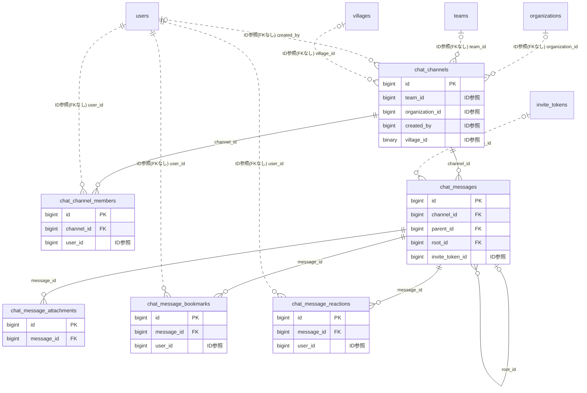

# chat ドメイン ER 図

> このファイルは自動生成されます。手で編集しないでください。再生成: `cd backend && ./gradlew generateErDiagrams`

- テーブル数: 6
- ビュー数: 0

## ER 図

実線 = 外部キー、点線 = ID参照(FKなし)。図中の `FK` は実外部キーの列だけ（ID参照列は `FK` を付けず "ID参照" と注記）。図にはキー列（PK / FK / 参照推定列 / 単一列 UNIQUE）のみを描く。全列は下の「テーブル定義」を参照。

## 被参照（他ドメインから）

このドメインのテーブルを参照している他ドメインの側（実 FK と ID参照のみ。多態参照と推定不能参照は含まない。同一ドメイン内の参照は上の図を参照）。

| 参照元ドメイン | 参照元テーブル | 列 | 種別 | 参照先テーブル |
| --- | --- | --- | --- | --- |
| [village](village.md) | `village_lobby_daily_threads` | `chat_channel_id` | ID参照 | `chat_channels` |

## 自己参照

mermaid は同一テーブルの自己参照を複数描けず 1 本に畳むため、図に線が欠けることがある。自己参照はこの表を正とする。

| テーブル | 列 | 種別 |
| --- | --- | --- |
| `chat_messages` | `parent_id` | 外部キー |
| `chat_messages` | `root_id` | 外部キー |

## 多態参照（線を引かない）

| テーブル | 種別列 | ID列 |
| --- | --- | --- |
| `chat_channels` | `source_type` | `source_id` |
| `chat_messages` | `posted_as_subject_type` | `posted_as_subject_id` |

## 推定不能参照

| テーブル | 列 | 理由 |
| --- | --- | --- |
| `chat_messages` | `forwarded_from_id` | 参照先テーブルを特定できない |
| `chat_messages` | `sender_id` | 参照先テーブルを特定できない |

## テーブル定義

### `chat_channel_members`

| 列名 | 型 | NULL | 既定値 | コメント |
| --- | --- | --- | --- | --- |
| `id` | `bigint unsigned` | NO | （なし） auto_increment |  |
| `channel_id` | `bigint unsigned` | NO | （なし） |  |
| `user_id` | `bigint unsigned` | NO | （なし） |  |
| `role` | `varchar(20)` | NO | `MEMBER` |  |
| `unread_count` | `int` | NO | `0` |  |
| `last_read_at` | `datetime` | YES | NULL |  |
| `is_muted` | `tinyint(1)` | NO | `0` |  |
| `is_pinned` | `tinyint(1)` | NO | `0` |  |
| `category` | `varchar(50)` | YES | NULL |  |
| `joined_at` | `datetime` | NO | `CURRENT_TIMESTAMP` （式） |  |
| `created_at` | `datetime` | NO | `CURRENT_TIMESTAMP` （式） |  |
| `updated_at` | `datetime` | NO | `CURRENT_TIMESTAMP` （式） |  |

### `chat_channels`

| 列名 | 型 | NULL | 既定値 | コメント |
| --- | --- | --- | --- | --- |
| `id` | `bigint unsigned` | NO | （なし） auto_increment |  |
| `channel_type` | `varchar(30)` | NO | （なし） |  |
| `team_id` | `bigint unsigned` | YES | NULL |  |
| `organization_id` | `bigint unsigned` | YES | NULL |  |
| `name` | `varchar(100)` | YES | NULL |  |
| `icon_key` | `varchar(500)` | YES | NULL |  |
| `description` | `varchar(500)` | YES | NULL |  |
| `is_private` | `tinyint(1)` | NO | `0` |  |
| `created_by` | `bigint unsigned` | YES | NULL |  |
| `last_message_at` | `datetime` | YES | NULL |  |
| `last_message_preview` | `varchar(100)` | YES | NULL |  |
| `source_type` | `varchar(30)` | YES | NULL |  |
| `source_id` | `bigint unsigned` | YES | NULL |  |
| `is_archived` | `tinyint(1)` | NO | `0` |  |
| `is_inquiry_channel` | `tinyint(1)` | NO | `0` |  |
| `version` | `bigint` | NO | `0` |  |
| `created_at` | `datetime` | NO | `CURRENT_TIMESTAMP` （式） |  |
| `updated_at` | `datetime` | NO | `CURRENT_TIMESTAMP` （式） |  |
| `deleted_at` | `datetime` | YES | NULL |  |
| `active_thread_count` | `int unsigned` | NO | `0` | 返信が1件以上あるトップレベルメッセージ数（denormalize） |
| `village_id` | `binary(16)` | YES | NULL | channel_type=VILLAGE_LOBBY のとき必須（FK 張らない / 原則1） |

### `chat_message_attachments`

| 列名 | 型 | NULL | 既定値 | コメント |
| --- | --- | --- | --- | --- |
| `id` | `bigint unsigned` | NO | （なし） auto_increment |  |
| `message_id` | `bigint unsigned` | NO | （なし） |  |
| `file_key` | `varchar(500)` | NO | （なし） |  |
| `file_name` | `varchar(255)` | NO | （なし） |  |
| `file_size` | `bigint` | NO | （なし） |  |
| `content_type` | `varchar(100)` | NO | （なし） |  |
| `created_at` | `datetime` | NO | `CURRENT_TIMESTAMP` （式） |  |

### `chat_message_bookmarks`

| 列名 | 型 | NULL | 既定値 | コメント |
| --- | --- | --- | --- | --- |
| `id` | `bigint unsigned` | NO | （なし） auto_increment |  |
| `message_id` | `bigint unsigned` | NO | （なし） |  |
| `user_id` | `bigint unsigned` | NO | （なし） |  |
| `note` | `varchar(200)` | YES | NULL |  |
| `created_at` | `datetime` | NO | `CURRENT_TIMESTAMP` （式） |  |

### `chat_message_reactions`

| 列名 | 型 | NULL | 既定値 | コメント |
| --- | --- | --- | --- | --- |
| `id` | `bigint unsigned` | NO | （なし） auto_increment |  |
| `message_id` | `bigint unsigned` | NO | （なし） |  |
| `user_id` | `bigint unsigned` | NO | （なし） |  |
| `emoji` | `varchar(50)` | NO | （なし） |  |
| `created_at` | `datetime` | NO | `CURRENT_TIMESTAMP` （式） |  |

### `chat_messages`

| 列名 | 型 | NULL | 既定値 | コメント |
| --- | --- | --- | --- | --- |
| `id` | `bigint unsigned` | NO | （なし） auto_increment |  |
| `channel_id` | `bigint unsigned` | NO | （なし） |  |
| `sender_id` | `bigint unsigned` | YES | NULL |  |
| `parent_id` | `bigint unsigned` | YES | NULL |  |
| `body` | `text` | NO | （なし） |  |
| `forwarded_from_id` | `bigint unsigned` | YES | NULL |  |
| `is_edited` | `tinyint(1)` | NO | `0` |  |
| `is_system` | `tinyint(1)` | NO | `0` |  |
| `scheduled_at` | `datetime` | YES | NULL |  |
| `reply_count` | `int` | NO | `0` |  |
| `reaction_count` | `int` | NO | `0` |  |
| `is_pinned` | `tinyint(1)` | NO | `0` |  |
| `created_at` | `datetime` | NO | `CURRENT_TIMESTAMP` （式） |  |
| `updated_at` | `datetime` | NO | `CURRENT_TIMESTAMP` （式） |  |
| `deleted_at` | `datetime` | YES | NULL |  |
| `root_id` | `bigint unsigned` | YES | NULL | スレッドルートメッセージID。NULL=自身がルート |
| `depth` | `int unsigned` | NO | `0` | ネスト深度（0=トップレベル） |
| `scheduled_sent_at` | `datetime` | YES | NULL | 予約送信実行日時 |
| `posted_as_subject_type` | `varchar(20)` | NO | `USER` | 投稿主体種別 USER/TEAM/ORGANIZATION |
| `posted_as_subject_id` | `bigint unsigned` | YES | NULL | USER 以外の場合の主体ID |
| `message_type` | `varchar(20)` | NO | `TEXT` | メッセージ種別 (TEXT/INVITE_CARD)。VARCHAR + アプリ層検証 |
| `invite_token_id` | `bigint unsigned` | YES | NULL | 招待カードが参照する invite_tokens.id（クロスドメイン・FK 張らない） |
