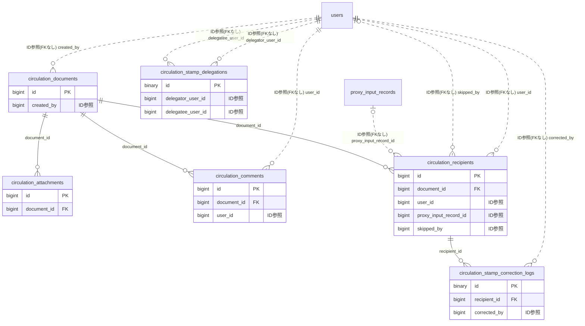

# circulation ドメイン ER 図

> このファイルは自動生成されます。手で編集しないでください。再生成: `cd backend && ./gradlew generateErDiagrams`

- テーブル数: 6
- ビュー数: 0

## ER 図

実線 = 外部キー、点線 = ID参照(FKなし)。図中の `FK` は実外部キーの列だけ（ID参照列は `FK` を付けず "ID参照" と注記）。図にはキー列（PK / FK / 参照推定列 / 単一列 UNIQUE）のみを描く。全列は下の「テーブル定義」を参照。

## 被参照（他ドメインから）

このドメインのテーブルを参照している他ドメインの側（実 FK と ID参照のみ。多態参照と推定不能参照は含まない。同一ドメイン内の参照は上の図を参照）。

| 参照元ドメイン | 参照元テーブル | 列 | 種別 | 参照先テーブル |
| --- | --- | --- | --- | --- |
| [disclosure](disclosure.md) | `disclosure_exports` | `circulation_document_id` | ID参照 | `circulation_documents` |

## 多態参照（線を引かない）

| テーブル | 種別列 | ID列 |
| --- | --- | --- |
| `circulation_documents` | `scope_type` | `scope_id` |

## 推定不能参照

| テーブル | 列 | 理由 |
| --- | --- | --- |
| `circulation_recipients` | `seal_id` | 参照先テーブルを特定できない |
| `circulation_stamp_correction_logs` | `document_id` | 参照先テーブルを特定できない |
| `circulation_stamp_correction_logs` | `original_seal_id` | 参照先テーブルを特定できない |
| `circulation_stamp_delegations` | `document_id` | 参照先テーブルを特定できない |

## テーブル定義

### `circulation_attachments`

| 列名 | 型 | NULL | 既定値 | コメント |
| --- | --- | --- | --- | --- |
| `id` | `bigint unsigned` | NO | （なし） auto_increment |  |
| `document_id` | `bigint unsigned` | NO | （なし） |  |
| `file_key` | `varchar(500)` | NO | （なし） |  |
| `original_filename` | `varchar(255)` | NO | （なし） |  |
| `file_size` | `bigint unsigned` | NO | （なし） |  |
| `mime_type` | `varchar(100)` | NO | （なし） |  |
| `created_at` | `datetime` | NO | `CURRENT_TIMESTAMP` （式） |  |

### `circulation_comments`

| 列名 | 型 | NULL | 既定値 | コメント |
| --- | --- | --- | --- | --- |
| `id` | `bigint unsigned` | NO | （なし） auto_increment |  |
| `document_id` | `bigint unsigned` | NO | （なし） |  |
| `user_id` | `bigint unsigned` | NO | （なし） |  |
| `body` | `varchar(1000)` | NO | （なし） |  |
| `created_at` | `datetime` | NO | `CURRENT_TIMESTAMP` （式） |  |
| `updated_at` | `datetime` | NO | `CURRENT_TIMESTAMP` （式） |  |
| `deleted_at` | `datetime` | YES | NULL |  |

### `circulation_documents`

| 列名 | 型 | NULL | 既定値 | コメント |
| --- | --- | --- | --- | --- |
| `id` | `bigint unsigned` | NO | （なし） auto_increment |  |
| `scope_type` | `varchar(20)` | NO | （なし） | スコープ種別: TEAM / ORGANIZATION / COMMITTEE |
| `scope_id` | `bigint unsigned` | NO | （なし） |  |
| `created_by` | `bigint unsigned` | NO | （なし） |  |
| `title` | `varchar(200)` | NO | （なし） |  |
| `body` | `text` | NO | （なし） |  |
| `circulation_mode` | `varchar(20)` | NO | `SIMULTANEOUS` |  |
| `sequential_count` | `int` | NO | `0` |  |
| `status` | `varchar(20)` | NO | `DRAFT` |  |
| `priority` | `varchar(10)` | NO | `NORMAL` |  |
| `due_date` | `date` | YES | NULL |  |
| `reminder_enabled` | `tinyint(1)` | NO | `0` |  |
| `reminder_interval_hours` | `smallint` | NO | `24` |  |
| `stamp_display_style` | `varchar(20)` | NO | `STANDARD` |  |
| `total_recipient_count` | `int` | NO | `0` |  |
| `stamped_count` | `int` | NO | `0` |  |
| `completed_at` | `datetime` | YES | NULL |  |
| `attachment_count` | `int` | NO | `0` |  |
| `comment_count` | `int` | NO | `0` |  |
| `created_at` | `datetime` | NO | `CURRENT_TIMESTAMP` （式） |  |
| `updated_at` | `datetime` | NO | `CURRENT_TIMESTAMP` （式） |  |
| `post_announcement_on_start` | `tinyint(1)` | NO | `0` | 配信開始時に自動でお知らせウィジェットに登録する |
| `deleted_at` | `datetime` | YES | NULL |  |
| `export_status` | `varchar(30)` | NO | `NOT_GENERATED` | エクスポート生成状態（NOT_GENERATED / PENDING / COMPLETED / FAILED） |
| `export_file_key` | `varchar(500)` | YES | NULL | R2 オブジェクトキー（生成完了時にセット） |
| `export_requested_at` | `datetime(3)` | YES | NULL | エクスポート生成リクエスト受付時刻 |
| `export_completed_at` | `datetime(3)` | YES | NULL | エクスポート生成完了時刻 |
| `export_error_message` | `varchar(1000)` | YES | NULL | 生成失敗時のエラー要約 |

### `circulation_recipients`

| 列名 | 型 | NULL | 既定値 | コメント |
| --- | --- | --- | --- | --- |
| `id` | `bigint unsigned` | NO | （なし） auto_increment |  |
| `document_id` | `bigint unsigned` | NO | （なし） |  |
| `user_id` | `bigint unsigned` | NO | （なし） |  |
| `sort_order` | `int` | NO | `0` |  |
| `status` | `varchar(20)` | NO | `PENDING` |  |
| `stamped_at` | `datetime` | YES | NULL |  |
| `is_proxy_confirmed` | `tinyint(1)` | NO | `0` | 代理確認押印フラグ（0=本人, 1=代理） |
| `proxy_input_record_id` | `bigint unsigned` | YES | NULL | 代理入力記録ID（proxy_input_records.id） |
| `seal_id` | `bigint unsigned` | YES | NULL |  |
| `seal_variant` | `varchar(20)` | YES | NULL |  |
| `tilt_angle` | `smallint` | NO | `0` |  |
| `is_flipped` | `tinyint(1)` | NO | `0` |  |
| `created_at` | `datetime` | NO | `CURRENT_TIMESTAMP` （式） |  |
| `updated_at` | `datetime` | NO | `CURRENT_TIMESTAMP` （式） |  |
| `skip_reason` | `varchar(255)` | YES | NULL | ADMIN 強制スキップ時の理由（本人スキップは NULL） |
| `skipped_by` | `bigint unsigned` | YES | NULL | スキップ操作を行った users.id（本人スキップは NULL） |
| `skipped_at` | `datetime` | YES | NULL | スキップ実行日時 |

### `circulation_stamp_correction_logs`

| 列名 | 型 | NULL | 既定値 | コメント |
| --- | --- | --- | --- | --- |
| `id` | `binary(16)` | NO | （なし） | UUIDv7 主キー |
| `recipient_id` | `bigint unsigned` | NO | （なし） | 対象の circulation_recipients.id（同一ドメイン内） |
| `document_id` | `bigint unsigned` | NO | （なし） | circulation_documents.id（検索効率用に冗長保持） |
| `corrected_by` | `bigint unsigned` | NO | （なし） | 訂正を行ったユーザーID（押印者本人） |
| `original_seal_id` | `bigint unsigned` | YES | NULL | 訂正前の印鑑ID |
| `original_seal_variant` | `varchar(20)` | YES | NULL | 訂正前のバリアント |
| `original_tilt_angle` | `smallint` | YES | NULL | 訂正前の傾き角度 |
| `original_is_flipped` | `tinyint(1)` | NO | `0` | 訂正前の反転フラグ |
| `reason` | `varchar(255)` | YES | NULL | 訂正理由（任意） |
| `created_at` | `datetime` | NO | `CURRENT_TIMESTAMP` （式） |  |

### `circulation_stamp_delegations`

| 列名 | 型 | NULL | 既定値 | コメント |
| --- | --- | --- | --- | --- |
| `id` | `binary(16)` | NO | （なし） | UUIDv7 主キー |
| `document_id` | `bigint unsigned` | NO | （なし） | circulation_documents.id |
| `delegator_user_id` | `bigint unsigned` | NO | （なし） | 委任者（元の受信者）の user_id |
| `delegatee_user_id` | `bigint unsigned` | NO | （なし） | 代理人（押印を委ねられた者）の user_id |
| `reason` | `varchar(255)` | YES | NULL | 委任理由（任意） |
| `status` | `varchar(20)` | NO | `ACTIVE` | ACTIVE / REVOKED / FULFILLED |
| `revoked_at` | `datetime` | YES | NULL |  |
| `fulfilled_at` | `datetime` | YES | NULL | 代理人が押印を完了した日時 |
| `created_at` | `datetime` | NO | `CURRENT_TIMESTAMP` （式） |  |
