# cms ドメイン ER 図

> このファイルは自動生成されます。手で編集しないでください。再生成: `cd backend && ./gradlew generateErDiagrams`

- テーブル数: 13
- ビュー数: 0

## ER 図

実線 = 外部キー、点線 = ID参照(FKなし)。図中の `FK` は実外部キーの列だけ（ID参照列は `FK` を付けず "ID参照" と注記）。図にはキー列（PK / FK / 参照推定列 / 単一列 UNIQUE）のみを描く。全列は下の「テーブル定義」を参照。

```mermaid
erDiagram
    blog_media_r2_delete_retries {
        binary id PK
        char object_key_hash UK
    }
    blog_media_uploads {
        bigint id PK
        bigint blog_post_id FK
        varchar s3_key UK
    }
    blog_post_reactions {
        bigint id PK
        bigint blog_post_id FK
        bigint user_id "ID参照"
    }
    blog_post_revisions {
        bigint id PK
        bigint blog_post_id FK
    }
    blog_post_series {
        bigint id PK
        bigint team_id "ID参照"
        bigint organization_id "ID参照"
        bigint created_by "ID参照"
    }
    blog_post_shares {
        bigint id PK
        bigint blog_post_id FK
        bigint team_id "ID参照"
        bigint organization_id "ID参照"
        bigint shared_by "ID参照"
    }
    blog_post_tags {
        bigint blog_post_id PK, FK
        bigint blog_tag_id PK, FK
    }
    blog_posts {
        bigint id PK
        bigint team_id "ID参照"
        bigint organization_id "ID参照"
        bigint user_id "ID参照"
        bigint timeline_post_id "ID参照"
        bigint series_id FK
        bigint visibility_template_id "ID参照"
        bigint first_published_author_user_id "ID参照"
    }
    blog_ranch_admin_commands {
        binary id PK
        bigint actor_user_id "ID参照"
    }
    blog_ranch_outboxes {
        binary id PK
        bigint recipient_user_id "ID参照"
    }
    blog_ranch_witnesses {
        binary id PK
        bigint recipient_user_id "ID参照"
    }
    blog_tags {
        bigint id PK
        bigint team_id "ID参照"
        bigint organization_id "ID参照"
    }
    user_blog_settings {
        bigint id PK
        bigint user_id UK "ID参照"
    }
    organizations
    teams
    timeline_posts
    users
    visibility_templates
    blog_posts |o--o{ blog_media_uploads : "blog_post_id"
    blog_posts ||--o{ blog_post_reactions : "blog_post_id"
    users ||..o{ blog_post_reactions : "ID参照(FKなし) user_id"
    blog_posts ||--o{ blog_post_revisions : "blog_post_id"
    organizations |o..o{ blog_post_series : "ID参照(FKなし) organization_id"
    teams |o..o{ blog_post_series : "ID参照(FKなし) team_id"
    users |o..o{ blog_post_series : "ID参照(FKなし) created_by"
    blog_posts ||--o{ blog_post_shares : "blog_post_id"
    organizations |o..o{ blog_post_shares : "ID参照(FKなし) organization_id"
    teams |o..o{ blog_post_shares : "ID参照(FKなし) team_id"
    users |o..o{ blog_post_shares : "ID参照(FKなし) shared_by"
    blog_posts ||--o{ blog_post_tags : "blog_post_id"
    blog_tags ||--o{ blog_post_tags : "blog_tag_id"
    blog_post_series |o--o{ blog_posts : "series_id"
    organizations |o..o{ blog_posts : "ID参照(FKなし) organization_id"
    teams |o..o{ blog_posts : "ID参照(FKなし) team_id"
    timeline_posts |o..o{ blog_posts : "ID参照(FKなし) timeline_post_id"
    users |o..o{ blog_posts : "ID参照(FKなし) first_published_author_user_id"
    users |o..o{ blog_posts : "ID参照(FKなし) user_id"
    visibility_templates |o..o{ blog_posts : "ID参照(FKなし) visibility_template_id"
    users ||..o{ blog_ranch_admin_commands : "ID参照(FKなし) actor_user_id"
    users ||..o{ blog_ranch_outboxes : "ID参照(FKなし) recipient_user_id"
    users ||..o{ blog_ranch_witnesses : "ID参照(FKなし) recipient_user_id"
    organizations |o..o{ blog_tags : "ID参照(FKなし) organization_id"
    teams |o..o{ blog_tags : "ID参照(FKなし) team_id"
    users ||..o| user_blog_settings : "ID参照(FKなし) user_id"
```

## 被参照（他ドメインから）

このドメインのテーブルを参照している他ドメインの側（実 FK と ID参照のみ。多態参照と推定不能参照は含まない。同一ドメイン内の参照は上の図を参照）。

| 参照元ドメイン | 参照元テーブル | 列 | 種別 | 参照先テーブル |
| --- | --- | --- | --- | --- |
| [digest](digest.md) | `timeline_digests` | `blog_post_id` | ID参照 | `blog_posts` |
| [reflection](reflection.md) | `reflection_entries` | `exported_blog_post_id` | ID参照 | `blog_posts` |

## 多態参照（線を引かない）

| テーブル | 種別列 | ID列 |
| --- | --- | --- |
| `blog_media_r2_delete_retries` | `scope_type` | `scope_id` |
| `blog_media_uploads` | `scope_type` | `scope_id` |
| `blog_posts` | `target_type` | `target_id` |

## 推定不能参照

| テーブル | 列 | 理由 |
| --- | --- | --- |
| `blog_media_uploads` | `uploader_id` | 参照先テーブルを特定できない |
| `blog_post_revisions` | `editor_id` | 参照先テーブルを特定できない |
| `blog_posts` | `author_id` | 参照先テーブルを特定できない |
| `blog_posts` | `social_profile_id` | 参照先テーブルを特定できない |
| `blog_ranch_outboxes` | `canonical_scope_id` | 参照先テーブルを特定できない |
| `blog_ranch_witnesses` | `canonical_source_id` | 参照先テーブルを特定できない |
| `blog_ranch_witnesses` | `content_key_id` | 参照先テーブルを特定できない |
| `blog_ranch_witnesses` | `event_id` | 型が参照先 events.id と不一致（binary ≠ bigint） |

## テーブル定義

### `blog_media_r2_delete_retries`

| 列名 | 型 | NULL | 既定値 | コメント |
| --- | --- | --- | --- | --- |
| `id` | `binary(16)` | NO | （なし） |  |
| `object_key` | `varchar(1024)` | NO | （なし） |  |
| `object_key_hash` | `char(64)` | NO | （なし） | object_key の SHA-256 16進文字列（UNIQUE索引の索引長制限対策） |
| `file_size` | `bigint` | NO | （なし） |  |
| `scope_type` | `varchar(32)` | NO | （なし） |  |
| `scope_id` | `varchar(64)` | NO | （なし） |  |
| `status` | `varchar(20)` | NO | `PENDING` |  |
| `attempt_count` | `int` | NO | `0` |  |
| `next_attempt_at` | `datetime(6)` | NO | （なし） |  |
| `last_error` | `varchar(500)` | YES | NULL |  |
| `created_at` | `datetime(6)` | NO | （なし） |  |
| `updated_at` | `datetime(6)` | NO | （なし） |  |

### `blog_media_uploads`

| 列名 | 型 | NULL | 既定値 | コメント |
| --- | --- | --- | --- | --- |
| `id` | `bigint unsigned` | NO | （なし） auto_increment |  |
| `blog_post_id` | `bigint unsigned` | YES | NULL |  |
| `uploader_id` | `bigint unsigned` | YES | NULL |  |
| `media_type` | `enum('IMAGE','VIDEO')` | NO | `IMAGE` | メディア種別: IMAGE=静止画, VIDEO=動画。既存レコードはすべて IMAGE |
| `s3_key` | `varchar(500)` | NO | （なし） |  |
| `thumbnail_r2_key` | `varchar(500)` | YES | NULL | 動画のポスターフレームサムネイル R2 オブジェクトキー（VIDEO のみ）。ハイブリッド方式で生成 |
| `duration_seconds` | `int unsigned` | YES | NULL | 動画再生時間（秒。VIDEO のみ）。5 分（300 秒）を境にサムネイル生成経路を Workers / クライアントで振り分ける |
| `processing_status` | `enum('PENDING','PROCESSING','READY','FAILED','UPLOADING')` | NO | `READY` |  |
| `file_size` | `bigint unsigned` | NO | （なし） | ファイルサイズ（bytes）。動画対応のため INT → BIGINT に拡張 |
| `content_type` | `varchar(50)` | NO | （なし） |  |
| `created_at` | `datetime` | NO | `CURRENT_TIMESTAMP` （式） |  |
| `scope_type` | `varchar(20)` | YES | NULL |  |
| `scope_id` | `bigint unsigned` | YES | NULL |  |

### `blog_post_reactions`

| 列名 | 型 | NULL | 既定値 | コメント |
| --- | --- | --- | --- | --- |
| `id` | `bigint unsigned` | NO | （なし） auto_increment |  |
| `blog_post_id` | `bigint unsigned` | NO | （なし） |  |
| `user_id` | `bigint unsigned` | NO | （なし） |  |
| `created_at` | `datetime` | NO | `CURRENT_TIMESTAMP` （式） |  |

### `blog_post_revisions`

| 列名 | 型 | NULL | 既定値 | コメント |
| --- | --- | --- | --- | --- |
| `id` | `bigint unsigned` | NO | （なし） auto_increment |  |
| `blog_post_id` | `bigint unsigned` | NO | （なし） |  |
| `revision_number` | `int unsigned` | NO | （なし） |  |
| `title` | `varchar(200)` | NO | （なし） |  |
| `body` | `text` | NO | （なし） |  |
| `editor_id` | `bigint unsigned` | YES | NULL |  |
| `change_summary` | `varchar(200)` | YES | NULL |  |
| `created_at` | `datetime` | NO | `CURRENT_TIMESTAMP` （式） |  |

### `blog_post_series`

| 列名 | 型 | NULL | 既定値 | コメント |
| --- | --- | --- | --- | --- |
| `id` | `bigint unsigned` | NO | （なし） auto_increment |  |
| `team_id` | `bigint unsigned` | YES | NULL |  |
| `organization_id` | `bigint unsigned` | YES | NULL |  |
| `name` | `varchar(100)` | NO | （なし） |  |
| `description` | `varchar(500)` | YES | NULL |  |
| `created_by` | `bigint unsigned` | YES | NULL |  |
| `created_at` | `datetime` | NO | `CURRENT_TIMESTAMP` （式） |  |
| `updated_at` | `datetime` | NO | `CURRENT_TIMESTAMP` （式） |  |

### `blog_post_shares`

| 列名 | 型 | NULL | 既定値 | コメント |
| --- | --- | --- | --- | --- |
| `id` | `bigint unsigned` | NO | （なし） auto_increment |  |
| `blog_post_id` | `bigint unsigned` | NO | （なし） |  |
| `team_id` | `bigint unsigned` | YES | NULL |  |
| `organization_id` | `bigint unsigned` | YES | NULL |  |
| `shared_by` | `bigint unsigned` | YES | NULL |  |
| `created_at` | `datetime` | NO | `CURRENT_TIMESTAMP` （式） |  |

### `blog_post_tags`

| 列名 | 型 | NULL | 既定値 | コメント |
| --- | --- | --- | --- | --- |
| `blog_post_id` | `bigint unsigned` | NO | （なし） |  |
| `blog_tag_id` | `bigint unsigned` | NO | （なし） |  |

### `blog_posts`

| 列名 | 型 | NULL | 既定値 | コメント |
| --- | --- | --- | --- | --- |
| `id` | `bigint unsigned` | NO | （なし） auto_increment |  |
| `team_id` | `bigint unsigned` | YES | NULL |  |
| `organization_id` | `bigint unsigned` | YES | NULL |  |
| `user_id` | `bigint unsigned` | YES | NULL |  |
| `social_profile_id` | `bigint unsigned` | YES | NULL |  |
| `author_id` | `bigint unsigned` | YES | NULL |  |
| `author_real_name_snapshot` | `varchar(100)` | YES | NULL |  |
| `title` | `varchar(200)` | NO | （なし） |  |
| `slug` | `varchar(200)` | NO | （なし） |  |
| `body` | `text` | NO | （なし） |  |
| `excerpt` | `varchar(500)` | YES | NULL |  |
| `cover_image_url` | `varchar(500)` | YES | NULL |  |
| `post_type` | `varchar(15)` | NO | `BLOG` |  |
| `visibility` | `varchar(30)` | NO | `MEMBERS_ONLY` |  |
| `priority` | `varchar(10)` | NO | `NORMAL` |  |
| `status` | `varchar(20)` | NO | `DRAFT` |  |
| `published_at` | `datetime` | YES | NULL |  |
| `self_review_deadline` | `datetime` | YES | NULL |  |
| `archive_at` | `datetime` | YES | NULL |  |
| `pinned` | `tinyint(1)` | NO | `0` |  |
| `allow_comments` | `tinyint(1)` | NO | `0` |  |
| `target_type` | `varchar(10)` | NO | `ALL` |  |
| `target_id` | `bigint unsigned` | YES | NULL |  |
| `cross_post_to_timeline` | `tinyint(1)` | NO | `0` |  |
| `timeline_post_id` | `bigint unsigned` | YES | NULL |  |
| `rejection_reason` | `varchar(500)` | YES | NULL |  |
| `view_count` | `int unsigned` | NO | `0` |  |
| `reading_time_minutes` | `smallint unsigned` | NO | `0` |  |
| `version` | `int unsigned` | NO | `1` |  |
| `preview_token` | `varchar(64)` | YES | NULL |  |
| `preview_token_expires_at` | `datetime` | YES | NULL |  |
| `series_id` | `bigint unsigned` | YES | NULL |  |
| `series_order` | `smallint unsigned` | YES | NULL |  |
| `created_at` | `datetime` | NO | `CURRENT_TIMESTAMP` （式） |  |
| `updated_at` | `datetime` | NO | `CURRENT_TIMESTAMP` （式） |  |
| `deleted_at` | `datetime` | YES | NULL |  |
| `public_visible` | `tinyint(1)` | NO | `1` |  |
| `visibility_template_id` | `bigint unsigned` | YES | NULL |  |
| `is_ranch_publication_historical` | `tinyint(1)` | NO | `0` |  |
| `is_ranch_publication_observed` | `tinyint(1)` | NO | `0` |  |
| `first_published_at` | `datetime(6)` | YES | NULL |  |
| `first_published_author_user_id` | `bigint unsigned` | YES | NULL |  |
| `is_publication_history_known` | `tinyint(1)` | NO | `0` |  |

### `blog_ranch_admin_commands`

| 列名 | 型 | NULL | 既定値 | コメント |
| --- | --- | --- | --- | --- |
| `id` | `binary(16)` | NO | （なし） |  |
| `actor_user_id` | `bigint unsigned` | NO | （なし） |  |
| `idempotency_key` | `binary(16)` | NO | （なし） |  |
| `command_type` | `varchar(30)` | NO | （なし） |  |
| `body_hash` | `binary(32)` | NO | （なし） |  |
| `result_json` | `json` | NO | （なし） |  |
| `completed_at` | `datetime(6)` | NO | （なし） |  |
| `created_at` | `datetime(6)` | NO | （なし） |  |
| `updated_at` | `datetime(6)` | NO | （なし） |  |

### `blog_ranch_outboxes`

| 列名 | 型 | NULL | 既定値 | コメント |
| --- | --- | --- | --- | --- |
| `id` | `binary(16)` | NO | （なし） |  |
| `schema_version` | `int` | NO | （なし） |  |
| `event_type` | `varchar(40)` | NO | （なし） |  |
| `scope_type` | `varchar(20)` | NO | （なし） |  |
| `scope_id_type` | `varchar(8)` | YES | NULL |  |
| `canonical_scope_id` | `varbinary(80)` | YES | NULL |  |
| `recipient_user_id` | `bigint unsigned` | NO | （なし） |  |
| `canonical_key` | `varbinary(240)` | NO | （なし） |  |
| `payload_json` | `json` | NO | （なし） |  |
| `occurred_at` | `datetime(6)` | NO | （なし） |  |
| `status` | `varchar(20)` | NO | （なし） |  |
| `terminal_outcome` | `varchar(40)` | YES | NULL |  |
| `attempt_count` | `int` | NO | `0` |  |
| `next_attempt_at` | `datetime(6)` | NO | （なし） |  |
| `lease_token` | `binary(16)` | YES | NULL |  |
| `lease_expires_at` | `datetime(6)` | YES | NULL |  |
| `last_error_code` | `varchar(80)` | YES | NULL |  |
| `acked_at` | `datetime(6)` | YES | NULL |  |
| `created_at` | `datetime(6)` | NO | （なし） |  |
| `updated_at` | `datetime(6)` | NO | （なし） |  |

### `blog_ranch_witnesses`

| 列名 | 型 | NULL | 既定値 | コメント |
| --- | --- | --- | --- | --- |
| `id` | `binary(16)` | NO | （なし） |  |
| `source_id_type` | `varchar(8)` | NO | （なし） |  |
| `canonical_source_id` | `varbinary(80)` | NO | （なし） |  |
| `recipient_user_id` | `bigint unsigned` | NO | （なし） |  |
| `kind` | `varchar(20)` | NO | （なし） |  |
| `qualifying_at` | `datetime(6)` | YES | NULL |  |
| `event_id` | `binary(16)` | YES | NULL |  |
| `content_week` | `date` | YES | NULL |  |
| `content_version` | `varchar(64)` | YES | NULL |  |
| `content_key_id` | `binary(32)` | YES | NULL |  |
| `content_digest` | `binary(32)` | YES | NULL |  |
| `created_at` | `datetime(6)` | NO | （なし） |  |
| `updated_at` | `datetime(6)` | NO | （なし） |  |

### `blog_tags`

| 列名 | 型 | NULL | 既定値 | コメント |
| --- | --- | --- | --- | --- |
| `id` | `bigint unsigned` | NO | （なし） auto_increment |  |
| `team_id` | `bigint unsigned` | YES | NULL |  |
| `organization_id` | `bigint unsigned` | YES | NULL |  |
| `name` | `varchar(50)` | NO | （なし） |  |
| `color` | `varchar(7)` | NO | `#6B7280` |  |
| `post_count` | `int unsigned` | NO | `0` |  |
| `sort_order` | `int` | NO | `0` |  |
| `created_at` | `datetime` | NO | `CURRENT_TIMESTAMP` （式） |  |
| `updated_at` | `datetime` | NO | `CURRENT_TIMESTAMP` （式） |  |

### `user_blog_settings`

| 列名 | 型 | NULL | 既定値 | コメント |
| --- | --- | --- | --- | --- |
| `id` | `bigint unsigned` | NO | （なし） auto_increment |  |
| `user_id` | `bigint unsigned` | NO | （なし） |  |
| `self_review_enabled` | `tinyint(1)` | NO | `0` |  |
| `self_review_start` | `time` | NO | `23:00:00` |  |
| `self_review_end` | `time` | NO | `06:00:00` |  |
| `created_at` | `datetime` | NO | `CURRENT_TIMESTAMP` （式） |  |
| `updated_at` | `datetime` | NO | `CURRENT_TIMESTAMP` （式） |  |
