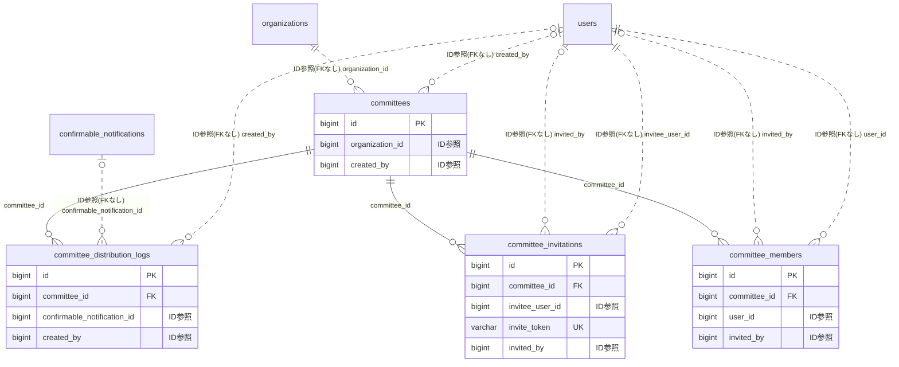

# committee ドメイン ER 図

> このファイルは自動生成されます。手で編集しないでください。再生成: `cd backend && ./gradlew generateErDiagrams`

- テーブル数: 4
- ビュー数: 0

## ER 図

実線 = 外部キー、点線 = ID参照(FKなし)。図中の `FK` は実外部キーの列だけ（ID参照列は `FK` を付けず "ID参照" と注記）。図にはキー列（PK / FK / 参照推定列 / 単一列 UNIQUE）のみを描く。全列は下の「テーブル定義」を参照。

## 被参照（他ドメインから）

このドメインのテーブルを参照している他ドメインの側（実 FK と ID参照のみ。多態参照と推定不能参照は含まない。同一ドメイン内の参照は上の図を参照）。

| 参照元ドメイン | 参照元テーブル | 列 | 種別 | 参照先テーブル |
| --- | --- | --- | --- | --- |
| [residencestatus](residencestatus.md) | `monitoring_committee_visits` | `committee_id` | ID参照 | `committees` |
| [schedule](schedule.md) | `schedules` | `committee_id` | ID参照 | `committees` |

## 多態参照（線を引かない）

| テーブル | 種別列 | ID列 |
| --- | --- | --- |
| `committee_distribution_logs` | `content_type` | `content_id` |

## テーブル定義

### `committee_distribution_logs`

| 列名 | 型 | NULL | 既定値 | コメント |
| --- | --- | --- | --- | --- |
| `id` | `bigint unsigned` | NO | （なし） auto_increment |  |
| `committee_id` | `bigint unsigned` | NO | （なし） | FK → committees（ON DELETE CASCADE） |
| `content_type` | `varchar(30)` | NO | （なし） | 伝達対象種別: SURVEY_RESULT / ACTIVITY_RECORD / CIRCULATION_RESULT / CUSTOM_MESSAGE |
| `content_id` | `bigint unsigned` | YES | NULL | 伝達対象エンティティ ID（CUSTOM_MESSAGE の場合 NULL） |
| `custom_title` | `varchar(200)` | YES | NULL | CUSTOM_MESSAGE 時のタイトル |
| `custom_body` | `text` | YES | NULL | CUSTOM_MESSAGE 時の本文 |
| `target_scope` | `varchar(30)` | NO | （なし） | 配信先: COMMITTEE_ONLY / PARENT_ORG / PARENT_ORG_AND_CHILDREN |
| `announcement_enabled` | `tinyint(1)` | NO | （なし） | お知らせ投下したかどうか |
| `confirmation_mode` | `varchar(10)` | NO | （なし） | 確認ボタン設定: NONE / OPTIONAL / REQUIRED |
| `confirmable_notification_id` | `bigint unsigned` | YES | NULL | FK → confirmable_notifications（ON DELETE SET NULL）REQUIRED/OPTIONAL 時に生成された確認通知 |
| `announcement_feed_ids` | `json` | YES | NULL | 生成された announcement_feeds レコードの ID 配列 |
| `created_by` | `bigint unsigned` | YES | NULL | FK → users（ON DELETE SET NULL）伝達操作者 |
| `created_at` | `datetime` | NO | `CURRENT_TIMESTAMP` （式） |  |
| `updated_at` | `datetime` | NO | `CURRENT_TIMESTAMP` （式） |  |

### `committee_invitations`

| 列名 | 型 | NULL | 既定値 | コメント |
| --- | --- | --- | --- | --- |
| `id` | `bigint unsigned` | NO | （なし） auto_increment |  |
| `committee_id` | `bigint unsigned` | NO | （なし） | FK → committees（ON DELETE CASCADE） |
| `invitee_user_id` | `bigint unsigned` | NO | （なし） | FK → users（ON DELETE CASCADE）被招集者 |
| `proposed_role` | `varchar(20)` | NO | `MEMBER` | 提案ロール |
| `invite_token` | `varchar(36)` | NO | （なし） | UUID。承諾 URL で使用 |
| `invited_by` | `bigint unsigned` | YES | NULL | FK → users（ON DELETE SET NULL）招集者 |
| `message` | `text` | YES | NULL | 招集時のメッセージ |
| `expires_at` | `datetime` | NO | （なし） | 承諾期限（デフォルト 7 日後） |
| `resolved_at` | `datetime` | YES | NULL | 承諾/辞退/期限切れが確定した日時 |
| `resolution` | `varchar(20)` | YES | NULL | 結果: ACCEPTED / DECLINED / EXPIRED / CANCELLED |
| `created_at` | `datetime` | NO | `CURRENT_TIMESTAMP` （式） |  |
| `updated_at` | `datetime` | NO | `CURRENT_TIMESTAMP` （式） |  |

### `committee_members`

| 列名 | 型 | NULL | 既定値 | コメント |
| --- | --- | --- | --- | --- |
| `id` | `bigint unsigned` | NO | （なし） auto_increment |  |
| `committee_id` | `bigint unsigned` | NO | （なし） | FK → committees（ON DELETE CASCADE） |
| `user_id` | `bigint unsigned` | NO | （なし） | FK → users（ON DELETE CASCADE） |
| `role` | `varchar(20)` | NO | `MEMBER` | 委員会内ロール: CHAIR / VICE_CHAIR / SECRETARY / MEMBER |
| `joined_at` | `datetime` | NO | `CURRENT_TIMESTAMP` （式） | 参加成立日時 |
| `left_at` | `datetime` | YES | NULL | 離脱日時。NULL = 現役メンバー |
| `invited_by` | `bigint unsigned` | YES | NULL | FK → users（ON DELETE SET NULL）招集者 |
| `created_at` | `datetime` | NO | `CURRENT_TIMESTAMP` （式） |  |
| `updated_at` | `datetime` | NO | `CURRENT_TIMESTAMP` （式） |  |

### `committees`

| 列名 | 型 | NULL | 既定値 | コメント |
| --- | --- | --- | --- | --- |
| `id` | `bigint unsigned` | NO | （なし） auto_increment |  |
| `organization_id` | `bigint unsigned` | NO | （なし） | FK → organizations（ON DELETE CASCADE）親組織 |
| `name` | `varchar(100)` | NO | （なし） | 委員会名 |
| `description` | `text` | YES | NULL | 委員会の目的・趣旨 |
| `purpose_tag` | `varchar(30)` | YES | NULL | 分類タグ: TOURNAMENT / GOVERNANCE / ELECTION / PROJECT / OTHER |
| `start_date` | `date` | YES | NULL | 設立日。NULL は未設定 |
| `end_date` | `date` | YES | NULL | 解散予定日。NULL は期限なし |
| `status` | `varchar(20)` | NO | `DRAFT` | ライフサイクル状態: DRAFT / ACTIVE / CLOSED / ARCHIVED / CANCELLED_DRAFT |
| `visibility_to_org` | `varchar(20)` | NO | `NAME_ONLY` | 組織内非メンバーからの可視性: HIDDEN / NAME_ONLY / NAME_AND_PURPOSE |
| `default_confirmation_mode` | `varchar(10)` | NO | `OPTIONAL` | 伝達時のデフォルト確認ボタン設定: NONE / OPTIONAL / REQUIRED |
| `default_announcement_enabled` | `tinyint(1)` | NO | `1` | 伝達時にお知らせ投下するかのデフォルト |
| `default_distribution_scope` | `varchar(30)` | NO | `COMMITTEE_ONLY` | 伝達時のデフォルト配信先: COMMITTEE_ONLY / PARENT_ORG / PARENT_ORG_AND_CHILDREN |
| `archived_at` | `datetime` | YES | NULL | ARCHIVED に遷移した日時 |
| `created_by` | `bigint unsigned` | YES | NULL | FK → users（ON DELETE SET NULL）設立者 |
| `deleted_at` | `datetime` | YES | NULL | 論理削除日時 |
| `created_at` | `datetime` | NO | `CURRENT_TIMESTAMP` （式） |  |
| `updated_at` | `datetime` | NO | `CURRENT_TIMESTAMP` （式） |  |
