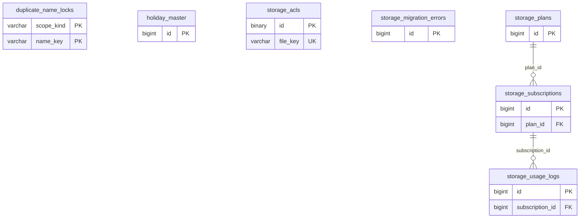

# common ドメイン ER 図

> このファイルは自動生成されます。手で編集しないでください。再生成: `cd backend && ./gradlew generateErDiagrams`

- テーブル数: 7
- ビュー数: 0

## ER 図

実線 = 外部キー、点線 = ID参照(FKなし)。図中の `FK` は実外部キーの列だけ（ID参照列は `FK` を付けず "ID参照" と注記）。図にはキー列（PK / FK / 参照推定列 / 単一列 UNIQUE）のみを描く。全列は下の「テーブル定義」を参照。

## 被参照（他ドメインから）

このドメインのテーブルを参照している他ドメインの側（実 FK と ID参照のみ。多態参照と推定不能参照は含まない。同一ドメイン内の参照は上の図を参照）。

なし

## 多態参照（線を引かない）

| テーブル | 種別列 | ID列 |
| --- | --- | --- |
| `holiday_master` | `scope_type` | `scope_id` |
| `storage_acls` | `reference_type` | `reference_id` |
| `storage_acls` | `scope_type` | `scope_id` |
| `storage_migration_errors` | `reference_type` | `reference_id` |
| `storage_subscriptions` | `scope_type` | `scope_id` |
| `storage_usage_logs` | `reference_type` | `reference_id` |

## 推定不能参照

| テーブル | 列 | 理由 |
| --- | --- | --- |
| `storage_acls` | `owner_id` | 参照先テーブルを特定できない |
| `storage_usage_logs` | `actor_id` | 参照先テーブルを特定できない |

## テーブル定義

### `duplicate_name_locks`

| 列名 | 型 | NULL | 既定値 | コメント |
| --- | --- | --- | --- | --- |
| `scope_kind` | `varchar(32)` | NO | （なし） | DuplicateNameScopeKind（ORGANIZATION/TEAM） |
| `name_key` | `varchar(100)` | NO | （なし） | trim済みの生の名称（organizations/teams.nameと同じ列長）。テーブルのutf8mb4_0900_ai_ci照合により候補検索と同じ同名判定になる |
| `created_at` | `timestamp(6)` | NO | `CURRENT_TIMESTAMP(6)` （式） |  |

### `holiday_master`

| 列名 | 型 | NULL | 既定値 | コメント |
| --- | --- | --- | --- | --- |
| `id` | `bigint unsigned` | NO | （なし） auto_increment |  |
| `scope_type` | `varchar(20)` | NO | `SYSTEM` | SYSTEM / ORGANIZATION / TEAM |
| `scope_id` | `bigint unsigned` | NO | `0` | scope_type=SYSTEM の場合は 0 |
| `holiday_date` | `date` | NO | （なし） |  |
| `name` | `varchar(200)` | NO | （なし） | 祝日名 |
| `country` | `varchar(5)` | NO | `JP` | ISO 3166-1 alpha-2 |
| `is_recurring` | `tinyint(1)` | NO | `0` | 毎年繰り返すか（振替休日等は FALSE） |
| `created_at` | `datetime` | NO | `CURRENT_TIMESTAMP` （式） |  |

### `storage_acls`

| 列名 | 型 | NULL | 既定値 | コメント |
| --- | --- | --- | --- | --- |
| `id` | `binary(16)` | NO | （なし） |  |
| `file_key` | `varchar(500)` | NO | （なし） |  |
| `owner_id` | `bigint unsigned` | NO | （なし） |  |
| `scope_type` | `varchar(32)` | NO | （なし） |  |
| `scope_key` | `varchar(64)` | NO | （なし） |  |
| `scope_id` | `bigint unsigned` | YES | NULL |  |
| `acl_mode` | `varchar(24)` | NO | `CONTENT_BOUND` |  |
| `content_type` | `varchar(100)` | NO | （なし） |  |
| `parent_content_reference_type` | `varchar(64)` | YES | NULL |  |
| `parent_content_reference_key` | `varchar(64)` | YES | NULL |  |
| `attachment_binding_type` | `varchar(64)` | YES | NULL |  |
| `attachment_binding_key` | `varchar(64)` | YES | NULL |  |
| `reference_type` | `varchar(64)` | YES | NULL |  |
| `reference_id` | `bigint unsigned` | YES | NULL |  |
| `status` | `varchar(16)` | NO | `PENDING` |  |
| `expires_at` | `datetime` | NO | （なし） |  |
| `created_at` | `datetime` | NO | （なし） |  |
| `updated_at` | `datetime` | NO | （なし） |  |

### `storage_migration_errors`

| 列名 | 型 | NULL | 既定値 | コメント |
| --- | --- | --- | --- | --- |
| `id` | `bigint unsigned` | NO | （なし） auto_increment |  |
| `reference_type` | `varchar(50)` | NO | （なし） | 対象テーブル名（例: chat_message_attachments） |
| `reference_id` | `bigint unsigned` | YES | NULL |  |
| `reference_uuid` | `binary(16)` | YES | NULL |  |
| `old_file_key` | `varchar(1000)` | NO | （なし） | 移行前R2キー |
| `new_file_key` | `varchar(1000)` | NO | （なし） | 移行先R2キー |
| `error_message` | `text` | YES | NULL | エラー内容 |
| `retry_count` | `int` | NO | `0` | リトライ回数 |
| `created_at` | `datetime` | NO | `CURRENT_TIMESTAMP` （式） |  |
| `resolved_at` | `datetime` | YES | NULL | 解決日時（手動マーク用） |

### `storage_plans`

| 列名 | 型 | NULL | 既定値 | コメント |
| --- | --- | --- | --- | --- |
| `id` | `bigint unsigned` | NO | （なし） auto_increment |  |
| `name` | `varchar(100)` | NO | （なし） | プラン名（例: フリー, スタンダード, プレミアム） |
| `scope_level` | `varchar(20)` | NO | （なし） | 適用スコープレベル: ORGANIZATION / TEAM / PERSONAL |
| `included_bytes` | `bigint unsigned` | NO | （なし） | 無料枠のバイト数（例: 5GB = 5,368,709,120） |
| `max_bytes` | `bigint unsigned` | YES | NULL | ハード上限バイト数（NULL = 超過課金で無制限） |
| `price_monthly` | `decimal(10,2)` | NO | `0.00` | 月額料金（税抜。0 = 無料プラン） |
| `price_yearly` | `decimal(10,2)` | YES | NULL | 年額料金（NULL = 月額のみ） |
| `price_per_extra_gb` | `decimal(10,2)` | YES | NULL | 超過時の GB 単価（NULL = 超過不可・ハードブロック） |
| `is_default` | `tinyint(1)` | NO | `0` | TRUE = 新規作成時に自動適用されるデフォルトプラン（scope_level 別に1つ） |
| `sort_order` | `smallint` | NO | `0` | プラン選択画面の表示順 |
| `created_at` | `datetime` | NO | `CURRENT_TIMESTAMP` （式） |  |
| `updated_at` | `datetime` | NO | `CURRENT_TIMESTAMP` （式） |  |
| `deleted_at` | `datetime` | YES | NULL | 論理削除（SoftDeletableEntity 適用） |

### `storage_subscriptions`

| 列名 | 型 | NULL | 既定値 | コメント |
| --- | --- | --- | --- | --- |
| `id` | `bigint unsigned` | NO | （なし） auto_increment |  |
| `scope_type` | `varchar(20)` | NO | （なし） | スコープ種別: ORGANIZATION / TEAM / PERSONAL |
| `scope_id` | `bigint unsigned` | NO | （なし） | スコープ ID（organizations.id / teams.id / users.id） |
| `plan_id` | `bigint unsigned` | NO | （なし） | FK → storage_plans |
| `used_bytes` | `bigint unsigned` | NO | `0` | 現在の使用量（bytes）。ファイルアップロード・削除時にアトミック更新 |
| `file_count` | `int unsigned` | NO | `0` | 現在のファイル数。アップロード・削除時にアトミック更新 |
| `last_notified_threshold` | `smallint` | YES | NULL | 最後に通知した閾値（%）: 80 / 90 / 100。同じ閾値の重複通知を防止。使用率が閾値を下回ったらリセット |
| `created_at` | `datetime` | NO | `CURRENT_TIMESTAMP` （式） |  |
| `updated_at` | `datetime` | NO | `CURRENT_TIMESTAMP` （式） |  |

### `storage_usage_logs`

| 列名 | 型 | NULL | 既定値 | コメント |
| --- | --- | --- | --- | --- |
| `id` | `bigint unsigned` | NO | （なし） auto_increment |  |
| `subscription_id` | `bigint unsigned` | NO | （なし） | FK → storage_subscriptions |
| `delta_bytes` | `bigint` | NO | （なし） | 変動量（正=増加、負=減少） |
| `after_bytes` | `bigint unsigned` | NO | （なし） | 変動後の使用量（bytes） |
| `feature_type` | `varchar(30)` | NO | （なし） | 機能種別: FILE_SHARING / CIRCULATION / BULLETIN / CHAT / TIMELINE / CMS / GALLERY / PERSONAL_TIMETABLE_NOTES / SCHEDULE_MEDIA |
| `reference_type` | `varchar(50)` | NO | （なし） | 参照先テーブル名（例: shared_files, circulation_attachments） |
| `reference_id` | `bigint unsigned` | YES | NULL |  |
| `reference_uuid` | `binary(16)` | YES | NULL |  |
| `action` | `varchar(20)` | NO | （なし） | 操作種別: UPLOAD / DELETE / VERSION_ADD / VERSION_DELETE / DRIFT_CORRECTION |
| `actor_id` | `bigint unsigned` | YES | NULL | FK → users（操作者。バッチ処理の場合は NULL） |
| `created_at` | `datetime` | NO | `CURRENT_TIMESTAMP` （式） |  |
