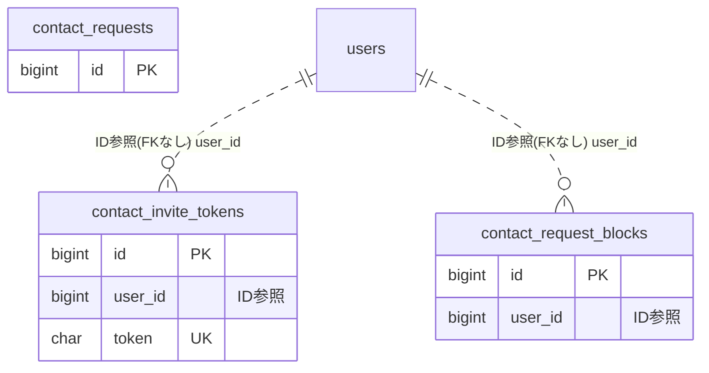

# contact ドメイン ER 図

> このファイルは自動生成されます。手で編集しないでください。再生成: `cd backend && ./gradlew generateErDiagrams`

- テーブル数: 3
- ビュー数: 0

## ER 図

実線 = 外部キー、点線 = ID参照(FKなし)。図中の `FK` は実外部キーの列だけ（ID参照列は `FK` を付けず "ID参照" と注記）。図にはキー列（PK / FK / 参照推定列 / 単一列 UNIQUE）のみを描く。全列は下の「テーブル定義」を参照。

## 被参照（他ドメインから）

このドメインのテーブルを参照している他ドメインの側（実 FK と ID参照のみ。多態参照と推定不能参照は含まない。同一ドメイン内の参照は上の図を参照）。

なし

## 多態参照（線を引かない）

| テーブル | 種別列 | ID列 |
| --- | --- | --- |
| `contact_requests` | `source_type` | `source_id` |

## 推定不能参照

| テーブル | 列 | 理由 |
| --- | --- | --- |
| `contact_request_blocks` | `blocked_id` | 参照先テーブルを特定できない |
| `contact_requests` | `requester_id` | 参照先テーブルを特定できない |
| `contact_requests` | `target_id` | 参照先テーブルを特定できない |

## テーブル定義

### `contact_invite_tokens`

| 列名 | 型 | NULL | 既定値 | コメント |
| --- | --- | --- | --- | --- |
| `id` | `bigint unsigned` | NO | （なし） auto_increment |  |
| `user_id` | `bigint unsigned` | NO | （なし） | トークン発行者 |
| `token` | `char(36)` | NO | （なし） | UUID v4 |
| `label` | `varchar(50)` | YES | NULL | 管理用ラベル |
| `max_uses` | `int` | YES | NULL | NULL=無制限 |
| `used_count` | `int` | NO | `0` |  |
| `expires_at` | `datetime` | YES | NULL | NULL=無期限 |
| `revoked_at` | `datetime` | YES | NULL |  |
| `created_at` | `datetime` | NO | `CURRENT_TIMESTAMP` （式） |  |
| `updated_at` | `datetime` | NO | `CURRENT_TIMESTAMP` （式） |  |

### `contact_request_blocks`

| 列名 | 型 | NULL | 既定値 | コメント |
| --- | --- | --- | --- | --- |
| `id` | `bigint unsigned` | NO | （なし） auto_increment |  |
| `user_id` | `bigint unsigned` | NO | （なし） | 拒否設定をしたユーザー |
| `blocked_id` | `bigint unsigned` | NO | （なし） | 申請を拒否するユーザー |
| `created_at` | `datetime` | NO | `CURRENT_TIMESTAMP` （式） |  |

### `contact_requests`

| 列名 | 型 | NULL | 既定値 | コメント |
| --- | --- | --- | --- | --- |
| `id` | `bigint unsigned` | NO | （なし） auto_increment |  |
| `requester_id` | `bigint unsigned` | NO | （なし） | 申請した側のユーザーID |
| `target_id` | `bigint unsigned` | NO | （なし） | 申請された側のユーザーID |
| `status` | `varchar(20)` | NO | `PENDING` | PENDING / ACCEPTED / REJECTED / CANCELLED |
| `source_type` | `varchar(30)` | YES | NULL | 申請起点: HANDLE_SEARCH / TEAM_SEARCH / ORG_SEARCH / INVITE_URL / AUTO_TEAM / AUTO_ORG |
| `source_id` | `bigint unsigned` | YES | NULL | チーム・組織・招待トークンのID |
| `message` | `varchar(200)` | YES | NULL | 申請時の一言メッセージ（表示時はv-textでエスケープ必須） |
| `responded_at` | `datetime` | YES | NULL |  |
| `expires_at` | `datetime` | YES | NULL | NULLは無期限 |
| `created_at` | `datetime` | NO | `CURRENT_TIMESTAMP` （式） |  |
| `updated_at` | `datetime` | NO | `CURRENT_TIMESTAMP` （式） |  |
