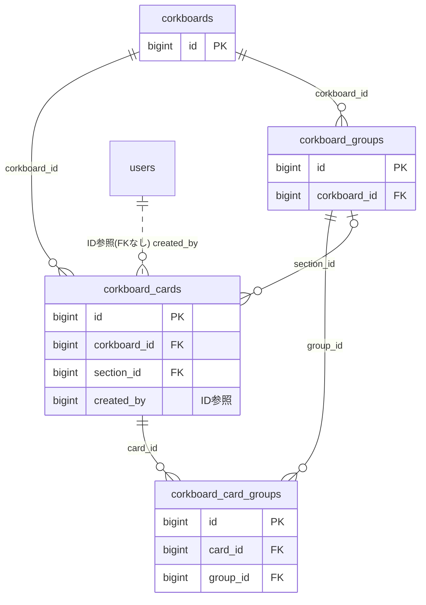

# corkboard ドメイン ER 図

> このファイルは自動生成されます。手で編集しないでください。再生成: `cd backend && ./gradlew generateErDiagrams`

- テーブル数: 4
- ビュー数: 0

## ER 図

実線 = 外部キー、点線 = ID参照(FKなし)。図中の `FK` は実外部キーの列だけ（ID参照列は `FK` を付けず "ID参照" と注記）。図にはキー列（PK / FK / 参照推定列 / 単一列 UNIQUE）のみを描く。全列は下の「テーブル定義」を参照。

## 被参照（他ドメインから）

このドメインのテーブルを参照している他ドメインの側（実 FK と ID参照のみ。多態参照と推定不能参照は含まない。同一ドメイン内の参照は上の図を参照）。

| 参照元ドメイン | 参照元テーブル | 列 | 種別 | 参照先テーブル |
| --- | --- | --- | --- | --- |
| [repairplan](repairplan.md) | `repair_simulation_scenarios` | `pinned_corkboard_id` | ID参照 | `corkboards` |

## 多態参照（線を引かない）

| テーブル | 種別列 | ID列 |
| --- | --- | --- |
| `corkboard_cards` | `reference_type` | `reference_id` |
| `corkboards` | `scope_type` | `scope_id` |

## 推定不能参照

| テーブル | 列 | 理由 |
| --- | --- | --- |
| `corkboards` | `owner_id` | 参照先テーブルを特定できない |

## テーブル定義

### `corkboard_card_groups`

| 列名 | 型 | NULL | 既定値 | コメント |
| --- | --- | --- | --- | --- |
| `id` | `bigint unsigned` | NO | （なし） auto_increment |  |
| `card_id` | `bigint unsigned` | NO | （なし） |  |
| `group_id` | `bigint unsigned` | NO | （なし） |  |
| `created_at` | `datetime` | NO | `CURRENT_TIMESTAMP` （式） |  |

### `corkboard_cards`

| 列名 | 型 | NULL | 既定値 | コメント |
| --- | --- | --- | --- | --- |
| `id` | `bigint unsigned` | NO | （なし） auto_increment |  |
| `corkboard_id` | `bigint unsigned` | NO | （なし） |  |
| `section_id` | `bigint unsigned` | YES | NULL |  |
| `card_type` | `varchar(20)` | NO | （なし） |  |
| `reference_type` | `varchar(30)` | YES | NULL |  |
| `reference_id` | `bigint unsigned` | YES | NULL |  |
| `reference_id_uuid` | `binary(16)` | YES | NULL |  |
| `content_snapshot` | `text` | YES | NULL |  |
| `title` | `varchar(200)` | YES | NULL |  |
| `body` | `text` | YES | NULL |  |
| `url` | `varchar(2000)` | YES | NULL |  |
| `og_title` | `varchar(200)` | YES | NULL |  |
| `og_image_url` | `varchar(500)` | YES | NULL |  |
| `og_description` | `varchar(500)` | YES | NULL |  |
| `color_label` | `varchar(10)` | NO | `NONE` |  |
| `card_size` | `varchar(10)` | NO | `MEDIUM` |  |
| `position_x` | `int` | NO | `0` |  |
| `position_y` | `int` | NO | `0` |  |
| `z_index` | `int` | NO | `0` |  |
| `user_note` | `text` | YES | NULL |  |
| `note_color` | `varchar(20)` | YES | NULL |  |
| `auto_archive_at` | `datetime` | YES | NULL |  |
| `is_archived` | `tinyint(1)` | NO | `0` |  |
| `is_pinned` | `tinyint(1)` | NO | `0` |  |
| `is_ref_deleted` | `tinyint(1)` | NO | `0` |  |
| `pinned_at` | `datetime` | YES | NULL |  |
| `created_by` | `bigint unsigned` | NO | （なし） |  |
| `deleted_at` | `datetime` | YES | NULL |  |
| `created_at` | `datetime` | NO | `CURRENT_TIMESTAMP` （式） |  |
| `updated_at` | `datetime` | NO | `CURRENT_TIMESTAMP` （式） |  |

### `corkboard_groups`

| 列名 | 型 | NULL | 既定値 | コメント |
| --- | --- | --- | --- | --- |
| `id` | `bigint unsigned` | NO | （なし） auto_increment |  |
| `corkboard_id` | `bigint unsigned` | NO | （なし） |  |
| `name` | `varchar(100)` | NO | （なし） |  |
| `is_collapsed` | `tinyint(1)` | NO | `0` |  |
| `position_x` | `int` | NO | `0` |  |
| `position_y` | `int` | NO | `0` |  |
| `width` | `int` | NO | `400` |  |
| `height` | `int` | NO | `300` |  |
| `display_order` | `smallint unsigned` | NO | `0` |  |
| `created_at` | `datetime` | NO | `CURRENT_TIMESTAMP` （式） |  |
| `updated_at` | `datetime` | NO | `CURRENT_TIMESTAMP` （式） |  |

### `corkboards`

| 列名 | 型 | NULL | 既定値 | コメント |
| --- | --- | --- | --- | --- |
| `id` | `bigint unsigned` | NO | （なし） auto_increment |  |
| `scope_type` | `varchar(20)` | NO | （なし） |  |
| `scope_id` | `bigint unsigned` | YES | NULL |  |
| `owner_id` | `bigint unsigned` | YES | NULL |  |
| `name` | `varchar(100)` | NO | （なし） |  |
| `background_style` | `varchar(10)` | NO | `CORK` |  |
| `edit_policy` | `varchar(20)` | NO | `ADMIN_ONLY` |  |
| `is_default` | `tinyint(1)` | NO | `0` |  |
| `version` | `bigint` | NO | `0` |  |
| `deleted_at` | `datetime` | YES | NULL |  |
| `created_at` | `datetime` | NO | `CURRENT_TIMESTAMP` （式） |  |
| `updated_at` | `datetime` | NO | `CURRENT_TIMESTAMP` （式） |  |
