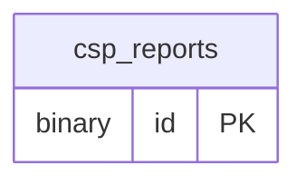

# cspreport ドメイン ER 図

> このファイルは自動生成されます。手で編集しないでください。再生成: `cd backend && ./gradlew generateErDiagrams`

- テーブル数: 1
- ビュー数: 0

## ER 図

実線 = 外部キー、点線 = ID参照(FKなし)。図中の `FK` は実外部キーの列だけ（ID参照列は `FK` を付けず "ID参照" と注記）。図にはキー列（PK / FK / 参照推定列 / 単一列 UNIQUE）のみを描く。全列は下の「テーブル定義」を参照。

## 被参照（他ドメインから）

このドメインのテーブルを参照している他ドメインの側（実 FK と ID参照のみ。多態参照と推定不能参照は含まない。同一ドメイン内の参照は上の図を参照）。

なし

## テーブル定義

### `csp_reports`

| 列名 | 型 | NULL | 既定値 | コメント |
| --- | --- | --- | --- | --- |
| `document_uri` | `varchar(1000)` | YES | NULL |  |
| `blocked_uri` | `varchar(1000)` | YES | NULL |  |
| `violated_directive` | `varchar(200)` | YES | NULL |  |
| `effective_directive` | `varchar(200)` | YES | NULL |  |
| `original_policy` | `text` | YES | NULL |  |
| `disposition` | `varchar(20)` | YES | NULL |  |
| `script_sample` | `varchar(500)` | YES | NULL |  |
| `status_code` | `int` | YES | NULL |  |
| `report_hash` | `varchar(64)` | NO | （なし） |  |
| `occurrence_count` | `int` | NO | `1` |  |
| `ip_address` | `varchar(45)` | YES | NULL |  |
| `user_agent` | `varchar(500)` | YES | NULL |  |
| `first_seen_at` | `datetime(6)` | NO | （なし） |  |
| `last_seen_at` | `datetime(6)` | NO | （なし） |  |
| `id` | `binary(16)` | NO | （なし） |  |
