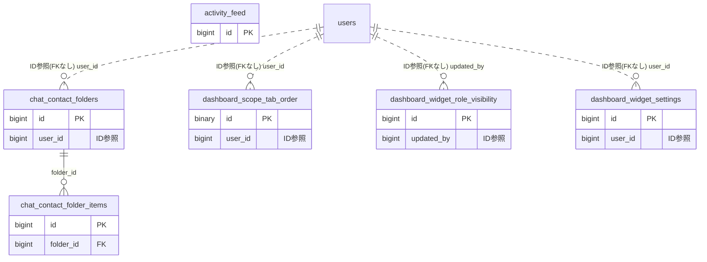

# dashboard ドメイン ER 図

> このファイルは自動生成されます。手で編集しないでください。再生成: `cd backend && ./gradlew generateErDiagrams`

- テーブル数: 6
- ビュー数: 0

## ER 図

実線 = 外部キー、点線 = ID参照(FKなし)。図中の `FK` は実外部キーの列だけ（ID参照列は `FK` を付けず "ID参照" と注記）。図にはキー列（PK / FK / 参照推定列 / 単一列 UNIQUE）のみを描く。全列は下の「テーブル定義」を参照。

## 被参照（他ドメインから）

このドメインのテーブルを参照している他ドメインの側（実 FK と ID参照のみ。多態参照と推定不能参照は含まない。同一ドメイン内の参照は上の図を参照）。

なし

## 多態参照（線を引かない）

| テーブル | 種別列 | ID列 |
| --- | --- | --- |
| `activity_feed` | `scope_type` | `scope_id` |
| `activity_feed` | `target_type` | `target_id` |
| `chat_contact_folder_items` | `item_type` | `item_id` |
| `dashboard_scope_tab_order` | `scope_type` | `scope_id` |
| `dashboard_widget_role_visibility` | `scope_type` | `scope_id` |
| `dashboard_widget_settings` | `scope_type` | `scope_id` |

## 推定不能参照

| テーブル | 列 | 理由 |
| --- | --- | --- |
| `activity_feed` | `actor_id` | 参照先テーブルを特定できない |

## テーブル定義

### `activity_feed`

| 列名 | 型 | NULL | 既定値 | コメント |
| --- | --- | --- | --- | --- |
| `id` | `bigint unsigned` | NO | （なし） auto_increment |  |
| `scope_type` | `varchar(20)` | NO | （なし） | TEAM / ORGANIZATION |
| `scope_id` | `bigint unsigned` | NO | （なし） |  |
| `actor_id` | `bigint unsigned` | NO | （なし） |  |
| `activity_type` | `varchar(30)` | NO | （なし） | POST_CREATED / EVENT_CREATED / MEMBER_JOINED / TODO_COMPLETED / BULLETIN_CREATED / POLL_CREATED / FILE_UPLOADED |
| `target_type` | `varchar(30)` | NO | （なし） | TIMELINE_POST / SCHEDULE / TODO / BULLETIN_THREAD / POLL / FILE |
| `target_id` | `bigint unsigned` | NO | （なし） |  |
| `summary` | `varchar(200)` | NO | （なし） |  |
| `detail` | `json` | YES | NULL | F03.18 変更差分（SCHEDULE系のみ非NULL） |
| `created_at` | `datetime` | NO | `CURRENT_TIMESTAMP` （式） |  |

### `chat_contact_folder_items`

| 列名 | 型 | NULL | 既定値 | コメント |
| --- | --- | --- | --- | --- |
| `id` | `bigint unsigned` | NO | （なし） auto_increment |  |
| `folder_id` | `bigint unsigned` | NO | （なし） |  |
| `item_type` | `varchar(20)` | NO | （なし） | DM_CHANNEL / CONTACT |
| `item_id` | `bigint unsigned` | NO | （なし） |  |
| `custom_name` | `varchar(50)` | YES | NULL | 連絡先の任意表示名（本名の代わりに表示） |
| `is_pinned` | `tinyint(1)` | NO | `0` | お気に入り（ピン留め）フラグ |
| `private_note` | `varchar(500)` | YES | NULL | プライベートメモ（他ユーザーには非公開） |
| `created_at` | `datetime` | NO | `CURRENT_TIMESTAMP` （式） |  |

### `chat_contact_folders`

| 列名 | 型 | NULL | 既定値 | コメント |
| --- | --- | --- | --- | --- |
| `id` | `bigint unsigned` | NO | （なし） auto_increment |  |
| `user_id` | `bigint unsigned` | NO | （なし） |  |
| `name` | `varchar(50)` | NO | （なし） |  |
| `icon` | `varchar(30)` | YES | NULL |  |
| `color` | `varchar(7)` | YES | NULL |  |
| `sort_order` | `int` | NO | `0` |  |
| `created_at` | `datetime` | NO | `CURRENT_TIMESTAMP` （式） |  |
| `updated_at` | `datetime` | NO | `CURRENT_TIMESTAMP` （式） |  |

### `dashboard_scope_tab_order`

| 列名 | 型 | NULL | 既定値 | コメント |
| --- | --- | --- | --- | --- |
| `id` | `binary(16)` | NO | （なし） | UUIDv7 主キー（原則6） |
| `user_id` | `bigint unsigned` | NO | （なし） | users.id（FK制約なし。クロスドメインFK禁止原則） |
| `scope_type` | `varchar(20)` | NO | （なし） | タグ種別（TEAM / ORGANIZATION） |
| `scope_id` | `bigint unsigned` | NO | （なし） | チームID または 組織ID（FK制約なし） |
| `sort_order` | `int` | NO | `0` | 表示順（昇順。小さいほど先頭） |
| `created_at` | `datetime(6)` | NO | `CURRENT_TIMESTAMP(6)` （式） |  |
| `updated_at` | `datetime(6)` | NO | `CURRENT_TIMESTAMP(6)` （式） |  |

### `dashboard_widget_role_visibility`

| 列名 | 型 | NULL | 既定値 | コメント |
| --- | --- | --- | --- | --- |
| `id` | `bigint unsigned` | NO | （なし） auto_increment |  |
| `scope_type` | `varchar(20)` | NO | （なし） | TEAM / ORGANIZATION |
| `scope_id` | `bigint unsigned` | NO | （なし） | スコープID（teams.id または organizations.id） |
| `widget_key` | `varchar(50)` | NO | （なし） | WidgetKey enum 値（UPPER_SNAKE_CASE） |
| `min_role` | `varchar(20)` | NO | （なし） | PUBLIC / SUPPORTER / MEMBER |
| `updated_by` | `bigint unsigned` | NO | （なし） | 最終更新者ユーザーID（監査用） |
| `created_at` | `datetime` | NO | `CURRENT_TIMESTAMP` （式） |  |
| `updated_at` | `datetime` | NO | `CURRENT_TIMESTAMP` （式） |  |

### `dashboard_widget_settings`

| 列名 | 型 | NULL | 既定値 | コメント |
| --- | --- | --- | --- | --- |
| `id` | `bigint unsigned` | NO | （なし） auto_increment |  |
| `user_id` | `bigint unsigned` | NO | （なし） |  |
| `scope_type` | `varchar(20)` | NO | （なし） | PERSONAL / TEAM / ORGANIZATION |
| `scope_id` | `bigint unsigned` | NO | `0` | PERSONAL=0, TEAM/ORGANIZATION=実ID |
| `widget_key` | `varchar(50)` | NO | （なし） |  |
| `is_visible` | `tinyint(1)` | NO | `1` |  |
| `sort_order` | `int` | NO | `0` |  |
| `created_at` | `datetime` | NO | `CURRENT_TIMESTAMP` （式） |  |
| `updated_at` | `datetime` | NO | `CURRENT_TIMESTAMP` （式） |  |
