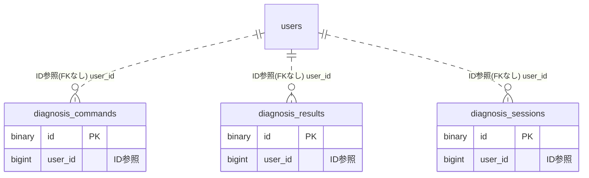

# diagnosis ドメイン ER 図

> このファイルは自動生成されます。手で編集しないでください。再生成: `cd backend && ./gradlew generateErDiagrams`

- テーブル数: 3
- ビュー数: 0

## ER 図

実線 = 外部キー、点線 = ID参照(FKなし)。図中の `FK` は実外部キーの列だけ（ID参照列は `FK` を付けず "ID参照" と注記）。図にはキー列（PK / FK / 参照推定列 / 単一列 UNIQUE）のみを描く。全列は下の「テーブル定義」を参照。

## 被参照（他ドメインから）

このドメインのテーブルを参照している他ドメインの側（実 FK と ID参照のみ。多態参照と推定不能参照は含まない。同一ドメイン内の参照は上の図を参照）。

なし

## 推定不能参照

| テーブル | 列 | 理由 |
| --- | --- | --- |
| `diagnosis_commands` | `command_id` | 参照先テーブルを特定できない |
| `diagnosis_sessions` | `result_id` | 参照先テーブルを特定できない |

## テーブル定義

### `diagnosis_commands`

| 列名 | 型 | NULL | 既定値 | コメント |
| --- | --- | --- | --- | --- |
| `id` | `binary(16)` | NO | （なし） |  |
| `user_id` | `bigint unsigned` | NO | （なし） |  |
| `command_id` | `binary(16)` | NO | （なし） |  |
| `request_hash` | `varchar(64)` | NO | （なし） |  |
| `response_snapshot` | `longtext` | NO | （なし） |  |
| `created_at` | `datetime(6)` | NO | （なし） |  |
| `updated_at` | `datetime(6)` | NO | （なし） |  |

### `diagnosis_results`

| 列名 | 型 | NULL | 既定値 | コメント |
| --- | --- | --- | --- | --- |
| `id` | `binary(16)` | NO | （なし） |  |
| `user_id` | `bigint unsigned` | NO | （なし） |  |
| `method` | `varchar(30)` | NO | （なし） |  |
| `source_profile_revision` | `bigint` | YES | NULL |  |
| `summary_snapshot` | `longtext` | NO | （なし） |  |
| `completed_at` | `datetime(6)` | NO | （なし） |  |
| `created_at` | `datetime(6)` | NO | （なし） |  |
| `updated_at` | `datetime(6)` | NO | （なし） |  |

### `diagnosis_sessions`

| 列名 | 型 | NULL | 既定値 | コメント |
| --- | --- | --- | --- | --- |
| `id` | `binary(16)` | NO | （なし） |  |
| `user_id` | `bigint unsigned` | NO | （なし） |  |
| `status` | `varchar(30)` | NO | （なし） |  |
| `questionnaire_version` | `varchar(80)` | NO | （なし） |  |
| `scoring_version` | `varchar(80)` | NO | （なし） |  |
| `questions_snapshot` | `longtext` | NO | （なし） |  |
| `answers_snapshot` | `longtext` | NO | （なし） |  |
| `answer_revision` | `bigint` | NO | `0` |  |
| `version` | `bigint` | NO | `0` |  |
| `result_id` | `binary(16)` | YES | NULL |  |
| `created_at` | `datetime(6)` | NO | （なし） |  |
| `updated_at` | `datetime(6)` | NO | （なし） |  |
