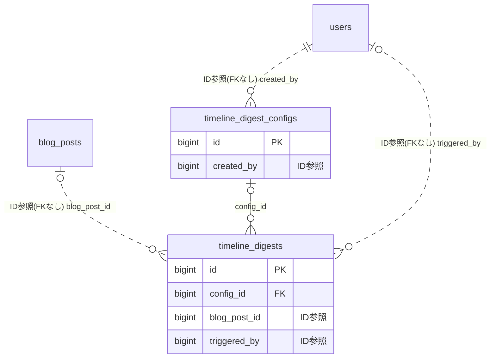

# digest ドメイン ER 図

> このファイルは自動生成されます。手で編集しないでください。再生成: `cd backend && ./gradlew generateErDiagrams`

- テーブル数: 2
- ビュー数: 0

## ER 図

実線 = 外部キー、点線 = ID参照(FKなし)。図中の `FK` は実外部キーの列だけ（ID参照列は `FK` を付けず "ID参照" と注記）。図にはキー列（PK / FK / 参照推定列 / 単一列 UNIQUE）のみを描く。全列は下の「テーブル定義」を参照。

## 被参照（他ドメインから）

このドメインのテーブルを参照している他ドメインの側（実 FK と ID参照のみ。多態参照と推定不能参照は含まない。同一ドメイン内の参照は上の図を参照）。

なし

## 多態参照（線を引かない）

| テーブル | 種別列 | ID列 |
| --- | --- | --- |
| `timeline_digest_configs` | `scope_type` | `scope_id` |
| `timeline_digests` | `scope_type` | `scope_id` |

## テーブル定義

### `timeline_digest_configs`

| 列名 | 型 | NULL | 既定値 | コメント |
| --- | --- | --- | --- | --- |
| `id` | `bigint unsigned` | NO | （なし） auto_increment |  |
| `scope_type` | `varchar(20)` | NO | （なし） |  |
| `scope_id` | `bigint unsigned` | NO | （なし） |  |
| `schedule_type` | `varchar(20)` | NO | `MANUAL` |  |
| `schedule_time` | `time` | YES | `09:00:00` |  |
| `schedule_day_of_week` | `tinyint` | YES | `1` |  |
| `last_executed_at` | `datetime` | YES | NULL |  |
| `digest_style` | `varchar(30)` | NO | `SUMMARY` |  |
| `auto_publish` | `tinyint(1)` | NO | `0` |  |
| `style_presets` | `json` | YES | NULL |  |
| `include_reactions` | `tinyint(1)` | NO | `1` |  |
| `include_polls` | `tinyint(1)` | NO | `1` |  |
| `include_diff_from_previous` | `tinyint(1)` | NO | `0` |  |
| `min_posts_threshold` | `int` | NO | `3` |  |
| `max_posts_per_digest` | `int` | NO | `100` |  |
| `timezone` | `varchar(50)` | NO | `Asia/Tokyo` |  |
| `content_max_chars` | `int` | NO | `500` |  |
| `language` | `varchar(10)` | NO | `ja` |  |
| `custom_prompt_suffix` | `text` | YES | NULL |  |
| `auto_tag_ids` | `json` | YES | NULL |  |
| `is_enabled` | `tinyint(1)` | NO | `1` |  |
| `created_by` | `bigint unsigned` | NO | （なし） |  |
| `deleted_at` | `datetime` | YES | NULL |  |
| `created_at` | `datetime` | NO | `CURRENT_TIMESTAMP` （式） |  |
| `updated_at` | `datetime` | NO | `CURRENT_TIMESTAMP` （式） |  |

### `timeline_digests`

| 列名 | 型 | NULL | 既定値 | コメント |
| --- | --- | --- | --- | --- |
| `id` | `bigint unsigned` | NO | （なし） auto_increment |  |
| `config_id` | `bigint unsigned` | YES | NULL |  |
| `scope_type` | `varchar(20)` | NO | （なし） |  |
| `scope_id` | `bigint unsigned` | NO | （なし） |  |
| `period_start` | `datetime` | NO | （なし） |  |
| `period_end` | `datetime` | NO | （なし） |  |
| `post_count` | `int` | YES | NULL |  |
| `digest_style` | `varchar(30)` | NO | （なし） |  |
| `generated_title` | `varchar(200)` | YES | NULL |  |
| `generated_body` | `text` | YES | NULL |  |
| `generated_excerpt` | `varchar(500)` | YES | NULL |  |
| `ai_model` | `varchar(50)` | YES | NULL |  |
| `ai_input_tokens` | `int` | YES | NULL |  |
| `ai_output_tokens` | `int` | YES | NULL |  |
| `status` | `varchar(20)` | NO | `GENERATING` |  |
| `blog_post_id` | `bigint unsigned` | YES | NULL |  |
| `generating_timeout_at` | `datetime` | YES | NULL |  |
| `source_post_ids` | `json` | YES | NULL |  |
| `error_message` | `text` | YES | NULL |  |
| `triggered_by` | `bigint unsigned` | YES | NULL |  |
| `created_at` | `datetime` | NO | `CURRENT_TIMESTAMP` （式） |  |
