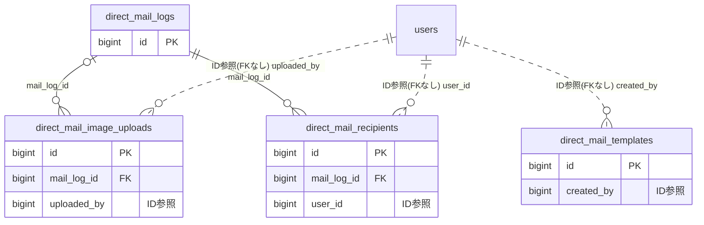

# directmail ドメイン ER 図

> このファイルは自動生成されます。手で編集しないでください。再生成: `cd backend && ./gradlew generateErDiagrams`

- テーブル数: 4
- ビュー数: 0

## ER 図

実線 = 外部キー、点線 = ID参照(FKなし)。図中の `FK` は実外部キーの列だけ（ID参照列は `FK` を付けず "ID参照" と注記）。図にはキー列（PK / FK / 参照推定列 / 単一列 UNIQUE）のみを描く。全列は下の「テーブル定義」を参照。

## 被参照（他ドメインから）

このドメインのテーブルを参照している他ドメインの側（実 FK と ID参照のみ。多態参照と推定不能参照は含まない。同一ドメイン内の参照は上の図を参照）。

| 参照元ドメイン | 参照元テーブル | 列 | 種別 | 参照先テーブル |
| --- | --- | --- | --- | --- |
| [advertising](advertising.md) | `ad_email_deliveries` | `direct_mail_recipient_id` | ID参照 | `direct_mail_recipients` |

## 多態参照（線を引かない）

| テーブル | 種別列 | ID列 |
| --- | --- | --- |
| `direct_mail_logs` | `scope_type` | `scope_id` |
| `direct_mail_logs` | `sender_type` | `sender_id` |
| `direct_mail_templates` | `scope_type` | `scope_id` |

## 推定不能参照

| テーブル | 列 | 理由 |
| --- | --- | --- |
| `direct_mail_recipients` | `ses_message_id` | 参照先テーブルを特定できない |

## テーブル定義

### `direct_mail_image_uploads`

| 列名 | 型 | NULL | 既定値 | コメント |
| --- | --- | --- | --- | --- |
| `id` | `bigint unsigned` | NO | （なし） auto_increment |  |
| `mail_log_id` | `bigint unsigned` | YES | NULL |  |
| `s3_key` | `varchar(500)` | NO | （なし） |  |
| `file_name` | `varchar(255)` | NO | （なし） |  |
| `file_size` | `int` | NO | （なし） |  |
| `content_type` | `varchar(100)` | NO | （なし） |  |
| `uploaded_by` | `bigint unsigned` | NO | （なし） |  |
| `created_at` | `datetime` | NO | `CURRENT_TIMESTAMP` （式） |  |

### `direct_mail_logs`

| 列名 | 型 | NULL | 既定値 | コメント |
| --- | --- | --- | --- | --- |
| `id` | `bigint unsigned` | NO | （なし） auto_increment |  |
| `scope_type` | `varchar(20)` | NO | （なし） |  |
| `scope_id` | `bigint unsigned` | NO | （なし） |  |
| `sender_id` | `bigint unsigned` | NO | （なし） |  |
| `subject` | `varchar(200)` | NO | （なし） |  |
| `body_markdown` | `text` | NO | （なし） |  |
| `body_html` | `text` | NO | （なし） |  |
| `recipient_type` | `varchar(20)` | NO | （なし） |  |
| `recipient_filter` | `json` | YES | NULL |  |
| `estimated_recipients` | `int` | YES | NULL |  |
| `total_recipients` | `int` | NO | `0` |  |
| `sent_count` | `int` | NO | `0` |  |
| `opened_count` | `int` | NO | `0` |  |
| `bounced_count` | `int` | NO | `0` |  |
| `status` | `varchar(20)` | NO | `DRAFT` |  |
| `scheduled_at` | `datetime` | YES | NULL |  |
| `error_message` | `text` | YES | NULL |  |
| `sent_at` | `datetime` | YES | NULL |  |
| `created_at` | `datetime` | NO | `CURRENT_TIMESTAMP` （式） |  |
| `updated_at` | `datetime` | NO | `CURRENT_TIMESTAMP` （式） |  |
| `sender_type` | `varchar(20)` | NO | `USER` | 送信者種別: USER / SYSTEM / SYSTEM_AD (F09.17 広告キャンペーン由来) |

### `direct_mail_recipients`

| 列名 | 型 | NULL | 既定値 | コメント |
| --- | --- | --- | --- | --- |
| `id` | `bigint unsigned` | NO | （なし） auto_increment |  |
| `mail_log_id` | `bigint unsigned` | NO | （なし） |  |
| `user_id` | `bigint unsigned` | NO | （なし） |  |
| `email` | `varchar(255)` | NO | （なし） |  |
| `status` | `varchar(20)` | NO | `PENDING` |  |
| `ses_message_id` | `varchar(100)` | YES | NULL |  |
| `opened_at` | `datetime` | YES | NULL |  |
| `bounced_at` | `datetime` | YES | NULL |  |
| `bounce_type` | `varchar(20)` | YES | NULL |  |
| `created_at` | `datetime` | NO | `CURRENT_TIMESTAMP` （式） |  |

### `direct_mail_templates`

| 列名 | 型 | NULL | 既定値 | コメント |
| --- | --- | --- | --- | --- |
| `id` | `bigint unsigned` | NO | （なし） auto_increment |  |
| `scope_type` | `varchar(20)` | NO | （なし） |  |
| `scope_id` | `bigint unsigned` | NO | （なし） |  |
| `name` | `varchar(100)` | NO | （なし） |  |
| `subject` | `varchar(200)` | NO | （なし） |  |
| `body_markdown` | `text` | NO | （なし） |  |
| `created_by` | `bigint unsigned` | NO | （なし） |  |
| `deleted_at` | `datetime` | YES | NULL |  |
| `created_at` | `datetime` | NO | `CURRENT_TIMESTAMP` （式） |  |
| `updated_at` | `datetime` | NO | `CURRENT_TIMESTAMP` （式） |  |
