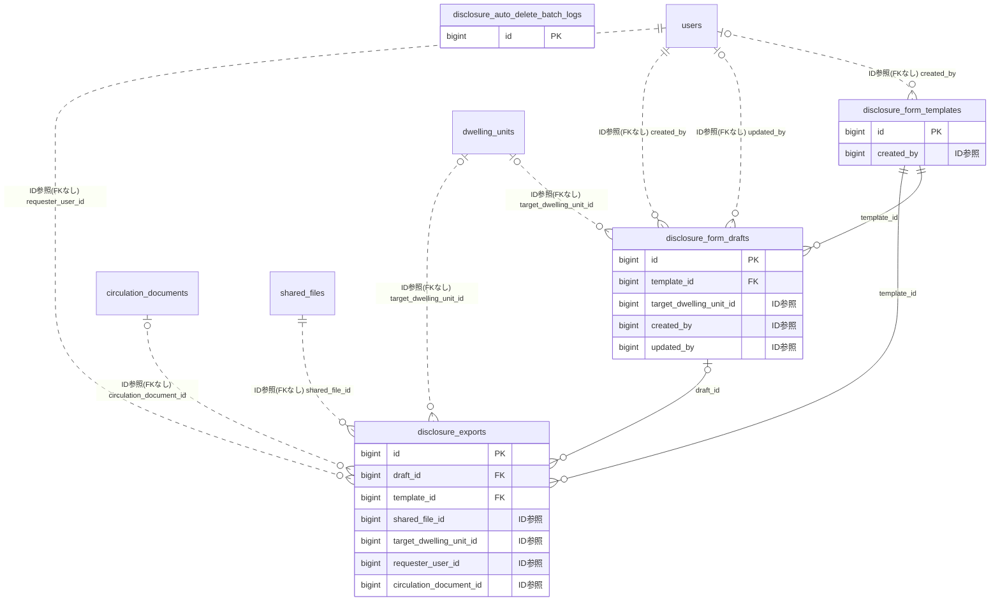

# disclosure ドメイン ER 図

> このファイルは自動生成されます。手で編集しないでください。再生成: `cd backend && ./gradlew generateErDiagrams`

- テーブル数: 4
- ビュー数: 0

## ER 図

実線 = 外部キー、点線 = ID参照(FKなし)。図中の `FK` は実外部キーの列だけ（ID参照列は `FK` を付けず "ID参照" と注記）。図にはキー列（PK / FK / 参照推定列 / 単一列 UNIQUE）のみを描く。全列は下の「テーブル定義」を参照。

## 被参照（他ドメインから）

このドメインのテーブルを参照している他ドメインの側（実 FK と ID参照のみ。多態参照と推定不能参照は含まない。同一ドメイン内の参照は上の図を参照）。

なし

## 多態参照（線を引かない）

| テーブル | 種別列 | ID列 |
| --- | --- | --- |
| `disclosure_exports` | `scope_type` | `scope_id` |
| `disclosure_form_drafts` | `scope_type` | `scope_id` |
| `disclosure_form_templates` | `scope_type` | `scope_id` |

## テーブル定義

### `disclosure_auto_delete_batch_logs`

| 列名 | 型 | NULL | 既定値 | コメント |
| --- | --- | --- | --- | --- |
| `id` | `bigint unsigned` | NO | （なし） auto_increment |  |
| `batch_run_at` | `datetime` | NO | （なし） |  |
| `total_expired` | `int` | NO | `0` |  |
| `total_deleted` | `int` | NO | `0` |  |
| `failed_count` | `int` | NO | `0` |  |
| `error_details` | `text` | YES | NULL |  |
| `created_at` | `datetime` | NO | （なし） |  |

### `disclosure_exports`

| 列名 | 型 | NULL | 既定値 | コメント |
| --- | --- | --- | --- | --- |
| `id` | `bigint unsigned` | NO | （なし） auto_increment |  |
| `scope_type` | `varchar(20)` | NO | （なし） |  |
| `scope_id` | `bigint unsigned` | NO | （なし） |  |
| `draft_id` | `bigint unsigned` | YES | NULL |  |
| `template_id` | `bigint unsigned` | NO | （なし） |  |
| `template_code_snapshot` | `varchar(50)` | NO | （なし） |  |
| `template_version_snapshot` | `varchar(20)` | NO | （なし） |  |
| `output_format` | `varchar(10)` | NO | （なし） |  |
| `shared_file_id` | `bigint unsigned` | NO | （なし） |  |
| `target_dwelling_unit_id` | `bigint unsigned` | YES | NULL |  |
| `requester_user_id` | `bigint unsigned` | NO | （なし） |  |
| `recipient_note` | `varchar(500)` | YES | NULL |  |
| `referenced_package_ids` | `json` | YES | NULL |  |
| `referenced_dwelling_unit_ids` | `json` | YES | NULL |  |
| `data_snapshot` | `json` | NO | （なし） |  |
| `output_sha256` | `char(64)` | YES | NULL |  |
| `circulation_document_id` | `bigint unsigned` | YES | NULL |  |
| `expires_at` | `datetime` | YES | NULL |  |
| `created_at` | `datetime` | NO | （なし） |  |
| `deleted_at` | `datetime` | YES | NULL |  |

### `disclosure_form_drafts`

| 列名 | 型 | NULL | 既定値 | コメント |
| --- | --- | --- | --- | --- |
| `id` | `bigint unsigned` | NO | （なし） auto_increment |  |
| `scope_type` | `varchar(20)` | NO | （なし） |  |
| `scope_id` | `bigint unsigned` | NO | （なし） |  |
| `template_id` | `bigint unsigned` | NO | （なし） |  |
| `template_version_snapshot` | `varchar(20)` | NO | （なし） |  |
| `title` | `varchar(200)` | NO | （なし） |  |
| `target_dwelling_unit_id` | `bigint unsigned` | YES | NULL |  |
| `form_data` | `json` | NO | （なし） |  |
| `referenced_package_ids` | `json` | YES | NULL |  |
| `status` | `varchar(20)` | NO | `DRAFT` |  |
| `created_by` | `bigint unsigned` | NO | （なし） |  |
| `updated_by` | `bigint unsigned` | YES | NULL |  |
| `version` | `bigint` | NO | `0` |  |
| `created_at` | `datetime` | NO | （なし） |  |
| `updated_at` | `datetime` | NO | （なし） |  |
| `deleted_at` | `datetime` | YES | NULL |  |

### `disclosure_form_templates`

| 列名 | 型 | NULL | 既定値 | コメント |
| --- | --- | --- | --- | --- |
| `id` | `bigint unsigned` | NO | （なし） auto_increment |  |
| `code` | `varchar(50)` | NO | （なし） |  |
| `name` | `varchar(150)` | NO | （なし） |  |
| `prefecture_code` | `char(2)` | YES | NULL |  |
| `version` | `varchar(20)` | NO | （なし） |  |
| `is_standard` | `tinyint(1)` | NO | `0` |  |
| `is_system_template` | `tinyint(1)` | NO | `0` |  |
| `scope_type` | `varchar(20)` | YES | NULL |  |
| `scope_id` | `bigint unsigned` | YES | NULL |  |
| `form_schema` | `json` | NO | （なし） |  |
| `pdf_template_path` | `varchar(500)` | YES | NULL |  |
| `excel_template_key` | `varchar(500)` | YES | NULL |  |
| `effective_from` | `date` | YES | NULL |  |
| `effective_until` | `date` | YES | NULL |  |
| `is_active` | `tinyint(1)` | NO | `1` |  |
| `created_by` | `bigint unsigned` | YES | NULL |  |
| `version_lock` | `bigint` | NO | `0` |  |
| `created_at` | `datetime` | NO | （なし） |  |
| `updated_at` | `datetime` | NO | （なし） |  |
| `deleted_at` | `datetime` | YES | NULL |  |
