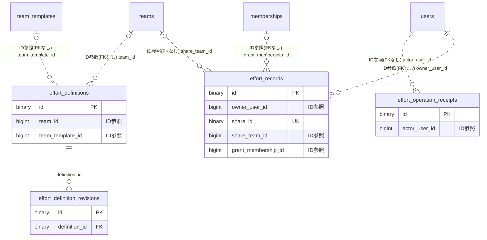

# effortrecord ドメイン ER 図

> このファイルは自動生成されます。手で編集しないでください。再生成: `cd backend && ./gradlew generateErDiagrams`

- テーブル数: 4
- ビュー数: 0

## ER 図

実線 = 外部キー、点線 = ID参照(FKなし)。図中の `FK` は実外部キーの列だけ（ID参照列は `FK` を付けず "ID参照" と注記）。図にはキー列（PK / FK / 参照推定列 / 単一列 UNIQUE）のみを描く。全列は下の「テーブル定義」を参照。

## 被参照（他ドメインから）

このドメインのテーブルを参照している他ドメインの側（実 FK と ID参照のみ。多態参照と推定不能参照は含まない。同一ドメイン内の参照は上の図を参照）。

なし

## 推定不能参照

| テーブル | 列 | 理由 |
| --- | --- | --- |
| `effort_operation_receipts` | `route_id` | 参照先テーブルを特定できない |
| `effort_records` | `definition_id` | 参照先テーブルを特定できない |
| `effort_records` | `share_id` | 参照先テーブルを特定できない |

## テーブル定義

### `effort_definition_revisions`

| 列名 | 型 | NULL | 既定値 | コメント |
| --- | --- | --- | --- | --- |
| `id` | `binary(16)` | NO | （なし） |  |
| `definition_id` | `binary(16)` | NO | （なし） |  |
| `revision` | `int unsigned` | NO | （なし） |  |
| `definition_json` | `json` | NO | （なし） |  |
| `definition_hash` | `char(64)` | NO | （なし） |  |
| `created_at` | `datetime(6)` | NO | （なし） |  |
| `updated_at` | `datetime(6)` | NO | （なし） |  |

### `effort_definitions`

| 列名 | 型 | NULL | 既定値 | コメント |
| --- | --- | --- | --- | --- |
| `id` | `binary(16)` | NO | （なし） |  |
| `source_type` | `varchar(10)` | NO | （なし） |  |
| `source_key` | `varchar(80)` | NO | （なし） |  |
| `team_id` | `bigint unsigned` | YES | NULL |  |
| `team_template_id` | `bigint unsigned` | YES | NULL |  |
| `current_revision` | `int unsigned` | NO | （なし） |  |
| `retired_at` | `datetime(6)` | YES | NULL |  |
| `version` | `bigint` | NO | `0` |  |
| `created_at` | `datetime(6)` | NO | （なし） |  |
| `updated_at` | `datetime(6)` | NO | （なし） |  |
| `deleted_at` | `datetime(6)` | YES | NULL |  |

### `effort_operation_receipts`

| 列名 | 型 | NULL | 既定値 | コメント |
| --- | --- | --- | --- | --- |
| `id` | `binary(16)` | NO | （なし） |  |
| `route_kind` | `varchar(10)` | NO | （なし） |  |
| `route_id` | `bigint unsigned` | NO | （なし） |  |
| `actor_user_id` | `bigint unsigned` | NO | （なし） |  |
| `operation_key` | `char(36)` | NO | （なし） |  |
| `operation_path` | `varchar(255)` | NO | （なし） |  |
| `request_hash` | `char(64)` | NO | （なし） |  |
| `response_status` | `smallint unsigned` | YES | NULL |  |
| `response_json` | `json` | YES | NULL |  |
| `created_at` | `datetime(6)` | NO | （なし） |  |
| `updated_at` | `datetime(6)` | NO | （なし） |  |
| `expires_at` | `datetime(6)` | NO | （なし） |  |

### `effort_records`

| 列名 | 型 | NULL | 既定値 | コメント |
| --- | --- | --- | --- | --- |
| `id` | `binary(16)` | NO | （なし） |  |
| `owner_user_id` | `bigint unsigned` | NO | （なし） |  |
| `definition_id` | `binary(16)` | NO | （なし） |  |
| `definition_revision` | `int unsigned` | NO | （なし） |  |
| `definition_snapshot` | `json` | NO | （なし） |  |
| `recorded_on` | `date` | NO | （なし） |  |
| `record_timezone` | `varchar(64)` | NO | （なし） |  |
| `values_json` | `json` | NO | （なし） |  |
| `private_note` | `text` | YES | NULL |  |
| `purged_at` | `datetime(6)` | YES | NULL |  |
| `version` | `bigint` | NO | `0` |  |
| `content_revision` | `bigint` | NO | `1` |  |
| `share_definition_snapshot` | `json` | YES | NULL |  |
| `share_mapping_json` | `json` | YES | NULL |  |
| `share_id` | `binary(16)` | YES | NULL |  |
| `share_team_id` | `bigint unsigned` | YES | NULL |  |
| `share_state` | `varchar(12)` | YES | NULL |  |
| `share_version` | `bigint` | NO | `0` |  |
| `grant_membership_id` | `bigint unsigned` | YES | NULL |  |
| `selected_field_keys` | `json` | YES | NULL |  |
| `desired_projection` | `json` | YES | NULL |  |
| `desired_hash` | `char(64)` | YES | NULL |  |
| `synced_source_version` | `bigint` | YES | NULL |  |
| `last_error_code` | `varchar(32)` | YES | NULL |  |
| `share_updated_at` | `datetime(6)` | YES | NULL |  |
| `created_at` | `datetime(6)` | NO | （なし） |  |
| `updated_at` | `datetime(6)` | NO | （なし） |  |
| `deleted_at` | `datetime(6)` | YES | NULL |  |
