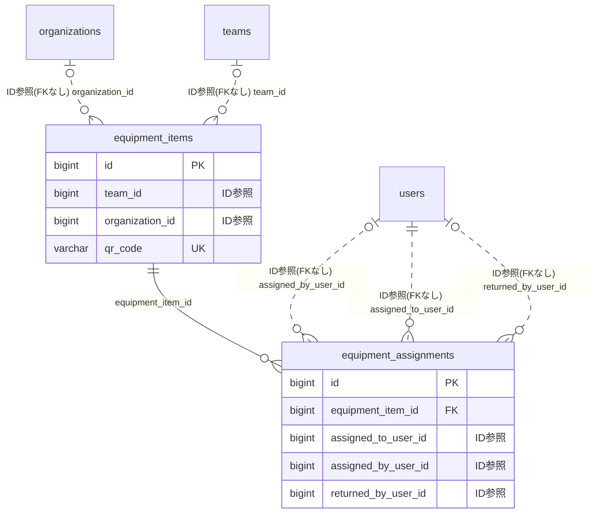

# equipment ドメイン ER 図

> このファイルは自動生成されます。手で編集しないでください。再生成: `cd backend && ./gradlew generateErDiagrams`

- テーブル数: 2
- ビュー数: 0

## ER 図

実線 = 外部キー、点線 = ID参照(FKなし)。図中の `FK` は実外部キーの列だけ（ID参照列は `FK` を付けず "ID参照" と注記）。図にはキー列（PK / FK / 参照推定列 / 単一列 UNIQUE）のみを描く。全列は下の「テーブル定義」を参照。

## 被参照（他ドメインから）

このドメインのテーブルを参照している他ドメインの側（実 FK と ID参照のみ。多態参照と推定不能参照は含まない。同一ドメイン内の参照は上の図を参照）。

なし

## テーブル定義

### `equipment_assignments`

| 列名 | 型 | NULL | 既定値 | コメント |
| --- | --- | --- | --- | --- |
| `id` | `bigint unsigned` | NO | （なし） auto_increment |  |
| `equipment_item_id` | `bigint unsigned` | NO | （なし） |  |
| `assigned_to_user_id` | `bigint unsigned` | NO | （なし） |  |
| `assigned_by_user_id` | `bigint unsigned` | YES | NULL |  |
| `quantity` | `int unsigned` | NO | `1` |  |
| `assigned_at` | `datetime` | NO | `CURRENT_TIMESTAMP` （式） |  |
| `expected_return_at` | `date` | YES | NULL |  |
| `returned_at` | `datetime` | YES | NULL |  |
| `returned_by_user_id` | `bigint unsigned` | YES | NULL |  |
| `note` | `varchar(300)` | YES | NULL |  |
| `last_overdue_notified_at` | `datetime` | YES | NULL |  |
| `created_at` | `datetime` | NO | `CURRENT_TIMESTAMP` （式） |  |
| `updated_at` | `datetime` | NO | `CURRENT_TIMESTAMP` （式） |  |

### `equipment_items`

| 列名 | 型 | NULL | 既定値 | コメント |
| --- | --- | --- | --- | --- |
| `id` | `bigint unsigned` | NO | （なし） auto_increment |  |
| `team_id` | `bigint unsigned` | YES | NULL |  |
| `organization_id` | `bigint unsigned` | YES | NULL |  |
| `name` | `varchar(200)` | NO | （なし） |  |
| `description` | `varchar(500)` | YES | NULL |  |
| `category` | `varchar(100)` | YES | NULL |  |
| `quantity` | `int unsigned` | NO | `1` |  |
| `assigned_quantity` | `int unsigned` | NO | `0` |  |
| `status` | `enum('AVAILABLE','ALL_ASSIGNED','MAINTENANCE','RETIRED')` | NO | `AVAILABLE` |  |
| `is_consumable` | `tinyint(1)` | NO | `0` |  |
| `storage_location` | `varchar(200)` | YES | NULL |  |
| `purchase_date` | `date` | YES | NULL |  |
| `purchase_price` | `decimal(10,2)` | YES | NULL |  |
| `s3_key` | `varchar(500)` | YES | NULL |  |
| `qr_code` | `varchar(100)` | NO | （なし） |  |
| `amazon_url` | `varchar(1000)` | YES | NULL |  |
| `amazon_asin` | `varchar(10)` | YES | NULL |  |
| `rakuten_item_code` | `varchar(200)` | YES | NULL |  |
| `reorder_threshold` | `int unsigned` | YES | NULL |  |
| `created_at` | `datetime` | NO | `CURRENT_TIMESTAMP` （式） |  |
| `updated_at` | `datetime` | NO | `CURRENT_TIMESTAMP` （式） |  |
| `deleted_at` | `datetime` | YES | NULL |  |
