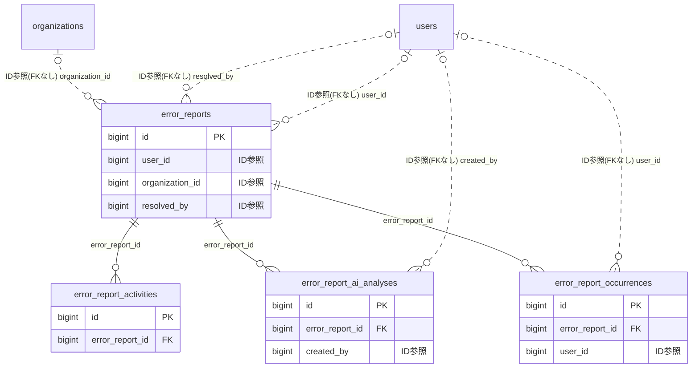

# errorreport ドメイン ER 図

> このファイルは自動生成されます。手で編集しないでください。再生成: `cd backend && ./gradlew generateErDiagrams`

- テーブル数: 4
- ビュー数: 0

## ER 図

実線 = 外部キー、点線 = ID参照(FKなし)。図中の `FK` は実外部キーの列だけ（ID参照列は `FK` を付けず "ID参照" と注記）。図にはキー列（PK / FK / 参照推定列 / 単一列 UNIQUE）のみを描く。全列は下の「テーブル定義」を参照。

## 被参照（他ドメインから）

このドメインのテーブルを参照している他ドメインの側（実 FK と ID参照のみ。多態参照と推定不能参照は含まない。同一ドメイン内の参照は上の図を参照）。

なし

## 推定不能参照

| テーブル | 列 | 理由 |
| --- | --- | --- |
| `error_report_activities` | `actor_id` | 参照先テーブルを特定できない |
| `error_report_occurrences` | `request_id` | 参照先テーブルを特定できない |
| `error_reports` | `assignee_id` | 参照先テーブルを特定できない |
| `error_reports` | `request_id` | 参照先テーブルを特定できない |

## テーブル定義

### `error_report_activities`

| 列名 | 型 | NULL | 既定値 | コメント |
| --- | --- | --- | --- | --- |
| `id` | `bigint unsigned` | NO | （なし） auto_increment |  |
| `error_report_id` | `bigint unsigned` | NO | （なし） |  |
| `actor_id` | `bigint unsigned` | YES | NULL |  |
| `activity_type` | `varchar(40)` | NO | （なし） |  |
| `content` | `varchar(2000)` | YES | NULL |  |
| `metadata_json` | `varchar(2000)` | YES | NULL |  |
| `created_at` | `datetime` | NO | `CURRENT_TIMESTAMP` （式） |  |

### `error_report_ai_analyses`

| 列名 | 型 | NULL | 既定値 | コメント |
| --- | --- | --- | --- | --- |
| `id` | `bigint unsigned` | NO | （なし） auto_increment |  |
| `error_report_id` | `bigint unsigned` | NO | （なし） |  |
| `model_name` | `varchar(100)` | NO | （なし） |  |
| `prompt_tokens` | `int` | NO | `0` |  |
| `completion_tokens` | `int` | NO | `0` |  |
| `estimated_cause` | `varchar(2000)` | YES | NULL |  |
| `fix_proposal` | `varchar(2000)` | YES | NULL |  |
| `impact_assessment` | `varchar(1000)` | YES | NULL |  |
| `suggested_files` | `varchar(1000)` | YES | NULL |  |
| `raw_response` | `text` | YES | NULL |  |
| `status` | `varchar(20)` | NO | `SUCCESS` |  |
| `error_message` | `varchar(500)` | YES | NULL |  |
| `created_by` | `bigint unsigned` | YES | NULL |  |
| `created_at` | `datetime` | NO | `CURRENT_TIMESTAMP` （式） |  |

### `error_report_occurrences`

| 列名 | 型 | NULL | 既定値 | コメント |
| --- | --- | --- | --- | --- |
| `id` | `bigint unsigned` | NO | （なし） auto_increment |  |
| `error_report_id` | `bigint unsigned` | NO | （なし） |  |
| `user_id` | `bigint unsigned` | YES | NULL |  |
| `page_url` | `varchar(2048)` | NO | （なし） |  |
| `user_agent` | `varchar(500)` | YES | NULL |  |
| `ip_address` | `varchar(45)` | YES | NULL |  |
| `request_id` | `varchar(36)` | YES | NULL |  |
| `occurred_at` | `datetime` | NO | （なし） |  |
| `created_at` | `datetime` | NO | `CURRENT_TIMESTAMP` （式） |  |

### `error_reports`

| 列名 | 型 | NULL | 既定値 | コメント |
| --- | --- | --- | --- | --- |
| `id` | `bigint unsigned` | NO | （なし） auto_increment |  |
| `error_message` | `varchar(1000)` | NO | （なし） |  |
| `stack_trace` | `varchar(2000)` | YES | NULL |  |
| `page_url` | `varchar(2048)` | NO | （なし） |  |
| `user_agent` | `varchar(500)` | YES | NULL |  |
| `user_comment` | `varchar(1000)` | YES | NULL |  |
| `user_id` | `bigint unsigned` | YES | NULL |  |
| `organization_id` | `bigint unsigned` | YES | NULL |  |
| `request_id` | `varchar(36)` | YES | NULL |  |
| `ip_address` | `varchar(45)` | YES | NULL |  |
| `occurred_at` | `datetime` | NO | （なし） |  |
| `status` | `varchar(20)` | NO | `NEW` |  |
| `workflow_stage` | `varchar(30)` | YES | NULL |  |
| `severity` | `varchar(10)` | NO | `MEDIUM` |  |
| `resolved_by` | `bigint unsigned` | YES | NULL |  |
| `assignee_id` | `bigint unsigned` | YES | NULL |  |
| `resolved_at` | `datetime` | YES | NULL |  |
| `admin_note` | `varchar(2000)` | YES | NULL |  |
| `github_issue_url` | `varchar(500)` | YES | NULL |  |
| `last_ai_analysis_at` | `datetime` | YES | NULL |  |
| `sla_due_at` | `datetime` | YES | NULL | SLA対応期限。CRITICAL=1h, HIGH=24h, MEDIUM=1w, LOW=NULL |
| `latest_user_comment` | `varchar(1000)` | YES | NULL |  |
| `error_hash` | `varchar(64)` | NO | （なし） |  |
| `occurrence_count` | `int` | NO | `1` |  |
| `affected_user_count` | `int` | NO | `1` |  |
| `first_occurred_at` | `datetime` | NO | （なし） |  |
| `last_occurred_at` | `datetime` | NO | （なし） |  |
| `created_at` | `datetime` | NO | `CURRENT_TIMESTAMP` （式） |  |
| `updated_at` | `datetime` | NO | `CURRENT_TIMESTAMP` （式） |  |
