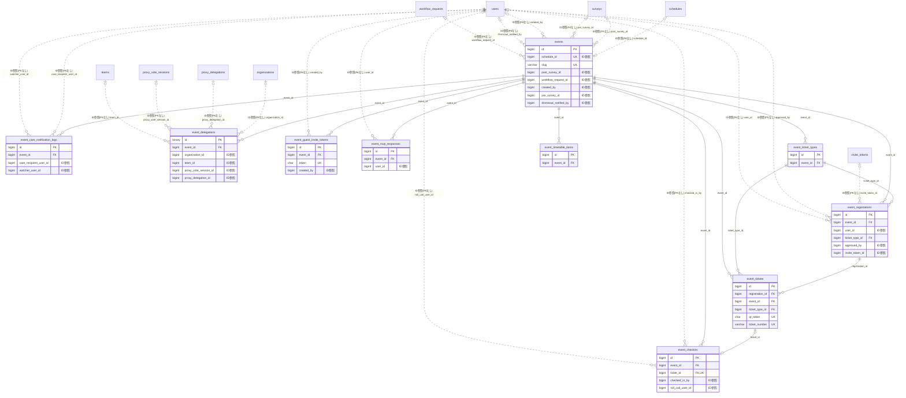

# event ドメイン ER 図

> このファイルは自動生成されます。手で編集しないでください。再生成: `cd backend && ./gradlew generateErDiagrams`

- テーブル数: 10
- ビュー数: 0

## ER 図

実線 = 外部キー、点線 = ID参照(FKなし)。図中の `FK` は実外部キーの列だけ（ID参照列は `FK` を付けず "ID参照" と注記）。図にはキー列（PK / FK / 参照推定列 / 単一列 UNIQUE）のみを描く。全列は下の「テーブル定義」を参照。

## 被参照（他ドメインから）

このドメインのテーブルを参照している他ドメインの側（実 FK と ID参照のみ。多態参照と推定不能参照は含まない。同一ドメイン内の参照は上の図を参照）。

なし

## 多態参照（線を引かない）

| テーブル | 種別列 | ID列 |
| --- | --- | --- |
| `event_care_notification_logs` | `notification_type` | `notification_id` |
| `events` | `scope_type` | `scope_id` |

## 推定不能参照

| テーブル | 列 | 理由 |
| --- | --- | --- |
| `event_checkins` | `delegation_id` | 参照先テーブルを特定できない |
| `event_checkins` | `roll_call_session_id` | 参照先テーブルを特定できない |
| `event_delegations` | `delegate_id` | 参照先テーブルを特定できない |
| `event_delegations` | `delegator_id` | 参照先テーブルを特定できない |

## テーブル定義

### `event_care_notification_logs`

| 列名 | 型 | NULL | 既定値 | コメント |
| --- | --- | --- | --- | --- |
| `id` | `bigint unsigned` | NO | （なし） auto_increment |  |
| `event_id` | `bigint unsigned` | NO | （なし） | FK → events.id |
| `care_recipient_user_id` | `bigint unsigned` | NO | （なし） | ケア対象 users.id |
| `watcher_user_id` | `bigint unsigned` | NO | （なし） | 見守り者 users.id |
| `care_category` | `enum('MINOR','ELDERLY','DISABILITY_SUPPORT','GENERAL_FAMILY')` | NO | （なし） | このリンクのケア区分（送信時スナップショット） |
| `notification_type` | `enum('RSVP_CONFIRMED','CHECKIN','CHECKOUT','NO_CONTACT_CHECK','ABSENT_ALERT','DISMISSAL')` | NO | （なし） | 通知種別 |
| `notification_id` | `bigint unsigned` | YES | NULL | FK → notifications.id（配信レコード参照） |
| `sent_at` | `datetime` | NO | `CURRENT_TIMESTAMP` （式） | 送信日時 |
| `retry_count` | `tinyint` | NO | `0` | 再送回数（最大3） |

### `event_checkins`

| 列名 | 型 | NULL | 既定値 | コメント |
| --- | --- | --- | --- | --- |
| `id` | `bigint unsigned` | NO | （なし） auto_increment |  |
| `event_id` | `bigint unsigned` | NO | （なし） |  |
| `ticket_id` | `bigint unsigned` | YES | NULL | FK → event_tickets.id（点呼などチケットを介さない場合は NULL） |
| `checkin_type` | `varchar(20)` | NO | `STAFF_SCAN` |  |
| `checked_in_by` | `bigint unsigned` | YES | NULL |  |
| `checked_in_at` | `datetime` | NO | `CURRENT_TIMESTAMP` （式） |  |
| `note` | `varchar(300)` | YES | NULL |  |
| `created_at` | `datetime` | NO | `CURRENT_TIMESTAMP` （式） |  |
| `checkout_at` | `datetime` | YES | NULL | チェックアウト日時（退場記録、任意） |
| `guardian_checkin_notified_at` | `datetime` | YES | NULL | チェックイン保護者通知送信日時（冪等チェック用） |
| `guardian_checkout_notified_at` | `datetime` | YES | NULL | チェックアウト保護者通知送信日時（冪等チェック用） |
| `roll_call_session_id` | `varchar(36)` | YES | NULL | 同一の点呼セッションで作成されたレコード群を識別するUUID |
| `late_arrival_minutes` | `int` | YES | NULL | 点呼時に遅刻として記録した場合の遅刻分数（オプション） |
| `absence_reason` | `enum('NOT_ARRIVED','SICK','PERSONAL_REASON','OTHER')` | YES | NULL | 欠席記録の場合の理由（点呼で「欠席」とした場合のみ使用） |
| `delegation_id` | `binary(16)` | YES | NULL | 代理チェックイン時の event_delegations.id（通常チェックイン時は NULL） |
| `roll_call_user_id` | `bigint unsigned` | YES | NULL | 点呼チェックイン対象ユーザーID（ROLL_CALL系のみ。ticket_idの代替） |

### `event_delegations`

| 列名 | 型 | NULL | 既定値 | コメント |
| --- | --- | --- | --- | --- |
| `id` | `binary(16)` | NO | （なし） | UUIDv7 主キー |
| `event_id` | `bigint unsigned` | NO | （なし） | FK → events.id |
| `delegator_id` | `bigint unsigned` | NO | （なし） | 委任者 user_id（クロスドメイン、FK なし） |
| `delegate_id` | `bigint unsigned` | NO | （なし） | 代理人 user_id（クロスドメイン、FK なし） |
| `organization_id` | `bigint unsigned` | YES | NULL | 親イベントから非正規化（組織スコープ時。team_id と XOR） |
| `team_id` | `bigint unsigned` | YES | NULL | 親イベントから非正規化（チームスコープ時。organization_id と XOR） |
| `status` | `varchar(20)` | NO | `PENDING` | PENDING / ACCEPTED / REJECTED / CANCELLED |
| `reason` | `varchar(500)` | YES | NULL | 委任理由（任意） |
| `proxy_vote_session_id` | `bigint unsigned` | YES | NULL | F08.3 任意連携（クロスドメイン、FK なし） |
| `proxy_delegation_id` | `bigint unsigned` | YES | NULL | proxy_delegations.id（連携作成後に設定。クロスドメイン、FK なし） |
| `reviewed_at` | `datetime` | YES | NULL | 承認/拒否/取消日時 |
| `created_at` | `datetime` | NO | （なし） |  |
| `updated_at` | `datetime` | NO | （なし） |  |
| `deleted_at` | `datetime` | YES | NULL | AbstractTenantAwareRepository 互換用（運用上は常に NULL。ライフサイクルは status で表現） |
| `active_delegator_marker` | `bigint unsigned` | YES | NULL | アクティブ委任の一意性を DB 強制するための生成カラム |

### `event_guest_invite_tokens`

| 列名 | 型 | NULL | 既定値 | コメント |
| --- | --- | --- | --- | --- |
| `id` | `bigint unsigned` | NO | （なし） auto_increment |  |
| `event_id` | `bigint unsigned` | NO | （なし） |  |
| `token` | `char(36)` | NO | （なし） |  |
| `label` | `varchar(100)` | YES | NULL |  |
| `max_uses` | `int unsigned` | YES | NULL |  |
| `used_count` | `int unsigned` | NO | `0` |  |
| `expires_at` | `datetime` | YES | NULL |  |
| `is_active` | `tinyint(1)` | NO | `1` |  |
| `created_by` | `bigint unsigned` | YES | NULL |  |
| `created_at` | `datetime` | NO | `CURRENT_TIMESTAMP` （式） |  |
| `updated_at` | `datetime` | NO | `CURRENT_TIMESTAMP` （式） |  |

### `event_registrations`

| 列名 | 型 | NULL | 既定値 | コメント |
| --- | --- | --- | --- | --- |
| `id` | `bigint unsigned` | NO | （なし） auto_increment |  |
| `event_id` | `bigint unsigned` | NO | （なし） |  |
| `user_id` | `bigint unsigned` | YES | NULL |  |
| `ticket_type_id` | `bigint unsigned` | NO | （なし） |  |
| `guest_name` | `varchar(100)` | YES | NULL |  |
| `guest_email` | `varchar(255)` | YES | NULL |  |
| `guest_phone` | `varchar(50)` | YES | NULL |  |
| `status` | `varchar(20)` | NO | `PENDING` |  |
| `quantity` | `int unsigned` | NO | `1` |  |
| `note` | `varchar(500)` | YES | NULL |  |
| `approved_by` | `bigint unsigned` | YES | NULL |  |
| `approved_at` | `datetime` | YES | NULL |  |
| `cancelled_at` | `datetime` | YES | NULL |  |
| `cancel_reason` | `varchar(500)` | YES | NULL |  |
| `invite_token_id` | `bigint unsigned` | YES | NULL |  |
| `created_at` | `datetime` | NO | `CURRENT_TIMESTAMP` （式） |  |
| `updated_at` | `datetime` | NO | `CURRENT_TIMESTAMP` （式） |  |
| `guardian_rsvp_notified_at` | `datetime` | YES | NULL | RSVP確認保護者通知送信日時（冪等チェック用） |

### `event_rsvp_responses`

| 列名 | 型 | NULL | 既定値 | コメント |
| --- | --- | --- | --- | --- |
| `id` | `bigint unsigned` | NO | （なし） auto_increment |  |
| `event_id` | `bigint unsigned` | NO | （なし） |  |
| `user_id` | `bigint unsigned` | NO | （なし） |  |
| `response` | `varchar(20)` | NO | `UNDECIDED` | ATTENDING / NOT_ATTENDING / MAYBE / UNDECIDED |
| `comment` | `varchar(500)` | YES | NULL |  |
| `responded_at` | `datetime` | YES | NULL |  |
| `created_at` | `datetime` | NO | `CURRENT_TIMESTAMP` （式） |  |
| `updated_at` | `datetime` | NO | `CURRENT_TIMESTAMP` （式） |  |
| `guardian_rsvp_notified_at` | `datetime` | YES | NULL | RSVP確認保護者通知送信日時（冪等チェック用） |
| `expected_arrival_minutes_late` | `int` | YES | NULL | 事前申告した遅刻分数（NULL=遅刻なし） |
| `advance_absence_reason` | `enum('SICK','PERSONAL_REASON','OTHER')` | YES | NULL | 事前欠席連絡時の理由 |

### `event_ticket_types`

| 列名 | 型 | NULL | 既定値 | コメント |
| --- | --- | --- | --- | --- |
| `id` | `bigint unsigned` | NO | （なし） auto_increment |  |
| `event_id` | `bigint unsigned` | NO | （なし） |  |
| `name` | `varchar(100)` | NO | （なし） |  |
| `description` | `varchar(500)` | YES | NULL |  |
| `price` | `decimal(12,0)` | NO | `0` |  |
| `currency` | `char(3)` | NO | `JPY` |  |
| `max_quantity` | `int unsigned` | YES | NULL |  |
| `issued_count` | `int unsigned` | NO | `0` |  |
| `min_registration_role` | `varchar(30)` | NO | `MEMBER_PLUS` |  |
| `is_active` | `tinyint(1)` | NO | `1` |  |
| `sort_order` | `int` | NO | `0` |  |
| `created_at` | `datetime` | NO | `CURRENT_TIMESTAMP` （式） |  |
| `updated_at` | `datetime` | NO | `CURRENT_TIMESTAMP` （式） |  |

### `event_tickets`

| 列名 | 型 | NULL | 既定値 | コメント |
| --- | --- | --- | --- | --- |
| `id` | `bigint unsigned` | NO | （なし） auto_increment |  |
| `registration_id` | `bigint unsigned` | NO | （なし） |  |
| `event_id` | `bigint unsigned` | NO | （なし） |  |
| `ticket_type_id` | `bigint unsigned` | NO | （なし） |  |
| `qr_token` | `char(36)` | NO | （なし） |  |
| `ticket_number` | `varchar(30)` | NO | （なし） |  |
| `status` | `varchar(20)` | NO | `VALID` |  |
| `used_at` | `datetime` | YES | NULL |  |
| `cancelled_at` | `datetime` | YES | NULL |  |
| `created_at` | `datetime` | NO | `CURRENT_TIMESTAMP` （式） |  |
| `updated_at` | `datetime` | NO | `CURRENT_TIMESTAMP` （式） |  |

### `event_timetable_items`

| 列名 | 型 | NULL | 既定値 | コメント |
| --- | --- | --- | --- | --- |
| `id` | `bigint unsigned` | NO | （なし） auto_increment |  |
| `event_id` | `bigint unsigned` | NO | （なし） |  |
| `title` | `varchar(200)` | NO | （なし） |  |
| `description` | `varchar(500)` | YES | NULL |  |
| `speaker` | `varchar(100)` | YES | NULL |  |
| `start_at` | `datetime` | YES | NULL |  |
| `end_at` | `datetime` | YES | NULL |  |
| `location` | `varchar(200)` | YES | NULL |  |
| `sort_order` | `int` | NO | `0` |  |
| `created_at` | `datetime` | NO | `CURRENT_TIMESTAMP` （式） |  |
| `updated_at` | `datetime` | NO | `CURRENT_TIMESTAMP` （式） |  |

### `events`

| 列名 | 型 | NULL | 既定値 | コメント |
| --- | --- | --- | --- | --- |
| `id` | `bigint unsigned` | NO | （なし） auto_increment |  |
| `scope_type` | `varchar(20)` | NO | （なし） |  |
| `scope_id` | `bigint unsigned` | NO | （なし） |  |
| `schedule_id` | `bigint unsigned` | YES | NULL |  |
| `slug` | `varchar(100)` | NO | （なし） |  |
| `subtitle` | `varchar(200)` | YES | NULL |  |
| `summary` | `text` | YES | NULL |  |
| `cover_image_key` | `varchar(300)` | YES | NULL |  |
| `venue_name` | `varchar(200)` | YES | NULL |  |
| `venue_address` | `varchar(500)` | YES | NULL |  |
| `venue_latitude` | `decimal(10,7)` | YES | NULL |  |
| `venue_longitude` | `decimal(10,7)` | YES | NULL |  |
| `venue_access_info` | `text` | YES | NULL |  |
| `status` | `varchar(20)` | NO | `DRAFT` |  |
| `visibility` | `varchar(30)` | NO | `MEMBERS_ONLY` | 公開範囲: PUBLIC / SUPPORTERS_AND_ABOVE / MEMBERS_ONLY |
| `registration_starts_at` | `datetime` | YES | NULL |  |
| `registration_ends_at` | `datetime` | YES | NULL |  |
| `max_capacity` | `int unsigned` | YES | NULL |  |
| `is_approval_required` | `tinyint(1)` | NO | `0` |  |
| `post_survey_id` | `bigint unsigned` | YES | NULL |  |
| `workflow_request_id` | `bigint unsigned` | YES | NULL |  |
| `ogp_title` | `varchar(200)` | YES | NULL |  |
| `ogp_description` | `varchar(500)` | YES | NULL |  |
| `ogp_image_key` | `varchar(300)` | YES | NULL |  |
| `registration_count` | `int unsigned` | NO | `0` |  |
| `checkin_count` | `int unsigned` | NO | `0` |  |
| `created_by` | `bigint unsigned` | YES | NULL |  |
| `version` | `bigint unsigned` | NO | `0` |  |
| `created_at` | `datetime` | NO | `CURRENT_TIMESTAMP` （式） |  |
| `updated_at` | `datetime` | NO | `CURRENT_TIMESTAMP` （式） |  |
| `deleted_at` | `datetime` | YES | NULL |  |
| `author_real_name_snapshot` | `varchar(100)` | YES | NULL |  |
| `public_visible` | `tinyint(1)` | NO | `1` |  |
| `attendance_mode` | `varchar(20)` | NO | `REGISTRATION` | NONE=自由参加 / RSVP=出欠確認 / REGISTRATION=参加登録 |
| `pre_survey_id` | `bigint unsigned` | YES | NULL | 事前アンケートFK (F05.4連携) |
| `dismissal_notification_sent_at` | `datetime` | YES | NULL | 解散通知送信日時（NULL=未送信） |
| `dismissal_notified_by` | `bigint` | YES | NULL | 解散通知を送信した主催者users.id |
| `organizer_reminder_sent_count` | `tinyint` | NO | `0` | 主催者へ送信したリマインド回数（最大3回） |
| `last_organizer_reminder_at` | `datetime` | YES | NULL | 最終主催者リマインド送信日時 |
| `allow_proxy_attendance` | `tinyint(1)` | NO | `0` | 代理出席を許可するか |
| `is_proxy_auto_accept` | `tinyint(1)` | NO | `0` | 代理人の承認不要（TRUE = 指定時に即 ACCEPTED） |
