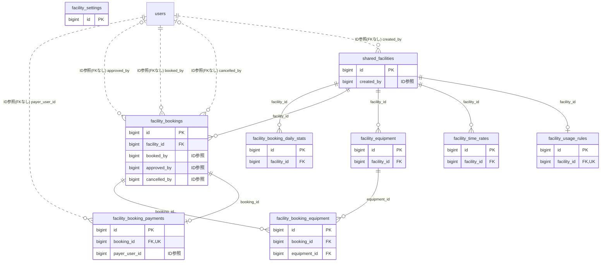

# facility ドメイン ER 図

> このファイルは自動生成されます。手で編集しないでください。再生成: `cd backend && ./gradlew generateErDiagrams`

- テーブル数: 9
- ビュー数: 0

## ER 図

実線 = 外部キー、点線 = ID参照(FKなし)。図中の `FK` は実外部キーの列だけ（ID参照列は `FK` を付けず "ID参照" と注記）。図にはキー列（PK / FK / 参照推定列 / 単一列 UNIQUE）のみを描く。全列は下の「テーブル定義」を参照。

## 被参照（他ドメインから）

このドメインのテーブルを参照している他ドメインの側（実 FK と ID参照のみ。多態参照と推定不能参照は含まない。同一ドメイン内の参照は上の図を参照）。

なし

## 多態参照（線を引かない）

| テーブル | 種別列 | ID列 |
| --- | --- | --- |
| `facility_booking_daily_stats` | `scope_type` | `scope_id` |
| `facility_settings` | `scope_type` | `scope_id` |
| `shared_facilities` | `scope_type` | `scope_id` |

## 推定不能参照

| テーブル | 列 | 理由 |
| --- | --- | --- |
| `facility_booking_payments` | `stripe_payment_intent_id` | 参照先テーブルを特定できない |

## テーブル定義

### `facility_booking_daily_stats`

| 列名 | 型 | NULL | 既定値 | コメント |
| --- | --- | --- | --- | --- |
| `id` | `bigint unsigned` | NO | （なし） auto_increment |  |
| `scope_type` | `varchar(20)` | NO | （なし） |  |
| `scope_id` | `bigint unsigned` | NO | （なし） |  |
| `facility_id` | `bigint unsigned` | NO | （なし） |  |
| `stat_date` | `date` | NO | （なし） |  |
| `booking_count` | `int unsigned` | NO | `0` |  |
| `completed_count` | `int unsigned` | NO | `0` |  |
| `no_show_count` | `int unsigned` | NO | `0` |  |
| `cancelled_count` | `int unsigned` | NO | `0` |  |
| `revenue_total` | `decimal(10,0)` | NO | `0` |  |
| `revenue_stripe` | `decimal(10,0)` | NO | `0` |  |
| `revenue_direct` | `decimal(10,0)` | NO | `0` |  |
| `platform_fee_total` | `decimal(10,0)` | NO | `0` |  |
| `slot_count_booked` | `int unsigned` | NO | `0` |  |
| `slot_count_available` | `int unsigned` | NO | `0` |  |
| `stay_nights_total` | `int unsigned` | NO | `0` |  |
| `created_at` | `datetime` | NO | `CURRENT_TIMESTAMP` （式） |  |

### `facility_booking_equipment`

| 列名 | 型 | NULL | 既定値 | コメント |
| --- | --- | --- | --- | --- |
| `id` | `bigint unsigned` | NO | （なし） auto_increment |  |
| `booking_id` | `bigint unsigned` | NO | （なし） |  |
| `equipment_id` | `bigint unsigned` | NO | （なし） |  |
| `quantity` | `smallint unsigned` | NO | `1` |  |
| `unit_price` | `decimal(10,0)` | NO | `0` |  |
| `subtotal` | `decimal(10,0)` | NO | `0` |  |

### `facility_booking_payments`

| 列名 | 型 | NULL | 既定値 | コメント |
| --- | --- | --- | --- | --- |
| `id` | `bigint unsigned` | NO | （なし） auto_increment |  |
| `booking_id` | `bigint unsigned` | NO | （なし） |  |
| `payer_user_id` | `bigint unsigned` | NO | （なし） |  |
| `payment_method` | `enum('DIRECT','STRIPE')` | NO | `DIRECT` |  |
| `amount` | `decimal(10,0)` | NO | （なし） |  |
| `stripe_fee` | `decimal(10,0)` | YES | NULL |  |
| `platform_fee` | `decimal(10,0)` | YES | NULL |  |
| `platform_fee_rate` | `decimal(5,4)` | YES | NULL |  |
| `net_amount` | `decimal(10,0)` | YES | NULL |  |
| `stripe_payment_intent_id` | `varchar(100)` | YES | NULL |  |
| `status` | `enum('PENDING','SUCCEEDED','FAILED','REFUNDED')` | NO | `PENDING` |  |
| `failed_reason` | `varchar(500)` | YES | NULL |  |
| `paid_at` | `datetime` | YES | NULL |  |
| `refunded_at` | `datetime` | YES | NULL |  |
| `created_at` | `datetime` | NO | `CURRENT_TIMESTAMP` （式） |  |
| `updated_at` | `datetime` | NO | `CURRENT_TIMESTAMP` （式） |  |

### `facility_bookings`

| 列名 | 型 | NULL | 既定値 | コメント |
| --- | --- | --- | --- | --- |
| `id` | `bigint unsigned` | NO | （なし） auto_increment |  |
| `facility_id` | `bigint unsigned` | NO | （なし） |  |
| `booked_by` | `bigint unsigned` | NO | （なし） |  |
| `created_by_admin` | `bigint unsigned` | YES | NULL |  |
| `booking_date` | `date` | NO | （なし） |  |
| `check_out_date` | `date` | YES | NULL |  |
| `stay_nights` | `smallint unsigned` | NO | `0` |  |
| `time_from` | `time` | NO | （なし） |  |
| `time_to` | `time` | NO | （なし） |  |
| `slot_count` | `smallint unsigned` | NO | （なし） |  |
| `purpose` | `varchar(500)` | YES | NULL |  |
| `attendee_count` | `smallint unsigned` | YES | NULL |  |
| `usage_fee` | `decimal(10,0)` | NO | `0` |  |
| `equipment_fee` | `decimal(10,0)` | NO | `0` |  |
| `total_fee` | `decimal(10,0)` | NO | `0` |  |
| `status` | `enum('PENDING_APPROVAL','CONFIRMED','CHECKED_IN','COMPLETED','CANCELLED','REJECTED','NO_SHOW')` | NO | `PENDING_APPROVAL` |  |
| `admin_comment` | `varchar(500)` | YES | NULL |  |
| `approved_by` | `bigint unsigned` | YES | NULL |  |
| `approved_at` | `datetime` | YES | NULL |  |
| `checked_in_at` | `datetime` | YES | NULL |  |
| `completed_at` | `datetime` | YES | NULL |  |
| `cancelled_at` | `datetime` | YES | NULL |  |
| `cancelled_by` | `bigint unsigned` | YES | NULL |  |
| `cancellation_reason` | `varchar(500)` | YES | NULL |  |
| `created_at` | `datetime` | NO | `CURRENT_TIMESTAMP` （式） |  |
| `updated_at` | `datetime` | NO | `CURRENT_TIMESTAMP` （式） |  |

### `facility_equipment`

| 列名 | 型 | NULL | 既定値 | コメント |
| --- | --- | --- | --- | --- |
| `id` | `bigint unsigned` | NO | （なし） auto_increment |  |
| `facility_id` | `bigint unsigned` | NO | （なし） |  |
| `name` | `varchar(100)` | NO | （なし） |  |
| `description` | `varchar(500)` | YES | NULL |  |
| `total_quantity` | `smallint unsigned` | NO | `1` |  |
| `price_per_use` | `decimal(10,0)` | YES | NULL |  |
| `is_available` | `tinyint(1)` | NO | `1` |  |
| `display_order` | `smallint unsigned` | NO | `0` |  |
| `created_at` | `datetime` | NO | `CURRENT_TIMESTAMP` （式） |  |
| `updated_at` | `datetime` | NO | `CURRENT_TIMESTAMP` （式） |  |
| `deleted_at` | `datetime` | YES | NULL |  |

### `facility_settings`

| 列名 | 型 | NULL | 既定値 | コメント |
| --- | --- | --- | --- | --- |
| `id` | `bigint unsigned` | NO | （なし） auto_increment |  |
| `scope_type` | `varchar(20)` | NO | （なし） |  |
| `scope_id` | `bigint unsigned` | NO | （なし） |  |
| `requires_approval` | `tinyint(1)` | NO | `1` |  |
| `max_bookings_per_day_per_user` | `smallint unsigned` | NO | `2` |  |
| `allow_stripe_payment` | `tinyint(1)` | NO | `0` |  |
| `cancellation_deadline_hours` | `smallint unsigned` | NO | `24` |  |
| `no_show_penalty_enabled` | `tinyint(1)` | NO | `0` |  |
| `no_show_penalty_threshold` | `smallint unsigned` | NO | `3` |  |
| `no_show_penalty_days` | `smallint unsigned` | NO | `30` |  |
| `created_at` | `datetime` | NO | `CURRENT_TIMESTAMP` （式） |  |
| `updated_at` | `datetime` | NO | `CURRENT_TIMESTAMP` （式） |  |

### `facility_time_rates`

| 列名 | 型 | NULL | 既定値 | コメント |
| --- | --- | --- | --- | --- |
| `id` | `bigint unsigned` | NO | （なし） auto_increment |  |
| `facility_id` | `bigint unsigned` | NO | （なし） |  |
| `day_type` | `enum('WEEKDAY','WEEKEND','HOLIDAY')` | NO | （なし） |  |
| `time_from` | `time` | NO | （なし） |  |
| `time_to` | `time` | NO | （なし） |  |
| `rate_per_slot` | `decimal(10,0)` | NO | （なし） |  |
| `created_at` | `datetime` | NO | `CURRENT_TIMESTAMP` （式） |  |
| `updated_at` | `datetime` | NO | `CURRENT_TIMESTAMP` （式） |  |

### `facility_usage_rules`

| 列名 | 型 | NULL | 既定値 | コメント |
| --- | --- | --- | --- | --- |
| `id` | `bigint unsigned` | NO | （なし） auto_increment |  |
| `facility_id` | `bigint unsigned` | NO | （なし） |  |
| `max_hours_per_booking` | `decimal(3,1)` | NO | `4.0` |  |
| `min_hours_per_booking` | `decimal(3,1)` | NO | `0.5` |  |
| `max_bookings_per_month_per_user` | `smallint unsigned` | NO | `4` |  |
| `max_consecutive_slots` | `smallint unsigned` | NO | `8` |  |
| `min_advance_hours` | `smallint unsigned` | NO | `1` |  |
| `max_advance_days` | `smallint unsigned` | NO | `30` |  |
| `max_stay_nights` | `smallint unsigned` | NO | `0` |  |
| `cancellation_deadline_hours` | `smallint unsigned` | YES | NULL |  |
| `available_time_from` | `time` | NO | `09:00:00` |  |
| `available_time_to` | `time` | NO | `22:00:00` |  |
| `available_days_of_week` | `json` | NO | `json_array(0,1,2,3,4,5,6)` （式） |  |
| `blackout_dates` | `json` | YES | NULL |  |
| `notes` | `varchar(500)` | YES | NULL |  |
| `created_at` | `datetime` | NO | `CURRENT_TIMESTAMP` （式） |  |
| `updated_at` | `datetime` | NO | `CURRENT_TIMESTAMP` （式） |  |

### `shared_facilities`

| 列名 | 型 | NULL | 既定値 | コメント |
| --- | --- | --- | --- | --- |
| `id` | `bigint unsigned` | NO | （なし） auto_increment |  |
| `scope_type` | `varchar(20)` | NO | （なし） |  |
| `scope_id` | `bigint unsigned` | NO | （なし） |  |
| `name` | `varchar(100)` | NO | （なし） |  |
| `facility_type` | `enum('GUEST_ROOM','MEETING_ROOM','PARTY_ROOM','BBQ_AREA','MULTIPURPOSE_HALL','KIDS_ROOM','FITNESS_ROOM','LAUNDRY_ROOM','STUDY_ROOM','MUSIC_ROOM','ROOFTOP','OTHER')` | NO | （なし） |  |
| `facility_type_label` | `varchar(50)` | YES | NULL |  |
| `capacity` | `smallint unsigned` | NO | （なし） |  |
| `floor` | `varchar(10)` | YES | NULL |  |
| `location_detail` | `varchar(200)` | YES | NULL |  |
| `description` | `text` | YES | NULL |  |
| `image_urls` | `json` | YES | NULL |  |
| `rate_per_slot` | `decimal(10,0)` | YES | NULL |  |
| `rate_per_night` | `decimal(10,0)` | YES | NULL |  |
| `check_in_time` | `time` | YES | NULL |  |
| `check_out_time` | `time` | YES | NULL |  |
| `cleaning_buffer_minutes` | `smallint unsigned` | NO | `0` |  |
| `auto_approve` | `tinyint(1)` | NO | `0` |  |
| `is_active` | `tinyint(1)` | NO | `1` |  |
| `display_order` | `smallint unsigned` | NO | `0` |  |
| `created_by` | `bigint unsigned` | NO | （なし） |  |
| `created_at` | `datetime` | NO | `CURRENT_TIMESTAMP` （式） |  |
| `updated_at` | `datetime` | NO | `CURRENT_TIMESTAMP` （式） |  |
| `deleted_at` | `datetime` | YES | NULL |  |
