# family ドメイン ER 図

> このファイルは自動生成されます。手で編集しないでください。再生成: `cd backend && ./gradlew generateErDiagrams`

- テーブル数: 11
- ビュー数: 0

## ER 図

実線 = 外部キー、点線 = ID参照(FKなし)。図中の `FK` は実外部キーの列だけ（ID参照列は `FK` を付けず "ID参照" と注記）。図にはキー列（PK / FK / 参照推定列 / 単一列 UNIQUE）のみを描く。全列は下の「テーブル定義」を参照。

```mermaid
erDiagram
    coin_toss_results {
        bigint id PK
        bigint team_id "ID参照"
        bigint user_id "ID参照"
    }
    duty_rotations {
        bigint id PK
        bigint team_id "ID参照"
        bigint created_by "ID参照"
    }
    presence_events {
        bigint id PK
        bigint team_id "ID参照"
        bigint user_id "ID参照"
    }
    shopping_list_items {
        bigint id PK
        bigint list_id FK
        bigint checked_by "ID参照"
        bigint created_by "ID参照"
    }
    shopping_lists {
        bigint id PK
        bigint team_id "ID参照"
        bigint created_by "ID参照"
    }
    team_anniversaries {
        bigint id PK
        bigint team_id "ID参照"
        bigint created_by "ID参照"
    }
    team_care_notification_overrides {
        bigint id PK
        bigint care_link_id FK
        bigint created_by "ID参照"
    }
    team_presence_icons {
        bigint id PK
        bigint team_id "ID参照"
        bigint updated_by "ID参照"
    }
    team_role_aliases {
        bigint id PK
        bigint team_id "ID参照"
        bigint updated_by "ID参照"
    }
    template_wallpapers {
        bigint id PK
    }
    user_care_links {
        bigint id PK
        bigint care_recipient_user_id "ID参照"
        bigint watcher_user_id "ID参照"
        bigint created_by "ID参照"
        bigint revoked_by "ID参照"
    }
    teams
    users
    teams ||..o{ coin_toss_results : "ID参照(FKなし) team_id"
    users ||..o{ coin_toss_results : "ID参照(FKなし) user_id"
    teams ||..o{ duty_rotations : "ID参照(FKなし) team_id"
    users ||..o{ duty_rotations : "ID参照(FKなし) created_by"
    teams ||..o{ presence_events : "ID参照(FKなし) team_id"
    users ||..o{ presence_events : "ID参照(FKなし) user_id"
    shopping_lists ||--o{ shopping_list_items : "list_id"
    users |o..o{ shopping_list_items : "ID参照(FKなし) checked_by"
    users ||..o{ shopping_list_items : "ID参照(FKなし) created_by"
    teams ||..o{ shopping_lists : "ID参照(FKなし) team_id"
    users ||..o{ shopping_lists : "ID参照(FKなし) created_by"
    teams ||..o{ team_anniversaries : "ID参照(FKなし) team_id"
    users ||..o{ team_anniversaries : "ID参照(FKなし) created_by"
    user_care_links ||--o{ team_care_notification_overrides : "care_link_id"
    users ||..o{ team_care_notification_overrides : "ID参照(FKなし) created_by"
    teams ||..o{ team_presence_icons : "ID参照(FKなし) team_id"
    users ||..o{ team_presence_icons : "ID参照(FKなし) updated_by"
    teams ||..o{ team_role_aliases : "ID参照(FKなし) team_id"
    users ||..o{ team_role_aliases : "ID参照(FKなし) updated_by"
    users ||..o{ user_care_links : "ID参照(FKなし) care_recipient_user_id"
    users ||..o{ user_care_links : "ID参照(FKなし) created_by"
    users |o..o{ user_care_links : "ID参照(FKなし) revoked_by"
    users ||..o{ user_care_links : "ID参照(FKなし) watcher_user_id"
```

## 被参照（他ドメインから）

このドメインのテーブルを参照している他ドメインの側（実 FK と ID参照のみ。多態参照と推定不能参照は含まない。同一ドメイン内の参照は上の図を参照）。

なし

## 多態参照（線を引かない）

| テーブル | 種別列 | ID列 |
| --- | --- | --- |
| `team_care_notification_overrides` | `scope_type` | `scope_id` |

## テーブル定義

### `coin_toss_results`

| 列名 | 型 | NULL | 既定値 | コメント |
| --- | --- | --- | --- | --- |
| `id` | `bigint unsigned` | NO | （なし） auto_increment |  |
| `team_id` | `bigint unsigned` | NO | （なし） |  |
| `user_id` | `bigint unsigned` | NO | （なし） |  |
| `mode` | `varchar(20)` | NO | `COIN` | COIN / CUSTOM |
| `options` | `json` | NO | （なし） | 選択肢の配列 |
| `result_index` | `tinyint` | NO | （なし） | 当選した選択肢のインデックス（0-based） |
| `question` | `varchar(200)` | YES | NULL | 質問文 |
| `shared_to_chat` | `tinyint(1)` | NO | `0` |  |
| `created_at` | `datetime` | NO | `CURRENT_TIMESTAMP` （式） |  |

### `duty_rotations`

| 列名 | 型 | NULL | 既定値 | コメント |
| --- | --- | --- | --- | --- |
| `id` | `bigint unsigned` | NO | （なし） auto_increment |  |
| `team_id` | `bigint unsigned` | NO | （なし） |  |
| `duty_name` | `varchar(100)` | NO | （なし） | 当番名 |
| `rotation_type` | `varchar(20)` | NO | `DAILY` | DAILY / WEEKLY |
| `member_order` | `json` | NO | （なし） | ローテーション順のメンバーID配列 |
| `start_date` | `date` | NO | （なし） | ローテーション開始日 |
| `icon` | `varchar(10)` | YES | NULL | 表示アイコン（絵文字） |
| `is_enabled` | `tinyint(1)` | NO | `1` |  |
| `created_by` | `bigint unsigned` | NO | （なし） |  |
| `deleted_at` | `datetime` | YES | NULL |  |
| `created_at` | `datetime` | NO | `CURRENT_TIMESTAMP` （式） |  |
| `updated_at` | `datetime` | NO | `CURRENT_TIMESTAMP` （式） |  |

### `presence_events`

| 列名 | 型 | NULL | 既定値 | コメント |
| --- | --- | --- | --- | --- |
| `id` | `bigint unsigned` | NO | （なし） auto_increment |  |
| `team_id` | `bigint unsigned` | NO | （なし） |  |
| `user_id` | `bigint unsigned` | NO | （なし） |  |
| `event_type` | `varchar(20)` | NO | （なし） | HOME / GOING_OUT |
| `message` | `varchar(100)` | YES | NULL | ひとことメッセージ |
| `destination` | `varchar(200)` | YES | NULL | お出かけ先（GOING_OUT時のみ） |
| `expected_return_at` | `datetime` | YES | NULL | 帰宅予定時刻（GOING_OUT時のみ） |
| `returned_at` | `datetime` | YES | NULL | 実際の帰宅時刻 |
| `overdue_level` | `tinyint` | NO | `0` | 遅延通知段階 0=未通知,1=15分超過,2=1時間超過 |
| `created_at` | `datetime` | NO | `CURRENT_TIMESTAMP` （式） |  |

### `shopping_list_items`

| 列名 | 型 | NULL | 既定値 | コメント |
| --- | --- | --- | --- | --- |
| `id` | `bigint unsigned` | NO | （なし） auto_increment |  |
| `list_id` | `bigint unsigned` | NO | （なし） |  |
| `name` | `varchar(200)` | NO | （なし） | アイテム名 |
| `quantity` | `varchar(50)` | YES | NULL | 数量（自由記述） |
| `note` | `varchar(500)` | YES | NULL | メモ |
| `assigned_to` | `bigint unsigned` | YES | NULL | 担当メンバー |
| `is_checked` | `tinyint(1)` | NO | `0` |  |
| `checked_by` | `bigint unsigned` | YES | NULL |  |
| `checked_at` | `datetime` | YES | NULL |  |
| `sort_order` | `int` | NO | `0` |  |
| `created_by` | `bigint unsigned` | NO | （なし） |  |
| `created_at` | `datetime` | NO | `CURRENT_TIMESTAMP` （式） |  |
| `updated_at` | `datetime` | NO | `CURRENT_TIMESTAMP` （式） |  |

### `shopping_lists`

| 列名 | 型 | NULL | 既定値 | コメント |
| --- | --- | --- | --- | --- |
| `id` | `bigint unsigned` | NO | （なし） auto_increment |  |
| `team_id` | `bigint unsigned` | NO | （なし） |  |
| `name` | `varchar(100)` | NO | （なし） | リスト名 |
| `is_template` | `tinyint(1)` | NO | `0` | テンプレートリスト |
| `status` | `varchar(20)` | NO | `ACTIVE` | ACTIVE / ARCHIVED |
| `created_by` | `bigint unsigned` | NO | （なし） |  |
| `deleted_at` | `datetime` | YES | NULL |  |
| `created_at` | `datetime` | NO | `CURRENT_TIMESTAMP` （式） |  |
| `updated_at` | `datetime` | NO | `CURRENT_TIMESTAMP` （式） |  |

### `team_anniversaries`

| 列名 | 型 | NULL | 既定値 | コメント |
| --- | --- | --- | --- | --- |
| `id` | `bigint unsigned` | NO | （なし） auto_increment |  |
| `team_id` | `bigint unsigned` | NO | （なし） |  |
| `name` | `varchar(200)` | NO | （なし） | 記念日名 |
| `date` | `date` | NO | （なし） | 記念日の日付 |
| `repeat_annually` | `tinyint(1)` | NO | `1` |  |
| `notify_days_before` | `tinyint` | NO | `1` | 何日前に事前通知するか |
| `created_by` | `bigint unsigned` | NO | （なし） |  |
| `deleted_at` | `datetime` | YES | NULL |  |
| `created_at` | `datetime` | NO | `CURRENT_TIMESTAMP` （式） |  |

### `team_care_notification_overrides`

| 列名 | 型 | NULL | 既定値 | コメント |
| --- | --- | --- | --- | --- |
| `id` | `bigint unsigned` | NO | （なし） auto_increment |  |
| `scope_type` | `enum('TEAM','ORGANIZATION')` | NO | （なし） | スコープ種別 |
| `scope_id` | `bigint unsigned` | NO | （なし） | チームIDまたは組織ID |
| `care_link_id` | `bigint unsigned` | NO | （なし） | FK → user_care_links.id |
| `notify_on_rsvp` | `tinyint(1)` | YES | NULL | NULL=デフォルト使用、TRUE/FALSE=上書き |
| `notify_on_checkin` | `tinyint(1)` | YES | NULL | 同上 |
| `notify_on_checkout` | `tinyint(1)` | YES | NULL | 同上 |
| `notify_on_absent_alert` | `tinyint(1)` | YES | NULL | 同上 |
| `notify_on_dismissal` | `tinyint(1)` | YES | NULL | 同上 |
| `disabled` | `tinyint(1)` | NO | `0` | TRUE=このチームでの通知を完全停止 |
| `created_by` | `bigint unsigned` | NO | （なし） | FK → users.id |
| `created_at` | `datetime` | NO | `CURRENT_TIMESTAMP` （式） |  |
| `updated_at` | `datetime` | NO | `CURRENT_TIMESTAMP` （式） |  |

### `team_presence_icons`

| 列名 | 型 | NULL | 既定値 | コメント |
| --- | --- | --- | --- | --- |
| `id` | `bigint unsigned` | NO | （なし） auto_increment |  |
| `team_id` | `bigint unsigned` | NO | （なし） |  |
| `event_type` | `varchar(20)` | NO | （なし） | HOME / GOING_OUT |
| `icon` | `varchar(10)` | NO | （なし） | カスタム絵文字 |
| `updated_by` | `bigint unsigned` | NO | （なし） |  |
| `created_at` | `datetime` | NO | `CURRENT_TIMESTAMP` （式） |  |
| `updated_at` | `datetime` | NO | `CURRENT_TIMESTAMP` （式） |  |

### `team_role_aliases`

| 列名 | 型 | NULL | 既定値 | コメント |
| --- | --- | --- | --- | --- |
| `id` | `bigint unsigned` | NO | （なし） auto_increment |  |
| `team_id` | `bigint unsigned` | NO | （なし） |  |
| `role_name` | `varchar(30)` | NO | （なし） | 対象ロール（ADMIN/DEPUTY_ADMIN/MEMBER/SUPPORTER） |
| `display_alias` | `varchar(50)` | NO | （なし） | 表示名（例: ボス、監督） |
| `updated_by` | `bigint unsigned` | NO | （なし） |  |
| `created_at` | `datetime` | NO | `CURRENT_TIMESTAMP` （式） |  |
| `updated_at` | `datetime` | NO | `CURRENT_TIMESTAMP` （式） |  |

### `template_wallpapers`

| 列名 | 型 | NULL | 既定値 | コメント |
| --- | --- | --- | --- | --- |
| `id` | `bigint unsigned` | NO | （なし） auto_increment |  |
| `template_slug` | `varchar(50)` | NO | （なし） | テンプレート識別子（* = 全テンプレート共通） |
| `name` | `varchar(100)` | NO | （なし） | 壁紙名 |
| `image_url` | `varchar(500)` | NO | （なし） | S3画像URL |
| `thumbnail_url` | `varchar(500)` | NO | （なし） | サムネイルURL |
| `category` | `varchar(50)` | NO | `DEFAULT` | DEFAULT / SEASONAL / FUN |
| `sort_order` | `int` | NO | `0` |  |
| `is_active` | `tinyint(1)` | NO | `1` |  |
| `created_at` | `datetime` | NO | `CURRENT_TIMESTAMP` （式） |  |
| `updated_at` | `datetime` | NO | `CURRENT_TIMESTAMP` （式） |  |

### `user_care_links`

| 列名 | 型 | NULL | 既定値 | コメント |
| --- | --- | --- | --- | --- |
| `id` | `bigint unsigned` | NO | （なし） auto_increment |  |
| `care_recipient_user_id` | `bigint unsigned` | NO | （なし） | FK → users.id（ケア対象本人） |
| `watcher_user_id` | `bigint unsigned` | NO | （なし） | FK → users.id（見守り者） |
| `care_category` | `enum('MINOR','ELDERLY','DISABILITY_SUPPORT','GENERAL_FAMILY')` | NO | （なし） | このリンクのケア区分 |
| `relationship` | `enum('PARENT','CHILD','SPOUSE','GRANDPARENT','GRANDCHILD','SIBLING','LEGAL_GUARDIAN','CARETAKER','OTHER')` | NO | `PARENT` | 続柄 |
| `is_primary` | `tinyint(1)` | NO | `1` | 主見守り者フラグ（緊急時優先順） |
| `status` | `enum('PENDING','ACTIVE','REJECTED','REVOKED')` | NO | `PENDING` | リンク状態 |
| `invited_by` | `enum('CARE_RECIPIENT','WATCHER','ADMIN','SYSTEM')` | NO | （なし） | 招待元 |
| `invitation_token` | `varchar(64)` | YES | NULL | 承認用トークン（メール招待時） |
| `invitation_sent_at` | `datetime` | YES | NULL | 招待送信日時 |
| `confirmed_at` | `datetime` | YES | NULL | 承認日時（status=ACTIVE になった時刻） |
| `notify_on_rsvp` | `tinyint(1)` | NO | `1` | RSVP確認時通知 |
| `notify_on_checkin` | `tinyint(1)` | NO | `1` | チェックイン時通知 |
| `notify_on_checkout` | `tinyint(1)` | NO | `0` | チェックアウト時通知 |
| `notify_on_absent_alert` | `tinyint(1)` | NO | `1` | 不在アラート通知 |
| `notify_on_dismissal` | `tinyint(1)` | NO | `1` | 解散通知 |
| `created_by` | `bigint unsigned` | NO | （なし） | FK → users.id（作成者） |
| `created_at` | `datetime` | NO | `CURRENT_TIMESTAMP` （式） |  |
| `updated_at` | `datetime` | NO | `CURRENT_TIMESTAMP` （式） |  |
| `revoked_at` | `datetime` | YES | NULL | 解除日時 |
| `revoked_by` | `bigint unsigned` | YES | NULL | 解除実行者 users.id |
