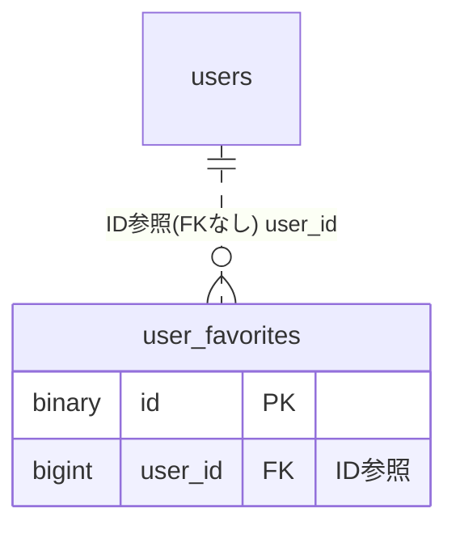

# favorite ドメイン ER 図

> このファイルは自動生成されます。手で編集しないでください。再生成: `cd backend && ./gradlew generateErDiagrams`

- テーブル数: 1
- ビュー数: 0

## ER 図

実線 = 外部キー、点線 = ID参照(FKなし)。図にはキー列（PK / FK / 参照推定列 / 単一列 UNIQUE）のみを描く。全列は下の「テーブル定義」を参照。

## 多態参照（線を引かない）

| テーブル | 種別列 | ID列 |
| --- | --- | --- |
| `user_favorites` | `entity_type` | `entity_id` |

## テーブル定義

### `user_favorites`

| 列名 | 型 | NULL | 既定値 | コメント |
| --- | --- | --- | --- | --- |
| `id` | `binary(16)` | NO | （なし） | UUIDv7 PK |
| `user_id` | `bigint unsigned` | NO | （なし） | お気に入り登録者（FK 張らない / 退会時バッチ削除） |
| `entity_type` | `varchar(50)` | NO | （なし） | TEAM \| ORGANIZATION \| KB_PAGE \| BLOG_AUTHOR \| VILLAGE |
| `entity_id` | `varchar(36)` | NO | （なし） | エンティティID（BIGINT は十進数文字列 "123"、UUID は36文字ハイフン付き "018f-..."） |
| `display_order` | `smallint unsigned` | NO | `0` | 表示順（低い値が先頭） |
| `created_at` | `datetime` | NO | `CURRENT_TIMESTAMP` （式） |  |
