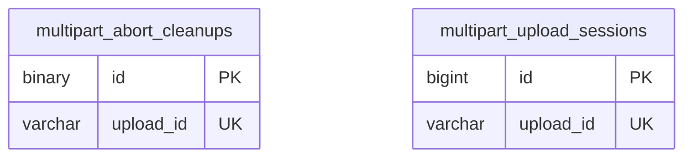

# files ドメイン ER 図

> このファイルは自動生成されます。手で編集しないでください。再生成: `cd backend && ./gradlew generateErDiagrams`

- テーブル数: 2
- ビュー数: 0

## ER 図

実線 = 外部キー、点線 = ID参照(FKなし)。図中の `FK` は実外部キーの列だけ（ID参照列は `FK` を付けず "ID参照" と注記）。図にはキー列（PK / FK / 参照推定列 / 単一列 UNIQUE）のみを描く。全列は下の「テーブル定義」を参照。

## 被参照（他ドメインから）

このドメインのテーブルを参照している他ドメインの側（実 FK と ID参照のみ。多態参照と推定不能参照は含まない。同一ドメイン内の参照は上の図を参照）。

なし

## 多態参照（線を引かない）

| テーブル | 種別列 | ID列 |
| --- | --- | --- |
| `multipart_abort_cleanups` | `scope_type` | `scope_id` |
| `multipart_upload_sessions` | `scope_type` | `scope_id` |

## 推定不能参照

| テーブル | 列 | 理由 |
| --- | --- | --- |
| `multipart_abort_cleanups` | `owner_id` | 参照先テーブルを特定できない |
| `multipart_abort_cleanups` | `upload_id` | 参照先テーブルを特定できない |
| `multipart_upload_sessions` | `upload_id` | 参照先テーブルを特定できない |
| `multipart_upload_sessions` | `uploader_id` | 参照先テーブルを特定できない |

## テーブル定義

### `multipart_abort_cleanups`

| 列名 | 型 | NULL | 既定値 | コメント |
| --- | --- | --- | --- | --- |
| `id` | `binary(16)` | NO | （なし） |  |
| `upload_id` | `varchar(255)` | NO | （なし） |  |
| `r2_key` | `varchar(500)` | NO | （なし） |  |
| `owner_id` | `bigint unsigned` | NO | （なし） |  |
| `content_type` | `varchar(100)` | NO | （なし） |  |
| `feature` | `varchar(30)` | NO | （なし） |  |
| `scope_type` | `varchar(20)` | NO | （なし） |  |
| `scope_id` | `bigint unsigned` | NO | （なし） |  |
| `status` | `varchar(20)` | NO | （なし） |  |
| `next_attempt_at` | `datetime` | NO | （なし） |  |
| `attempt_count` | `int` | NO | `0` |  |
| `claimed_at` | `datetime` | YES | NULL |  |
| `lease_until` | `datetime` | YES | NULL |  |
| `dead_lettered_at` | `datetime` | YES | NULL |  |
| `created_at` | `datetime` | NO | （なし） |  |
| `updated_at` | `datetime` | NO | （なし） |  |

### `multipart_upload_sessions`

| 列名 | 型 | NULL | 既定値 | コメント |
| --- | --- | --- | --- | --- |
| `id` | `bigint unsigned` | NO | （なし） auto_increment |  |
| `upload_id` | `varchar(255)` | NO | （なし） | R2/S3 Multipart Upload ID |
| `r2_key` | `varchar(500)` | NO | （なし） | アップロード先の R2 オブジェクトキー |
| `feature` | `varchar(30)` | NO | （なし） | 呼び出し元機能 (timeline/gallery/blog/files) |
| `scope_type` | `varchar(20)` | NO | （なし） | スコープ種別: PERSONAL/TEAM/ORGANIZATION |
| `scope_id` | `bigint unsigned` | NO | （なし） | スコープ ID（teams.id / organizations.id / users.id） |
| `uploader_id` | `bigint unsigned` | NO | （なし） | アップロードを開始したユーザーの ID |
| `content_type` | `varchar(100)` | NO | （なし） | アップロードファイルの MIME タイプ |
| `status` | `varchar(20)` | NO | `IN_PROGRESS` | セッション状態: IN_PROGRESS=アップロード中, COMPLETED=完了, ABORTED=中断 |
| `expires_at` | `datetime` | NO | （なし） | セッション有効期限（開始から24時間） |
| `created_at` | `datetime` | NO | `CURRENT_TIMESTAMP` （式） |  |
| `updated_at` | `datetime` | NO | `CURRENT_TIMESTAMP` （式） |  |
