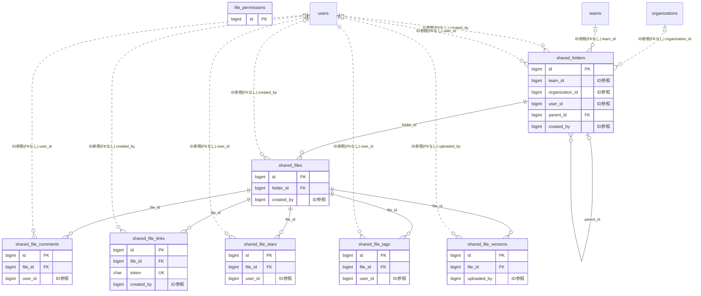

# filesharing ドメイン ER 図

> このファイルは自動生成されます。手で編集しないでください。再生成: `cd backend && ./gradlew generateErDiagrams`

- テーブル数: 8
- ビュー数: 0

## ER 図

実線 = 外部キー、点線 = ID参照(FKなし)。図中の `FK` は実外部キーの列だけ（ID参照列は `FK` を付けず "ID参照" と注記）。図にはキー列（PK / FK / 参照推定列 / 単一列 UNIQUE）のみを描く。全列は下の「テーブル定義」を参照。

## 被参照（他ドメインから）

このドメインのテーブルを参照している他ドメインの側（実 FK と ID参照のみ。多態参照と推定不能参照は含まない。同一ドメイン内の参照は上の図を参照）。

| 参照元ドメイン | 参照元テーブル | 列 | 種別 | 参照先テーブル |
| --- | --- | --- | --- | --- |
| [disclosure](disclosure.md) | `disclosure_exports` | `shared_file_id` | ID参照 | `shared_files` |
| [property](property.md) | `property_work_documents` | `shared_file_id` | ID参照 | `shared_files` |

## 自己参照

mermaid は同一テーブルの自己参照を複数描けず 1 本に畳むため、図に線が欠けることがある。自己参照はこの表を正とする。

| テーブル | 列 | 種別 |
| --- | --- | --- |
| `shared_folders` | `parent_id` | 外部キー |

## 多態参照（線を引かない）

| テーブル | 種別列 | ID列 |
| --- | --- | --- |
| `file_permissions` | `permission_target_type` | `permission_target_id` |
| `file_permissions` | `target_type` | `target_id` |

## 推定不能参照

| テーブル | 列 | 理由 |
| --- | --- | --- |
| `shared_folders` | `scope_ref_id` | 参照先テーブルを特定できない |

## テーブル定義

### `file_permissions`

| 列名 | 型 | NULL | 既定値 | コメント |
| --- | --- | --- | --- | --- |
| `id` | `bigint unsigned` | NO | （なし） auto_increment |  |
| `target_type` | `varchar(10)` | NO | （なし） |  |
| `target_id` | `bigint unsigned` | NO | （なし） |  |
| `permission_type` | `varchar(10)` | NO | （なし） |  |
| `permission_target_type` | `varchar(10)` | NO | （なし） |  |
| `permission_target_id` | `bigint unsigned` | NO | （なし） |  |
| `created_at` | `datetime(6)` | NO | （なし） |  |

### `shared_file_comments`

| 列名 | 型 | NULL | 既定値 | コメント |
| --- | --- | --- | --- | --- |
| `id` | `bigint unsigned` | NO | （なし） auto_increment |  |
| `file_id` | `bigint unsigned` | NO | （なし） |  |
| `user_id` | `bigint unsigned` | YES | NULL |  |
| `body` | `varchar(2000)` | NO | （なし） |  |
| `created_at` | `datetime(6)` | NO | （なし） |  |
| `updated_at` | `datetime(6)` | NO | （なし） |  |
| `deleted_at` | `datetime(6)` | YES | NULL |  |

### `shared_file_links`

| 列名 | 型 | NULL | 既定値 | コメント |
| --- | --- | --- | --- | --- |
| `id` | `bigint unsigned` | NO | （なし） auto_increment |  |
| `file_id` | `bigint unsigned` | NO | （なし） |  |
| `token` | `char(36)` | NO | （なし） |  |
| `expires_at` | `datetime(6)` | YES | NULL |  |
| `password_hash` | `varchar(255)` | YES | NULL |  |
| `access_count` | `int` | NO | `0` |  |
| `last_accessed_at` | `datetime(6)` | YES | NULL |  |
| `created_by` | `bigint unsigned` | YES | NULL |  |
| `created_at` | `datetime(6)` | NO | （なし） |  |
| `is_active` | `tinyint(1)` | NO | `1` | 手動失効フラグ(FALSE=失効) |
| `download_allowed` | `tinyint(1)` | NO | `0` | このリンクでDLを許すか。既定FALSE=閲覧のみ(C:download_disabledとAND評価) |

### `shared_file_stars`

| 列名 | 型 | NULL | 既定値 | コメント |
| --- | --- | --- | --- | --- |
| `id` | `bigint unsigned` | NO | （なし） auto_increment |  |
| `file_id` | `bigint unsigned` | NO | （なし） |  |
| `user_id` | `bigint unsigned` | NO | （なし） |  |
| `created_at` | `datetime(6)` | NO | （なし） |  |

### `shared_file_tags`

| 列名 | 型 | NULL | 既定値 | コメント |
| --- | --- | --- | --- | --- |
| `id` | `bigint unsigned` | NO | （なし） auto_increment |  |
| `file_id` | `bigint unsigned` | NO | （なし） |  |
| `tag_name` | `varchar(50)` | NO | （なし） |  |
| `user_id` | `bigint unsigned` | NO | （なし） |  |
| `created_at` | `datetime(6)` | NO | （なし） |  |

### `shared_file_versions`

| 列名 | 型 | NULL | 既定値 | コメント |
| --- | --- | --- | --- | --- |
| `id` | `bigint unsigned` | NO | （なし） auto_increment |  |
| `file_id` | `bigint unsigned` | NO | （なし） |  |
| `version_number` | `int` | NO | （なし） |  |
| `file_key` | `varchar(500)` | NO | （なし） |  |
| `file_size` | `bigint unsigned` | NO | （なし） |  |
| `content_type` | `varchar(100)` | NO | （なし） |  |
| `uploaded_by` | `bigint unsigned` | YES | NULL |  |
| `comment` | `varchar(500)` | YES | NULL |  |
| `created_at` | `datetime(6)` | NO | （なし） |  |

### `shared_files`

| 列名 | 型 | NULL | 既定値 | コメント |
| --- | --- | --- | --- | --- |
| `id` | `bigint unsigned` | NO | （なし） auto_increment |  |
| `folder_id` | `bigint unsigned` | NO | （なし） |  |
| `name` | `varchar(255)` | NO | （なし） |  |
| `file_key` | `varchar(500)` | NO | （なし） |  |
| `file_size` | `bigint unsigned` | NO | （なし） |  |
| `content_type` | `varchar(100)` | NO | （なし） |  |
| `description` | `varchar(500)` | YES | NULL |  |
| `created_by` | `bigint unsigned` | YES | NULL |  |
| `min_visible_role` | `varchar(24)` | YES | NULL | B: ファイル個別の最低可視ロール（NULL=フォルダ継承） |
| `download_disabled` | `tinyint(1)` | NO | `0` | C: ファイル個別の DL 禁止フラグ（実効禁止=フォルダ OR ファイル） |
| `current_version` | `int` | NO | `1` |  |
| `version` | `bigint unsigned` | NO | `0` |  |
| `created_at` | `datetime(6)` | NO | （なし） |  |
| `updated_at` | `datetime(6)` | NO | （なし） |  |
| `deleted_at` | `datetime(6)` | YES | NULL |  |

### `shared_folders`

| 列名 | 型 | NULL | 既定値 | コメント |
| --- | --- | --- | --- | --- |
| `id` | `bigint unsigned` | NO | （なし） auto_increment |  |
| `scope_type` | `varchar(20)` | NO | （なし） |  |
| `team_id` | `bigint unsigned` | YES | NULL |  |
| `organization_id` | `bigint unsigned` | YES | NULL |  |
| `user_id` | `bigint unsigned` | YES | NULL |  |
| `scope_ref_id` | `bigint unsigned` | YES | NULL | F08.7.1: 大会 ID / ディビジョン ID（TOURNAMENT(_DIVISION) スコープのみ。FK なし・原則1） |
| `parent_id` | `bigint unsigned` | YES | NULL |  |
| `name` | `varchar(255)` | NO | （なし） |  |
| `description` | `varchar(500)` | YES | NULL |  |
| `created_by` | `bigint unsigned` | YES | NULL |  |
| `min_visible_role` | `varchar(24)` | YES | NULL | B: 最低可視ロール（NULL=所属者全員可視。SUPPORTERS_AND_ABOVE/MEMBERS_AND_ABOVE/ADMINS_AND_ABOVE） |
| `download_disabled` | `tinyint(1)` | NO | `0` | C: DL 禁止フラグ（true=配下ファイルの DL URL 発行を拒否。禁止は単調・ファイルで解除不可） |
| `version` | `bigint unsigned` | NO | `0` |  |
| `created_at` | `datetime(6)` | NO | （なし） |  |
| `updated_at` | `datetime(6)` | NO | （なし） |  |
| `deleted_at` | `datetime(6)` | YES | NULL |  |
