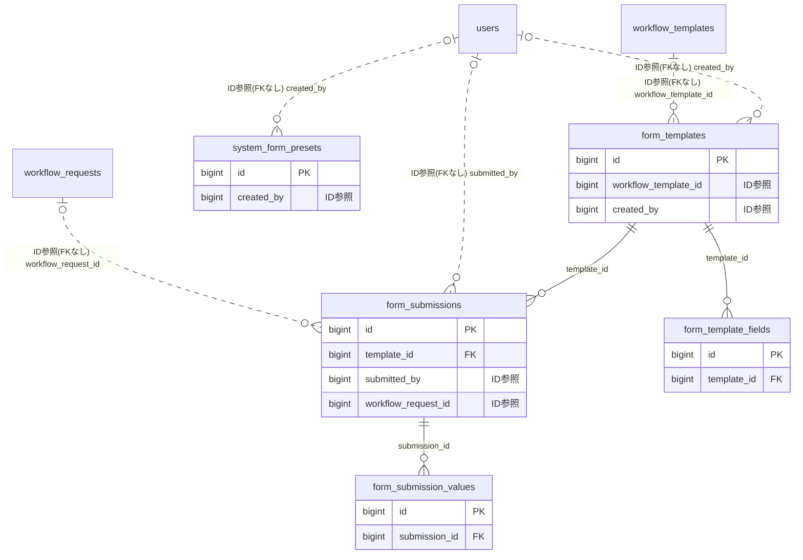

# forms ドメイン ER 図

> このファイルは自動生成されます。手で編集しないでください。再生成: `cd backend && ./gradlew generateErDiagrams`

- テーブル数: 5
- ビュー数: 0

## ER 図

実線 = 外部キー、点線 = ID参照(FKなし)。図中の `FK` は実外部キーの列だけ（ID参照列は `FK` を付けず "ID参照" と注記）。図にはキー列（PK / FK / 参照推定列 / 単一列 UNIQUE）のみを描く。全列は下の「テーブル定義」を参照。

## 被参照（他ドメインから）

このドメインのテーブルを参照している他ドメインの側（実 FK と ID参照のみ。多態参照と推定不能参照は含まない。同一ドメイン内の参照は上の図を参照）。

| 参照元ドメイン | 参照元テーブル | 列 | 種別 | 参照先テーブル |
| --- | --- | --- | --- | --- |
| [tournament](tournament.md) | `tournament_submission_requirement` | `form_template_id` | ID参照 | `form_templates` |

## 多態参照（線を引かない）

| テーブル | 種別列 | ID列 |
| --- | --- | --- |
| `form_submissions` | `scope_type` | `scope_id` |
| `form_templates` | `scope_type` | `scope_id` |

## 推定不能参照

| テーブル | 列 | 理由 |
| --- | --- | --- |
| `form_submissions` | `tournament_submission_requirement_id` | 参照先テーブルを特定できない |
| `form_templates` | `preset_id` | 参照先テーブルを特定できない |

## テーブル定義

### `form_submission_values`

| 列名 | 型 | NULL | 既定値 | コメント |
| --- | --- | --- | --- | --- |
| `id` | `bigint unsigned` | NO | （なし） auto_increment |  |
| `submission_id` | `bigint unsigned` | NO | （なし） |  |
| `field_key` | `varchar(50)` | NO | （なし） |  |
| `field_type` | `varchar(20)` | NO | （なし） |  |
| `text_value` | `text` | YES | NULL |  |
| `number_value` | `decimal(15,4)` | YES | NULL |  |
| `date_value` | `date` | YES | NULL |  |
| `file_key` | `varchar(500)` | YES | NULL |  |
| `is_auto_filled` | `tinyint(1)` | NO | `0` |  |
| `created_at` | `datetime` | NO | `CURRENT_TIMESTAMP` （式） |  |

### `form_submissions`

| 列名 | 型 | NULL | 既定値 | コメント |
| --- | --- | --- | --- | --- |
| `id` | `bigint unsigned` | NO | （なし） auto_increment |  |
| `template_id` | `bigint unsigned` | NO | （なし） |  |
| `scope_type` | `varchar(20)` | NO | （なし） |  |
| `scope_id` | `bigint unsigned` | NO | （なし） |  |
| `status` | `varchar(20)` | NO | `DRAFT` |  |
| `submitted_by` | `bigint unsigned` | YES | NULL |  |
| `workflow_request_id` | `bigint unsigned` | YES | NULL |  |
| `pdf_file_key` | `varchar(500)` | YES | NULL |  |
| `submission_count_for_user` | `int` | NO | `1` |  |
| `version` | `bigint unsigned` | NO | `0` |  |
| `created_at` | `datetime` | NO | `CURRENT_TIMESTAMP` （式） |  |
| `updated_at` | `datetime` | NO | `CURRENT_TIMESTAMP` （式） |  |
| `deleted_at` | `datetime` | YES | NULL |  |
| `tournament_submission_requirement_id` | `binary(16)` | YES | NULL | 大会提出枠への ID 参照（F08.7.1/06・FK なし／原則1） |

### `form_template_fields`

| 列名 | 型 | NULL | 既定値 | コメント |
| --- | --- | --- | --- | --- |
| `id` | `bigint unsigned` | NO | （なし） auto_increment |  |
| `template_id` | `bigint unsigned` | NO | （なし） |  |
| `field_key` | `varchar(50)` | NO | （なし） |  |
| `field_label` | `varchar(100)` | NO | （なし） |  |
| `field_type` | `varchar(20)` | NO | （なし） |  |
| `is_required` | `tinyint(1)` | NO | `0` |  |
| `sort_order` | `int` | NO | `0` |  |
| `auto_fill_key` | `varchar(50)` | YES | NULL |  |
| `options_json` | `json` | YES | NULL |  |
| `placeholder` | `varchar(200)` | YES | NULL |  |

### `form_templates`

| 列名 | 型 | NULL | 既定値 | コメント |
| --- | --- | --- | --- | --- |
| `id` | `bigint unsigned` | NO | （なし） auto_increment |  |
| `scope_type` | `varchar(20)` | NO | （なし） |  |
| `scope_id` | `bigint unsigned` | NO | （なし） |  |
| `name` | `varchar(100)` | NO | （なし） |  |
| `description` | `varchar(500)` | YES | NULL |  |
| `icon` | `varchar(50)` | YES | NULL |  |
| `color` | `varchar(7)` | YES | NULL |  |
| `status` | `varchar(20)` | NO | `DRAFT` |  |
| `requires_approval` | `tinyint(1)` | NO | `0` |  |
| `workflow_template_id` | `bigint unsigned` | YES | NULL |  |
| `is_seal_on_pdf` | `tinyint(1)` | NO | `0` |  |
| `deadline` | `datetime` | YES | NULL |  |
| `allow_edit_after_submit` | `tinyint(1)` | NO | `0` |  |
| `auto_fill_enabled` | `tinyint(1)` | NO | `0` |  |
| `max_submissions_per_user` | `int` | NO | `0` |  |
| `sort_order` | `int` | NO | `0` |  |
| `preset_id` | `bigint unsigned` | YES | NULL |  |
| `submission_count` | `int` | NO | `0` |  |
| `target_count` | `int` | NO | `0` |  |
| `created_by` | `bigint unsigned` | YES | NULL |  |
| `published_at` | `datetime` | YES | NULL |  |
| `closed_at` | `datetime` | YES | NULL |  |
| `version` | `bigint unsigned` | NO | `0` |  |
| `created_at` | `datetime` | NO | `CURRENT_TIMESTAMP` （式） |  |
| `updated_at` | `datetime` | NO | `CURRENT_TIMESTAMP` （式） |  |
| `deleted_at` | `datetime` | YES | NULL |  |

### `system_form_presets`

| 列名 | 型 | NULL | 既定値 | コメント |
| --- | --- | --- | --- | --- |
| `id` | `bigint unsigned` | NO | （なし） auto_increment |  |
| `name` | `varchar(100)` | NO | （なし） |  |
| `description` | `varchar(500)` | YES | NULL |  |
| `category` | `varchar(50)` | YES | NULL |  |
| `fields_json` | `json` | NO | （なし） |  |
| `icon` | `varchar(50)` | YES | NULL |  |
| `color` | `varchar(7)` | YES | NULL |  |
| `is_active` | `tinyint(1)` | NO | `1` |  |
| `created_by` | `bigint unsigned` | YES | NULL |  |
| `created_at` | `datetime` | NO | `CURRENT_TIMESTAMP` （式） |  |
| `updated_at` | `datetime` | NO | `CURRENT_TIMESTAMP` （式） |  |
| `deleted_at` | `datetime` | YES | NULL |  |
