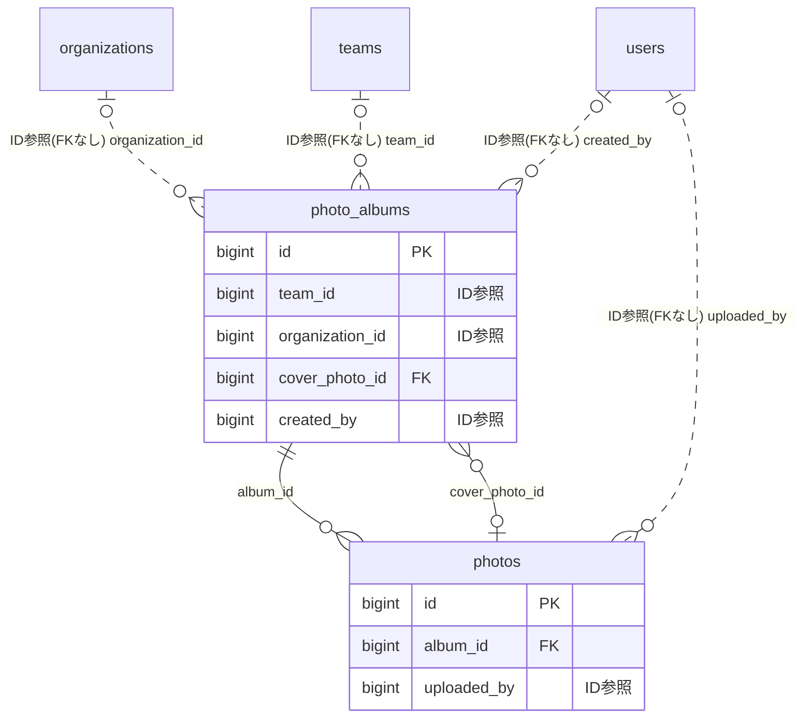

# gallery ドメイン ER 図

> このファイルは自動生成されます。手で編集しないでください。再生成: `cd backend && ./gradlew generateErDiagrams`

- テーブル数: 2
- ビュー数: 0

## ER 図

実線 = 外部キー、点線 = ID参照(FKなし)。図中の `FK` は実外部キーの列だけ（ID参照列は `FK` を付けず "ID参照" と注記）。図にはキー列（PK / FK / 参照推定列 / 単一列 UNIQUE）のみを描く。全列は下の「テーブル定義」を参照。

## 被参照（他ドメインから）

このドメインのテーブルを参照している他ドメインの側（実 FK と ID参照のみ。多態参照と推定不能参照は含まない。同一ドメイン内の参照は上の図を参照）。

なし

## テーブル定義

### `photo_albums`

| 列名 | 型 | NULL | 既定値 | コメント |
| --- | --- | --- | --- | --- |
| `id` | `bigint unsigned` | NO | （なし） auto_increment |  |
| `team_id` | `bigint unsigned` | YES | NULL |  |
| `organization_id` | `bigint unsigned` | YES | NULL |  |
| `title` | `varchar(200)` | NO | （なし） |  |
| `description` | `varchar(500)` | YES | NULL |  |
| `cover_photo_id` | `bigint unsigned` | YES | NULL |  |
| `event_date` | `date` | YES | NULL |  |
| `visibility` | `enum('ALL_MEMBERS','SUPPORTERS_AND_ABOVE','ADMIN_ONLY')` | NO | `ALL_MEMBERS` |  |
| `allow_member_upload` | `tinyint(1)` | NO | `0` |  |
| `allow_download` | `tinyint(1)` | NO | `1` |  |
| `photo_count` | `int unsigned` | NO | `0` |  |
| `created_by` | `bigint unsigned` | YES | NULL |  |
| `created_at` | `datetime` | NO | `CURRENT_TIMESTAMP` （式） |  |
| `updated_at` | `datetime` | NO | `CURRENT_TIMESTAMP` （式） |  |
| `deleted_at` | `datetime` | YES | NULL |  |

### `photos`

| 列名 | 型 | NULL | 既定値 | コメント |
| --- | --- | --- | --- | --- |
| `id` | `bigint unsigned` | NO | （なし） auto_increment |  |
| `album_id` | `bigint unsigned` | NO | （なし） |  |
| `r2_key` | `varchar(500)` | NO | （なし） |  |
| `media_type` | `enum('PHOTO','VIDEO')` | NO | `PHOTO` | メディア種別: PHOTO=静止画, VIDEO=動画。既存レコードはすべて PHOTO |
| `duration_seconds` | `int unsigned` | YES | NULL | 動画の再生時間（秒）。VIDEO のみ。Cloudflare Workers がメタデータ抽出時に格納 |
| `video_codec` | `varchar(30)` | YES | NULL | 動画コーデック（例: h264, h265, vp9）。VIDEO のみ |
| `processing_status` | `enum('PENDING','PROCESSING','READY','FAILED')` | NO | `READY` | 後処理ステータス: PHOTO は即時 READY、VIDEO はアップロード直後 PENDING → Workers 実行中 PROCESSING → 完了で READY |
| `thumbnail_r2_key` | `varchar(500)` | YES | NULL |  |
| `original_filename` | `varchar(255)` | NO | （なし） |  |
| `content_type` | `varchar(50)` | NO | （なし） |  |
| `file_size` | `bigint unsigned` | NO | （なし） | ファイルサイズ（bytes）。動画対応のため INT → BIGINT に拡張 |
| `width` | `int unsigned` | YES | NULL |  |
| `height` | `int unsigned` | YES | NULL |  |
| `caption` | `varchar(300)` | YES | NULL |  |
| `taken_at` | `datetime` | YES | NULL |  |
| `sort_order` | `int` | NO | `0` |  |
| `uploaded_by` | `bigint unsigned` | YES | NULL |  |
| `created_at` | `datetime` | NO | `CURRENT_TIMESTAMP` （式） |  |
| `updated_at` | `datetime` | NO | `CURRENT_TIMESTAMP` （式） |  |
