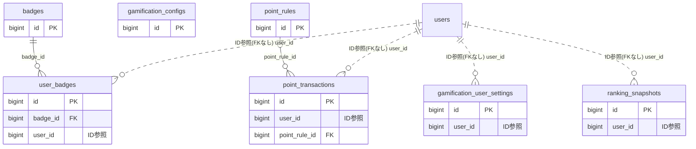

# gamification ドメイン ER 図

> このファイルは自動生成されます。手で編集しないでください。再生成: `cd backend && ./gradlew generateErDiagrams`

- テーブル数: 7
- ビュー数: 0

## ER 図

実線 = 外部キー、点線 = ID参照(FKなし)。図中の `FK` は実外部キーの列だけ（ID参照列は `FK` を付けず "ID参照" と注記）。図にはキー列（PK / FK / 参照推定列 / 単一列 UNIQUE）のみを描く。全列は下の「テーブル定義」を参照。

## 被参照（他ドメインから）

このドメインのテーブルを参照している他ドメインの側（実 FK と ID参照のみ。多態参照と推定不能参照は含まない。同一ドメイン内の参照は上の図を参照）。

なし

## 多態参照（線を引かない）

| テーブル | 種別列 | ID列 |
| --- | --- | --- |
| `badges` | `scope_type` | `scope_id` |
| `gamification_configs` | `scope_type` | `scope_id` |
| `gamification_user_settings` | `scope_type` | `scope_id` |
| `point_rules` | `scope_type` | `scope_id` |
| `point_transactions` | `reference_type` | `reference_id` |
| `point_transactions` | `scope_type` | `scope_id` |
| `ranking_snapshots` | `scope_type` | `scope_id` |

## テーブル定義

### `badges`

| 列名 | 型 | NULL | 既定値 | コメント |
| --- | --- | --- | --- | --- |
| `id` | `bigint unsigned` | NO | （なし） auto_increment |  |
| `scope_type` | `varchar(50)` | NO | （なし） |  |
| `scope_id` | `bigint unsigned` | NO | （なし） |  |
| `name` | `varchar(100)` | NO | （なし） |  |
| `badge_type` | `varchar(50)` | NO | （なし） |  |
| `condition_type` | `varchar(50)` | NO | （なし） |  |
| `condition_value` | `int` | YES | NULL |  |
| `condition_period` | `varchar(50)` | YES | NULL |  |
| `icon_emoji` | `varchar(10)` | YES | NULL |  |
| `icon_key` | `varchar(200)` | YES | NULL |  |
| `is_system` | `tinyint(1)` | NO | `0` |  |
| `is_repeatable` | `tinyint(1)` | NO | `0` |  |
| `is_active` | `tinyint(1)` | NO | `1` |  |
| `version` | `bigint` | NO | `0` |  |
| `created_at` | `datetime` | NO | `CURRENT_TIMESTAMP` （式） |  |
| `updated_at` | `datetime` | NO | `CURRENT_TIMESTAMP` （式） |  |
| `deleted_at` | `datetime` | YES | NULL |  |

### `gamification_configs`

| 列名 | 型 | NULL | 既定値 | コメント |
| --- | --- | --- | --- | --- |
| `id` | `bigint unsigned` | NO | （なし） auto_increment |  |
| `scope_type` | `varchar(50)` | NO | （なし） |  |
| `scope_id` | `bigint unsigned` | NO | （なし） |  |
| `is_enabled` | `tinyint(1)` | NO | `0` |  |
| `is_ranking_enabled` | `tinyint(1)` | NO | `1` |  |
| `ranking_display_count` | `int` | NO | `10` |  |
| `point_reset_month` | `tinyint` | YES | NULL |  |
| `version` | `bigint` | NO | `0` |  |
| `created_at` | `datetime` | NO | `CURRENT_TIMESTAMP` （式） |  |
| `updated_at` | `datetime` | NO | `CURRENT_TIMESTAMP` （式） |  |

### `gamification_user_settings`

| 列名 | 型 | NULL | 既定値 | コメント |
| --- | --- | --- | --- | --- |
| `id` | `bigint unsigned` | NO | （なし） auto_increment |  |
| `user_id` | `bigint unsigned` | NO | （なし） |  |
| `scope_type` | `varchar(50)` | NO | （なし） |  |
| `scope_id` | `bigint unsigned` | NO | （なし） |  |
| `show_in_ranking` | `tinyint(1)` | NO | `1` |  |
| `show_badges` | `tinyint(1)` | NO | `1` |  |
| `created_at` | `datetime` | NO | `CURRENT_TIMESTAMP` （式） |  |
| `updated_at` | `datetime` | NO | `CURRENT_TIMESTAMP` （式） |  |

### `point_rules`

| 列名 | 型 | NULL | 既定値 | コメント |
| --- | --- | --- | --- | --- |
| `id` | `bigint unsigned` | NO | （なし） auto_increment |  |
| `scope_type` | `varchar(50)` | NO | （なし） |  |
| `scope_id` | `bigint unsigned` | NO | （なし） |  |
| `action_type` | `varchar(50)` | NO | （なし） |  |
| `name` | `varchar(100)` | NO | （なし） |  |
| `points` | `int` | NO | （なし） |  |
| `daily_limit` | `int` | NO | `0` |  |
| `is_system` | `tinyint(1)` | NO | `0` |  |
| `is_active` | `tinyint(1)` | NO | `1` |  |
| `version` | `bigint` | NO | `0` |  |
| `created_at` | `datetime` | NO | `CURRENT_TIMESTAMP` （式） |  |
| `updated_at` | `datetime` | NO | `CURRENT_TIMESTAMP` （式） |  |
| `deleted_at` | `datetime` | YES | NULL |  |

### `point_transactions`

| 列名 | 型 | NULL | 既定値 | コメント |
| --- | --- | --- | --- | --- |
| `id` | `bigint unsigned` | NO | （なし） auto_increment |  |
| `user_id` | `bigint unsigned` | NO | （なし） |  |
| `scope_type` | `varchar(50)` | NO | （なし） |  |
| `scope_id` | `bigint unsigned` | NO | （なし） |  |
| `point_rule_id` | `bigint unsigned` | YES | NULL |  |
| `transaction_type` | `enum('EARN','RESET','ADMIN_ADJUST')` | NO | （なし） |  |
| `points` | `int` | NO | （なし） |  |
| `action_type` | `varchar(50)` | YES | NULL |  |
| `reference_type` | `varchar(50)` | YES | NULL |  |
| `reference_id` | `bigint unsigned` | YES | NULL |  |
| `earned_on` | `date` | NO | （なし） |  |
| `created_at` | `datetime` | NO | `CURRENT_TIMESTAMP` （式） |  |

### `ranking_snapshots`

| 列名 | 型 | NULL | 既定値 | コメント |
| --- | --- | --- | --- | --- |
| `id` | `bigint unsigned` | NO | （なし） auto_increment |  |
| `scope_type` | `varchar(50)` | NO | （なし） |  |
| `scope_id` | `bigint unsigned` | NO | （なし） |  |
| `period_type` | `varchar(20)` | NO | （なし） |  |
| `period_label` | `varchar(20)` | NO | （なし） |  |
| `user_id` | `bigint unsigned` | NO | （なし） |  |
| `total_points` | `int` | NO | `0` |  |
| `rank_position` | `int` | NO | （なし） |  |
| `created_at` | `datetime` | NO | `CURRENT_TIMESTAMP` （式） |  |
| `updated_at` | `datetime` | NO | `CURRENT_TIMESTAMP` （式） |  |

### `user_badges`

| 列名 | 型 | NULL | 既定値 | コメント |
| --- | --- | --- | --- | --- |
| `id` | `bigint unsigned` | NO | （なし） auto_increment |  |
| `badge_id` | `bigint unsigned` | NO | （なし） |  |
| `user_id` | `bigint unsigned` | NO | （なし） |  |
| `earned_on` | `date` | NO | （なし） |  |
| `period_label` | `varchar(20)` | YES | NULL |  |
| `awarded_by` | `varchar(20)` | NO | （なし） |  |
| `created_at` | `datetime` | NO | `CURRENT_TIMESTAMP` （式） |  |
