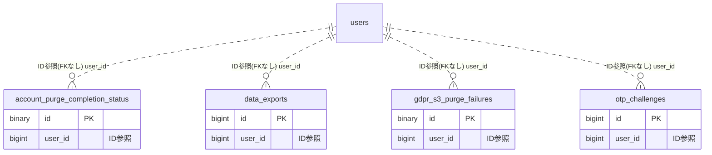

# gdpr ドメイン ER 図

> このファイルは自動生成されます。手で編集しないでください。再生成: `cd backend && ./gradlew generateErDiagrams`

- テーブル数: 4
- ビュー数: 0

## ER 図

実線 = 外部キー、点線 = ID参照(FKなし)。図中の `FK` は実外部キーの列だけ（ID参照列は `FK` を付けず "ID参照" と注記）。図にはキー列（PK / FK / 参照推定列 / 単一列 UNIQUE）のみを描く。全列は下の「テーブル定義」を参照。

## 被参照（他ドメインから）

このドメインのテーブルを参照している他ドメインの側（実 FK と ID参照のみ。多態参照と推定不能参照は含まない。同一ドメイン内の参照は上の図を参照）。

なし

## テーブル定義

### `account_purge_completion_status`

| 列名 | 型 | NULL | 既定値 | コメント |
| --- | --- | --- | --- | --- |
| `id` | `binary(16)` | NO | （なし） |  |
| `user_id` | `bigint unsigned` | NO | （なし） | users.id の参照値（FK 制約なし: クロスドメイン FK 禁止原則） |
| `email_hash` | `char(64)` | NO | （なし） | SHA-256(email) GDPR証跡。email 本体は保持しない |
| `domain_name` | `varchar(50)` | NO | （なし） | ドメイン識別子: role/team/payment/chart/proxy/errorreport |
| `status` | `varchar(20)` | NO | `PENDING` | 処理状態: PENDING/SUCCESS |
| `attempted_at` | `datetime(6)` | NO | （なし） | PENDING レコード作成日時（AccountPurgeService#purgeUser 実行時刻） |
| `completed_at` | `datetime(6)` | YES | NULL | SUCCESS に更新された日時（*PurgeEventListener 完了時刻） |
| `retry_count` | `tinyint unsigned` | NO | `0` | retry 実行回数（管理者による手動 retry 累計。Phase F） |
| `last_retried_at` | `datetime(6)` | YES | NULL | 最後に retry を実行した日時（管理者操作。Phase F） |

### `data_exports`

| 列名 | 型 | NULL | 既定値 | コメント |
| --- | --- | --- | --- | --- |
| `id` | `bigint unsigned` | NO | （なし） auto_increment |  |
| `user_id` | `bigint unsigned` | NO | （なし） |  |
| `status` | `varchar(20)` | NO | `PENDING` |  |
| `categories` | `varchar(500)` | YES | NULL |  |
| `progress_percent` | `tinyint unsigned` | NO | `0` |  |
| `current_step` | `varchar(50)` | YES | NULL |  |
| `s3_key` | `varchar(500)` | YES | NULL |  |
| `file_size_bytes` | `bigint unsigned` | YES | NULL |  |
| `zip_password_hash` | `varchar(200)` | YES | NULL |  |
| `expires_at` | `datetime` | YES | NULL |  |
| `error_message` | `varchar(500)` | YES | NULL |  |
| `created_at` | `datetime` | NO | （なし） |  |
| `completed_at` | `datetime` | YES | NULL |  |
| `updated_at` | `datetime` | YES | NULL |  |

### `gdpr_s3_purge_failures`

| 列名 | 型 | NULL | 既定値 | コメント |
| --- | --- | --- | --- | --- |
| `id` | `binary(16)` | NO | （なし） |  |
| `user_id` | `bigint unsigned` | NO | （なし） |  |
| `s3_key` | `varchar(500)` | NO | （なし） |  |
| `failed_at` | `datetime(6)` | NO | （なし） |  |
| `retry_count` | `tinyint unsigned` | NO | `0` |  |
| `last_retried_at` | `datetime(6)` | YES | NULL |  |
| `last_error` | `varchar(500)` | YES | NULL |  |
| `resolved_at` | `datetime(6)` | YES | NULL |  |

### `otp_challenges`

| 列名 | 型 | NULL | 既定値 | コメント |
| --- | --- | --- | --- | --- |
| `id` | `bigint unsigned` | NO | （なし） auto_increment |  |
| `user_id` | `bigint unsigned` | NO | （なし） |  |
| `purpose` | `varchar(30)` | NO | （なし） |  |
| `code_hash` | `varchar(200)` | NO | （なし） |  |
| `attempt_count` | `int unsigned` | NO | `0` |  |
| `locked_until` | `datetime` | YES | NULL |  |
| `expires_at` | `datetime` | NO | （なし） |  |
| `used_at` | `datetime` | YES | NULL |  |
| `created_at` | `datetime` | NO | （なし） |  |
