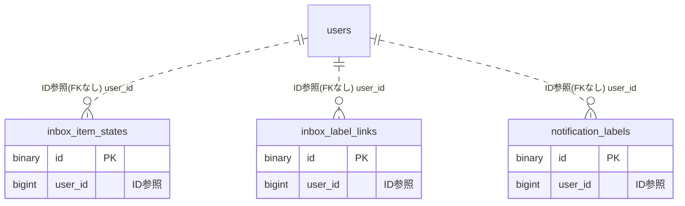

# inbox ドメイン ER 図

> このファイルは自動生成されます。手で編集しないでください。再生成: `cd backend && ./gradlew generateErDiagrams`

- テーブル数: 3
- ビュー数: 0

## ER 図

実線 = 外部キー、点線 = ID参照(FKなし)。図中の `FK` は実外部キーの列だけ（ID参照列は `FK` を付けず "ID参照" と注記）。図にはキー列（PK / FK / 参照推定列 / 単一列 UNIQUE）のみを描く。全列は下の「テーブル定義」を参照。

## 被参照（他ドメインから）

このドメインのテーブルを参照している他ドメインの側（実 FK と ID参照のみ。多態参照と推定不能参照は含まない。同一ドメイン内の参照は上の図を参照）。

なし

## 多態参照（線を引かない）

| テーブル | 種別列 | ID列 |
| --- | --- | --- |
| `inbox_item_states` | `source_type` | `source_id` |
| `inbox_label_links` | `source_type` | `source_id` |

## 推定不能参照

| テーブル | 列 | 理由 |
| --- | --- | --- |
| `inbox_label_links` | `label_id` | 参照先テーブルを特定できない |

## テーブル定義

### `inbox_item_states`

| 列名 | 型 | NULL | 既定値 | コメント |
| --- | --- | --- | --- | --- |
| `id` | `binary(16)` | NO | （なし） | UUIDv7 主キー（原則6） |
| `user_id` | `bigint unsigned` | NO | （なし） | users.id（FK制約なし。クロスドメインFK禁止原則1） |
| `source_type` | `varchar(30)` | NO | （なし） | 通知ソース種別（NOTIFICATION/ANNOUNCEMENT/MENTION/CONFIRMABLE/TODO_DUE） |
| `source_id` | `bigint unsigned` | NO | （なし） | 各ソーステーブルのPK（FK制約なし・論理参照） |
| `snoozed_until` | `datetime(6)` | YES | NULL | スヌーズ解除予定時刻。NULL=非スヌーズ。now超過で受信箱へ自動復帰 |
| `snooze_notified_at` | `datetime(6)` | YES | NULL | スヌーズ復帰push送信済み時刻。NULL=未送信（再スヌーズ時はNULLへリセット） |
| `archived_at` | `datetime(6)` | YES | NULL | アーカイブ退避時刻。NULL=受信箱、非NULL=保管庫 |
| `created_at` | `datetime(6)` | NO | `CURRENT_TIMESTAMP(6)` （式） | 作成日時 |
| `updated_at` | `datetime(6)` | NO | `CURRENT_TIMESTAMP(6)` （式） | 更新日時 |

### `inbox_label_links`

| 列名 | 型 | NULL | 既定値 | コメント |
| --- | --- | --- | --- | --- |
| `id` | `binary(16)` | NO | （なし） | UUIDv7 主キー（原則6） |
| `label_id` | `binary(16)` | NO | （なし） | notification_labels.id（同一inboxドメイン内・FK制約なし方針） |
| `user_id` | `bigint unsigned` | NO | （なし） | users.id（冗長保持・user絞り込み高速化／所有検証） |
| `source_type` | `varchar(30)` | NO | （なし） | 通知ソース種別 |
| `source_id` | `bigint unsigned` | NO | （なし） | 各ソースPK（論理参照） |
| `created_at` | `datetime(6)` | NO | `CURRENT_TIMESTAMP(6)` （式） | 作成日時 |

### `notification_labels`

| 列名 | 型 | NULL | 既定値 | コメント |
| --- | --- | --- | --- | --- |
| `id` | `binary(16)` | NO | （なし） | UUIDv7 主キー（原則6） |
| `user_id` | `bigint unsigned` | NO | （なし） | users.id（FK制約なし） |
| `name` | `varchar(50)` | NO | （なし） | ラベル名（ユーザー内で重複不可・サービス層検証） |
| `color` | `char(7)` | YES | NULL | 表示色 #RRGGBB（任意） |
| `icon` | `varchar(40)` | YES | NULL | PrimeIcons 名（任意。例 pi-tag） |
| `sort_order` | `int` | NO | `0` | 表示順（昇順） |
| `deleted_at` | `datetime(6)` | YES | NULL | 論理削除（@SQLRestriction） |
| `created_at` | `datetime(6)` | NO | `CURRENT_TIMESTAMP(6)` （式） | 作成日時 |
| `updated_at` | `datetime(6)` | NO | `CURRENT_TIMESTAMP(6)` （式） | 更新日時 |
