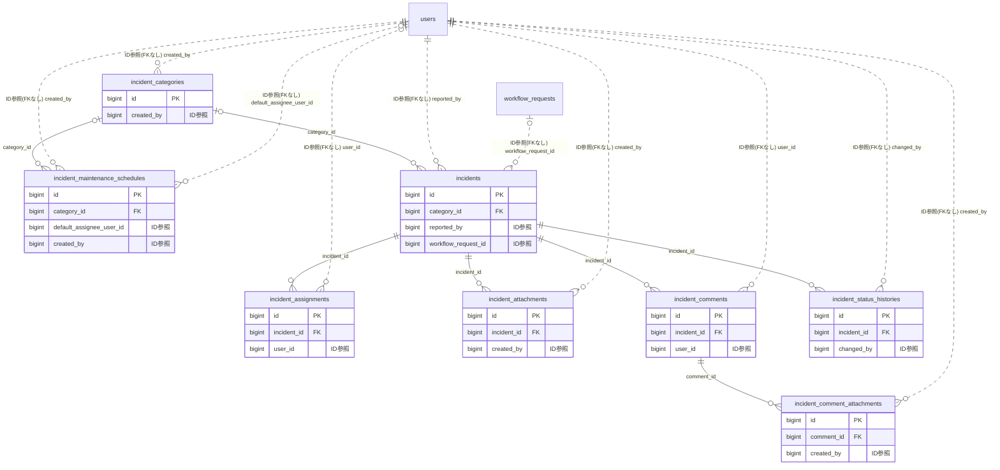

# incident ドメイン ER 図

> このファイルは自動生成されます。手で編集しないでください。再生成: `cd backend && ./gradlew generateErDiagrams`

- テーブル数: 8
- ビュー数: 0

## ER 図

実線 = 外部キー、点線 = ID参照(FKなし)。図中の `FK` は実外部キーの列だけ（ID参照列は `FK` を付けず "ID参照" と注記）。図にはキー列（PK / FK / 参照推定列 / 単一列 UNIQUE）のみを描く。全列は下の「テーブル定義」を参照。

## 被参照（他ドメインから）

このドメインのテーブルを参照している他ドメインの側（実 FK と ID参照のみ。多態参照と推定不能参照は含まない。同一ドメイン内の参照は上の図を参照）。

| 参照元ドメイン | 参照元テーブル | 列 | 種別 | 参照先テーブル |
| --- | --- | --- | --- | --- |
| [property](property.md) | `property_work_packages` | `incident_id` | ID参照 | `incidents` |

## 多態参照（線を引かない）

| テーブル | 種別列 | ID列 |
| --- | --- | --- |
| `incident_categories` | `scope_type` | `scope_id` |
| `incident_maintenance_schedules` | `scope_type` | `scope_id` |
| `incidents` | `scope_type` | `scope_id` |

## テーブル定義

### `incident_assignments`

| 列名 | 型 | NULL | 既定値 | コメント |
| --- | --- | --- | --- | --- |
| `id` | `bigint unsigned` | NO | （なし） auto_increment |  |
| `incident_id` | `bigint unsigned` | NO | （なし） |  |
| `assignee_type` | `varchar(20)` | NO | （なし） | USER/EXTERNAL |
| `user_id` | `bigint unsigned` | YES | NULL | assignee_type=USERの場合 |
| `external_name` | `varchar(100)` | YES | NULL | assignee_type=EXTERNALの場合 |
| `created_at` | `datetime` | NO | （なし） |  |

### `incident_attachments`

| 列名 | 型 | NULL | 既定値 | コメント |
| --- | --- | --- | --- | --- |
| `id` | `bigint unsigned` | NO | （なし） auto_increment |  |
| `incident_id` | `bigint unsigned` | NO | （なし） |  |
| `file_key` | `varchar(500)` | NO | （なし） |  |
| `mime_type` | `varchar(50)` | NO | （なし） | JPEG/PNG/WebPのみ |
| `created_by` | `bigint unsigned` | NO | （なし） |  |
| `created_at` | `datetime` | NO | （なし） |  |

### `incident_categories`

| 列名 | 型 | NULL | 既定値 | コメント |
| --- | --- | --- | --- | --- |
| `id` | `bigint unsigned` | NO | （なし） auto_increment |  |
| `scope_type` | `varchar(50)` | NO | （なし） |  |
| `scope_id` | `bigint unsigned` | NO | （なし） |  |
| `name` | `varchar(100)` | NO | （なし） |  |
| `sla_hours` | `int` | NO | `72` | デフォルトSLA時間 |
| `is_active` | `tinyint(1)` | NO | `1` |  |
| `created_by` | `bigint unsigned` | NO | （なし） |  |
| `version` | `bigint` | NO | `0` |  |
| `created_at` | `datetime` | NO | （なし） |  |
| `updated_at` | `datetime` | NO | （なし） |  |
| `deleted_at` | `datetime` | YES | NULL |  |

### `incident_comment_attachments`

| 列名 | 型 | NULL | 既定値 | コメント |
| --- | --- | --- | --- | --- |
| `id` | `bigint unsigned` | NO | （なし） auto_increment |  |
| `comment_id` | `bigint unsigned` | NO | （なし） |  |
| `file_key` | `varchar(500)` | NO | （なし） |  |
| `mime_type` | `varchar(50)` | NO | （なし） |  |
| `created_by` | `bigint unsigned` | NO | （なし） |  |
| `created_at` | `datetime` | NO | （なし） |  |

### `incident_comments`

| 列名 | 型 | NULL | 既定値 | コメント |
| --- | --- | --- | --- | --- |
| `id` | `bigint unsigned` | NO | （なし） auto_increment |  |
| `incident_id` | `bigint unsigned` | NO | （なし） |  |
| `user_id` | `bigint unsigned` | NO | （なし） |  |
| `body` | `text` | NO | （なし） |  |
| `is_internal` | `tinyint(1)` | NO | `0` | 内部コメント=ADMIN/担当者のみ可視 |
| `version` | `bigint` | NO | `0` |  |
| `created_at` | `datetime` | NO | （なし） |  |
| `updated_at` | `datetime` | NO | （なし） |  |
| `deleted_at` | `datetime` | YES | NULL |  |

### `incident_maintenance_schedules`

| 列名 | 型 | NULL | 既定値 | コメント |
| --- | --- | --- | --- | --- |
| `id` | `bigint unsigned` | NO | （なし） auto_increment |  |
| `scope_type` | `varchar(50)` | NO | （なし） |  |
| `scope_id` | `bigint unsigned` | NO | （なし） |  |
| `category_id` | `bigint unsigned` | YES | NULL |  |
| `name` | `varchar(200)` | NO | （なし） |  |
| `description` | `text` | YES | NULL |  |
| `cron_expression` | `varchar(100)` | NO | （なし） |  |
| `next_execution_date` | `date` | NO | （なし） |  |
| `default_assignee_type` | `varchar(20)` | YES | NULL | USER/EXTERNAL |
| `default_assignee_user_id` | `bigint unsigned` | YES | NULL |  |
| `default_assignee_external_name` | `varchar(100)` | YES | NULL |  |
| `is_active` | `tinyint(1)` | NO | `1` |  |
| `version` | `bigint` | NO | `0` |  |
| `created_by` | `bigint unsigned` | NO | （なし） |  |
| `created_at` | `datetime` | NO | （なし） |  |
| `updated_at` | `datetime` | NO | （なし） |  |
| `deleted_at` | `datetime` | YES | NULL |  |

### `incident_status_histories`

| 列名 | 型 | NULL | 既定値 | コメント |
| --- | --- | --- | --- | --- |
| `id` | `bigint unsigned` | NO | （なし） auto_increment |  |
| `incident_id` | `bigint unsigned` | NO | （なし） |  |
| `from_status` | `varchar(30)` | YES | NULL | 初回REPORTEDはNULL |
| `to_status` | `varchar(30)` | NO | （なし） |  |
| `changed_by` | `bigint unsigned` | NO | （なし） |  |
| `comment` | `varchar(500)` | YES | NULL |  |
| `created_at` | `datetime` | NO | （なし） |  |

### `incidents`

| 列名 | 型 | NULL | 既定値 | コメント |
| --- | --- | --- | --- | --- |
| `id` | `bigint unsigned` | NO | （なし） auto_increment |  |
| `scope_type` | `varchar(50)` | NO | （なし） |  |
| `scope_id` | `bigint unsigned` | NO | （なし） |  |
| `category_id` | `bigint unsigned` | YES | NULL |  |
| `title` | `varchar(200)` | NO | （なし） |  |
| `description` | `text` | YES | NULL |  |
| `status` | `varchar(30)` | NO | `REPORTED` |  |
| `priority` | `varchar(20)` | NO | `MEDIUM` |  |
| `sla_deadline` | `datetime` | YES | NULL |  |
| `is_sla_breached` | `tinyint(1)` | NO | `0` |  |
| `reported_by` | `bigint unsigned` | NO | （なし） |  |
| `workflow_request_id` | `bigint unsigned` | YES | NULL | F05.6費用承認申請ID |
| `version` | `bigint` | NO | `0` |  |
| `created_at` | `datetime` | NO | （なし） |  |
| `updated_at` | `datetime` | NO | （なし） |  |
| `deleted_at` | `datetime` | YES | NULL |  |
