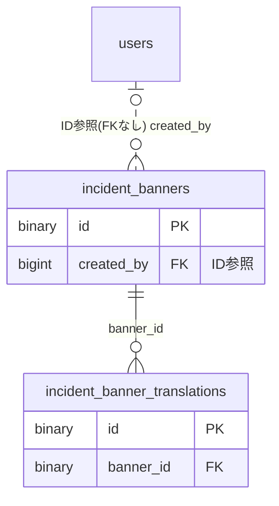

# incidentbanner ドメイン ER 図

> このファイルは自動生成されます。手で編集しないでください。再生成: `cd backend && ./gradlew generateErDiagrams`

- テーブル数: 2
- ビュー数: 0

## ER 図

実線 = 外部キー、点線 = ID参照(FKなし)。図にはキー列（PK / FK / 参照推定列 / 単一列 UNIQUE）のみを描く。全列は下の「テーブル定義」を参照。

## テーブル定義

### `incident_banner_translations`

| 列名 | 型 | NULL | 既定値 | コメント |
| --- | --- | --- | --- | --- |
| `id` | `binary(16)` | NO | （なし） |  |
| `banner_id` | `binary(16)` | NO | （なし） |  |
| `language` | `varchar(10)` | NO | （なし） |  |
| `message` | `varchar(500)` | NO | （なし） |  |
| `created_at` | `datetime` | NO | （なし） |  |
| `updated_at` | `datetime` | NO | （なし） |  |

### `incident_banners`

| 列名 | 型 | NULL | 既定値 | コメント |
| --- | --- | --- | --- | --- |
| `id` | `binary(16)` | NO | （なし） |  |
| `level` | `varchar(10)` | NO | `INFO` |  |
| `page_pattern` | `varchar(255)` | NO | `*` |  |
| `published` | `tinyint(1)` | NO | `0` |  |
| `original_language` | `varchar(10)` | NO | `ja` |  |
| `starts_at` | `datetime` | YES | NULL |  |
| `ends_at` | `datetime` | YES | NULL |  |
| `created_by` | `bigint` | YES | NULL |  |
| `created_at` | `datetime` | NO | （なし） |  |
| `updated_at` | `datetime` | NO | （なし） |  |
| `deleted_at` | `datetime` | YES | NULL |  |
