# jobmatching ドメイン ER 図

> このファイルは自動生成されます。手で編集しないでください。再生成: `cd backend && ./gradlew generateErDiagrams`

- テーブル数: 5
- ビュー数: 0

## ER 図

実線 = 外部キー、点線 = ID参照(FKなし)。図中の `FK` は実外部キーの列だけ（ID参照列は `FK` を付けず "ID参照" と注記）。図にはキー列（PK / FK / 参照推定列 / 単一列 UNIQUE）のみを描く。全列は下の「テーブル定義」を参照。

```mermaid
erDiagram
    job_applications {
        bigint id PK
        bigint job_posting_id FK
        bigint applicant_user_id "ID参照"
        bigint decided_by_user_id "ID参照"
    }
    job_check_ins {
        bigint id PK
        bigint job_contract_id FK
        bigint worker_user_id "ID参照"
        bigint qr_token_id FK
    }
    job_contracts {
        bigint id PK
        bigint job_posting_id FK
        bigint job_application_id FK, UK
        bigint requester_user_id "ID参照"
        bigint worker_user_id "ID参照"
    }
    job_postings {
        bigint id PK
        bigint team_id "ID参照"
        bigint created_by_user_id "ID参照"
    }
    job_qr_tokens {
        bigint id PK
        bigint job_contract_id FK
        varchar nonce UK
        bigint issued_by_user_id "ID参照"
    }
    teams
    users
    job_postings ||--o{ job_applications : "job_posting_id"
    users ||..o{ job_applications : "ID参照(FKなし) applicant_user_id"
    users |o..o{ job_applications : "ID参照(FKなし) decided_by_user_id"
    job_contracts ||--o{ job_check_ins : "job_contract_id"
    job_qr_tokens |o--o{ job_check_ins : "qr_token_id"
    users ||..o{ job_check_ins : "ID参照(FKなし) worker_user_id"
    job_applications ||--o| job_contracts : "job_application_id"
    job_postings ||--o{ job_contracts : "job_posting_id"
    users ||..o{ job_contracts : "ID参照(FKなし) requester_user_id"
    users ||..o{ job_contracts : "ID参照(FKなし) worker_user_id"
    teams ||..o{ job_postings : "ID参照(FKなし) team_id"
    users ||..o{ job_postings : "ID参照(FKなし) created_by_user_id"
    job_contracts ||--o{ job_qr_tokens : "job_contract_id"
    users ||..o{ job_qr_tokens : "ID参照(FKなし) issued_by_user_id"
```

## 被参照（他ドメインから）

このドメインのテーブルを参照している他ドメインの側（実 FK と ID参照のみ。多態参照と推定不能参照は含まない。同一ドメイン内の参照は上の図を参照）。

なし

## 推定不能参照

| テーブル | 列 | 理由 |
| --- | --- | --- |
| `job_contracts` | `chat_room_id` | 参照先テーブルを特定できない |

## テーブル定義

### `job_applications`

| 列名 | 型 | NULL | 既定値 | コメント |
| --- | --- | --- | --- | --- |
| `id` | `bigint unsigned` | NO | （なし） auto_increment |  |
| `job_posting_id` | `bigint unsigned` | NO | （なし） |  |
| `applicant_user_id` | `bigint unsigned` | NO | （なし） |  |
| `self_pr` | `text` | YES | NULL |  |
| `status` | `enum('APPLIED','ACCEPTED','REJECTED','WITHDRAWN')` | NO | `APPLIED` |  |
| `applied_at` | `datetime` | NO | `CURRENT_TIMESTAMP` （式） |  |
| `decided_at` | `datetime` | YES | NULL |  |
| `decided_by_user_id` | `bigint unsigned` | YES | NULL |  |
| `created_at` | `datetime` | NO | `CURRENT_TIMESTAMP` （式） |  |
| `updated_at` | `datetime` | NO | `CURRENT_TIMESTAMP` （式） |  |

### `job_check_ins`

| 列名 | 型 | NULL | 既定値 | コメント |
| --- | --- | --- | --- | --- |
| `id` | `bigint unsigned` | NO | （なし） auto_increment |  |
| `job_contract_id` | `bigint unsigned` | NO | （なし） |  |
| `worker_user_id` | `bigint unsigned` | NO | （なし） |  |
| `type` | `enum('IN','OUT')` | NO | （なし） |  |
| `qr_token_id` | `bigint unsigned` | YES | NULL |  |
| `scanned_at` | `timestamp(3)` | NO | （なし） |  |
| `server_received_at` | `timestamp(3)` | NO | `CURRENT_TIMESTAMP(3)` （式） |  |
| `offline_submitted` | `tinyint(1)` | NO | `0` |  |
| `manual_code_fallback` | `tinyint(1)` | NO | `0` |  |
| `geolocation_lat` | `decimal(9,6)` | YES | NULL |  |
| `geolocation_lng` | `decimal(9,6)` | YES | NULL |  |
| `geolocation_accuracy_m` | `decimal(8,2)` | YES | NULL |  |
| `geo_anomaly` | `tinyint(1)` | NO | `0` |  |
| `geolocation_deleted_at` | `timestamp(3)` | YES | NULL |  |
| `client_user_agent` | `varchar(512)` | YES | NULL |  |
| `created_at` | `datetime` | NO | `CURRENT_TIMESTAMP` （式） |  |
| `updated_at` | `datetime` | NO | `CURRENT_TIMESTAMP` （式） |  |

### `job_contracts`

| 列名 | 型 | NULL | 既定値 | コメント |
| --- | --- | --- | --- | --- |
| `id` | `bigint unsigned` | NO | （なし） auto_increment |  |
| `job_posting_id` | `bigint unsigned` | NO | （なし） |  |
| `job_application_id` | `bigint unsigned` | NO | （なし） |  |
| `requester_user_id` | `bigint unsigned` | NO | （なし） |  |
| `worker_user_id` | `bigint unsigned` | NO | （なし） |  |
| `chat_room_id` | `bigint unsigned` | YES | NULL |  |
| `base_reward_jpy` | `int` | NO | （なし） |  |
| `work_start_at` | `datetime` | NO | （なし） |  |
| `work_end_at` | `datetime` | NO | （なし） |  |
| `status` | `enum('MATCHED','CHECKED_IN','IN_PROGRESS','CHECKED_OUT','TIME_CONFIRMED','COMPLETION_REPORTED','COMPLETED','AUTHORIZED','CAPTURED','PAID','CANCELLED','DISPUTED')` | NO | `MATCHED` |  |
| `matched_at` | `datetime` | NO | `CURRENT_TIMESTAMP` （式） |  |
| `checked_in_at` | `timestamp(3)` | YES | NULL |  |
| `checked_out_at` | `timestamp(3)` | YES | NULL |  |
| `work_duration_minutes` | `int` | YES | NULL |  |
| `completion_reported_at` | `datetime` | YES | NULL |  |
| `completion_approved_at` | `datetime` | YES | NULL |  |
| `cancelled_at` | `datetime` | YES | NULL |  |
| `rejection_count` | `int` | NO | `0` |  |
| `last_rejection_reason` | `text` | YES | NULL |  |
| `version` | `int` | NO | `0` |  |
| `created_at` | `datetime` | NO | `CURRENT_TIMESTAMP` （式） |  |
| `updated_at` | `datetime` | NO | `CURRENT_TIMESTAMP` （式） |  |

### `job_postings`

| 列名 | 型 | NULL | 既定値 | コメント |
| --- | --- | --- | --- | --- |
| `id` | `bigint unsigned` | NO | （なし） auto_increment |  |
| `team_id` | `bigint unsigned` | NO | （なし） |  |
| `created_by_user_id` | `bigint unsigned` | NO | （なし） |  |
| `title` | `varchar(100)` | NO | （なし） |  |
| `description` | `text` | NO | （なし） |  |
| `category` | `varchar(50)` | YES | NULL |  |
| `work_location_type` | `enum('ONSITE','ONLINE','HYBRID')` | NO | `ONSITE` |  |
| `work_address` | `varchar(255)` | YES | NULL |  |
| `work_start_at` | `datetime` | NO | （なし） |  |
| `work_end_at` | `datetime` | NO | （なし） |  |
| `reward_type` | `enum('HOURLY','DAILY','LUMP_SUM')` | NO | `LUMP_SUM` |  |
| `base_reward_jpy` | `int` | NO | （なし） |  |
| `capacity` | `int` | NO | `1` |  |
| `application_deadline_at` | `datetime` | NO | （なし） |  |
| `visibility_scope` | `enum('TEAM_MEMBERS','TEAM_MEMBERS_SUPPORTERS','JOBBER_INTERNAL','JOBBER_PUBLIC_BOARD','ORGANIZATION_SCOPE','CUSTOM_TEMPLATE')` | NO | `TEAM_MEMBERS` |  |
| `status` | `enum('DRAFT','OPEN','CLOSED','CANCELLED')` | NO | `DRAFT` |  |
| `publish_at` | `datetime` | YES | NULL |  |
| `version` | `int` | NO | `0` |  |
| `created_at` | `datetime` | NO | `CURRENT_TIMESTAMP` （式） |  |
| `updated_at` | `datetime` | NO | `CURRENT_TIMESTAMP` （式） |  |
| `deleted_at` | `datetime` | YES | NULL |  |

### `job_qr_tokens`

| 列名 | 型 | NULL | 既定値 | コメント |
| --- | --- | --- | --- | --- |
| `id` | `bigint unsigned` | NO | （なし） auto_increment |  |
| `job_contract_id` | `bigint unsigned` | NO | （なし） |  |
| `type` | `enum('IN','OUT')` | NO | （なし） |  |
| `nonce` | `varchar(36)` | NO | （なし） |  |
| `kid` | `varchar(32)` | NO | （なし） |  |
| `short_code` | `varchar(6)` | NO | （なし） |  |
| `issued_at` | `timestamp(3)` | NO | `CURRENT_TIMESTAMP(3)` （式） |  |
| `expires_at` | `timestamp(3)` | NO | （なし） |  |
| `used_at` | `timestamp(3)` | YES | NULL |  |
| `issued_by_user_id` | `bigint unsigned` | NO | （なし） |  |
| `created_at` | `datetime` | NO | `CURRENT_TIMESTAMP` （式） |  |
| `updated_at` | `datetime` | NO | `CURRENT_TIMESTAMP` （式） |  |
