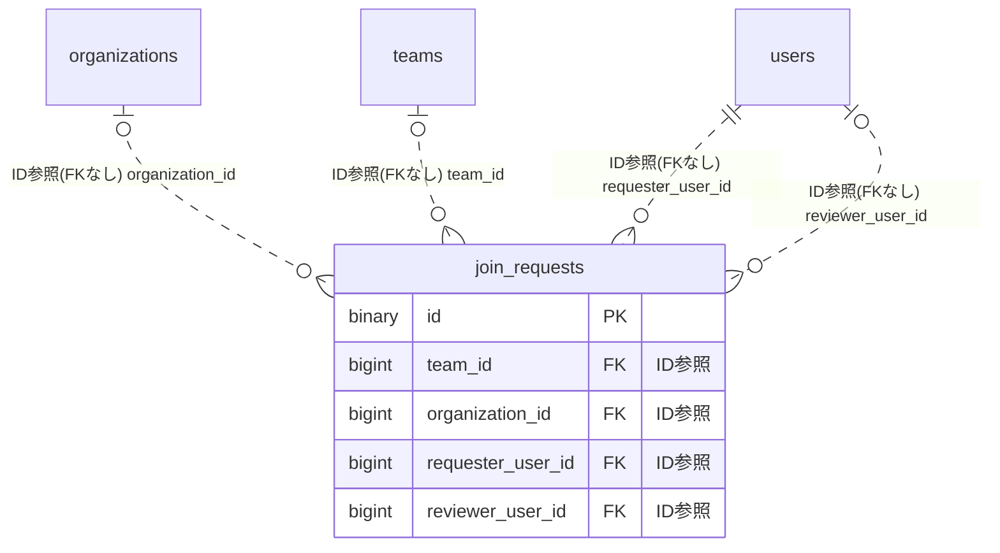

# joinrequest ドメイン ER 図

> このファイルは自動生成されます。手で編集しないでください。再生成: `cd backend && ./gradlew generateErDiagrams`

- テーブル数: 1
- ビュー数: 0

## ER 図

実線 = 外部キー、点線 = ID参照(FKなし)。図にはキー列（PK / FK / 参照推定列 / 単一列 UNIQUE）のみを描く。全列は下の「テーブル定義」を参照。

## テーブル定義

### `join_requests`

| 列名 | 型 | NULL | 既定値 | コメント |
| --- | --- | --- | --- | --- |
| `id` | `binary(16)` | NO | （なし） | UUIDv7 PK |
| `team_id` | `bigint unsigned` | YES | NULL | チームスコープ時の対象チームID（organization_idと排他） |
| `organization_id` | `bigint unsigned` | YES | NULL | 組織スコープ時の対象組織ID（team_idと排他） |
| `requester_user_id` | `bigint unsigned` | NO | （なし） | 申請者ユーザーID |
| `message` | `varchar(500)` | YES | NULL | 申請時の任意の一言メッセージ |
| `status` | `varchar(20)` | NO | `PENDING` | PENDING/APPROVED/REJECTED |
| `reviewer_user_id` | `bigint unsigned` | YES | NULL | 審査したADMIN/DEPUTY_ADMINのユーザーID |
| `reviewed_at` | `timestamp(6)` | YES | NULL |  |
| `review_comment` | `varchar(500)` | YES | NULL |  |
| `created_at` | `timestamp(6)` | NO | `CURRENT_TIMESTAMP(6)` （式） |  |
| `updated_at` | `timestamp(6)` | NO | `CURRENT_TIMESTAMP(6)` （式） |  |
