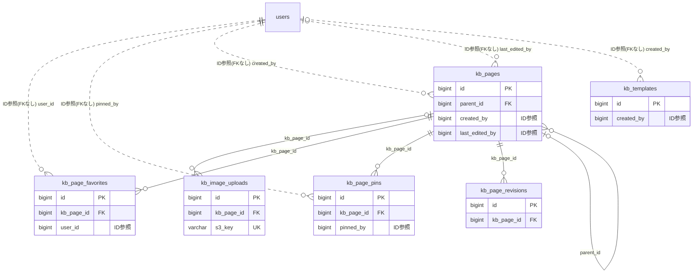

# knowledgebase ドメイン ER 図

> このファイルは自動生成されます。手で編集しないでください。再生成: `cd backend && ./gradlew generateErDiagrams`

- テーブル数: 6
- ビュー数: 0

## ER 図

実線 = 外部キー、点線 = ID参照(FKなし)。図中の `FK` は実外部キーの列だけ（ID参照列は `FK` を付けず "ID参照" と注記）。図にはキー列（PK / FK / 参照推定列 / 単一列 UNIQUE）のみを描く。全列は下の「テーブル定義」を参照。

## 被参照（他ドメインから）

このドメインのテーブルを参照している他ドメインの側（実 FK と ID参照のみ。多態参照と推定不能参照は含まない。同一ドメイン内の参照は上の図を参照）。

なし

## 自己参照

mermaid は同一テーブルの自己参照を複数描けず 1 本に畳むため、図に線が欠けることがある。自己参照はこの表を正とする。

| テーブル | 列 | 種別 |
| --- | --- | --- |
| `kb_pages` | `parent_id` | 外部キー |

## 多態参照（線を引かない）

| テーブル | 種別列 | ID列 |
| --- | --- | --- |
| `kb_page_pins` | `scope_type` | `scope_id` |
| `kb_pages` | `scope_type` | `scope_id` |
| `kb_templates` | `scope_type` | `scope_id` |

## 推定不能参照

| テーブル | 列 | 理由 |
| --- | --- | --- |
| `kb_image_uploads` | `uploader_id` | 参照先テーブルを特定できない |
| `kb_page_revisions` | `editor_id` | 参照先テーブルを特定できない |

## テーブル定義

### `kb_image_uploads`

| 列名 | 型 | NULL | 既定値 | コメント |
| --- | --- | --- | --- | --- |
| `id` | `bigint unsigned` | NO | （なし） auto_increment |  |
| `kb_page_id` | `bigint unsigned` | YES | NULL | NULL=未紐付け/アップロード中 |
| `uploader_id` | `bigint unsigned` | NO | （なし） |  |
| `s3_key` | `varchar(500)` | NO | （なし） |  |
| `file_size` | `bigint` | NO | （なし） |  |
| `content_type` | `varchar(50)` | NO | （なし） |  |
| `created_at` | `datetime` | NO | `CURRENT_TIMESTAMP` （式） |  |

### `kb_page_favorites`

| 列名 | 型 | NULL | 既定値 | コメント |
| --- | --- | --- | --- | --- |
| `id` | `bigint unsigned` | NO | （なし） auto_increment |  |
| `kb_page_id` | `bigint unsigned` | NO | （なし） |  |
| `user_id` | `bigint unsigned` | NO | （なし） |  |
| `created_at` | `datetime` | NO | `CURRENT_TIMESTAMP` （式） |  |

### `kb_page_pins`

| 列名 | 型 | NULL | 既定値 | コメント |
| --- | --- | --- | --- | --- |
| `id` | `bigint unsigned` | NO | （なし） auto_increment |  |
| `kb_page_id` | `bigint unsigned` | NO | （なし） |  |
| `scope_type` | `varchar(50)` | NO | （なし） |  |
| `scope_id` | `bigint unsigned` | NO | （なし） |  |
| `sort_order` | `int` | NO | `0` |  |
| `pinned_by` | `bigint unsigned` | NO | （なし） |  |
| `created_at` | `datetime` | NO | `CURRENT_TIMESTAMP` （式） |  |

### `kb_page_revisions`

| 列名 | 型 | NULL | 既定値 | コメント |
| --- | --- | --- | --- | --- |
| `id` | `bigint unsigned` | NO | （なし） auto_increment |  |
| `kb_page_id` | `bigint unsigned` | NO | （なし） |  |
| `revision_number` | `int` | NO | （なし） |  |
| `title` | `varchar(200)` | NO | （なし） |  |
| `body` | `mediumtext` | YES | NULL |  |
| `editor_id` | `bigint unsigned` | NO | （なし） |  |
| `change_summary` | `varchar(500)` | YES | NULL |  |
| `created_at` | `datetime` | NO | `CURRENT_TIMESTAMP` （式） |  |

### `kb_pages`

| 列名 | 型 | NULL | 既定値 | コメント |
| --- | --- | --- | --- | --- |
| `id` | `bigint unsigned` | NO | （なし） auto_increment |  |
| `scope_type` | `varchar(50)` | NO | （なし） |  |
| `scope_id` | `bigint unsigned` | NO | （なし） |  |
| `parent_id` | `bigint unsigned` | YES | NULL | 自己参照（ルートページはNULL） |
| `path` | `varchar(1000)` | NO | （なし） | マテリアライズドパス /1/5/12形式 |
| `depth` | `int` | NO | `0` |  |
| `title` | `varchar(200)` | NO | （なし） |  |
| `slug` | `varchar(200)` | NO | （なし） |  |
| `body` | `mediumtext` | YES | NULL |  |
| `icon` | `varchar(50)` | YES | NULL |  |
| `access_level` | `varchar(30)` | NO | `ALL_MEMBERS` |  |
| `status` | `varchar(20)` | NO | `DRAFT` |  |
| `view_count` | `int` | NO | `0` |  |
| `created_by` | `bigint unsigned` | NO | （なし） |  |
| `last_edited_by` | `bigint unsigned` | YES | NULL |  |
| `version` | `bigint` | NO | `0` |  |
| `created_at` | `datetime` | NO | `CURRENT_TIMESTAMP` （式） |  |
| `updated_at` | `datetime` | NO | `CURRENT_TIMESTAMP` （式） |  |
| `deleted_at` | `datetime` | YES | NULL |  |

### `kb_templates`

| 列名 | 型 | NULL | 既定値 | コメント |
| --- | --- | --- | --- | --- |
| `id` | `bigint unsigned` | NO | （なし） auto_increment |  |
| `scope_type` | `varchar(50)` | NO | （なし） |  |
| `scope_id` | `bigint unsigned` | YES | NULL | SYSTEMの場合NULL |
| `name` | `varchar(100)` | NO | （なし） |  |
| `body` | `mediumtext` | YES | NULL |  |
| `icon` | `varchar(50)` | YES | NULL |  |
| `is_system` | `tinyint(1)` | NO | `0` |  |
| `created_by` | `bigint unsigned` | YES | NULL |  |
| `version` | `bigint` | NO | `0` |  |
| `created_at` | `datetime` | NO | `CURRENT_TIMESTAMP` （式） |  |
| `updated_at` | `datetime` | NO | `CURRENT_TIMESTAMP` （式） |  |
| `deleted_at` | `datetime` | YES | NULL |  |
