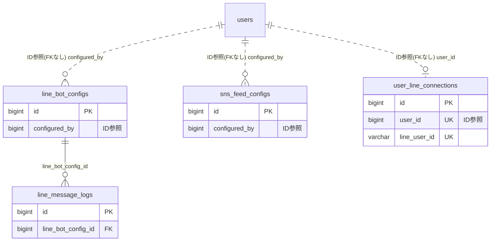

# line ドメイン ER 図

> このファイルは自動生成されます。手で編集しないでください。再生成: `cd backend && ./gradlew generateErDiagrams`

- テーブル数: 4
- ビュー数: 0

## ER 図

実線 = 外部キー、点線 = ID参照(FKなし)。図中の `FK` は実外部キーの列だけ（ID参照列は `FK` を付けず "ID参照" と注記）。図にはキー列（PK / FK / 参照推定列 / 単一列 UNIQUE）のみを描く。全列は下の「テーブル定義」を参照。

## 被参照（他ドメインから）

このドメインのテーブルを参照している他ドメインの側（実 FK と ID参照のみ。多態参照と推定不能参照は含まない。同一ドメイン内の参照は上の図を参照）。

なし

## 多態参照（線を引かない）

| テーブル | 種別列 | ID列 |
| --- | --- | --- |
| `line_bot_configs` | `scope_type` | `scope_id` |
| `sns_feed_configs` | `scope_type` | `scope_id` |

## 推定不能参照

| テーブル | 列 | 理由 |
| --- | --- | --- |
| `line_bot_configs` | `bot_user_id` | 型が参照先 users.id と不一致（varchar ≠ bigint） |
| `line_bot_configs` | `channel_id` | 参照先テーブルを特定できない |
| `line_message_logs` | `line_message_id` | 参照先テーブルを特定できない |
| `line_message_logs` | `line_user_id` | 型が参照先 users.id と不一致（varchar ≠ bigint） |
| `user_line_connections` | `line_user_id` | 型が参照先 users.id と不一致（varchar ≠ bigint） |

## テーブル定義

### `line_bot_configs`

| 列名 | 型 | NULL | 既定値 | コメント |
| --- | --- | --- | --- | --- |
| `id` | `bigint unsigned` | NO | （なし） auto_increment |  |
| `scope_type` | `varchar(20)` | NO | （なし） | TEAM / ORGANIZATION |
| `scope_id` | `bigint unsigned` | NO | （なし） | teams.id / organizations.id |
| `channel_id` | `varchar(100)` | NO | （なし） | LINE チャンネルID |
| `channel_secret_enc` | `varbinary(512)` | NO | （なし） | AES-256-GCM暗号化 |
| `channel_access_token_enc` | `varbinary(1024)` | NO | （なし） | AES-256-GCM暗号化 |
| `encryption_key_version` | `int unsigned` | NO | `1` | 暗号化キーバージョン |
| `webhook_secret` | `varchar(64)` | NO | （なし） | Webhook検証シークレット |
| `bot_user_id` | `varchar(50)` | YES | NULL | LINE BOTユーザーID |
| `is_active` | `tinyint(1)` | NO | `1` | BOT有効/無効 |
| `notification_enabled` | `tinyint(1)` | NO | `1` | 通知有効/無効 |
| `configured_by` | `bigint unsigned` | NO | （なし） | FK → users |
| `created_at` | `datetime` | NO | `CURRENT_TIMESTAMP` （式） |  |
| `updated_at` | `datetime` | NO | `CURRENT_TIMESTAMP` （式） |  |
| `deleted_at` | `datetime` | YES | NULL | 論理削除 |

### `line_message_logs`

| 列名 | 型 | NULL | 既定値 | コメント |
| --- | --- | --- | --- | --- |
| `id` | `bigint unsigned` | NO | （なし） auto_increment |  |
| `line_bot_config_id` | `bigint unsigned` | NO | （なし） | FK → line_bot_configs |
| `direction` | `varchar(10)` | NO | （なし） | OUTBOUND / INBOUND |
| `message_type` | `varchar(20)` | NO | （なし） | TEXT / FLEX / TEMPLATE / IMAGE / WEBHOOK_EVENT |
| `line_user_id` | `varchar(50)` | YES | NULL | 送受信対象 |
| `content_summary` | `varchar(500)` | YES | NULL | メッセージ概要 |
| `line_message_id` | `varchar(50)` | YES | NULL | LINE メッセージID |
| `status` | `varchar(20)` | NO | `PENDING` | PENDING / SENT / DELIVERED / FAILED |
| `error_detail` | `text` | YES | NULL | エラー詳細 |
| `created_at` | `datetime` | NO | `CURRENT_TIMESTAMP` （式） |  |
| `updated_at` | `datetime` | NO | `CURRENT_TIMESTAMP` （式） |  |

### `sns_feed_configs`

| 列名 | 型 | NULL | 既定値 | コメント |
| --- | --- | --- | --- | --- |
| `id` | `bigint unsigned` | NO | （なし） auto_increment |  |
| `scope_type` | `varchar(20)` | NO | （なし） | TEAM / ORGANIZATION |
| `scope_id` | `bigint unsigned` | NO | （なし） | teams.id / organizations.id |
| `provider` | `varchar(20)` | NO | （なし） | INSTAGRAM（将来: X） |
| `account_username` | `varchar(100)` | NO | （なし） | アカウント名 |
| `access_token_enc` | `varbinary(1024)` | YES | NULL | アクセストークン（暗号化） |
| `encryption_key_version` | `int unsigned` | NO | `1` | 暗号化キーバージョン |
| `display_count` | `smallint unsigned` | NO | `6` | 表示件数 |
| `is_active` | `tinyint(1)` | NO | `1` |  |
| `configured_by` | `bigint unsigned` | NO | （なし） | FK → users |
| `created_at` | `datetime` | NO | `CURRENT_TIMESTAMP` （式） |  |
| `updated_at` | `datetime` | NO | `CURRENT_TIMESTAMP` （式） |  |
| `deleted_at` | `datetime` | YES | NULL | 論理削除 |

### `user_line_connections`

| 列名 | 型 | NULL | 既定値 | コメント |
| --- | --- | --- | --- | --- |
| `id` | `bigint unsigned` | NO | （なし） auto_increment |  |
| `user_id` | `bigint unsigned` | NO | （なし） | FK → users |
| `line_user_id` | `varchar(50)` | NO | （なし） | LINEユーザーID |
| `display_name` | `varchar(100)` | YES | NULL | LINE表示名 |
| `picture_url` | `varchar(500)` | YES | NULL | プロフィール画像 |
| `status_message` | `varchar(500)` | YES | NULL | ステータスメッセージ |
| `is_active` | `tinyint(1)` | NO | `1` | 有効/無効 |
| `linked_at` | `datetime` | NO | （なし） | リンク日時 |
| `created_at` | `datetime` | NO | `CURRENT_TIMESTAMP` （式） |  |
| `updated_at` | `datetime` | NO | `CURRENT_TIMESTAMP` （式） |  |
