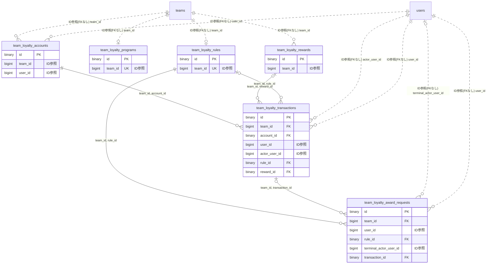

# loyalty ドメイン ER 図

> このファイルは自動生成されます。手で編集しないでください。再生成: `cd backend && ./gradlew generateErDiagrams`

- テーブル数: 6
- ビュー数: 0

## ER 図

実線 = 外部キー、点線 = ID参照(FKなし)。図中の `FK` は実外部キーの列だけ（ID参照列は `FK` を付けず "ID参照" と注記）。図にはキー列（PK / FK / 参照推定列 / 単一列 UNIQUE）のみを描く。全列は下の「テーブル定義」を参照。

## 被参照（他ドメインから）

このドメインのテーブルを参照している他ドメインの側（実 FK と ID参照のみ。多態参照と推定不能参照は含まない。同一ドメイン内の参照は上の図を参照）。

なし

## 推定不能参照

| テーブル | 列 | 理由 |
| --- | --- | --- |
| `team_loyalty_award_requests` | `source_location_id` | 参照先テーブルを特定できない |
| `team_loyalty_transactions` | `source_location_id` | 参照先テーブルを特定できない |

## テーブル定義

### `team_loyalty_accounts`

| 列名 | 型 | NULL | 既定値 | コメント |
| --- | --- | --- | --- | --- |
| `id` | `binary(16)` | NO | （なし） |  |
| `team_id` | `bigint unsigned` | NO | （なし） |  |
| `user_id` | `bigint unsigned` | NO | （なし） |  |
| `balance` | `int` | NO | `0` |  |
| `lifetime_earned` | `bigint` | NO | `0` |  |
| `created_at` | `datetime` | NO | （なし） |  |
| `updated_at` | `datetime` | NO | （なし） |  |

### `team_loyalty_award_requests`

| 列名 | 型 | NULL | 既定値 | コメント |
| --- | --- | --- | --- | --- |
| `id` | `binary(16)` | NO | （なし） |  |
| `team_id` | `bigint unsigned` | NO | （なし） |  |
| `user_id` | `bigint unsigned` | NO | （なし） |  |
| `rule_id` | `binary(16)` | NO | （なし） |  |
| `source_location_id` | `bigint unsigned` | NO | （なし） |  |
| `program_version` | `bigint` | NO | （なし） |  |
| `rule_version` | `bigint` | NO | （なし） |  |
| `points` | `int` | NO | （なし） |  |
| `rule_name` | `varchar(100)` | NO | （なし） |  |
| `location_name` | `varchar(100)` | NO | （なし） |  |
| `award_on` | `date` | NO | （なし） |  |
| `expires_at` | `datetime` | NO | （なし） |  |
| `status` | `varchar(20)` | NO | （なし） |  |
| `reason` | `varchar(30)` | YES | NULL |  |
| `version` | `bigint` | NO | `0` |  |
| `verification_code` | `char(8)` | NO | （なし） |  |
| `submit_key` | `binary(16)` | NO | （なし） |  |
| `submit_payload_hash` | `binary(32)` | NO | （なし） |  |
| `terminal_actor_user_id` | `bigint unsigned` | YES | NULL |  |
| `terminal_action` | `varchar(10)` | YES | NULL |  |
| `action_key` | `binary(16)` | YES | NULL |  |
| `action_payload_hash` | `binary(32)` | YES | NULL |  |
| `transaction_id` | `binary(16)` | YES | NULL |  |
| `closed_at` | `datetime` | YES | NULL |  |
| `pending_unique_key` | `tinyint` | YES | NULL |  |
| `created_at` | `datetime` | NO | （なし） |  |
| `updated_at` | `datetime` | NO | （なし） |  |

### `team_loyalty_programs`

| 列名 | 型 | NULL | 既定値 | コメント |
| --- | --- | --- | --- | --- |
| `id` | `binary(16)` | NO | （なし） |  |
| `team_id` | `bigint unsigned` | NO | （なし） |  |
| `is_enabled` | `tinyint(1)` | NO | `0` |  |
| `target_audience` | `varchar(30)` | NO | （なし） |  |
| `self_award_mode` | `varchar(20)` | NO | `STAFF_APPROVAL` |  |
| `version` | `bigint` | NO | `0` |  |
| `created_at` | `datetime` | NO | （なし） |  |
| `updated_at` | `datetime` | NO | （なし） |  |

### `team_loyalty_rewards`

| 列名 | 型 | NULL | 既定値 | コメント |
| --- | --- | --- | --- | --- |
| `id` | `binary(16)` | NO | （なし） |  |
| `team_id` | `bigint unsigned` | NO | （なし） |  |
| `name` | `varchar(100)` | NO | （なし） |  |
| `description` | `varchar(500)` | YES | NULL |  |
| `required_points` | `int` | NO | （なし） |  |
| `is_active` | `tinyint(1)` | NO | `1` |  |
| `version` | `bigint` | NO | `0` |  |
| `created_at` | `datetime` | NO | （なし） |  |
| `updated_at` | `datetime` | NO | （なし） |  |

### `team_loyalty_rules`

| 列名 | 型 | NULL | 既定値 | コメント |
| --- | --- | --- | --- | --- |
| `id` | `binary(16)` | NO | （なし） |  |
| `team_id` | `bigint unsigned` | NO | （なし） |  |
| `name` | `varchar(100)` | NO | （なし） |  |
| `points` | `int` | NO | （なし） |  |
| `frequency` | `varchar(30)` | NO | （なし） |  |
| `is_self_award_enabled` | `tinyint(1)` | NO | `0` |  |
| `is_active` | `tinyint(1)` | NO | `1` |  |
| `version` | `bigint` | NO | `0` |  |
| `created_at` | `datetime` | NO | （なし） |  |
| `updated_at` | `datetime` | NO | （なし） |  |

### `team_loyalty_transactions`

| 列名 | 型 | NULL | 既定値 | コメント |
| --- | --- | --- | --- | --- |
| `id` | `binary(16)` | NO | （なし） |  |
| `team_id` | `bigint unsigned` | NO | （なし） |  |
| `account_id` | `binary(16)` | NO | （なし） |  |
| `user_id` | `bigint unsigned` | NO | （なし） |  |
| `actor_user_id` | `bigint unsigned` | NO | （なし） |  |
| `kind` | `varchar(10)` | NO | （なし） |  |
| `channel` | `varchar(20)` | NO | （なし） |  |
| `request_operation` | `varchar(20)` | NO | （なし） |  |
| `delta` | `int` | NO | （なし） |  |
| `balance_after` | `int` | NO | （なし） |  |
| `rule_id` | `binary(16)` | YES | NULL |  |
| `reward_id` | `binary(16)` | YES | NULL |  |
| `source_location_id` | `bigint unsigned` | YES | NULL |  |
| `award_on` | `date` | YES | NULL |  |
| `label` | `varchar(100)` | NO | （なし） |  |
| `rule_or_reward_version` | `bigint` | NO | （なし） |  |
| `program_version` | `bigint` | NO | （なし） |  |
| `request_key` | `binary(16)` | NO | （なし） |  |
| `payload_hash` | `binary(32)` | NO | （なし） |  |
| `created_at` | `datetime` | NO | （なし） |  |
| `updated_at` | `datetime` | NO | （なし） |  |
