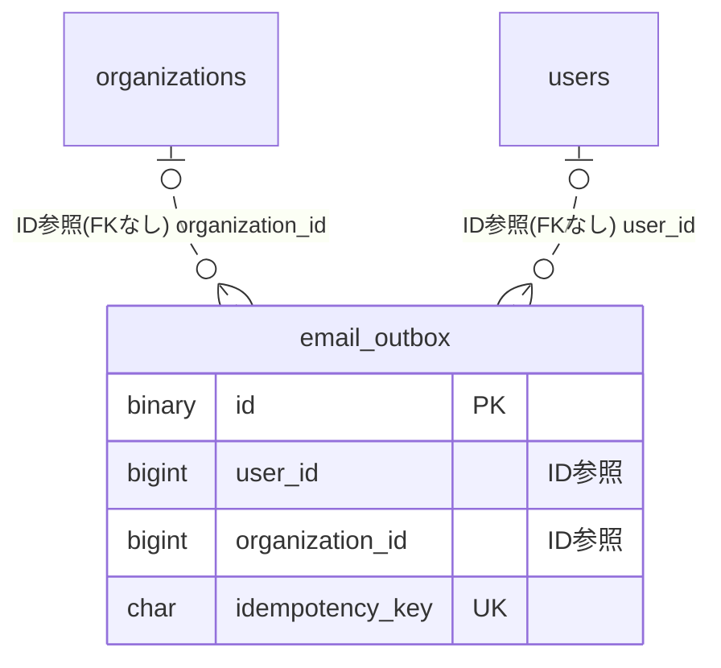

# mail ドメイン ER 図

> このファイルは自動生成されます。手で編集しないでください。再生成: `cd backend && ./gradlew generateErDiagrams`

- テーブル数: 1
- ビュー数: 0

## ER 図

実線 = 外部キー、点線 = ID参照(FKなし)。図中の `FK` は実外部キーの列だけ（ID参照列は `FK` を付けず "ID参照" と注記）。図にはキー列（PK / FK / 参照推定列 / 単一列 UNIQUE）のみを描く。全列は下の「テーブル定義」を参照。

## 被参照（他ドメインから）

このドメインのテーブルを参照している他ドメインの側（実 FK と ID参照のみ。多態参照と推定不能参照は含まない。同一ドメイン内の参照は上の図を参照）。

なし

## 推定不能参照

| テーブル | 列 | 理由 |
| --- | --- | --- |
| `email_outbox` | `ses_message_id` | 参照先テーブルを特定できない |
| `email_outbox` | `source_event_id` | 型が参照先 events.id と不一致（varchar ≠ bigint） |

## テーブル定義

### `email_outbox`

| 列名 | 型 | NULL | 既定値 | コメント |
| --- | --- | --- | --- | --- |
| `id` | `binary(16)` | NO | （なし） | UUIDv7 主キー |
| `template_kind` | `varchar(64)` | NO | （なし） | VERIFICATION / PASSWORD_RESET / ANALYTICS_KPI_MONTHLY 等 (§11 マトリクス参照) |
| `locale` | `varchar(8)` | NO | （なし） | ja/en/zh/ko/es/de |
| `to_address` | `varbinary(512)` | NO | （なし） | AES-256-GCM 暗号化済メールアドレス |
| `to_address_hash` | `binary(32)` | NO | （なし） | HMAC-SHA-256 (検索用、別鍵) |
| `payload_json` | `varbinary(8192)` | YES | NULL | AES-256-GCM 暗号化済変数 JSON (Map&lt;String,String&gt; 制約) |
| `source_domain` | `varchar(32)` | NO | （なし） | auth/billing/event-watch/chat/reservation/pointcard/organization/repair-plan/advertising |
| `source_event_id` | `varchar(128)` | YES | NULL | 業務側の冪等キー (token.id, batch_run_id 等) |
| `user_id` | `bigint unsigned` | YES | NULL | 宛先ユーザー (論理参照、FK なし) |
| `organization_id` | `bigint unsigned` | YES | NULL | 所属組織 (論理参照、FK なし。認証メールは NULL) |
| `idempotency_key` | `char(32)` | NO | （なし） | sha256(user_id:template_kind:nonce)[:32] |
| `status` | `varchar(16)` | NO | `PENDING` | PENDING/SENDING/SENT/DEAD_LETTER/FAILED/CANCELLED |
| `retry_count` | `int` | NO | `0` | 0..5 |
| `next_attempt_at` | `datetime(3)` | NO | （なし） | 次回試行時刻 (enqueue 時=NOW()) |
| `sent_at` | `datetime(3)` | YES | NULL | 送信成功時刻 |
| `ses_message_id` | `varchar(64)` | YES | NULL | SES MessageId (DEAD_LETTER 調査用) |
| `last_error` | `varchar(512)` | YES | NULL | 例外クラス名 + メッセージ冒頭500文字 |
| `created_at` | `datetime(3)` | NO | `CURRENT_TIMESTAMP(3)` （式） |  |
| `updated_at` | `datetime(3)` | NO | `CURRENT_TIMESTAMP(3)` （式） |  |
