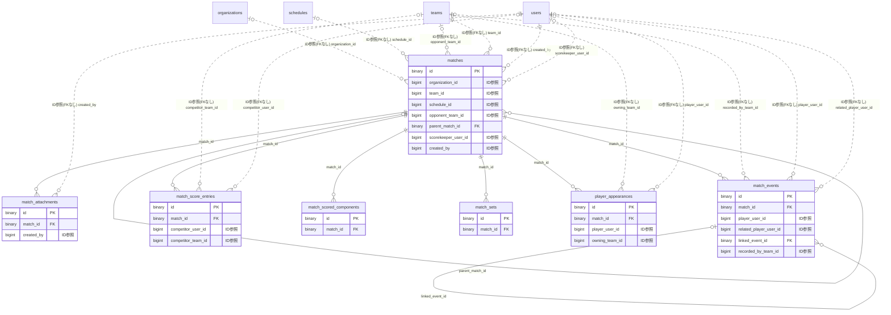

# match ドメイン ER 図

> このファイルは自動生成されます。手で編集しないでください。再生成: `cd backend && ./gradlew generateErDiagrams`

- テーブル数: 7
- ビュー数: 0

## ER 図

実線 = 外部キー、点線 = ID参照(FKなし)。図中の `FK` は実外部キーの列だけ（ID参照列は `FK` を付けず "ID参照" と注記）。図にはキー列（PK / FK / 参照推定列 / 単一列 UNIQUE）のみを描く。全列は下の「テーブル定義」を参照。

## 被参照（他ドメインから）

このドメインのテーブルを参照している他ドメインの側（実 FK と ID参照のみ。多態参照と推定不能参照は含まない。同一ドメイン内の参照は上の図を参照）。

なし

## 自己参照

mermaid は同一テーブルの自己参照を複数描けず 1 本に畳むため、図に線が欠けることがある。自己参照はこの表を正とする。

| テーブル | 列 | 種別 |
| --- | --- | --- |
| `match_events` | `linked_event_id` | 外部キー |
| `matches` | `parent_match_id` | 外部キー |

## 推定不能参照

| テーブル | 列 | 理由 |
| --- | --- | --- |
| `match_scored_components` | `score_entry_id` | 参照先テーブルを特定できない |
| `matches` | `tournament_fixture_id` | 参照先テーブルを特定できない |

## テーブル定義

### `match_attachments`

| 列名 | 型 | NULL | 既定値 | コメント |
| --- | --- | --- | --- | --- |
| `id` | `binary(16)` | NO | （なし） | UUIDv7（原則6） |
| `match_id` | `binary(16)` | NO | （なし） | matches(id)（同一ドメイン → FK CASCADE） |
| `file_key` | `varchar(512)` | NO | （なし） | R2 オブジェクトキー（server 採番・クライアント任意 key を信用しない） |
| `original_filename` | `varchar(255)` | YES | NULL | 元ファイル名（表示用） |
| `content_type` | `varchar(128)` | NO | （なし） | MIME（画像のみ・SVG 除外） |
| `file_size` | `bigint` | NO | （なし） | バイト数（上限 10MB） |
| `created_by` | `bigint` | NO | （なし） | アップロード者（user ドメイン ID 参照・FK なし） |
| `created_at` | `datetime` | NO | `CURRENT_TIMESTAMP` （式） |  |
| `updated_at` | `datetime` | NO | `CURRENT_TIMESTAMP` （式） |  |

### `match_events`

| 列名 | 型 | NULL | 既定値 | コメント |
| --- | --- | --- | --- | --- |
| `id` | `binary(16)` | NO | （なし） | UUIDv7（原則6） |
| `match_id` | `binary(16)` | NO | （なし） | matches(id)（同一ドメイン → FK CASCADE） |
| `minute` | `smallint unsigned` | YES | NULL | 経過分（タイマー連動・手動訂正可・NULL=分不明） |
| `stoppage_minute` | `smallint unsigned` | YES | NULL | アディショナルタイム（例 45+2 の "2"・NULL=なし） |
| `period` | `varchar(24)` | YES | NULL | PeriodType（器は競技非依存）。ターン制（将棋/囲碁）は period を使わないため NULL 許容。連続時間制/セット制では Service が必須化する（01 §B.2 / §D.6） |
| `event_type` | `varchar(24)` | NO | （なし） | MatchEventType（器は競技非依存・許容値は競技別カタログ＝サッカーは sports/01 §2） |
| `card_reason_code` | `varchar(8)` | YES | NULL | 警告/退場の標準理由コード（競技別カタログの列挙値・サッカーは C1〜C8/S1〜S6/CS・非カード系は NULL） |
| `custom_label` | `varchar(64)` | YES | NULL | event_type=OTHER 時の自由ラベル名 |
| `team_side` | `enum('HOME','AWAY')` | NO | （なし） | どちらのチームのイベントか |
| `player_user_id` | `bigint unsigned` | YES | NULL | 主体選手（user ドメイン ID 参照・未登録は NULL・FK なし） |
| `player_name` | `varchar(128)` | YES | NULL | 未登録選手名（player_user_id NULL のとき） |
| `jersey_number` | `smallint unsigned` | YES | NULL | 背番号（未登録選手の同一性キーの一部） |
| `related_player_user_id` | `bigint unsigned` | YES | NULL | 関連選手（アシスト者/交代相手・user ドメイン ID 参照・FK なし） |
| `related_player_name` | `varchar(128)` | YES | NULL | 関連未登録選手名 |
| `note` | `varchar(255)` | YES | NULL | 理由・メモ自由記述（入力検証・XSS/CRLF サニタイズ対象） |
| `linked_event_id` | `binary(16)` | YES | NULL | 時系列連鎖の相手イベント（同一テーブル自己参照・例 アシスト⤵得点） |
| `detail` | `json` | YES | NULL | 拡張属性（競技別の追加情報・最大 4KB・サーバー検証） |
| `recorded_by_team_id` | `bigint unsigned` | YES | NULL | 記録したチーム（共同記録の権限判定・team ドメイン ID 参照・NULL=記録係記録・FK なし） |
| `sort_seq` | `int` | NO | `0` | 同分内の表示順（タイムライン安定ソート） |
| `created_at` | `datetime` | NO | `CURRENT_TIMESTAMP` （式） |  |
| `updated_at` | `datetime` | NO | `CURRENT_TIMESTAMP` （式） |  |

### `match_score_entries`

| 列名 | 型 | NULL | 既定値 | コメント |
| --- | --- | --- | --- | --- |
| `id` | `binary(16)` | NO | （なし） | UUIDv7（原則6） |
| `match_id` | `binary(16)` | NO | （なし） | matches(id)（同一ドメイン → FK CASCADE） |
| `competitor_user_id` | `bigint unsigned` | YES | NULL | 出場選手（user ドメイン ID 参照・未登録は NULL・原則1） |
| `competitor_name` | `varchar(128)` | YES | NULL | 未登録選手名（competitor_user_id NULL のときの表示名） |
| `competitor_team_id` | `bigint unsigned` | YES | NULL | 所属チーム（team ドメイン ID 参照・団体採点時・原則1） |
| `total_scaled` | `int` | NO | `0` | 合計点（整数スケール×1000・§4.1） |
| `rank_position` | `smallint unsigned` | YES | NULL | 順位（合計点降順で導出・同点同順位・Service が再計算） |
| `created_at` | `datetime` | NO | `CURRENT_TIMESTAMP` （式） |  |
| `updated_at` | `datetime` | NO | `CURRENT_TIMESTAMP` （式） |  |

### `match_scored_components`

| 列名 | 型 | NULL | 既定値 | コメント |
| --- | --- | --- | --- | --- |
| `id` | `binary(16)` | NO | （なし） | UUIDv7（原則6） |
| `match_id` | `binary(16)` | NO | （なし） | matches(id)（同一ドメイン → FK CASCADE） |
| `competitor_side` | `enum('HOME','AWAY')` | YES | NULL | 2 者対戦時の side（多人数順位制導入時は NULL・score_entry_id を使う） |
| `score_entry_id` | `binary(16)` | YES | NULL | 多人数順位制（§5B・後段 Phase）のエントリ参照（2 者対戦時は NULL） |
| `apparatus` | `varchar(32)` | YES | NULL | 種目/セグメント（体操 FLOOR… フィギュア SP/FS・競技別カタログ列挙・NULL 許容） |
| `judge_label` | `varchar(32)` | YES | NULL | 審判識別（J1〜J9 等・審判別素点用・集計のみなら NULL） |
| `component_type` | `varchar(32)` | NO | （なし） | 項目（フィギュア=TES/PCS/DEDUCTION・体操=D_SCORE/E_SCORE・競技別カタログ列挙） |
| `points_scaled` | `int` | NO | `0` | 当該項目の点数（整数スケール×1000・小数は表示で復元・§4.1）。DEDUCTION は集計時に減算 |
| `created_at` | `datetime` | NO | `CURRENT_TIMESTAMP` （式） |  |
| `updated_at` | `datetime` | NO | `CURRENT_TIMESTAMP` （式） |  |

### `match_sets`

| 列名 | 型 | NULL | 既定値 | コメント |
| --- | --- | --- | --- | --- |
| `id` | `binary(16)` | NO | （なし） | UUIDv7（原則6） |
| `match_id` | `binary(16)` | NO | （なし） | matches(id)（同一ドメイン → FK CASCADE） |
| `set_number` | `smallint unsigned` | NO | （なし） | セット番号（1〜5・best-of-5） |
| `home_points` | `smallint unsigned` | NO | `0` | 当該セットのホーム得点 |
| `away_points` | `smallint unsigned` | NO | `0` | 当該セットのアウェイ得点 |
| `winner_side` | `enum('HOME','AWAY')` | YES | NULL | セット勝者（SET_END でデュース条件達成時に確定・未決着は NULL・sports/04 §4.2） |
| `is_final_set` | `tinyint(1)` | NO | `0` | 最終第 5 セット（15 点制・デュース）フラグ |
| `created_at` | `datetime` | NO | `CURRENT_TIMESTAMP` （式） |  |
| `updated_at` | `datetime` | NO | `CURRENT_TIMESTAMP` （式） |  |

### `matches`

| 列名 | 型 | NULL | 既定値 | コメント |
| --- | --- | --- | --- | --- |
| `id` | `binary(16)` | NO | （なし） | UUIDv7（UuidV7Entity 継承・原則6） |
| `organization_id` | `bigint unsigned` | YES | NULL | テナント（organization ドメインへの ID 参照・原則1/7・FK なし） |
| `team_id` | `bigint unsigned` | NO | （なし） | 記録/ホーム主体チーム（team ドメイン ID 参照・FK なし） |
| `sport` | `varchar(32)` | NO | `SOCCER` | 競技種別（多競技対応・enum 文字列） |
| `kind` | `varchar(16)` | NO | （なし） | PRACTICE/FRIENDLY/TOURNAMENT/LEAGUE（enum 文字列） |
| `tournament_fixture_id` | `bigint unsigned` | YES | NULL | 大会 fixture リンク（tournament ドメインへの BIGINT ID 参照・NULL=単独試合・FK なし） |
| `schedule_id` | `bigint unsigned` | YES | NULL | カレンダー連携（F03.1・schedules への BIGINT ID 参照・FK なし） |
| `home_away` | `enum('HOME','AWAY','NEUTRAL')` | NO | `HOME` | 主体チームのホーム/アウェイ/中立地 |
| `opponent_team_id` | `bigint unsigned` | YES | NULL | 登録相手チーム（team ドメイン ID 参照・NULL 可・FK なし） |
| `opponent_name` | `varchar(128)` | YES | NULL | 未登録相手名（opponent_team_id が NULL のとき使用） |
| `kickoff_at` | `datetime` | YES | NULL | キックオフ日時（予定/実績） |
| `venue` | `varchar(200)` | YES | NULL | 会場 |
| `duration_minutes` | `smallint unsigned` | YES | NULL | 試合長（分・前後半90＋延長の試合通算・出場時間 out 既定値に使用） |
| `period_format` | `varchar(32)` | YES | NULL | 試合形式（HALVES_45/QUARTERS_10 等・PeriodType と対応） |
| `home_score` | `int unsigned` | YES | NULL | ホーム本戦スコア（正本・延長得点も合算。採点競技は合計点を整数スケール×1000 で格納・§B.1.2/§D.8） |
| `away_score` | `int unsigned` | YES | NULL | アウェイ本戦スコア（正本・延長得点も合算。採点競技は合計点を整数スケール×1000 で格納・§B.1.2/§D.8） |
| `home_penalty_score` | `smallint unsigned` | YES | NULL | ホーム PK 戦スコア（本戦と分離） |
| `away_penalty_score` | `smallint unsigned` | YES | NULL | アウェイ PK 戦スコア（本戦と分離） |
| `status` | `varchar(16)` | NO | `SCHEDULED` | SCHEDULED/IN_PROGRESS/COMPLETED/POSTPONED/CANCELLED |
| `state_model` | `varchar(16)` | NO | `CONTINUOUS_TIME` | 状態モデル類型（CONTINUOUS_TIME/SET_BASED/TURN_BASED・Sport から導出・01 §D.6） |
| `total_moves` | `smallint unsigned` | YES | NULL | 総手数（ターン制のみ・球技では NULL・01 §B.1 / sports/05 §3） |
| `win_method` | `varchar(32)` | YES | NULL | 勝ち方（ターン制のみ・ShogiWinMethod/GoWinMethod・球技では NULL・01 §D.7） |
| `parent_match_id` | `binary(16)` | YES | NULL | 団体戦の親 match（個人戦=NULL・自己参照 FK＋CASCADE・同一ドメイン・01 §B.6） |
| `board_number` | `smallint unsigned` | YES | NULL | ボード順（団体戦の子のみ・1=大将/主将 等・01 §B.6） |
| `scorekeeper_user_id` | `bigint unsigned` | YES | NULL | 記録係ユーザー（公式戦・user ドメイン ID 参照・FK なし） |
| `has_scorekeeper` | `tinyint(1)` | NO | `0` | 記録モード判定（TRUE=公式戦/FALSE=共同記録） |
| `notes` | `text` | YES | NULL | 備考 |
| `created_by` | `bigint` | NO | （なし） | 作成者（user ドメイン ID 参照・FK なし） |
| `version` | `bigint` | NO | `0` | 楽観ロック（@Version・メタ更新専用） |
| `created_at` | `datetime` | NO | `CURRENT_TIMESTAMP` （式） |  |
| `updated_at` | `datetime` | NO | `CURRENT_TIMESTAMP` （式） |  |
| `deleted_at` | `datetime` | YES | NULL | 論理削除（原則3） |

### `player_appearances`

| 列名 | 型 | NULL | 既定値 | コメント |
| --- | --- | --- | --- | --- |
| `id` | `binary(16)` | NO | （なし） | UUIDv7（原則6） |
| `match_id` | `binary(16)` | NO | （なし） | matches(id)（同一ドメイン → FK CASCADE） |
| `player_user_id` | `bigint unsigned` | YES | NULL | 選手（user ドメイン ID 参照・未登録は NULL・FK なし） |
| `player_name` | `varchar(128)` | YES | NULL | 未登録選手名 |
| `team_side` | `enum('HOME','AWAY')` | NO | （なし） | 所属サイド |
| `is_starter` | `tinyint(1)` | NO | `0` | 先発フラグ |
| `position` | `varchar(30)` | YES | NULL | ポジション（器は競技非依存・語彙は競技別＝サッカーは sports/01 §7 の GK/DF/MF/FW 等） |
| `jersey_number` | `smallint unsigned` | YES | NULL | 背番号（未登録選手の同一性キーの一部） |
| `first_in_minute` | `smallint unsigned` | YES | NULL | 最初の出場開始分（STARTER=0 / 初回 SUB_IN・代表値） |
| `last_out_minute` | `smallint unsigned` | YES | NULL | 最後の退場分（代表値） |
| `computed_minutes` | `smallint unsigned` | YES | NULL | 自動算出出場分＝全 in/out 区間の合計（再出場対応） |
| `owning_team_id` | `bigint unsigned` | NO | （なし） | 自チーム編集権限の判定（team ドメイン ID 参照・FK なし） |
| `created_at` | `datetime` | NO | `CURRENT_TIMESTAMP` （式） |  |
| `updated_at` | `datetime` | NO | `CURRENT_TIMESTAMP` （式） |  |
