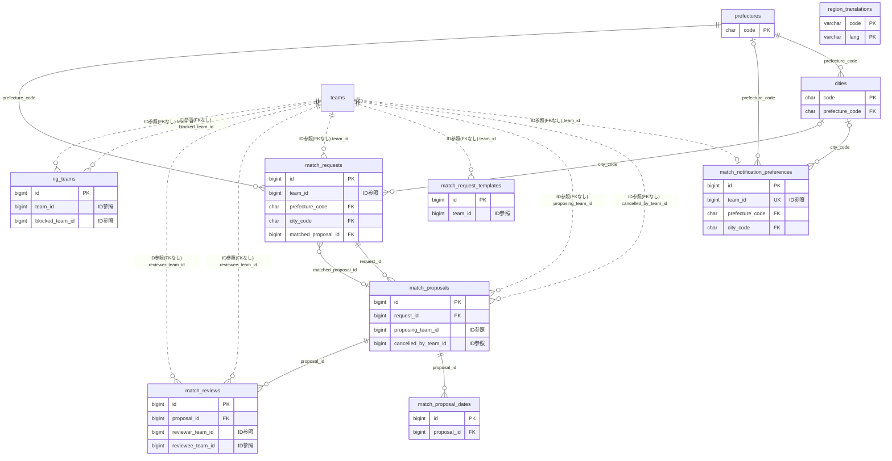

# matching ドメイン ER 図

> このファイルは自動生成されます。手で編集しないでください。再生成: `cd backend && ./gradlew generateErDiagrams`

- テーブル数: 10
- ビュー数: 0

## ER 図

実線 = 外部キー、点線 = ID参照(FKなし)。図中の `FK` は実外部キーの列だけ（ID参照列は `FK` を付けず "ID参照" と注記）。図にはキー列（PK / FK / 参照推定列 / 単一列 UNIQUE）のみを描く。全列は下の「テーブル定義」を参照。

## 被参照（他ドメインから）

このドメインのテーブルを参照している他ドメインの側（実 FK と ID参照のみ。多態参照と推定不能参照は含まない。同一ドメイン内の参照は上の図を参照）。

なし

## テーブル定義

### `cities`

| 列名 | 型 | NULL | 既定値 | コメント |
| --- | --- | --- | --- | --- |
| `code` | `char(5)` | NO | （なし） |  |
| `prefecture_code` | `char(2)` | NO | （なし） |  |
| `name` | `varchar(20)` | NO | （なし） |  |

### `match_notification_preferences`

| 列名 | 型 | NULL | 既定値 | コメント |
| --- | --- | --- | --- | --- |
| `id` | `bigint unsigned` | NO | （なし） auto_increment |  |
| `team_id` | `bigint unsigned` | NO | （なし） |  |
| `prefecture_code` | `char(2)` | YES | NULL |  |
| `city_code` | `char(5)` | YES | NULL |  |
| `activity_type` | `enum('COMPETITION','PRACTICE','EXCHANGE','RECRUIT','OTHER')` | YES | NULL |  |
| `category` | `enum('ELEMENTARY','JUNIOR_HIGH','HIGH_SCHOOL','UNIVERSITY','ADULT','SENIOR','ANY')` | YES | NULL |  |
| `is_enabled` | `tinyint(1)` | NO | `1` |  |
| `created_at` | `datetime` | NO | `CURRENT_TIMESTAMP` （式） |  |
| `updated_at` | `datetime` | NO | `CURRENT_TIMESTAMP` （式） |  |

### `match_proposal_dates`

| 列名 | 型 | NULL | 既定値 | コメント |
| --- | --- | --- | --- | --- |
| `id` | `bigint unsigned` | NO | （なし） auto_increment |  |
| `proposal_id` | `bigint unsigned` | NO | （なし） |  |
| `proposed_date` | `date` | NO | （なし） |  |
| `proposed_time_from` | `time` | YES | NULL |  |
| `proposed_time_to` | `time` | YES | NULL |  |
| `is_selected` | `tinyint(1)` | NO | `0` |  |

### `match_proposals`

| 列名 | 型 | NULL | 既定値 | コメント |
| --- | --- | --- | --- | --- |
| `id` | `bigint unsigned` | NO | （なし） auto_increment |  |
| `request_id` | `bigint unsigned` | NO | （なし） |  |
| `proposing_team_id` | `bigint unsigned` | NO | （なし） |  |
| `message` | `text` | YES | NULL |  |
| `proposed_venue` | `varchar(200)` | YES | NULL |  |
| `status` | `enum('PENDING','ACCEPTED','REJECTED','CANCELLED','WITHDRAWN')` | NO | `PENDING` |  |
| `status_reason` | `varchar(500)` | YES | NULL |  |
| `cancelled_by_team_id` | `bigint unsigned` | YES | NULL |  |
| `cancellation_type` | `enum('UNILATERAL','MUTUAL_PENDING','MUTUAL')` | YES | NULL |  |
| `mutual_agreed_at` | `datetime` | YES | NULL |  |
| `created_at` | `datetime` | NO | `CURRENT_TIMESTAMP` （式） |  |
| `updated_at` | `datetime` | NO | `CURRENT_TIMESTAMP` （式） |  |

### `match_request_templates`

| 列名 | 型 | NULL | 既定値 | コメント |
| --- | --- | --- | --- | --- |
| `id` | `bigint unsigned` | NO | （なし） auto_increment |  |
| `team_id` | `bigint unsigned` | NO | （なし） |  |
| `name` | `varchar(50)` | NO | （なし） |  |
| `template_json` | `json` | NO | （なし） |  |
| `created_at` | `datetime` | NO | `CURRENT_TIMESTAMP` （式） |  |
| `updated_at` | `datetime` | NO | `CURRENT_TIMESTAMP` （式） |  |

### `match_requests`

| 列名 | 型 | NULL | 既定値 | コメント |
| --- | --- | --- | --- | --- |
| `id` | `bigint unsigned` | NO | （なし） auto_increment |  |
| `team_id` | `bigint unsigned` | NO | （なし） |  |
| `title` | `varchar(100)` | NO | （なし） |  |
| `description` | `text` | YES | NULL |  |
| `activity_type` | `enum('COMPETITION','PRACTICE','EXCHANGE','RECRUIT','OTHER')` | NO | （なし） |  |
| `activity_detail` | `varchar(50)` | YES | NULL |  |
| `category` | `enum('ELEMENTARY','JUNIOR_HIGH','HIGH_SCHOOL','UNIVERSITY','ADULT','SENIOR','ANY')` | NO | `ANY` |  |
| `visibility` | `enum('PLATFORM','ORGANIZATION')` | NO | `PLATFORM` |  |
| `prefecture_code` | `char(2)` | NO | （なし） |  |
| `city_code` | `char(5)` | YES | NULL |  |
| `venue_name` | `varchar(200)` | YES | NULL |  |
| `preferred_date_from` | `date` | YES | NULL |  |
| `preferred_date_to` | `date` | YES | NULL |  |
| `preferred_time_from` | `time` | YES | NULL |  |
| `preferred_time_to` | `time` | YES | NULL |  |
| `level` | `enum('BEGINNER','INTERMEDIATE','ADVANCED','ANY')` | NO | `ANY` |  |
| `min_participants` | `smallint unsigned` | YES | NULL |  |
| `max_participants` | `smallint unsigned` | YES | NULL |  |
| `status` | `enum('OPEN','MATCHED','CANCELLED','EXPIRED')` | NO | `OPEN` |  |
| `proposal_count` | `int unsigned` | NO | `0` |  |
| `expires_at` | `datetime` | YES | NULL |  |
| `matched_proposal_id` | `bigint unsigned` | YES | NULL |  |
| `cancel_count` | `smallint unsigned` | NO | `0` |  |
| `created_at` | `datetime` | NO | `CURRENT_TIMESTAMP` （式） |  |
| `updated_at` | `datetime` | NO | `CURRENT_TIMESTAMP` （式） |  |
| `deleted_at` | `datetime` | YES | NULL |  |

### `match_reviews`

| 列名 | 型 | NULL | 既定値 | コメント |
| --- | --- | --- | --- | --- |
| `id` | `bigint unsigned` | NO | （なし） auto_increment |  |
| `proposal_id` | `bigint unsigned` | NO | （なし） |  |
| `reviewer_team_id` | `bigint unsigned` | NO | （なし） |  |
| `reviewee_team_id` | `bigint unsigned` | NO | （なし） |  |
| `rating` | `tinyint unsigned` | NO | （なし） |  |
| `comment` | `varchar(1000)` | YES | NULL |  |
| `is_public` | `tinyint(1)` | NO | `1` |  |
| `created_at` | `datetime` | NO | `CURRENT_TIMESTAMP` （式） |  |

### `ng_teams`

| 列名 | 型 | NULL | 既定値 | コメント |
| --- | --- | --- | --- | --- |
| `id` | `bigint unsigned` | NO | （なし） auto_increment |  |
| `team_id` | `bigint unsigned` | NO | （なし） |  |
| `blocked_team_id` | `bigint unsigned` | NO | （なし） |  |
| `reason` | `varchar(500)` | YES | NULL |  |
| `created_at` | `datetime` | NO | `CURRENT_TIMESTAMP` （式） |  |

### `prefectures`

| 列名 | 型 | NULL | 既定値 | コメント |
| --- | --- | --- | --- | --- |
| `code` | `char(2)` | NO | （なし） |  |
| `name` | `varchar(10)` | NO | （なし） |  |

### `region_translations`

| 列名 | 型 | NULL | 既定値 | コメント |
| --- | --- | --- | --- | --- |
| `code` | `varchar(5)` | NO | （なし） | 地域コード（都道府県2桁 / 市区町村5桁の双方を格納） |
| `lang` | `varchar(5)` | NO | （なし） | 言語コード（en/zh/ko/es/de。ja は元マスタ name が正なので格納しない） |
| `name` | `varchar(40)` | NO | （なし） | 当該言語での地域表示名 |
