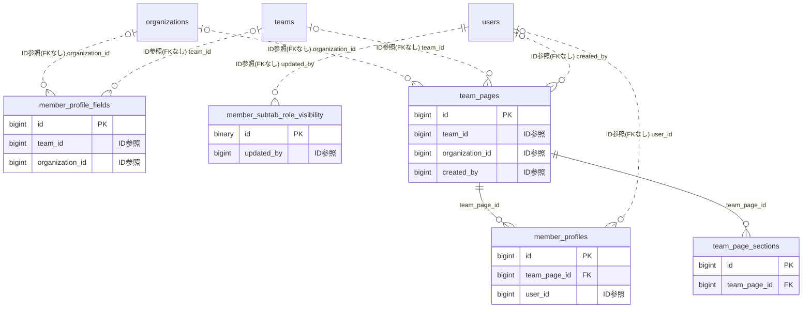

# member ドメイン ER 図

> このファイルは自動生成されます。手で編集しないでください。再生成: `cd backend && ./gradlew generateErDiagrams`

- テーブル数: 5
- ビュー数: 0

## ER 図

実線 = 外部キー、点線 = ID参照(FKなし)。図中の `FK` は実外部キーの列だけ（ID参照列は `FK` を付けず "ID参照" と注記）。図にはキー列（PK / FK / 参照推定列 / 単一列 UNIQUE）のみを描く。全列は下の「テーブル定義」を参照。

## 被参照（他ドメインから）

このドメインのテーブルを参照している他ドメインの側（実 FK と ID参照のみ。多態参照と推定不能参照は含まない。同一ドメイン内の参照は上の図を参照）。

なし

## 多態参照（線を引かない）

| テーブル | 種別列 | ID列 |
| --- | --- | --- |
| `member_subtab_role_visibility` | `scope_type` | `scope_id` |

## テーブル定義

### `member_profile_fields`

| 列名 | 型 | NULL | 既定値 | コメント |
| --- | --- | --- | --- | --- |
| `id` | `bigint unsigned` | NO | （なし） auto_increment |  |
| `team_id` | `bigint unsigned` | YES | NULL |  |
| `organization_id` | `bigint unsigned` | YES | NULL |  |
| `field_name` | `varchar(100)` | NO | （なし） |  |
| `field_type` | `enum('TEXT','NUMBER','DATE','SELECT')` | NO | `TEXT` |  |
| `options` | `json` | YES | NULL |  |
| `is_required` | `tinyint(1)` | NO | `0` |  |
| `sort_order` | `int` | NO | `0` |  |
| `is_active` | `tinyint(1)` | NO | `1` |  |
| `created_at` | `datetime` | NO | `CURRENT_TIMESTAMP` （式） |  |
| `updated_at` | `datetime` | NO | `CURRENT_TIMESTAMP` （式） |  |

### `member_profiles`

| 列名 | 型 | NULL | 既定値 | コメント |
| --- | --- | --- | --- | --- |
| `id` | `bigint unsigned` | NO | （なし） auto_increment |  |
| `team_page_id` | `bigint unsigned` | NO | （なし） |  |
| `user_id` | `bigint unsigned` | YES | NULL |  |
| `display_name` | `varchar(100)` | NO | （なし） |  |
| `member_number` | `varchar(20)` | YES | NULL |  |
| `photo_s3_key` | `varchar(500)` | YES | NULL |  |
| `bio` | `varchar(500)` | YES | NULL |  |
| `position` | `varchar(100)` | YES | NULL |  |
| `custom_field_values` | `json` | YES | NULL |  |
| `sort_order` | `int` | NO | `0` |  |
| `is_visible` | `tinyint(1)` | NO | `1` |  |
| `created_at` | `datetime` | NO | `CURRENT_TIMESTAMP` （式） |  |
| `updated_at` | `datetime` | NO | `CURRENT_TIMESTAMP` （式） |  |

### `member_subtab_role_visibility`

| 列名 | 型 | NULL | 既定値 | コメント |
| --- | --- | --- | --- | --- |
| `id` | `binary(16)` | NO | （なし） |  |
| `scope_type` | `varchar(20)` | NO | （なし） |  |
| `scope_id` | `bigint unsigned` | NO | （なし） |  |
| `subtab_key` | `varchar(30)` | NO | （なし） |  |
| `min_role` | `varchar(20)` | NO | （なし） |  |
| `updated_by` | `bigint unsigned` | NO | （なし） |  |
| `created_at` | `datetime(6)` | NO | `CURRENT_TIMESTAMP(6)` （式） |  |
| `updated_at` | `datetime(6)` | NO | `CURRENT_TIMESTAMP(6)` （式） |  |

### `team_page_sections`

| 列名 | 型 | NULL | 既定値 | コメント |
| --- | --- | --- | --- | --- |
| `id` | `bigint unsigned` | NO | （なし） auto_increment |  |
| `team_page_id` | `bigint unsigned` | NO | （なし） |  |
| `section_type` | `enum('TEXT','IMAGE','MEMBER_LIST','HEADING')` | NO | （なし） |  |
| `title` | `varchar(200)` | YES | NULL |  |
| `content` | `text` | YES | NULL |  |
| `image_s3_key` | `varchar(500)` | YES | NULL |  |
| `image_caption` | `varchar(200)` | YES | NULL |  |
| `sort_order` | `int` | NO | `0` |  |
| `created_at` | `datetime` | NO | `CURRENT_TIMESTAMP` （式） |  |
| `updated_at` | `datetime` | NO | `CURRENT_TIMESTAMP` （式） |  |

### `team_pages`

| 列名 | 型 | NULL | 既定値 | コメント |
| --- | --- | --- | --- | --- |
| `id` | `bigint unsigned` | NO | （なし） auto_increment |  |
| `team_id` | `bigint unsigned` | YES | NULL |  |
| `organization_id` | `bigint unsigned` | YES | NULL |  |
| `title` | `varchar(200)` | NO | （なし） |  |
| `slug` | `varchar(200)` | NO | （なし） |  |
| `page_type` | `enum('MAIN','YEARLY')` | NO | （なし） |  |
| `year` | `smallint unsigned` | YES | NULL |  |
| `description` | `text` | YES | NULL |  |
| `cover_image_s3_key` | `varchar(500)` | YES | NULL |  |
| `visibility` | `enum('PUBLIC','MEMBERS_ONLY')` | NO | `MEMBERS_ONLY` |  |
| `status` | `enum('DRAFT','PUBLISHED')` | NO | `DRAFT` |  |
| `preview_token` | `varchar(64)` | YES | NULL |  |
| `preview_token_expires_at` | `datetime` | YES | NULL |  |
| `allow_self_edit` | `tinyint(1)` | NO | `0` |  |
| `sort_order` | `int` | NO | `0` |  |
| `created_by` | `bigint unsigned` | YES | NULL |  |
| `created_at` | `datetime` | NO | `CURRENT_TIMESTAMP` （式） |  |
| `updated_at` | `datetime` | NO | `CURRENT_TIMESTAMP` （式） |  |
| `deleted_at` | `datetime` | YES | NULL |  |
